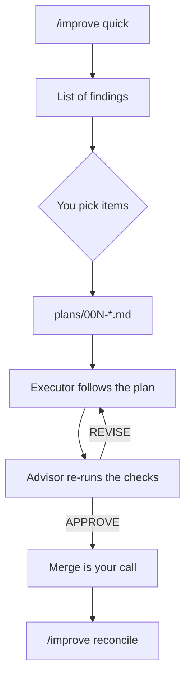

Ask a coding agent "what should I fix in this project?" and you often get a long list back, still leaving you to decide what matters and how to verify it.

[shadcn/improve](https://github.com/shadcn/improve) uses a more capable model to read the code and write plans, then hands them to a cheaper model. I used it to generate four plans and run two on a sample project. I've included the actual output and token usage for each step.

> I checked the shadcn/improve README, SKILL.md, and the three files under `references/` and ran the demo on 2026-11-22 (Taipei time). I installed commit `cac56e1` (2026-09-12), which SKILL.md labels `version: "1.0.0"`.
{: .prompt-info }

## The advisor plans, the executor follows

improve is an agent skill by shadcn, meaning a set of instructions the agent follows. It has no code, just one SKILL.md and three Markdown reference files, and it splits the work between two roles:

- **advisor** (plans): the model you are already using in your agent. It reads the code, lists problems, and writes plans. It may not change anything outside the `plans/` folder.
- **executor** (codes): a subagent that `execute` starts, meaning a separate agent the main agent launches for one task. It follows the plan in its own git worktree, which is a second working directory of the same repo. Sonnet is the default, and you can name another model.



improve calls no API of its own. Both roles run inside your agent, on your own subscription or API usage.

SKILL.md gives the more capable model the job of understanding the code, setting priorities, and writing plans. I chose Opus 5.5 as the advisor.

This post follows the order of the README's "How to use" section for one full round. The README's usage list also includes these:

| Command | What the README says |
| --- | --- |
| `/improve security` | A focused security audit; also perf, tests, bugs, and more |
| `/improve next` | Feature suggestions, or where to take the project |
| `/improve plan <description>` | Skip the audit and write a plan for one thing |
| `/improve review-plan <file>` | Critique and tighten an existing plan |

## Set up a sample project with planted problems

I wrote a bookmarks service called `bookmarks-api`. It needs Node.js 22 or later and has no dependencies. The code is just 4 source files, about 150 lines, with a single test.

I planted four problems in it:

| Planted problem | Location |
| --- | --- |
| The backup download decodes the file name before `join()`, so `..%2F` can read files outside the folder | `src/server.js` |
| Pagination starts at `page * pageSize`, but pages start at 1, so page 1 skips the first 20 items | `src/store.js` |
| Import only checks that `new URL()` can parse the URL, so `javascript:` URLs get in | `src/import.js` |
| A request body that is not valid JSON returns 500 instead of 400 | `src/server.js` |

I recorded a deliberate choice in the ADR (Architecture Decision Record) at `docs/adr/0001-json-file-storage.md`. Each request reads and writes one JSON file using a synchronous API. I wanted to see whether the advisor recognized this as a design tradeoff.

I committed the project as `acf5380` and pushed it to a local bare repo (a repo with git history but no working directory) as `origin`. I started Claude Code with this command:

```bash
claude --model opus --permission-mode auto
```

The test environment and models:

| Item | Version or setting |
| --- | --- |
| OS | macOS |
| Node.js | 25.2.1 |
| Claude Code | 2.1.330, default medium effort, auto permission mode |
| Installer | `skills` 1.9.0 |
| advisor | `claude-opus-5-5` (main Claude Code session) |
| executor | `claude-sonnet-5-5`, `claude-haiku-5-5` (started by the skill) |

The terminal screenshots below are the recorded text laid out as images. Everything is the original output except for these edits:

- I removed the Claude Code startup header.
- My home path is written as `~`.
- One command with a temp path is shortened to `…`.
- The install prompt is shortened to `$`.
- `⋮` marks omitted lines, and the yellow highlights are mine.

## Step 1: Install the skill

```bash
npx skills add shadcn/improve
```

`skills` is a command-line tool that installs skills in the [Agent Skills](https://agentskills.io) format. Run it bare and it asks which agent to install for. I pinned the version and named the agent so it would not ask.

`DISABLE_TELEMETRY=1` turns off its usage stats:

```bash
DISABLE_TELEMETRY=1 npx -y skills@1.9.0 add shadcn/improve --skill improve --agent claude-code -y
```

{: w="1099" h="1087" }
_The skill is copied into the project's .claude/skills/improve (actual output)._

The installer writes `skills-lock.json` in the project root with the source, commit, and file hash. The repo has no GitHub releases. Check the `commit` here to see exactly what you installed.

```json
{
  "version": 2,
  "skills": {
    "improve": {
      "source": "shadcn/improve",
      "commit": "cac56e1ebd3c279aa9153616cfeac7b174ab90f9",
      "sourceType": "github",
      "skillPath": "skills/improve/SKILL.md",
      "computedHash": "9e8fe9ea4f9a0e4155801d1624e38ca23798467bb88b447efaa5120f7b1fe802"
    }
  }
}
```

The last line of the output warns that a skill has the same permissions as the agent. improve is four Markdown files with no scripts, so reading it before you install takes a few minutes. [Agent Skill and MCP Security Risks: 5 Cases, a Checklist](/posts/coding-agent-supply-chain-permission-risks/) covers this kind of risk.

## Step 2: List problems with `/improve quick`

In Claude Code, type:

```text
/improve quick
```

`quick` is the cheapest of the three audit depths. SKILL.md sets them up like this:

| | `quick` | `standard` (default) | `deep` |
| --- | --- | --- | --- |
| Coverage | The most-changed, most critical hotspots | Hotspots plus key packages | The whole repo |
| Subagents | 0 to 1 | Up to 4 in parallel | Up to 8 in parallel |
| Categories | Correctness, security, tests | All 9 | All 9 |
| Findings listed | About the top 6, high confidence only | Full table | Full table, including low-confidence items to check |

{: w="1099" h="887" }
_It read every file, ran the tests, and reproduced the problems against a real server (actual output)._

The project is small, so it started no subagents and read all the code itself. Then it started the server with a temp database and reproduced each problem.

{: w="1099" h="1689" }
_Five findings, one rejected item, and the scope this run did not audit (actual output)._

It found all four planted problems, each with a `file:line`. Where the API could reproduce a problem, it attached the result too. For example, `GET /exports/..%2Fpackage.json` returned 200.

Finding 4 also caught a problem I did not plant on purpose. When a file is missing, the 500 error message includes the server's absolute path.

Finding 5 is "too few tests." It suggested no separate plan for that, and instead had each plan bring its own tests.

The decoy didn't fool it. The sync file writes documented in the ADR are listed under "Rejected," and it recognized them as a deliberate choice.

At the end it lists what quick mode did not look at, including performance, docs, and data loss from a crash halfway through a write.

The table has no confidence column. SKILL.md asks for a confidence rating on every finding. But the table columns it defines don't include one, and confidence is only used for ordering.

## Step 3: Pick the items and read the plans

Reply with the items to do:

```text
plan 1, 2, 3 and 4
```

{: w="1099" h="1511" }
_Four plans and an index, all in plans/, with no source changes (actual output)._

Imports need to share the API's `validateBookmark` function. The advisor put the fix to that function in plan `003` and the import changes in plan `004`. Here's how the original findings map to the plans.

| Finding | Plan |
| --- | --- |
| 1: Backup download path traversal | `001-block-export-path-traversal.md` |
| 2: Pagination skips page 1 | `002-fix-pagination-off-by-one.md` |
| 4: Bad input returns 500 | `003-return-400-for-bad-input.md` |
| 3: Import skips validation | `004-validate-imported-bookmarks.md` |

SKILL.md describes the plan as the product. The plans are written for a less capable model starting with no context from the advisor's session. Plan 001 is 219 lines and opens with executor instructions and a drift check.

```markdown
> **Executor instructions**: Follow this plan step by step. Run every
> verification command and confirm the expected result before moving to the
> next step. If anything in the "STOP conditions" section occurs, stop and
> report — do not improvise. When done, update the status row for this plan
> in `plans/README.md` — unless a reviewer dispatched you and told you they
> maintain the index.
>
> **Drift check (run first)**: `git diff --stat acf5380..HEAD -- src/server.js test/exports.test.js`
> If any in-scope file changed since this plan was written, compare the
> "Current state" excerpts against the live code before proceeding; on a
> mismatch, treat it as a STOP condition.
```

The drift check compares against the commit the plan was written at. If the code changed since then, the executor first checks the code excerpts in the plan. If they don't match, it stops.

The scope and stop conditions are specific. Here are two excerpts from the same plan:

```markdown
**Out of scope** (do NOT touch):
- The generic `catch` block at lines 44–46 — another plan (003) changes it. Leave it as is.
- The `/bookmarks` routes, `src/store.js`, `src/validate.js`, `src/import.js`.

## STOP conditions

Stop and report back (do not improvise) if:

- `src/server.js` does not match the excerpts above (drift).
- Test 2 returns 404 before your change (someone already fixed it differently).
- Making a test pass seems to need changes to the generic `catch` block (lines 44–46) — that belongs to plan 003.
```

The other sections, in order:

- **Current state**: the code to change, quoted with line numbers.
- **Steps**: write a failing test first, then change the code. Each step has a verification command and the expected result.
- **Done criteria** include commands that verify the result. One search command checks that `decodeURIComponent` appears only inside the new function.
- **Git workflow**: the branch name `advisor/001-block-export-path-traversal` and the commit message.

`plans/README.md` indexes all the plans:

```markdown
| Plan | Title | Priority | Effort | Depends on | Status |
|------|-------|----------|--------|------------|--------|
| [001](001-block-export-path-traversal.md) | `GET /exports/:file` only serves files directly inside `exports/` | P1 | S | — | TODO |
| [002](002-fix-pagination-off-by-one.md) | `GET /bookmarks?page=1` returns the first 20 bookmarks | P1 | S | — | TODO |
| [003](003-return-400-for-bad-input.md) | Bad request bodies return 400; 500s stop leaking details | P2 | S | 001 (same file) | TODO |
| [004](004-validate-imported-bookmarks.md) | Imported bookmarks pass the same validation as the API | P2 | S | 003 | TODO |
```

Plan `004` changes the return value of `importFromFile` from a number to `{ imported, skipped }`. Decide if you want to make that change before running the plan. If there are other callers, the plan tells the executor to stop and report.

## Step 4: Hand off to the cheap model with `/improve execute`

```text
/improve execute 001
```

{: w="1099" h="776" }
_It runs the drift check, then sends Sonnet 5.5 to its own worktree (actual output)._

The advisor first ran the drift check itself and got `DRIFT-OK`. Then it started a subagent, labeled Sonnet 5.5 on screen.

`plans/` was not committed yet, so the worktree could not read it. The plan text had to go straight into the subagent's prompt.

closing-the-loop.md says to paste the full plan. I compared against the session logs. For both 001 and 002, what went in was a version the advisor had condensed.

For 001, the text shrank from 10,599 bytes to 7,946 bytes. The "Test plan" and "Maintenance notes" sections were gone, and every other section was rewritten shorter.

The steps, done criteria, and stop conditions were all still there. But what the executor followed was not exactly the plan file you read.

The executor works in its own worktree under `.claude/worktrees/`, so it never touches your working directory. For how worktrees work, see [git worktree for AI Agents: Run Two Agents in One Repo](/posts/git-worktree-parallel-ai-agents/).

The executor finished in 46 seconds. The advisor did not take its report at face value. It checked the work in the worktree itself:

{: w="1099" h="1221" }
_The advisor approved only after re-running the done criteria, checking scope, and reading the diff and tests (actual output)._

It followed the four checks in `references/closing-the-loop.md`:

1. Re-run every done criterion.
2. Confirm that only in-scope files changed.
3. Read the whole diff against the problem the plan was meant to solve.
4. Read what the new tests actually assert, so a passing test isn't testing nothing.

The executor reported three deviations from the plan, and one was a mistake in the plan itself. The plan expected the `%2E%2E` test to fail before the change. But Node's URL parser handles it first, so it already returned 404.

The executor also skipped an intermediate test run and committed the fix and tests in the reverse order from the plan. The advisor reran the tests during final review.

closing-the-loop.md says a documented deviation is judged on its reasons, not rejected by default. Here the advisor decided none of the three changed the outcome, and it gave APPROVE.

After APPROVE it set the index status to DONE, but it did not merge or push. Merging is your call.

I gave the second plan to Haiku:

```text
/improve execute 002 haiku
```

{: w="1099" h="1177" }
_Haiku 5.5 ran for 30 seconds, and the advisor also confirmed the 001 and 002 branches merge cleanly together (actual output)._

Haiku finished in 30 seconds and also got APPROVE. This time the advisor did one more thing. It used `git merge-tree` to confirm the 001 and 002 branches would merge together without conflicts.

I also checked the Claude Code session logs. The two executors really ran on `claude-sonnet-5-5` and `claude-haiku-5-5`, matching the labels on screen.

## Step 5: Look again before merging with `/improve branch`

`APPROVE` means the advisor's review passed. Before merging, you can open a new session in the executor's worktree to review the branch.

I switched to branch 001 in my original working directory to review it. By default, Git allows a branch to be checked out in one worktree at a time, so I removed the worktree for 001 and cleaned up the one for 002 as well. The first command below lists the worktree paths, which change from run to run.

```bash
git worktree list
git worktree remove .claude/worktrees/agent-ac299380af963eaff
git worktree remove .claude/worktrees/agent-ac8a3882939c9f9e3
git switch advisor/001-block-export-path-traversal
```

Open a new Claude Code session and run:

```text
/improve branch
```

`branch` audits only the files this branch changed and the code that calls them. Each finding is tagged as either brought in by this branch (`introduced`) or already there (`pre-existing`).

{: w="1099" h="1956" }
_The path traversal is fixed, but it found a case the fix missed (actual output)._

The branch review confirmed the original path traversal was fixed and all 8 tests passed. It tagged finding 2 as `introduced (the fix is incomplete)`. The finding describes a case the fix missed where an invalid file name can still produce a 500 response containing the server's absolute path.

The advisor checked for a similar path leak when it reviewed plan 001. I think this illustrates how the two reviews differ. The first focused on the plan's criteria, while the branch review started from the changes and found a case the plan and tests missed.

It suggested writing finding 1 as a new plan 005 and folding finding 2 into plan 003. Then it asked which ones to plan.

I chose to merge 001 and 002 first. The sample service ran locally, and the advisor rated finding 2 as low impact. I left the new plan for finding 1 for the next round.

Plan 003 already calls for a generic message in 500 responses, which addresses the path leak observed here. The branch review separately recommended correcting the status code for this case.

## Step 6: Clean up the list after merging with `/improve reconcile`

Merge both branches, run the tests, then push:

```bash
git switch main
git merge --no-ff --no-edit advisor/001-block-export-path-traversal
git merge --no-ff --no-edit advisor/002-fix-pagination-off-by-one
npm test
git push origin main
```

All 15 tests passed. In the next session, run:

```text
/improve reconcile
```

{: w="1099" h="887" }
_Two plans verified, and 003 had only stale line numbers, so it was updated in place (actual output)._

reconcile handles each plan by its status in the index:

| Status | What reconcile does |
| --- | --- |
| DONE | Re-runs the cheap done criteria at the current HEAD |
| BLOCKED | Finds out what blocked it, then rewrites the plan or marks it REJECTED |
| IN PROGRESS | Warns you that the executor may have stopped partway |
| TODO | Runs the drift check and refreshes the plan if needed; marks it REJECTED if the problem is gone |

This time 001 and 002 passed again on `35fb742`. The files for 004 were untouched, so it stayed as is.

The earlier merges pushed 003's code down, so its line numbers were stale. The quoted excerpts still matched word for word. So it updated the line numbers and the drift check's base commit in place, and confirmed the problem was still there.

The updated index:

```markdown
| Plan | Title | Priority | Effort | Depends on | Status |
|------|-------|----------|--------|------------|--------|
| [001](001-block-export-path-traversal.md) | `GET /exports/:file` only serves files directly inside `exports/` | P1 | S | — | DONE — verified on `35fb742` (merged to `main`) |
| [002](002-fix-pagination-off-by-one.md) | `GET /bookmarks?page=1` returns the first 20 bookmarks | P1 | S | — | DONE — verified on `35fb742` (merged to `main`) |
| [003](003-return-400-for-bad-input.md) | Bad request bodies return 400; 500s stop leaking details | P2 | S | 001 ✓ | TODO — refreshed at `35fb742`, ready |
| [004](004-validate-imported-bookmarks.md) | Imported bookmarks pass the same validation as the API | P2 | S | 003 | TODO — no drift; waits for 003 |
```

It changed only two files in `plans/` and committed nothing. Whether `plans/` goes under version control is up to you.

## `--issues` opens issues only when you ask

improve can open each plan as a GitHub issue, but only when you add `--issues`. For example:

```text
/improve quick --issues
```

Per closing-the-loop.md, it does these steps in order:

1. Confirm that `gh auth status` succeeds and the repo has a GitHub remote.
2. Check with `gh repo view --json visibility` whether the repo is public. If it is, it asks you before publishing any plan about a security hole or where credentials live.
3. List the issue titles it will create and ask you once.
4. Create the issues with `gh issue create --body-file`, add the `improve` label and a category label, and write the URLs back into the plans and the index.

A path traversal plan like 001 should not appear in a public repo's issues before it's fixed. The confirmation in step 2 exists for that.

## About $2.76 at API list prices, 93% for the advisor

The numbers come from the session logs Claude Code keeps on disk, the jsonl files under `~/.claude/projects/`. Every model response has a `usage` field, and one response can be written as several lines. I deduplicated by message id and added them up.

Costs use the [Claude pricing](https://platform.claude.com/docs/en/about-claude/pricing) as of 2026-11-22. Caching stores the prompt so later calls can read it back cheaply. Uncached input was only a few dozen tokens per phase, so the table leaves it out.

| Phase | Model | Output | Cache write | Cache read | At list price |
| --- | --- | ---: | ---: | ---: | ---: |
| quick | Opus 5.5 | 3,167 | 18,419 | 150,490 | $0.241 |
| plan 1, 2, 3 and 4 | Opus 5.5 | 21,785 | 24,813 | 265,124 | $0.687 |
| execute 001 (advisor) | Opus 5.5 | 6,824 | 18,919 | 916,208 | $0.471 |
| execute 001 (executor) | Sonnet 5.5 | 5,418 | 37,273 | 338,423 | $0.181 |
| execute 002 (advisor) | Opus 5.5 | 5,522 | 14,190 | 697,471 | $0.364 |
| execute 002 (executor) | Haiku 5.5 | 6,322 | 39,527 | 306,512 | $0.011 |
| branch | Opus 5.5 | 4,675 | 28,073 | 273,952 | $0.373 |
| reconcile | Opus 5.5 | 4,320 | 32,655 | 418,019 | $0.431 |
| Total | | | | | $2.759 |

Prices used (USD per million tokens):

| Model | Input | Cache write (5 min) | Cache write (1 h) | Cache read | Output |
| --- | ---: | ---: | ---: | ---: | ---: |
| Opus 5.5 | 4 | 5 | 8 | 0.20 | 20 |
| Sonnet 5.5 | 2 | 2.50 | 4 | 0.10 | 10 |
| Haiku 5.5 (prompts up to 100K tokens) | 0.10 | 0.125 | 0.20 | 0.01 | 0.50 |

Sonnet 5.5 costs half as much per token as Opus 5.5. Haiku 5.5 input and output cost 1/40 of Opus.

Opus accounts for $2.567. That covers the initial audit, planning, dispatch and review, and the branch and post-merge checks.

Cache writes were the largest part of the Opus cost. The logs show a 1-hour cache for the main session, where Opus costs $8 per million tokens written. Opus cache writes alone account for about $1.10, or 40% of the total.

`branch` and `reconcile` each ran in a new session. Cache writes accounted for about 60% of their combined cost.

In execute 001, the Opus side cost $0.471, while the Sonnet run cost only $0.181. The Opus side covers dispatching, waiting, and reviewing, across 11 model calls.

Those 11 calls had prompts of 77K to 91K tokens, mostly read from cache. About 70K of those tokens existed before this phase began. They were the system prompt, the skill text, and the conversation from quick and plan.

These numbers have three limits:

- Sonnet and Haiku ran different plans, so their costs can't be compared directly.
- This is a single run. Claude Code picks the cache lifetime. This time it used 1 hour for the main session and 5 minutes for subagents.
- If you're on a subscription, you won't get this bill. You spend plan quota instead. I converted to list prices only to compare how much each role used.

Both plans I ran were rated S, the smallest of S/M/L. I think larger plans could be a better fit for the split. To measure any savings, I'd have Opus do the same work on its own and compare the cost of the full run.

## Start with one `/improve quick`

To try this in your own project, pick one finding to turn into a plan. Read the plan before running it, then use the plan number you got. The example below uses `001`.

```text
/improve quick
plan 1
/improve execute 001
```

Switch to the executor's branch or go to its worktree, then start a new session for the branch review.

```text
/improve branch
```

## Further reading

- [shadcn/improve](https://github.com/shadcn/improve): source, README, and the full command list.
- [Official example plan](https://github.com/shadcn/improve/blob/main/examples/001-extract-shadow-config-resolution.md): a plan it produced for shadcn/ui.
- [Agent Skills](https://agentskills.io): the skill format improve uses.
- [git worktree for AI Agents: Run Two Agents in One Repo](/posts/git-worktree-parallel-ai-agents/): the mechanism `execute` uses to isolate the executor.
- [mattpocock/skills, Part 3: Spec, Tickets, or More Questions?](/posts/mattpocock-skills-specs-work-breakdown/): another way to break work into tickets someone else can pick up.
- [Anthropic's AI-Native SDLC Playbook, With a Worked Example](/posts/ai-native-sdlc-playbook/): the overall flow that separates planning, building, and review.
- [How to Write an Agent Skill: SKILL.md, Triggers, Tests](/posts/agent-skill-authoring-guide/): how to write a SKILL.md.
- [Agent Skill and MCP Security Risks: 5 Cases, a Checklist](/posts/coding-agent-supply-chain-permission-risks/): what to check before installing a third-party skill.
