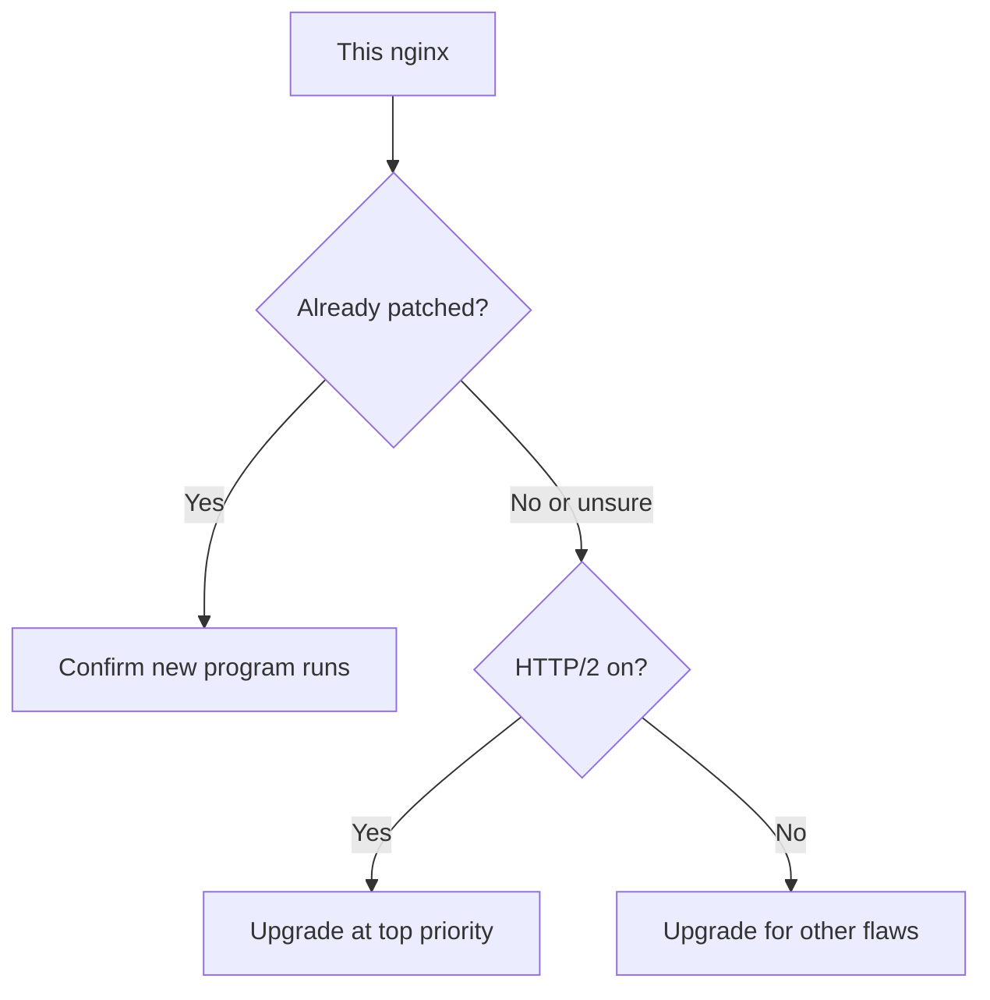
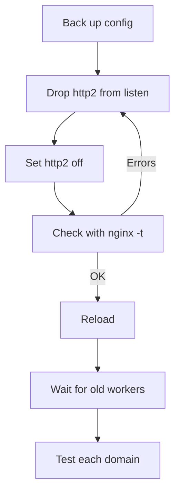

nginx fixed the HTTP/2 flaw **CVE-2026-123007** on November 18. If a site has HTTP/2 on, a remote attacker with no login may corrupt nginx's memory and then run code.

I collected the commands that check the version and settings. I also used the official Docker image to confirm a step that is easy to miss. If you only reload after upgrading, the old program keeps serving.

> Based on the official nginx security advisories, F5's notes in the CVE record, CERT-EU, and articles from three research teams, checked on 2026-11-22 (Taipei time). Exploitation status and fixed versions may change, so use the latest official information.
{: .prompt-info }

I use this chart first to judge how urgent it is:



"Patched" includes distribution packages that already carry the fix, and a later section shows how to tell. If you do not manage servers, you can hand this post to your operations staff, since the commands below need root privileges.

## The November 18 release fixed 10 issues, and the HTTP/2 one is most urgent

nginx released 1.31.9 and 1.30.7 together on 2026-11-18. Version 1.31.9 is on mainline, the branch with newer features. Version 1.30.7 is on stable, the branch that only takes fixes.

Version 1.31.9 fixes 10 security issues, and 1.30.7 fixes 9 of them. The missing one only affects 1.31.x.

CVE-2026-123007 affects 1.9.5 through 1.31.8. Version 1.9.5 added HTTP/2 in September 2015, so almost every nginx that has HTTP/2 on falls in that range.

Three sources rate the severity. F5 is nginx's parent company and the organization that assigned this CVE. CVSS is a common scoring standard for vulnerabilities, and 3.1 and 4.0 are two of its versions:

| Source | Rating |
| --- | --- |
| [nginx official advisory](https://nginx.org/en/security_advisories.html) | major (nginx's own scale of major, medium, and minor) |
| [CVSS 3.1 from F5 in the CVE record](https://www.cve.org/CVERecord?id=CVE-2026-123007) | 8.1, High |
| CVSS 4.0 from F5 in the CVE record | 9.2, Critical |

As of 2026-11-22, [NVD](https://nvd.nist.gov/vuln/detail/CVE-2026-123007) has no score of its own and only lists F5's scores. So if you see both 8.1 and 9.2, the difference is the CVSS version, not two organizations disagreeing.

I look at exploitation status as three separate things:

| Item | Status | Source |
| --- | --- | --- |
| Public proof-of-concept code | Yes, released 2026-11-18 | [Rapid7](https://www.rapid7.com/blog/post/ve-cve-2026-123007-critical-nginx-http-2-integer-underflow-leads-to-rce-fixed/) |
| Reports of exploitation in the wild | None yet (as of 2026-11-18) | [CERT-EU](https://www.cert.europa.eu/publications/security-advisories/2026-022/) |
| CISA's catalog of known exploited vulnerabilities (KEV) | Not listed (2026-11-20 version) | [CISA KEV](https://www.cisa.gov/known-exploited-vulnerabilities-catalog) |

A proof of concept (PoC) is sample code that shows a flaw can be exploited, and this post does not link to it. Absence from KEV only means CISA has not confirmed exploitation. It does not mean nobody is trying.

### Researchers describe a high bar for exploitation

According to Rapid7, their demonstration sends about 128 GB of HTTP/2 data. On a network slower than about 300 Mbit/s, that cannot finish within nginx's default one-hour connection limit. If HTTP/2 passes through another proxy on the way, the attack will most likely fail too.

ASLR is a defense that loads a program at different memory addresses each time. F5 says running code requires ASLR to be off or bypassed. [Wiz](https://www.wiz.io/blog/nginx-http2-rce-vulnerabilities) says ASLR does not stop this flaw, and demonstrated remote code execution on an ordinary server that only serves static files.

I think the bar is high. But the PoC is public, so an attacker only needs to find a host with HTTP/2 on to try it. That is why I would treat this as a flaw to handle right away.

## An HTTP/2 flow control miscalculation corrupts worker memory

HTTP/2 uses flow control to limit how much data each connection can carry. The receiver tells the sender how much more it can accept, and that allowance is called the window.

According to Rapid7, an attacker can make nginx miscalculate how much response data the client still allows it to send. F5 says the window can exceed its allowed maximum and cause a heap buffer overflow, which means writing past the memory that was allocated.

The problem is in the worker. In nginx, one master process reads the configuration and manages the workers, and the workers handle the actual connections. The master usually runs as root, and workers run as an ordinary account such as `nginx` or `www-data`.

According to [Xint](https://xint.io/blog/nginx2root-remote-code-execution), a successful attack runs commands with the worker's privileges. Xint also chained it with a Linux kernel flaw and got root from nginx inside a Docker container. So I would not treat "the worker is not root" as a reason to wait.

## Check three things first: version, HTTP/2 settings, and the running program

These commands are for people who manage nginx hosts, and they need root privileges.

### 1. For distribution packages, check the package version

```sh
nginx -v
nginx -V 2>&1 | grep -o with-http_v2_module
```

The first line shows the upstream version. The second checks whether the binary includes the HTTP/2 module, and no output means it does not, so this HTTP/2 flaw cannot reach it. nginx source builds leave the module out by default, but the nginx.org and Debian packages include it.

If you build from source or use the official nginx packages or Docker images, 1.30.7 or 1.31.9 and later are patched.

With distribution packages, `nginx -v` is misleading. Distributions often apply fixes to older package versions without changing the upstream version number, which is called backporting.

The clearest example is Debian unstable. Its package `1.30.6-4` is patched, but nginx's official advisory lists 1.30.6 as affected.

In a Debian 12 container, I installed the patched `1.22.1-9+deb12u11`, and `nginx -v` only showed 1.22.1.

Check the package version first. Run the one line that fits your system:

```sh
dpkg -l | grep nginx
rpm -qa | grep nginx
apk info -v | grep nginx
```

The first line is for Debian and Ubuntu, the second for the RHEL family, and the third for Alpine. Then compare against your distribution's advisory. This table lists the first fixed package for several common releases:

| Distribution | Fixed package version | Advisory |
| --- | --- | --- |
| Debian 12 bookworm | `1.22.1-9+deb12u11` | [DLA-4918-1](https://security-tracker.debian.org/tracker/CVE-2026-123007) |
| Debian 13 trixie | `1.26.3-3+deb13u11` | [DSA-6642-1](https://security-tracker.debian.org/tracker/CVE-2026-123007) |
| Ubuntu 22.04 jammy | `1.18.0-6ubuntu14.23` | [USN-9159-1](https://ubuntu.com/security/CVE-2026-123007) |
| Ubuntu 24.04 noble | `1.24.0-2ubuntu7.20` | [USN-9159-1](https://ubuntu.com/security/CVE-2026-123007) |
| RHEL 9 | `nginx-1.20.1-32.el9_9.2` | [RHSA-2026:100748](https://access.redhat.com/security/cve/CVE-2026-123007) |
| RHEL 10 | `nginx-1.26.3-16.el10_3.3` | [RHSA-2026:100744](https://access.redhat.com/security/cve/CVE-2026-123007) |
| Alpine 3.22 and 3.23 | `1.28.3-r8` | [Alpine secdb](https://secdb.alpinelinux.org/v3.23/main.json) |
| Alpine 3.24 | `1.30.7-r0` | [Alpine secdb](https://secdb.alpinelinux.org/v3.24/main.json) |

The nginx module streams for RHEL 9 and RHEL 8 have their own advisories. If you installed with `dnf module`, check Red Hat's full list. On Ubuntu 16.04, 18.04, and 20.04, the fix requires Ubuntu Pro.

### 2. Check HTTP/2 settings in every server block

```sh
sudo nginx -T 2>/dev/null | grep -E '^# configuration file|http2'
```

`nginx -T` prints the main configuration file along with every file pulled in by `include`. This command keeps only the file names and the lines that contain `http2`. Watch for two forms:

- `listen 443 ssl http2;` is the old form. It has been deprecated since 1.25.1 but still works.
- `http2 on;` is the new form since 1.25.1. It can go in a `server` block, or in the `http` block so that every server inherits it.

The two forms apply to different scopes. I tested four setups with the official Docker image:

| Setup | Result |
| --- | --- |
| On one port, A has `http2 on;` and B has `http2 off;` | Connections to A use HTTP/2, and connections to B use HTTP/1.1 |
| On one port, A has `listen ... http2` and B has `http2 off;` | Both A and B use HTTP/2 |
| One server has `listen ... http2` and also `http2 off;` | Still uses HTTP/2 |
| Plaintext port 80 has `http2 on;` | Accepts a client that sends HTTP/2 directly |

So judge whether HTTP/2 is on per address and port. On a TLS connection, the client uses SNI to tell the server which domain name it wants. If any one server on a port has HTTP/2 on, an attacker can put that name in SNI and reach HTTP/2.

To check from outside, test each domain name once:

```sh
curl -s --http2 -o /dev/null -w '%{http_version}\n' https://example.com/
curl -s --http2-prior-knowledge -o /dev/null -w '%{http_version}\n' http://example.com/
```

Replace `example.com` with your real domain. The first line tests HTTPS, and the second tests a plaintext connection.

Output `2` means HTTP/2 is accepted. Output `1.1`, or `0` when the second line fails, means it is not. This only tests the name you give it, so the configuration files remain the main evidence.

### 3. Check the running program, because `nginx -v` reads the file on disk

```sh
sudo ls -l /proc/$(cat /run/nginx.pid)/exe
```

If the output ends with `(deleted)`, the binary on disk has been replaced, but the old program is still serving. On Alpine the pid file is at `/run/nginx/nginx.pid`, and on other systems you can find it from `--pid-path=` in the `nginx -V` output. This check relies on Linux's `/proc`.

## Restart after upgrading, because a reload is not enough

nginx only ships fixes for two branches. On an older branch, move to one of them or switch to your distribution's fixed package:

| Your version | Upgrade to |
| --- | --- |
| nginx stable (1.30.x) | 1.30.7 or later |
| nginx mainline (1.31.x) | 1.31.9 or later |
| NGINX Plus 37.0.x | 37.0.8.1 or later |
| NGINX Plus 37.1 and later | 37.3.0.1 or later |
| Distribution packages | The versions in the previous section's table |

The NGINX Plus versions come from F5's CVE record. That record also lists the R series from R33 on as affected, but gives no fixed version for the R series.

Version 1.31.9 also starts rejecting header lines without a colon, and chunked request bodies with excessive framing overhead. Version 1.30.7 has only security fixes, so stable users will not hit these behavior changes when they upgrade.

### A reload does not replace the binary

In the official 1.30.6 image, I replaced the binary on disk with 1.30.7 to simulate a package upgrade. Then I checked which version actually answered connections after each step:

| Step | `nginx -v` | Version in response header | `/proc/<pid>/exe` |
| --- | --- | --- | --- |
| After replacing the binary | 1.30.7 | 1.30.6 | `(deleted)` |
| Then `nginx -s reload` | 1.30.7 | 1.30.6 | `(deleted)` |
| After a restart | 1.30.7 | 1.30.7 | Normal |

A reload only makes the master reread the configuration and start a new set of workers. The master itself is still the old binary, and the new workers are forked from it. Xint's article also states that reloading the configuration does not replace the running program.

Whether a package upgrade handles this for you depends on the package. The nginx.org [deb](https://github.com/nginx/pkg-oss/blob/master/debian/debian/nginx.postinst) and rpm packages try to swap the binary without downtime, but on failure they only print one line and the upgrade still counts as successful. So whatever the package does, I run the `/proc` check above after upgrading.

Test the configuration, then restart:

```sh
sudo nginx -t
sudo systemctl restart nginx
```

On systems that use OpenRC, such as Alpine, replace the second line with:

```sh
sudo rc-service nginx restart
```

A restart briefly drops existing connections. For services that cannot take that, the nginx docs describe how to [replace the binary without downtime](https://nginx.org/en/docs/control.html#upgrade). After restarting, run the `/proc` check again, and the output should no longer end with `(deleted)`.

If you run nginx in containers, switch to a new image such as `nginx:1.30.7` and redeploy. Restarting a container from the same old image does not update it.

F5 products such as NGINX Ingress Controller and NGINX Gateway Fabric also contain nginx. [NVD](https://nvd.nist.gov/vuln/detail/CVE-2026-123007) lists them as affected, so check F5's advisories for them.

The Kubernetes community's ingress-nginx stopped being maintained in March 2026. If you use it, check the advisories for your branch or from your cloud provider.

## If you cannot upgrade yet, drop http2 from listen and also set http2 off

CERT-EU, Xint, and Wiz all recommend turning off HTTP/2 when you cannot upgrade right away. This only blocks the two HTTP/2 flaws, CVE-2026-123007 and CVE-2026-123633. F5's CVE record lists the mitigation as None, so this only buys time.

CERT-EU says to remove `http2` from `listen`, or to set `http2 off;`. But the tests above show that **you need both**.

As long as one `listen ... http2` line remains, `http2 off;` has no effect. Xint and Wiz also call for both.

The edited server block looks like this:

```nginx
server {
    listen 443 ssl;    # removed the original http2
    http2 off;         # was http2 on;
    # other settings unchanged
}
```

Versions 1.25.0 and earlier have no `http2` directive, so only remove `http2` from `listen`. The change must cover:

- Every server block on the same address and port, including the default server.
- Any `http2 on;` in the `http` block, which every server inherits.
- Any `http2 on;` on a plaintext listener such as port 80.

The full process:



A reload is enough here, because only the configuration changed and the binary did not:

```sh
sudo nginx -t
sudo nginx -s reload
```

But HTTP/2 connections that are already open stay on the old workers until they close. By default, nginx lets a connection last up to one hour. This line shows whether any old workers remain:

```sh
ps -eo pid,args | grep '[w]orker process is shutting down'
```

Any output means old workers are still handling old connections. If you do not want to wait, restart with the commands above instead. Once the old workers are gone, run the `curl` commands from "Check three things first" once per domain, and HTTPS should print `1.1` every time.

Turning off HTTP/2 has two side effects to check first:

- **gRPC will break.** gRPC runs on HTTP/2, so clients cannot connect to a host that serves gRPC with `grpc_pass`.
- **HTTP/3 is not touched by this change, and not protected by it either.** HTTP/3 has its own flaw, CVE-2026-121810, and turning off HTTP/2 does not block it.

Ordinary browsers fall back to HTTP/1.1 on their own. After the upgrade, remember to turn HTTP/2 back on.

## Upgrade even without HTTP/2, because the same release fixes other flaws

CVE-2026-123007 cannot reach a host without HTTP/2, but the same release fixed other issues. [CERT-EU](https://www.cert.europa.eu/publications/security-advisories/2026-022/) believes five of the flaws fixed in this release, including CVE-2026-123007, may let a remote attacker with no login run code.

This table is based on the [official nginx advisories](https://nginx.org/en/security_advisories.html). The "Feature involved" column comes from the advisory titles:

| CVE | Issue | nginx rating | Feature involved |
| --- | --- | --- | --- |
| CVE-2026-123633 | use-after-free | medium | HTTP/2 reverse proxy |
| CVE-2026-121810 | use-after-free | medium | HTTP/3 |
| CVE-2026-123634 | use-after-free | medium | `resolver` |
| CVE-2026-113425 | use-after-free | major | mail proxy |
| CVE-2026-118899 | infinite loop | major | reading the request body over TLS 1.3 |
| CVE-2026-125283 | buffer overflow | minor | `alias` with `try_files` |
| CVE-2026-120967 | SNI bypass | medium | client certificate verification in the stream module |
| CVE-2026-123640 | insufficient validation | minor | `ssl_preread` in the stream module |
| CVE-2026-120993 | NULL pointer | minor | PROXY protocol v2, only 1.31.4 through 1.31.8 |

Use-after-free means a program keeps using memory it has already freed.

Watch the first row closely. nginx rates it medium, but F5 gives it the same CVSS scores as CVE-2026-123007, 8.1 and 9.2. According to F5, it triggers when nginx reverse-proxies to a backend and the worker is close to running out of connections.

The official nginx advisory page currently shows CVE-2026-121810 as "CVE-CVE-2026-121810", which breaks its link. Use the correct ID when you look it up.

If you are still on a version older than 1.31.7 or 1.30.6, this upgrade also fixes the 5 issues announced on October 14. These flaws each have their own conditions. Rather than judge one by one whether I can skip any, I would just upgrade.

## A worker crash in the logs does not mean you were compromised

CERT-EU recommends monitoring for worker crashes, which leave records like these in the error log:

```sh
sudo grep 'exited on signal' /var/log/nginx/error.log
```

A matching line looks like `worker process 165 exited on signal 11`. CERT-EU also says this is not a high-fidelity indicator of successful code execution, and more likely shows someone trying. Xint adds that a worker can also crash for reasons unrelated to any attack.

According to Xint, the clearest sign is a worker starting another program. nginx workers do not normally start other programs. This line lists the workers' current child processes:

```sh
ps --ppid "$(pgrep -d, -P "$(cat /run/nginx.pid)")" -o pid,user,args
```

If it prints only the header row, there are none right now. This only shows the present, so for past activity check the process creation logs from auditd or your endpoint protection tool. Xint also warns that this kind of attack may leave very little trace in the access log.

If a host exposed HTTP/2, ran an affected version, and shows a suspicious child process, I would treat it as compromised:

1. Restrict its external network access, and keep the logs and disk snapshots.
2. Rebuild the host from a trusted clean image.
3. From a clean environment, rotate the credentials, API tokens, and passwords the worker could read.

I would replace the TLS private keys too. The worker handles TLS connections, so my inference is that the private key sits in its memory. Patching only stops later attacks and does not remove anything already left behind.

## Even with the right version, confirm the new program is running

The easiest mistake this time is when the package is upgraded and `nginx -v` shows the new version, but the old program is still serving. After upgrading, I confirm with `/proc`.

I ran into the same "package updated, old service still running" problem in [CVE-2026-123158: OpenSSH Password Bypass on Alpine (musl)](/posts/openssh-musl-password-bypass-alpine/). That time, sshd had not been restarted.

## Main sources

- [nginx security advisories](https://nginx.org/en/security_advisories.html) for each CVE's rating and affected versions
- [nginx 1.31.9 changelog](https://nginx.org/en/CHANGES) and [1.30.7 changelog](https://nginx.org/en/CHANGES-1.30)
- [CVE-2026-123007 record](https://www.cve.org/CVERecord?id=CVE-2026-123007) for F5's description, CVSS, and NGINX Plus versions
- [CVE-2026-123007 on NVD](https://nvd.nist.gov/vuln/detail/CVE-2026-123007) for the list of affected F5 products
- [CERT-EU 2026-022](https://www.cert.europa.eu/publications/security-advisories/2026-022/) for exploitation status, mitigation, and log monitoring
- [Canadian Centre for Cyber Security AV26-1174](https://www.cyber.gc.ca/en/alerts-advisories/f5-security-advisory-av26-1174) for a summary of F5's advisory
- [Rapid7's analysis](https://www.rapid7.com/blog/post/ve-cve-2026-123007-critical-nginx-http-2-integer-underflow-leads-to-rce-fixed/) for exploitation conditions and practical limits
- [Wiz's analysis](https://www.wiz.io/blog/nginx-http2-rce-vulnerabilities) for the two HTTP/2 flaws and NGINX Plus versions
- [Xint's nginx2root](https://xint.io/blog/nginx2root-remote-code-execution) for checks, mitigation, and signs of compromise
- [nginx http2 directive docs](https://nginx.org/en/docs/http/ngx_http_v2_module.html) and [process control docs](https://nginx.org/en/docs/control.html)
- Distribution advisories: [Debian](https://security-tracker.debian.org/tracker/CVE-2026-123007), [Ubuntu](https://ubuntu.com/security/CVE-2026-123007), [Red Hat](https://access.redhat.com/security/cve/CVE-2026-123007)
- [CISA KEV catalog](https://www.cisa.gov/known-exploited-vulnerabilities-catalog)
