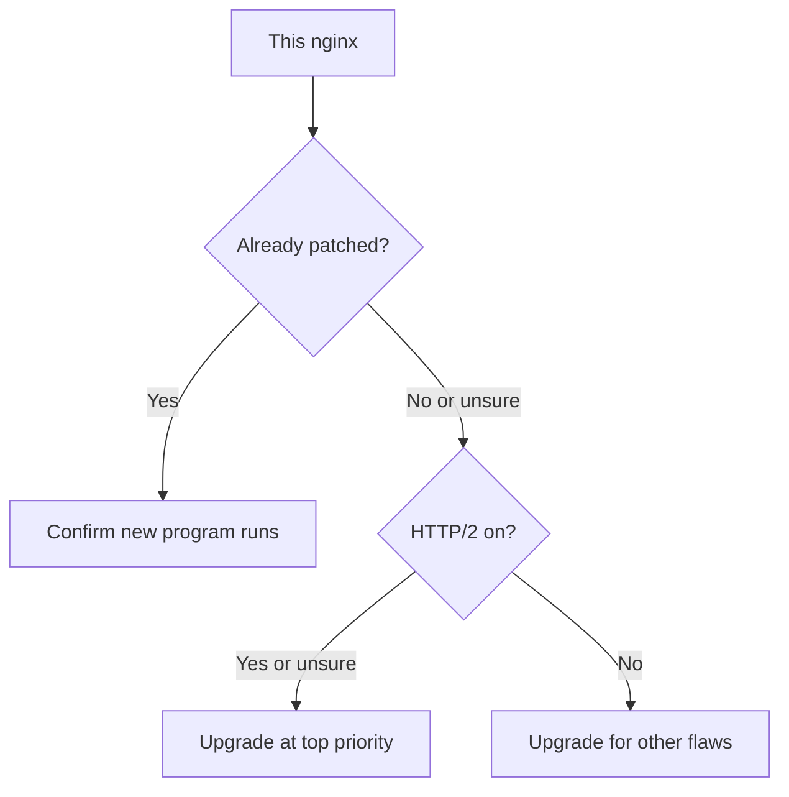
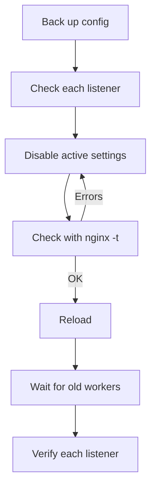

nginx fixed the HTTP/2 flaw **CVE-2026-123007** on November 18. If an affected nginx instance has HTTP/2 enabled, an unauthenticated remote attacker may corrupt nginx memory and execute code.

I collected the commands that check the version and settings. I also used the official Docker image to confirm a step that is easy to miss. If an upgrade only replaces the binary on disk, the old program keeps serving after a reload.

> Based on the official nginx security advisories, F5's notes in the CVE record, CERT-EU, and articles from three research teams, checked on 2026-11-22 (Taipei time). Exploitation status and fixed versions may change, so use the latest official information.
{: .prompt-info }

Use this chart to set your patching priorities. “Patched” refers to the version installed on disk and includes distribution packages that carry the fix.



If you find old processes still running, follow the upgrade steps below to replace them. If you do not manage the server, share this post with your operations team.

## Check three things first: version, HTTP/2 settings, and the running program

Check the version and configuration on the host or inside the container running nginx. If you are already root, omit `sudo` from the examples.

### 1. For distribution packages, check the package version

```sh
nginx -v
nginx -V 2>&1 | grep -o with-http_v2_module
```

The first line shows the binary’s upstream version. If `nginx -V` runs successfully and the second line prints nothing, that binary lacks the HTTP/2 module. The nginx.org and Debian packages include it, while source builds need to enable it explicitly.

Check the release branch if you build nginx yourself or use its official packages or Docker images. On stable 1.30.x, the first fixed release is 1.30.7. On mainline 1.31.x, it is 1.31.9.

For distribution packages, use the full package version. Distributions often backport fixes, meaning they apply them to older packages while keeping the upstream version number. For example, Debian unstable’s `1.30.6-4` contains the fix for upstream 1.30.6, which the nginx advisory lists as affected.

In a Debian 12 container, I installed the patched `1.22.1-9+deb12u11`, and `nginx -v` only showed 1.22.1.

Check the package version first. Run the one line that fits your system:

```sh
dpkg -l | grep nginx
rpm -qa | grep nginx
apk info -v | grep nginx
```

The first line is for Debian and Ubuntu, the second for the RHEL family, and the third for Alpine. Then compare against your distribution's advisory. This table lists the first fixed package for several common releases:

| Distribution | Fixed package version | Advisory |
| --- | --- | --- |
| Debian 12 bookworm | `1.22.1-9+deb12u11` | [DLA-4918-1](https://security-tracker.debian.org/tracker/CVE-2026-123007) |
| Debian 13 trixie | `1.26.3-3+deb13u11` | [DSA-6642-1](https://security-tracker.debian.org/tracker/CVE-2026-123007) |
| Ubuntu 22.04 jammy | `1.18.0-6ubuntu14.23` | [USN-9159-1](https://ubuntu.com/security/CVE-2026-123007) |
| Ubuntu 24.04 noble | `1.24.0-2ubuntu7.20` | [USN-9159-1](https://ubuntu.com/security/CVE-2026-123007) |
| RHEL 9 | `nginx-1.20.1-32.el9_9.2` | [RHSA-2026:100748](https://access.redhat.com/security/cve/CVE-2026-123007) |
| RHEL 10 | `nginx-1.26.3-16.el10_3.3` | [RHSA-2026:100744](https://access.redhat.com/security/cve/CVE-2026-123007) |
| Alpine 3.22 and 3.23 | `1.28.3-r8` | [Alpine secdb](https://secdb.alpinelinux.org/v3.23/main.json) |
| Alpine 3.24 | `1.30.7-r0` | [Alpine secdb](https://secdb.alpinelinux.org/v3.24/main.json) |

The nginx module streams for RHEL 9 and RHEL 8 have their own advisories. If you installed with `dnf module`, check Red Hat's full list. On Ubuntu 16.04, 18.04, and 20.04, the fix requires Ubuntu Pro.

### 2. Check HTTP/2 settings in every server block

```sh
sudo nginx -T
```

`nginx -T` checks the configuration on disk and prints the main file and all included files. Use the service’s executable and startup options, including any custom `-c`, `-p`, and `-g` options. Resolve any configuration errors before interpreting the output.

Check these two forms for each listening address, port, and virtual host.

- `listen 443 ssl http2;` is the old form. It has been deprecated since 1.25.1 but still works.
- `http2 on;` is the new form since 1.25.1. A setting in the `http` block applies to servers without their own setting.

The two forms apply to different scopes. I tested four setups with the official Docker image:

| Setup | Result |
| --- | --- |
| On a shared address and port, A has `http2 on;` and B has `http2 off;` | Connections to A use HTTP/2, and connections to B use HTTP/1.1 |
| On a shared address and port, A has `listen ... http2` and B has `http2 off;` | Both A and B use HTTP/2 |
| One server has `listen ... http2` and also `http2 off;` | Still uses HTTP/2 |
| Plaintext port 80 has `http2 on;` | Accepts a client that sends HTTP/2 directly |

Check the old form by listening address and port, then check the new form for each virtual host. TLS clients use SNI to tell nginx the hostname, so different names on the same address and port can give different results. Check the default virtual host too, as it handles TLS connections with a missing or unmatched hostname.

Changes on disk may still be waiting for a reload, so test each listening address, port, and hostname from a network that can reach your nginx directly. A test against a public hostname behind a CDN or load balancer may show the intermediary’s protocol. `--resolve` keeps the original hostname while directing the request to the nginx address you specify.

```sh
curl -sS --noproxy '*' --http2 --resolve example.com:443:192.0.2.10 \
  -o /dev/null -w '%{http_version}\n' https://example.com/
curl -sS --noproxy '*' --http2-prior-knowledge --resolve example.com:80:192.0.2.10 \
  -o /dev/null -w '%{http_version}\n' http://example.com/
```

Replace the hostname, address, and port with your own values. The first command checks HTTPS, and the second checks cleartext HTTP/2.

On a completed request, `2` means that connection used HTTP/2, and `1.1` means it used HTTP/1.1. If curl prints `0` or exits with an error, the result is inconclusive.

If the cleartext HTTP/2 test fails, try `--http1.1` at the same address and port to verify the listener responds. Then check the cleartext listener configuration.

### 3. Identify the binaries nginx processes are running

`nginx -v` reports the version of the binary you just invoked. Find the master and worker PIDs in the process list. The master reads the configuration and manages processes, while the workers handle connections.

```sh
ps -e -o pid,ppid,args | grep -E '[n]ginx: (master|worker) process'
```

On Linux, replace `1234` with the PID to check and `/usr/sbin/nginx` with the binary you verified is patched. Repeat for the master and each worker in this instance.

```sh
pid=1234
patched_binary=/usr/sbin/nginx
sudo readlink "/proc/$pid/exe"
sudo stat -Lc '%d:%i %n' "/proc/$pid/exe" "$patched_binary"
```

`(deleted)` means the process still references a file removed from its original path. Use `stat` to compare the device and inode numbers that identify the file. Both numbers must match to confirm that the process runs the specified patched binary.

## Both November 18 releases fix the flaw, and HTTP/2 takes priority

nginx fixed CVE-2026-123007 in both mainline 1.31.9 and stable 1.30.7 on 2026-11-18. Mainline, the branch with newer features, fixed 10 security issues, and stable, the branch that only takes fixes, fixed nine. The tenth issue only affects versions 1.31.4 through 1.31.8.

CVE-2026-123007 affects nginx Open Source 1.9.5 through 1.30.6 and 1.31.0 through 1.31.8 when HTTP/2 is enabled. Version 1.9.5 added HTTP/2 in September 2015.

nginx uses its own severity scale. F5, which assigned the CVE ID, uses two versions of the Common Vulnerability Scoring System (CVSS).

| Source | Rating |
| --- | --- |
| [nginx official advisory](https://nginx.org/en/security_advisories.html) | major (nginx's own scale of major, medium, and minor) |
| [F5’s CVE record](https://www.cve.org/CVERecord?id=CVE-2026-123007) | CVSS 3.1 gives 8.1 (High)<br>CVSS 4.0 gives 9.2 (Critical) |

As of 2026-11-22, both scores listed by the [National Vulnerability Database (NVD)](https://nvd.nist.gov/vuln/detail/CVE-2026-123007) came from F5.

A proof of concept (PoC) is sample code that shows a flaw can be exploited. Reports from real deployments and the KEV catalog track evidence of exploitation in the wild.

| Item | Status | Source |
| --- | --- | --- |
| Public proof-of-concept code | Yes, released 2026-11-18 | [Rapid7](https://www.rapid7.com/blog/post/ve-cve-2026-123007-critical-nginx-http-2-integer-underflow-leads-to-rce-fixed/) |
| Reports of exploitation in the wild | None yet (as of 2026-11-18) | [CERT-EU](https://www.cert.europa.eu/publications/security-advisories/2026-022/) |
| CISA's catalog of known exploited vulnerabilities (KEV) | Not listed (2026-11-20 version) | [CISA KEV](https://www.cisa.gov/known-exploited-vulnerabilities-catalog) |

### Research demonstrations vary, so prioritize exposed HTTP/2

Rapid7 describes a demonstration with specific network and deployment conditions.

ASLR is a defense that loads a program at different memory addresses each time. F5 says running code requires ASLR to be off or bypassed. [Wiz](https://www.wiz.io/blog/nginx-http2-rce-vulnerabilities) demonstrated remote code execution on an ordinary server serving only static files and found ASLR alone insufficient.

I think successful exploitation still depends on the deployment. With a public demonstration, I would prioritize patching affected hosts that accept HTTP/2 from outside the network.

## An HTTP/2 flow control miscalculation corrupts worker memory

HTTP/2 uses flow control to limit how much data each connection can carry. The receiver tells the sender how much more it can accept, and that allowance is called the window.

According to Rapid7, an attacker can make nginx miscalculate how much response data the client still allows it to send. F5 says the window can exceed its allowed maximum and cause a heap buffer overflow, which means writing past the memory that was allocated.

The flaw affects the workers that handle connections. The master usually runs as root, and workers typically run as an ordinary account such as `nginx` or `www-data`.

According to [Xint](https://xint.io/blog/nginx2root-remote-code-execution), a successful attack runs commands with the worker's privileges. Xint also chained it with a Linux kernel flaw and got root from nginx inside a Docker container. So I would not treat "the worker is not root" as a reason to wait.

## Replace the running binary after upgrading

Choose a fixed release based on how you installed nginx. If your older open-source branch lacks a fix, move to one of the open-source branches below or use your distribution’s patched package.

| Your version | Upgrade to |
| --- | --- |
| nginx stable (1.30.x) | 1.30.7 or later |
| nginx mainline (1.31.x) | 1.31.9 or later |
| NGINX Plus 37.0.x | 37.0.8.1 or later |
| NGINX Plus 37.1.0 up to but excluding 37.3.0.1 | 37.3.0.1 or later |
| Distribution packages | The package versions under “Check three things first” |

The NGINX Plus versions come from F5’s CVE record. It lists affected R-series releases starting at R33, including R34 through R36, which CERT-EU names. The record lists no fixed release for the R series, so follow F5’s advisory to move to a patched branch.

Version 1.31.9 also starts rejecting header lines without a colon, and chunked request bodies with excessive framing overhead. Version 1.30.7 has only security fixes, so stable users will not hit these behavior changes when they upgrade.

### A reload does not replace the binary

In the official 1.30.6 image, I replaced the binary on disk with 1.30.7 to simulate a package upgrade. Then I checked which version actually answered connections after each step:

| Step | `nginx -v` | Version in response header | `/proc/<pid>/exe` |
| --- | --- | --- | --- |
| After replacing the binary | 1.30.7 | 1.30.6 | `(deleted)` |
| Then `nginx -s reload` | 1.30.7 | 1.30.6 | `(deleted)` |
| After a restart | 1.30.7 | 1.30.7 | Normal |

A reload only makes the master reread the configuration and start a new set of workers. The master itself is still the old binary, and the new workers are forked from it. Xint's article also states that reloading the configuration does not replace the running program.

Some packages attempt to replace the running binary during an upgrade. The nginx.org [deb](https://github.com/nginx/pkg-oss/blob/master/debian/debian/nginx.postinst) and rpm packages try to do this without downtime, but the package upgrade can still report success if the swap fails. I use the `/proc` check above to see if any old processes are still running.

For nginx installed directly on a host, a restart can replace old processes that are still running. If your service can tolerate a brief interruption, restart once the configuration test passes. Use the service’s custom configuration file or startup options for the test, where applicable.

```sh
sudo nginx -t && sudo systemctl restart nginx
```

On systems that use OpenRC, such as Alpine, use this command.

```sh
sudo nginx -t && sudo rc-service nginx restart
```

A restart can interrupt existing connections. If your service cannot tolerate an interruption, follow the nginx docs to [replace the binary without downtime](https://nginx.org/en/docs/control.html#upgrade).

During a live upgrade, the original PID file may already point to the new master. The old master’s PID goes into the file with an `.oldbin` suffix, and both sets of workers can still serve traffic. After the upgrade, use the process list and `/proc` to verify that every serving worker runs the patched binary and the old workers have exited.

If you run nginx in containers, switch to a new image such as `nginx:1.30.7` and redeploy. Restarting a container from the same old image does not update it.

F5 products have their own fixed releases. The [F5 advisory](https://my.f5.com/manage/s/article/K000163926) lists `2.9.0` for NGINX Gateway Fabric 2.x. It lists `5.8.0` for NGINX Ingress Controller 5.x and `2026-lts-r11` for its LTS branch.

Check the same advisory for other branches.

The Kubernetes community's ingress-nginx stopped being maintained in March 2026. If you use it, check the advisories for your branch or from your cloud provider.

## Turn off exposed HTTP/2 on nginx if you cannot upgrade yet

CERT-EU, Xint, and Wiz recommend turning off exposed HTTP/2 if you cannot upgrade right away. This reduces the risk from CVE-2026-123007 and CVE-2026-123633. F5’s CVE record lists no mitigation, and the other flaws fixed in these releases still require an upgrade.

Before turning off HTTP/2, check whether your clients depend on it. gRPC runs on HTTP/2, so clients will lose access to a gRPC service served through `grpc_pass` if you turn HTTP/2 off for that service. Browsers can fall back to HTTP/1.1 or use HTTP/3 where available.

If HTTP/3 is enabled, you still need to patch CVE-2026-121810.

CERT-EU describes two ways to disable HTTP/2. Which one you need depends on how your configuration enables it.

| Current configuration | What to change |
| --- | --- |
| Only the old `listen ... http2` form | Remove `http2` from every server’s `listen` directive on that address and port |
| Only `http2 on;` | Make sure `http2 off;` applies to each server, accounting for settings inherited from the `http` block |
| Both forms | Change both settings. An old `listen ... http2` still enables HTTP/2 even if you set `http2 off;` |

When both forms are present, the edited server block can look like this.

```nginx
server {
    listen 443 ssl;    # removed the original http2
    http2 off;         # was http2 on;
    # other settings unchanged
}
```

The `http2` directive first appeared in 1.25.1. Check the default virtual host and cleartext listeners such as port 80 as well.



If you only changed the configuration, reload after the test passes.

```sh
sudo nginx -t && sudo nginx -s reload
```

After the reload, check the error log for configuration errors. Open HTTP/2 connections may still be on the old workers. Check whether any workers are still shutting down.

```sh
ps -eo pid,args | grep '[w]orker process is shutting down'
```

After the old workers exit, use the earlier `curl` commands to verify each listener. Endpoints that should still serve HTTPS should respond over HTTP/1.1. For cleartext listeners, use the earlier tests and check their configuration.

If you need to close existing connections immediately, use the restart commands above and plan for a service interruption.

Once you confirm that the patched binary is serving, restore the HTTP/2 settings you need.

## Upgrade even without HTTP/2, because the same release fixes other flaws

CVE-2026-123007 affects deployments with HTTP/2 enabled. The same updates fix flaws in other features, including HTTP/3 and mail proxying. According to [CERT-EU](https://www.cert.europa.eu/publications/security-advisories/2026-022/), five of these flaws, including CVE-2026-123007, may allow an unauthenticated remote attacker to execute code.

This table is based on the [official nginx advisories](https://nginx.org/en/security_advisories.html). The "Feature involved" column comes from the advisory titles:

| CVE | Issue | nginx rating | Feature involved |
| --- | --- | --- | --- |
| CVE-2026-123633 | use-after-free | medium | HTTP/2 reverse proxy |
| CVE-2026-121810 | use-after-free | medium | HTTP/3 |
| CVE-2026-123634 | use-after-free | medium | `resolver` |
| CVE-2026-113425 | use-after-free | major | mail proxy |
| CVE-2026-118899 | infinite loop | major | reading the request body over TLS 1.3 |
| CVE-2026-125283 | buffer overflow | minor | `alias` with `try_files` |
| CVE-2026-120967 | SNI bypass | medium | client certificate verification in the stream module |
| CVE-2026-123640 | insufficient validation | minor | `ssl_preread` in the stream module |
| CVE-2026-120993 | NULL pointer | minor | PROXY protocol v2, only 1.31.4 through 1.31.8 |

Use-after-free means a program keeps using memory it has already freed.

Watch the first row closely. nginx rates it medium, but F5 gives it the same CVSS scores as CVE-2026-123007, 8.1 and 9.2. According to F5, it triggers when nginx reverse-proxies to a backend and the worker is close to running out of connections.

The official nginx advisory page currently shows CVE-2026-121810 as "CVE-CVE-2026-121810", which breaks its link. Use the correct ID when you look it up.

This update includes fixes for the five issues announced on October 14. Those fixes first shipped in mainline 1.31.7 and stable 1.30.6. I would upgrade to apply the fixes relevant to my deployment in one go.

## A worker crash in the logs does not mean you were compromised

CERT-EU recommends monitoring for worker crashes, which leave records like these in the error log:

```sh
sudo grep 'exited on signal' /var/log/nginx/error.log
```

A matching line looks like `worker process 165 exited on signal 11`. CERT-EU treats such crashes as a possible sign of an attempt. Xint points out that workers also crash for unrelated reasons, so check for unusual process activity.

According to Xint, a worker starting an unexpected program is a stronger sign. The example finds the master using its PID file and checks whether any of its child processes started other processes. Adjust the path to match the service’s `pid` setting. Alpine packages use `/run/nginx/nginx.pid`.

```sh
ps --ppid "$(pgrep -d, -P "$(cat /run/nginx.pid)")" -o pid,user,args
```

This command needs a version of `ps` that supports `--ppid` and only shows processes that are still running. For past activity, check the process creation logs from auditd or your endpoint protection tool. Xint also warns that this kind of attack may leave very little trace in the access log.

If a host exposed HTTP/2, ran an affected version, and shows a suspicious child process, I would treat it as compromised:

1. Restrict its external network access, and keep the logs and disk snapshots.
2. Rebuild the host from a trusted clean image.
3. From a clean environment, rotate the credentials, API tokens, and passwords the worker could read.

If nginx handles TLS and its workers can access the private keys, I would replace those keys too. I infer that code running with worker privileges could read keys available to the worker. Rebuilding the host and rotating credentials address a compromise that may already have happened before patching.

## Even with the right version, confirm the new program is running

After upgrading, I use the process list and `/proc` to verify that the patched binary is serving and the old workers have exited.

I ran into the same "package updated, old service still running" problem in [CVE-2026-123158: OpenSSH Password Bypass on Alpine (musl)](/posts/openssh-musl-password-bypass-alpine/). That time, sshd had not been restarted.

If PHP-FPM sits behind nginx, PHP has its own exploited flaw to fix: php2shell. Restarting nginx does not replace PHP processes, so restart PHP-FPM separately. See [PHP CVE-2026-109618: How to Fix Exploited php2shell Flaws](/posts/php2shell-cve-2026-109618/).

## Main sources

- [nginx security advisories](https://nginx.org/en/security_advisories.html) for each CVE's rating and affected versions
- [nginx 1.31.9 changelog](https://nginx.org/en/CHANGES) and [1.30.7 changelog](https://nginx.org/en/CHANGES-1.30)
- [CVE-2026-123007 record](https://www.cve.org/CVERecord?id=CVE-2026-123007) for F5's description, CVSS, and NGINX Plus versions
- [CVE-2026-123007 on NVD](https://nvd.nist.gov/vuln/detail/CVE-2026-123007) for the list of affected F5 products
- [CERT-EU 2026-022](https://www.cert.europa.eu/publications/security-advisories/2026-022/) for exploitation status, mitigation, and log monitoring
- [Canadian Centre for Cyber Security AV26-1174](https://www.cyber.gc.ca/en/alerts-advisories/f5-security-advisory-av26-1174) for a summary of F5's advisory
- [Rapid7's analysis](https://www.rapid7.com/blog/post/ve-cve-2026-123007-critical-nginx-http-2-integer-underflow-leads-to-rce-fixed/) for exploitation conditions and practical limits
- [Wiz's analysis](https://www.wiz.io/blog/nginx-http2-rce-vulnerabilities) for the two HTTP/2 flaws and NGINX Plus versions
- [Xint's nginx2root](https://xint.io/blog/nginx2root-remote-code-execution) for checks, mitigation, and signs of compromise
- [nginx http2 directive docs](https://nginx.org/en/docs/http/ngx_http_v2_module.html) and [process control docs](https://nginx.org/en/docs/control.html)
- Distribution advisories: [Debian](https://security-tracker.debian.org/tracker/CVE-2026-123007), [Ubuntu](https://ubuntu.com/security/CVE-2026-123007), [Red Hat](https://access.redhat.com/security/cve/CVE-2026-123007)
- [CISA KEV catalog](https://www.cisa.gov/known-exploited-vulnerabilities-catalog)
