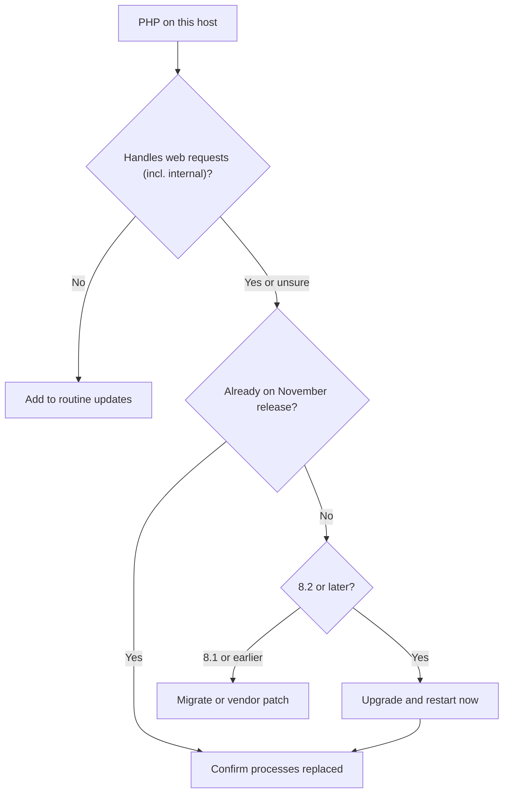

On October 21, PHP released its first fixes for two flaws known together as php2shell, **CVE-2026-109618** and **CVE-2026-109619**. Under certain conditions, an attacker can execute code remotely without logging in, and CISA has added both flaws to its Known Exploited Vulnerabilities catalog.

If you upgraded in October, check whether your PHP branch or distribution package needs a follow-up fix.

> Based on php.net, the security advisories PHP publishes on GitHub (GHSA), the PHP Foundation, CISA, and NVD, checked on 2026-11-23 (Taipei time). Fixed versions and exploitation status may change, so use the latest official information.
{: .prompt-info }

Use this chart to prioritize updates. “November release” means the November 19 release for your branch or later, or a distribution package that includes the fixes it needs. Sites that serve internal web traffic should also follow the “Yes or unsure” branch.



## php2shell affects PHP's memory management and error handling

According to the PHP Foundation, almost every request uses these two parts of PHP. The fixes had to address the flaws while keeping existing applications compatible.

| CVE | Where it goes wrong | Confirmed remote code execution |
| --- | --- | --- |
| CVE-2026-109618 | When memory runs out (OOM), PHP aborts the work in progress. Request data may be only half initialized, yet cleanup treats it as valid | With Apache mod_php's default settings, a request can trigger it before any application code runs |
| CVE-2026-109619 | After a request ends, PHP's global state still points to freed memory, and the next request in the same worker uses it | Demonstrated on mod_php. The session upload progress path is verified on both mod_php and PHP-FPM |

A worker is the process that actually handles requests. Using memory that has already been freed is a class of bug called use-after-free.

Both score 9.2 (Critical) on CVSS 4.0, with the same vector. Attack complexity is rated high, and an attack needs specific preconditions.

### Check any PHP installation that handles web requests

Here, SAPI refers to the interface PHP uses to receive requests from a web server. php.net lists PHP-FPM, Apache mod_php, php-cgi, FrankenPHP, and LiteSpeed as affected SAPIs. The PHP project considers mod_php the highest risk among them.

mod_php is a PHP module that Apache loads directly. PHP-FPM is a separate pool of PHP processes, and servers such as nginx forward requests to it.

Two official documents describe the status of CVE-2026-109618 on PHP-FPM differently:

| Source | What it says about PHP-FPM |
| --- | --- |
| [PHP Foundation](https://thephp.foundation/blog/2026/10/21/todays-php-security-release-and-how-were-strengthening-php-security/) (October 21) | Remote code execution confirmed through an application-level path |
| [GHSA-w8hw-w9fx-j79w](https://github.com/php/php-src/security/advisories/GHSA-w8hw-w9fx-j79w) (updated November 3) | Judged affected based on source code analysis, but no complete FPM-specific demonstration yet |

In my judgment, running FPM is no reason to patch later. Remote code execution through CVE-2026-109619 has already been verified on FPM.

### CISA listed both as known exploited five days after disclosure

CISA's Known Exploited Vulnerabilities catalog (KEV) lists flaws with evidence of exploitation in the wild.

| Date | Event |
| --- | --- |
| October 20 | php.net announces an upcoming major security update |
| October 21 | 8.5.12, 8.4.27, 8.3.36, and 8.2.35 released, and CISA issues an alert |
| October 23 | php.net adds a note about session upload progress |
| October 26 | CISA adds both CVEs to KEV |
| November 19 | 8.5.13, 8.4.28, 8.3.37, and 8.2.36 released with follow-up fixes |

According to the PHP Foundation, a research team mistakenly published a demonstration video the day before disclosure, and proofs of concept (PoCs) began to appear. By the October 21 disclosure, the PHP security team had found no working exploit among the PoCs it reviewed. The October 26 KEV entries show that CISA had evidence of real-world exploitation by then.

## Check which PHP version your site actually runs

`php -v` only shows the command-line (CLI) PHP. Your site may use a different package and version, with different configuration files.

Run the checks and mitigation settings in this post on the host or container your site actually uses.

### 1. Find the SAPI

```sh
ps -eo pid,user,args | grep -E '[p]hp-fpm|[a]pache2|[h]ttpd|[l]sphp|[f]rankenphp|[p]hp-cgi'
```

If you see `php-fpm: master process`, PHP-FPM is running on the host. If you run multiple sites or FPM versions, match the socket or port in the site's configuration to the FPM pool that receives its requests. If you see `apache2` or `httpd`, check whether Apache is configured to load the PHP module.

```sh
apache2ctl -M 2>/dev/null | grep -i php
httpd -M 2>/dev/null | grep -i php
```

The first line is for Debian and Ubuntu, and the second for the RHEL family. Output of `php_module (shared)` means Apache is configured to load mod_php. If the host also runs PHP-FPM, check the site's VirtualHost configuration to see which one handles its requests.

### 2. Check the version of the PHP that serves your site

PHP-FPM binary names often include the version. Identify the executable that belongs to the FPM process you found, then check its version.

```sh
ls /usr/sbin/php-fpm* /usr/local/sbin/php-fpm 2>/dev/null
php-fpm8.3 -v
```

Replace `php-fpm8.3` with the corresponding executable. The `(fpm-fcgi)` label identifies an FPM build. If you just upgraded the package, use the checks below to confirm the running processes have picked up the new files.

mod_php has no separate binary, so check its package version. If your site sends the `X-Powered-By` header, you can also see the version from outside:

```sh
curl -sI https://example.com/ | grep -i x-powered-by
```

The [expose_php](https://www.php.net/manual/en/ini.core.php#ini.expose-php) setting adds an `X-Powered-By` header with the running PHP version. If that PHP is 8.5.13, the header reads `X-Powered-By: PHP/8.5.13`.

Production sites may disable `expose_php`, so check on the server if the header is absent. For distribution packages, use the full package version to determine whether a fix is installed.

### 3. On distributions, check the full package version

Run the one line that fits your system:

```sh
dpkg -l | grep -E 'php[0-9.]*-(fpm|cli|cgi|common)|libapache2-mod-php'
rpm -qa | grep -E '^php'
apk info -v | grep -E '^php[0-9]+'
```

The first line is for Debian and Ubuntu, the second for the RHEL family, and the third for Alpine. Compare the result with the distribution table in the next section.

CISA warns that PHP is often bundled inside other software, where it is easy to miss. Count containers, hosting control panels, and packaged applications too. For containers, run the same checks inside the container.

## For upstream PHP, install the November 19 release or later

| Branch | October 21 | November 19 (target) |
| --- | --- | --- |
| 8.5 | 8.5.12 | 8.5.13 |
| 8.4 | 8.4.27 | 8.4.28 |
| 8.3 | 8.3.36 | 8.3.37 |
| 8.2 | 8.2.35 | 8.2.36 |

The October security releases included the first round of fixes for both flaws. The November releases came out as part of PHP's four-week release cycle. They carry the October fixes forward and close a gap in the CVE-2026-109619 fix.

The November releases also fix two flaws of the same class as CVE-2026-109619. GHSA rates both Critical 9.2:

- GHSA attributes CVE-2026-129481 to an incomplete fix for CVE-2026-109619. It affects upstream PHP 8.3, 8.4, and 8.5 before the November versions in the table. [CVE-2026-129481](https://github.com/php/php-src/security/advisories/GHSA-g3vh-838c-65v7)
- CVE-2026-129182 affects PHP 8.5 releases before 8.5.13. Version 8.5.12 clears a piece of global state, but the later shutdown sequence can write it back. [CVE-2026-129182](https://github.com/php/php-src/security/advisories/GHSA-2fjv-p558-g82m)

Both GHSAs say code execution through these two paths has not been demonstrated yet. php.net also says the issues rated Critical in November need non-default settings or uncommon environments. I would still go straight to the November release and pick up all these fixes at once.

The same batch also fixes PHP-FPM request smuggling (CVE-2026-129289) and other issues, listed in full in the [PHP 8 ChangeLog](https://www.php.net/ChangeLog-8.php). PHP 8.2 stops receiving security updates on 2026-12-31, so start planning an upgrade.

### 8.1 and earlier have no official fixed release

The PHP project no longer releases updates for 8.1 and earlier. Because these flaws are so severe, the security team provided minimal source backports for 7.4, 8.0, and 8.1. They are for people who build PHP themselves.

Some distributions and long-term support (LTS) vendors also offer backported fixes, so check with your vendor. CISA recommends taking systems offline until they can be patched if they cannot install an update or are still running an unpatched version of PHP 8.1 or earlier.

### Distribution packages

Distributions often apply fixes to older packages and keep the upstream version number. This is called a backport. php.net says distributions and LTS vendors received the fixes in advance.

The table lists the full version of the first package to include each fix. “Not affected” applies only to CVE-2026-129481 in the November column. The two October flaws still need patches. If secdb has no entry for the flaw, check its status with the vendor.

| Distribution | Package | php2shell (October) | CVE-2026-129481 (November) |
| --- | --- | --- | --- |
| Debian 12 | `php8.2` | `8.2.35-1~deb12u1` (DLA-4848-1) | Not affected |
| Debian 13 | `php8.4` | `8.4.27-1~deb13u1` (DSA-6574-1) | `8.4.28-1~deb13u1` (DSA-6641-1) |
| Ubuntu 22.04 | `php8.1` | `8.1.2-1ubuntu2.28` (USN-8948-1) | `8.1.2-1ubuntu2.29` |
| Ubuntu 24.04 | `php8.3` | `8.3.6-0ubuntu0.24.04.13` (USN-8948-1) | `8.3.6-0ubuntu0.24.04.14` |
| Ubuntu 26.04 | `php8.5` | `8.5.4-0ubuntu1.5` (USN-8948-1) | `8.5.4-0ubuntu1.6` |
| RHEL 8 | `php:8.2` module | `8.2.35-1.module+el8.10.0` (RHSA-2026:87073) | Not affected |
| RHEL 9 | `php:8.3` module | `8.3.36-1.module+el9.8.0` (RHSA-2026:87079) | Affected, not yet fixed |
| RHEL 10 | `php` | `8.3.36-1.el10_2` (RHSA-2026:87070) | Affected, not yet fixed |
| RHEL 10 | `php8.4` | `8.4.27-1.el10_2` (RHSA-2026:87071) | `8.4.28-1.el10_3` (RHSA-2026:100821) |
| Alpine 3.22 | `php82` | `8.2.35-r0` | Not affected |
| Alpine 3.22 | `php83`, `php84` | `8.3.36-r0`, `8.4.27-r0` | No secdb entry yet |
| Alpine 3.23 | `php83`, `php84`, `php85` | `8.3.36-r0`, `8.4.27-r0`, `8.5.12-r0` | No secdb entry yet |
| Alpine 3.24 | `php83`, `php84`, `php85` | `8.3.36-r0`, `8.4.27-r0`, `8.5.12-r0` | `8.3.37-r0`, `8.4.28-r0`, `8.5.13-r0` |

The versions come from [Debian](https://security-tracker.debian.org/tracker/CVE-2026-109618), [Ubuntu](https://ubuntu.com/security/CVE-2026-109618), [Red Hat](https://access.redhat.com/security/cve/CVE-2026-109618), and [Alpine secdb](https://secdb.alpinelinux.org/v3.24/community.json). The November column comes from each vendor's CVE-2026-129481 page, such as [Debian's](https://security-tracker.debian.org/tracker/CVE-2026-129481). For other RHEL module streams, such as `php:7.4` on RHEL 8, see the full list on the Red Hat page.

The upstream advisory covers releases from the PHP project. Ubuntu lists a fix for CVE-2026-129481 in its own PHP 8.1 package on 22.04, so the table uses Ubuntu's record for that package. [Ubuntu security tracker](https://ubuntu.com/security/CVE-2026-129481)

The other follow-up flaw, CVE-2026-129182, affects only PHP 8.5. Ubuntu 26.04 fixes it in `8.5.4-0ubuntu1.6`. As of the check date, Alpine's secdb had no entry for it.

As of the check date, `php:8.3` on RHEL 9 and `php` on RHEL 10 had no fix for CVE-2026-129481 in the standard releases. Some EUS (Extended Update Support) releases had fixes.

Until a fix for CVE-2026-129481 is available, GHSA recommends addressing potential fatal errors during session cleanup. If you run PHP-FPM, the `pm.max_requests` setting below can also reduce exposure temporarily.

### Windows builds and Docker images

On October 26, the Windows builds were rebuilt separately as 8.5.12-1 and similar versions. The rebuild fixes a Brotli flaw, and the PHP version itself stays the same.

When I checked, the official Docker images `php:8.5-apache` and `php:8.5-fpm` were already 8.5.13, built on November 19. With containers, pull the new image and redeploy. Restarting an old container does not update it.

Tags without a branch, such as `php:latest` and `php:fpm`, already point to 8.6.0. It came out the same day as the November releases, and its ChangeLog also lists the fixes for CVE-2026-129481 and CVE-2026-129182. To stay on your current branch, name the version explicitly, for example `php:8.4-fpm`.

## Restart PHP after upgrading, then confirm no old processes remain

After upgrading the package, verify that the PHP processes handling requests have loaded the new files. Existing processes may keep using files they loaded before the upgrade. GHSA also calls for restarting every PHP worker after applying mitigation settings.

After a package replaces the file on disk, a running process can keep using the old file. [proc_pid_exe(5)](https://man7.org/linux/man-pages/man5/proc_pid_exe.5.html) and [proc_pid_maps(5)](https://man7.org/linux/man-pages/man5/proc_pid_maps.5.html) describe the marker: when the file has been removed, `/proc` appends `(deleted)` to its path.

| Service | Usual reload | While the old file is still in use |
| --- | --- | --- |
| Apache mod_php | `apache2ctl -k graceful` | `libphp.so` is marked `(deleted)` |
| PHP-FPM | `USR2` to the master | `php-fpm` is marked `(deleted)` |

Whether a reload makes every process load the new file depends on the distribution. If nginx forwards requests to PHP-FPM, confirm that PHP-FPM itself has restarted or reloaded.

Service names and reload behavior vary by distribution, so I would restart the service that handles the site's PHP requests. Use the first line for PHP-FPM and the second for Apache mod_php.

```sh
sudo systemctl restart php8.3-fpm
sudo systemctl restart apache2
```

Use the actual service names on your system, such as `php-fpm` and `httpd` on the RHEL family. A restart can interrupt existing connections, so plan it into your maintenance window.

```sh
sudo grep -l 'libphp.*(deleted)' /proc/[0-9]*/maps 2>/dev/null
sudo ls -l /proc/[0-9]*/exe 2>/dev/null | grep -E 'php.*\(deleted\)'
```

The first line looks for processes still using a removed `libphp` file, including Debian's `libphp8.3.so`. The second looks for processes still using a removed PHP executable, such as `php-fpm`, `php-cgi`, or `lsphp`. If neither command reports a match, also verify that the service is running and the site uses a patched PHP version.

## If you cannot upgrade yet, the official mitigations are all incomplete

php.net states plainly that only updating is a complete fix. The settings below only block specific attack paths. They do not make the system safe.

### CVE-2026-109618: remove the controllable memory limit

- Set `memory_limit=-1` in a way the application cannot override, such as `php_admin_value` in an FPM pool or Apache configuration. Also confirm that no other pool, directory, or application setting adds a limit back. This only removes the controllable memory limit, and low-level allocation failures still reach the vulnerable path.
- Lower `post_max_size`. Use `8M` if you do not need file uploads and `32M` if you do, and keep `upload_max_filesize` below it.
- At the web server or proxy layer, limit decoded request size, field count, multipart part count, header count, and nesting depth. Also limit requests without a usable `Content-Length`. Multipart is the request format forms use to upload files, and GHSA also suggests blocking it at the front end if the application does not use it.
- Use a container or cgroup memory limit as the availability boundary, ideally one that kills only the worker that goes over it. A cgroup is the Linux mechanism that limits process resources. Do not use `RLIMIT_AS` or `RLIMIT_DATA` instead, because they make memory allocations fail and trigger exactly the vulnerable path.

My understanding is that `memory_limit=-1` lets a single request use a large amount of memory, so php.net lists the cgroup limit in the same group.

### CVE-2026-109619: close the two confirmed paths

- Set `session.upload_progress.enabled=0` and restart every worker. Set it where it applies before the request is parsed: `php.ini`, the FPM pool, or the server configuration, not `ini_set()` or FPM's `.user.ini`. This only blocks the confirmed session path.
- On PHP 8.5, also set `fatal_error_backtraces=0` and restart every worker. This only blocks the confirmed fatal error backtrace path.
- Remove invalid or deprecated settings that are applied per request and produce warnings. Hiding the warnings with `error_reporting`, `display_errors`, or `@` does not help.
- Fix fatal errors and execution timeouts that an attacker can trigger, including errors in callbacks, upload or import handling, and cleanup routines.
- GHSA also recommends setting `pm.max_requests=1` in PHP-FPM and restarting the service. This replaces each worker after one request. Starting workers that frequently adds overhead.

The November release turns session upload progress off by default. According to [GHSA-658j-r8rw-q6mx](https://github.com/php/php-src/security/advisories/GHSA-658j-r8rw-q6mx), a configuration file that explicitly turns it on still overrides the new default. After you upgrade, check `session.upload_progress.enabled` in the PHP that handles requests and confirm it is off.

GHSA also names another exposure: front ends such as nginx that send settings per request with `PHP_VALUE` or `PHP_ADMIN_VALUE`. If those values produce warnings, FPM may be affected by CVE-2026-109619.

That is why mitigation settings belong in the pool file instead of being sent from the front end. First check whether your front end sends settings this way:

```sh
sudo grep -rn -E 'PHP_(ADMIN_)?VALUE' /etc/nginx /etc/apache2 /etc/httpd 2>/dev/null
```

### Put the settings in the pool or Apache configuration

For PHP-FPM, put the settings in the pool your site uses. For the default `www` pool, PHP 8.3 on Debian or Ubuntu uses `/etc/php/8.3/fpm/pool.d/www.conf`. RHEL systems commonly use `/etc/php-fpm.d/www.conf`.

In both examples, use the `fatal_error_backtraces` line only with PHP 8.5.

```ini
php_admin_value[memory_limit] = -1
php_admin_value[session.upload_progress.enabled] = 0
; The next line applies to PHP 8.5 only
php_admin_value[fatal_error_backtraces] = 0
```

For mod_php, put them in Apache's main configuration or a VirtualHost:

```apache
php_admin_value memory_limit -1
php_admin_flag session.upload_progress.enabled off
# The next line is for PHP 8.5 only
php_admin_flag fatal_error_backtraces off
```

`php_admin_value` and `php_admin_flag` are server settings, and application code cannot override them with `ini_set()`. See the [FPM pool configuration](https://www.php.net/manual/en/install.fpm.configuration.php) and [Apache configuration changes](https://www.php.net/manual/en/configuration.changes.php). [`ini_set()`](https://www.php.net/manual/en/function.ini-set.php) returns `false` when it cannot change a setting.

`php -i` and `php-fpm -i` read the CLI or FPM master ini, not `php_admin_*` from a pool or Apache. After you restart, use a real request to the site and confirm that `memory_limit` is `-1` and that `ini_set('memory_limit', '128M')` does not change it.

With PHP-FPM, use `-tt` to read the configuration and filter the output for `php_admin_value` settings.

```sh
sudo php-fpm8.3 -tt 2>&1 | grep php_admin_value
```

After changing the settings, follow the restart steps above. Then use an actual request to your site to verify that the settings took effect. CISA also notes that a web application firewall (WAF) may give partial protection before you patch.

## Check for signs of compromise after patching

If the host served public PHP traffic before you patched it, look for signs of compromise from that period.

CISA recommends watching for PHP workers that start a shell or download tools. This command lists current processes under the selected account and filters out common PHP-FPM and Apache process names.

```sh
ps -u www-data -o pid,ppid,user,lstart,args | grep -v -E 'php-fpm|apache2|httpd'
```

Replace `www-data` with the PHP worker's account; `apache` and `nginx` are also common. The command lists processes by account, not by parent. A background process reparented to PID 1 is no longer a child of the worker, but it still appears here when it runs as the same account.

A listed process is not necessarily a compromise, since scheduled jobs may use the same account. This command only shows current processes, so for past activity, check the records from auditd or your endpoint protection tool. CISA also provides [SIGMA detection rules](https://github.com/cisagov/SIGMA_Rules).

GHSA warns that a log without errors does not mean you are safe. Older logs may not capture deprecation-level messages, and PHP may fail before it writes a message.

According to GHSA, the confirmed impact is code execution with the privileges of the web worker account. If I found suspicious signs, I would treat the host as compromised:

1. Restrict its external network access, and keep the logs and disk snapshots.
2. Rebuild the host from a trusted clean image.
3. From a clean environment, rotate the credentials the worker could read, such as database passwords, API tokens, and application secrets.

## If nginx is your front end, check the nginx flaw too

PHP-FPM often sits behind nginx. On November 18, nginx also fixed an HTTP/2 flaw that allows remote code execution. See [nginx CVE-2026-123007: Upgrade Now If HTTP/2 Is On](/posts/nginx-http2-cve-2026-123007/).

I also ran into the “package updated, old service still running” problem in [CVE-2026-123158: OpenSSH Password Bypass on Alpine (musl)](/posts/openssh-musl-password-bypass-alpine/).

## Main sources

- [php.net security announcement of October 21](https://www.php.net/archive/2026.php#2026-10-21-5) for affected SAPIs, fixed versions, and temporary mitigations
- [php.net 2026 news archive](https://www.php.net/archive/2026.php) for the October 23 note and the November 19 releases
- [GHSA-w8hw-w9fx-j79w](https://github.com/php/php-src/security/advisories/GHSA-w8hw-w9fx-j79w) for technical details and mitigations of CVE-2026-109618
- [GHSA-6wmf-4rv5-p3rp](https://github.com/php/php-src/security/advisories/GHSA-6wmf-4rv5-p3rp) for technical details and mitigations of CVE-2026-109619
- [GHSA-g3vh-838c-65v7](https://github.com/php/php-src/security/advisories/GHSA-g3vh-838c-65v7) and [GHSA-2fjv-p558-g82m](https://github.com/php/php-src/security/advisories/GHSA-2fjv-p558-g82m) for the November follow-up fixes
- [GHSA-658j-r8rw-q6mx](https://github.com/php/php-src/security/advisories/GHSA-658j-r8rw-q6mx) for turning session upload progress off by default
- [PHP 8 ChangeLog](https://www.php.net/ChangeLog-8.php) for the full list of fixes in each release
- [PHP Foundation's post](https://thephp.foundation/blog/2026/10/21/todays-php-security-release-and-how-were-strengthening-php-security/) for how the flaws were found and the disclosure timeline
- [CISA alert](https://www.cisa.gov/news-events/alerts/2026/10/21/critical-vulnerabilities-php-require-immediate-patching) for response guidance and resources from national agencies
- [CISA's announcement adding them to KEV](https://www.cisa.gov/news-events/alerts/2026/10/26/cisa-adds-two-known-exploited-vulnerabilities-catalog) and the [KEV catalog](https://www.cisa.gov/known-exploited-vulnerabilities-catalog)
- [CVE-2026-109618](https://nvd.nist.gov/vuln/detail/CVE-2026-109618) and [CVE-2026-109619](https://nvd.nist.gov/vuln/detail/CVE-2026-109619) on NVD
