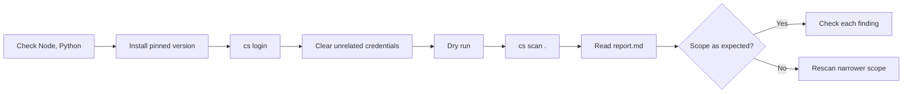

Want to check your code for vulnerabilities without setting up a security platform? OpenAI's Codex Security provides a command-line tool, `cs`, for scanning your own repository. Here's how to prepare your first local scan and use a sample report to check its scope and findings.

> The steps follow the npm-v0.10.1 [README](https://github.com/openai/codex-security/blob/npm-v0.10.1/README.md) and [CLI reference](https://github.com/openai/codex-security/blob/npm-v0.10.1/sdk/typescript/docs/cli.md) of [openai/codex-security](https://github.com/openai/codex-security), plus the official [CLI quickstart](https://learn.chatgpt.com/docs/security/cli), checked on 2026-11-24. The tool changes quickly, so trust `cs scan --help` from your installed version for options.
{: .prompt-info }

## Codex Security finds vulnerabilities, but it isn't a security audit

Codex Security is OpenAI's official vulnerability scanner, open source on GitHub under Apache-2.0. You can use it in a Codex conversation, from a terminal, or in CI (checks that run automatically on every push). This post covers only the terminal CLI.

Per the README, a scan finds suspected vulnerabilities, validates them against the source, and saves a report and a set of findings. It can also generate and verify patches for findings, which this post doesn't cover.

I don't treat its results as a formal security audit or a penetration test. The official docs say so too: a completed scan doesn't mean every file was reviewed, and a report with no findings doesn't rule out vulnerabilities. I treat the report as a list of where to look first.

Here is the flow of a first scan:



## Before you scan: it runs with your permissions, and results contain source code

The Codex Security CLI starts under your local account. Per the [official quickstart](https://learn.chatgpt.com/docs/security/cli), it runs without prompting for approval. [SECURITY.md](https://github.com/openai/codex-security/blob/npm-v0.10.1/SECURITY.md) recommends scanning only repositories you trust and have permission to assess.

Check these before you start:

- **Scan processes inherit environment variables.** The docs warn that this includes unrelated API tokens and cloud credentials. Step 4 covers removing those variables before the scan.
- **A model analyzes your code.** OpenAI is the default model provider. You can switch to a provider such as Amazon Bedrock.
- **Reports and logs may contain sensitive information.** Reports include code excerpts and vulnerability details. Per the [official FAQ](https://learn.chatgpt.com/docs/security/cli/faq), `cs scans logs` displays unredacted logs that may contain source code or credentials. Review them before sharing.
- **Sign-in and cyber access are separate checks.** Per the README, some cybersecurity requests and protected findings require [Trusted Access for Cyber](https://chatgpt.com/cyber). A scan can be refused after a successful sign-in, as described in Step 4.

## Step 1: Check your Node.js and Python versions

The CLI needs Node.js 22.x from 22.13.0, or 24.x or 26.x, plus Python 3.10 or later. Check what you have:

```bash
node --version
python3 --version
```
{: .nolineno }

The package declares `^22.13.0 || ^24.0.0 || ^26.0.0`, so odd-numbered releases such as 23 and 25 aren't supported. On Python 3.10, also install `tomli`:

```bash
python3 -m pip install tomli
```
{: .nolineno }

## Step 2: Install the CLI and pin it to 0.10.1

Install globally with npm, with an explicit version:

```bash
npm install --global @openai/codex-security@0.10.1
```
{: .nolineno }

Check the version afterward. It should print `0.10.1`:

```bash
cs --version
```
{: .nolineno }

The install gives you two identical commands, `cs` and `codex-security`. If `cs` clashes with another command on your machine, use `codex-security`.

If you'd rather not install globally, or npm reports an `EEXIST` conflict, use npx. Replace `cs` in every later step with `npx @openai/codex-security@0.10.1`:

```bash
npx @openai/codex-security@0.10.1 --version
```
{: .nolineno }

To upgrade later, read the notes on [GitHub Releases](https://github.com/openai/codex-security/releases) first, then reinstall with the new version number. `cs update` also works, but it goes straight to the latest release.

## Step 3: Sign in to your ChatGPT account with cs login

**If the Codex CLI stores your ChatGPT sign-in in a file, give Codex Security its own sign-in session first.** Per the CLI reference, the first scan or status check may import the Codex sign-in. The two tools then share a single-use refresh token.

Once either tool uses that token, the other tool's next refresh can fail. Its status can still say you're signed in.

Signing in opens a browser, where you use your ChatGPT account. Then check the status:

```bash
cs login
cs login status
```
{: .nolineno }

On a remote machine without a browser, use device auth if your workspace allows it:

```bash
cs login --device-auth
```
{: .nolineno }

If your workspace disables device auth, follow the [SSH forwarding steps in the CLI reference](https://github.com/openai/codex-security/blob/npm-v0.10.1/sdk/typescript/docs/cli.md#remote-login-with-ssh-forwarding).

If Codex Security says the refresh token was already used, sign out and back in with this CLI.

```bash
cs logout
cs login
```
{: .nolineno }

## Step 4: Dry-run first, then scan for real

Check for unrelated credentials in the terminal you'll use for the scan. If your environment values are single-line, this command flags names to review. Skip the filter if you have multiline credentials, such as a PEM private key, because it can print parts of their values.

```bash
env | grep -iE 'token|secret|key|pass' | cut -d= -f1
```
{: .nolineno }

The filter also matches variable values, so some names may have nothing to do with credentials. After you identify the credentials your scan doesn't need, substitute their names in this `unset` example.

```bash
unset GITHUB_TOKEN AWS_ACCESS_KEY_ID AWS_SECRET_ACCESS_KEY
```
{: .nolineno }

`unset` removes the variables from the current shell and from the environment of scans you start afterward. Your shell configuration and other open terminals are unaffected.

Go to the root of your repo and do a dry run:

```bash
cd /path/to/your-repo
cs scan . --dry-run
```
{: .nolineno }

A dry run checks only local inputs: what to scan, which mode, and where results go. It doesn't start a scan, load credentials, or check Python. So a passing dry run doesn't prove that sign-in and the runtime will work.

`stateDirectory` in the dry-run output is the root for scan history and default artifacts, usually `~/.codex/state/plugins/codex-security`. To save this scan's results elsewhere, pass the same `--output-dir` to both the dry run and the real scan. Pick an empty directory outside the repository.

Try a mock scan to preview the report layout. It requires no sign-in, model calls, or source analysis, and its `[Mock]` findings are synthetic.

The docs recommend a separate, temporary state directory to keep mock results out of your real scan history.

```bash
CODEX_SECURITY_STATE_DIR="$(mktemp -d)" cs scan . --mock
```
{: .nolineno }

When you're ready, drop `--dry-run` and scan:

```bash
cs scan .
```
{: .nolineno }

When `OPENAI_API_KEY` or `CODEX_API_KEY` is set, the CLI reference says non-interactive and JSON scans prefer an API key. Interactive scans offer a choice when both an API key and a ChatGPT sign-in are available. To select ChatGPT explicitly, use this command in place of the previous one.

```bash
cs scan . --auth chatgpt
```
{: .nolineno }

In an interactive terminal, the scan shows a live dashboard. Press `d` for details. For plain progress lines instead, add `--headless`.

When allowance data is available for your ChatGPT account, progress shows the percentage used in each window. To set a stopping threshold based on estimated cost, give `--max-cost` a dollar amount.

```bash
cs scan . --max-cost 5
```
{: .nolineno }

The CLI estimates cost at the model's standard rates and stops after the estimate crosses the threshold. In-flight requests can push the estimate higher. ChatGPT account allowance is measured separately.

When the scan finishes, the terminal prints a summary. Here is the example from the official docs:

```text
  REPORT    /path/outside/repository/codex-security-results/report.md
  FINDINGS  2 (2 confirmed this scan; 0 previously found; 1 high, 1 medium)
  SCOPE     repository: .
  ELAPSED   42s
  RESULTS   /path/outside/repository/codex-security-results
```
{: .nolineno }

`REPORT` points to the report file, and `RESULTS` points to this scan's results directory. A completed scan exits with 0 by default, even if it reports findings. A configured severity threshold can produce exit code 1, while input or execution errors can produce 2.

I tried this twice with a ChatGPT Team account. Both runs exited with code 2 after the cybersecurity policy blocked them while building the threat model, which outlines plausible attack scenarios. The CLI showed this message.

```text
This content was flagged for possible cybersecurity risk. If this seems wrong, try rephrasing your request. If you’re doing authorized security work that requires more cyber permissive safeguards, apply for Daybreak access via https://platform.openai.com/settings/organization/status-and-access before retrying.
```
{: .nolineno }

That means OpenAI's cybersecurity policy blocked the request. Daybreak, named in the message, is a more permissive access program for authorized security work. Without it, narrowing the scan scope may not help, so apply through [Trusted Access for Cyber](https://chatgpt.com/cyber) first.

Per the CLI reference, once you have access, add `--codex daybreak=true` to your scans, because the toggle is off by default:

```bash
cs scan . --codex daybreak=true
```
{: .nolineno }

## Step 5: Read the report's scope before its findings

These three files in the results directory matter most:

| File | What it's for |
| --- | --- |
| `report.md` | The human-readable report, covering scope and each finding |
| `findings.json` | Location and evidence for each finding, for tools to process |
| `scan-manifest.json` | Scan status, target, and scope; `scan.scope` records included and excluded paths |

A scan also attempts to write `exports/results.sarif`, a standard format that GitHub and other platforms can read. The scan can complete even if this optional export fails.

My test runs didn't produce a real report. The section descriptions below come from the official docs and the mock scan's `report.md`.

1. **Scope** records the target, commit (Revision), included and excluded paths, and Limitations and exclusions.
2. **Scan Summary** gives the outcome, finding count, and breakdown by severity and confidence.
3. **Threat Model** summarizes the threat model the scan used.
4. **Findings** lists each finding's severity and confidence, followed by a detailed write-up.

I start with Scope and check that the repo, commit, and excluded paths match what I intended to scan. Then I read Limitations and exclusions for coverage limits and work that still needs review.

Severity describes the potential impact of a vulnerability. Confidence describes how strongly the available evidence supports the finding. The report uses three confidence levels.

| Confidence | Meaning |
| --- | --- |
| high | Direct evidence supports it, with no material unresolved blocker |
| medium | Evidence suggests a plausible issue, but runtime or reachability proof is still missing |
| low | Evidence is incomplete; kept only for follow-up |

Each finding's write-up runs in sections, from Summary and Root Cause through to Remediation. The official quickstart suggests checking each finding for:

- Where the affected code is.
- What an attacker needs first.
- What the validation evidence is.
- What remains uncertain.

These findings come from source analysis, and they don't necessarily include a successful runtime reproduction. The docs advise picking a finding to fix only after its evidence supports the claimed issue.

Use the scan status to decide whether to review the report, investigate gaps, or diagnose a failed run.

| Situation | Next step |
| --- | --- |
| The scan finished and the scope is what you wanted | Check each finding, and note the limitations the report lists |
| An important directory or related question still needs review | Check whether the gap is scope, access, or context before deciding to rescan the relevant path |
| The scan failed or was canceled | Use `cs scans logs` with that run's scan ID, then address the cause before retrying |

Per the CLI reference, repeating the same scan may leave the same gaps. If a path was left out, use `--path` as shown in the section on narrowing scope to target that directory.

## Step 6: Find past results with cs scans show

Run this in the same repo with the same state directory to see the latest completed scan. Per the CLI reference, `cs scans logs` defaults to the latest run, which can include a failed or active scan. Pass the same scan ID to both commands to inspect one run.

```bash
cs scans show
```
{: .nolineno }

The `artifacts` section gives paths to the report, result files, and available exports. Use `cs scans list` for this repo's scan history and `cs findings list` for open findings across scans.

```bash
cs scans list
cs findings list
```
{: .nolineno }

`cs findings list` shows an occurrence ID for each open finding. When you've confirmed a finding is a false positive, record why with that ID:

```bash
cs findings false-positive OCCURRENCE_ID --reason "The framework escapes this input before it reaches the query"
```
{: .nolineno }

Later scans of the same repo receive that reason as context. Per the official FAQ, they still check the current code independently and don't skip a whole class of issues.

AI scans can return different results from run to run. To compare two scans, use `cs scans compare`, which defaults to the latest two completed scans:

```bash
cs scans compare
```
{: .nolineno }

## Narrow the scope: scan selected directories, or only your changes

For a large repo, or when you only care about one part, use these options:

```bash
# Scan only src and tests
cs scan . --path src --path tests

# Exclude the examples directory
cs scan . --exclude-path examples/

# Scan only committed changes from origin/main to HEAD
cs scan . --diff origin/main

# Give a Standard scan about 15 minutes of investigation time
cs scan . --max-time 15
```
{: .nolineno }

- **`--exclude-path` wins over `--path`.** Excluded files may still be read as context, but findings located entirely in excluded paths are removed from the results.
- **`--diff` needs a clean, full checkout.** You must be on the commit you're scanning, and you need to commit or stash local changes first. To scan uncommitted changes, use `--working-tree` instead.
- **`--max-time` is in minutes.** In Standard mode it's advisory: at the deadline the scan stops starting new investigations, and writing the report can take a little longer.

`--mode deep` runs Standard scans repeatedly in batches, then merges and deduplicates their findings. It costs more time and allowance. I suggest starting with the default Standard mode, then deciding on deep after you've read a report.

## Add it to CI: use an API key and the official GitHub Action

For an unattended CI scan with the CLI, set `OPENAI_API_KEY` or `CODEX_API_KEY` in the scan step's environment. Per the official CLI reference, expose the key only to that step in a trusted workflow.

There's also an official GitHub Action. Per the README, store an OpenAI API key as the repository secret `CODEX_SECURITY_API_KEY`, then copy the [weekly workflow example](https://github.com/openai/codex-security/blob/npm-v0.10.1/github-action/examples/repository.yml).

Replace `REPLACE_WITH_REVIEWED_COMMIT` with the commit SHA from an Action release that you've reviewed. For why you'd pin actions to a commit SHA, see [gh actions-lock Tutorial: Pin GitHub Actions Dependencies With a Lockfile](/posts/gh-actions-lock-workflow-lockfile/).

The example sets an estimated cost threshold of $5 per scan. It reports findings by default, and execution errors can still fail the job.

To make high or critical findings fail CI as well, use `--fail-on-severity high` with the CLI. In the Action, set `fail-on-severity` to `high`.

## Conclusion

I suggest starting with a repo you know well and the default Standard mode. Pick one well-supported finding and check it against your code before deciding on a fix.

## Further Reading

- [openai/codex-security](https://github.com/openai/codex-security): source code, README, and release notes.
- [Codex Security CLI quickstart](https://learn.chatgpt.com/docs/security/cli): the official first-scan tutorial.
- [Codex Security CLI FAQ](https://learn.chatgpt.com/docs/security/cli/faq): false positives, varying results across scans, cost limits, and more.
- [OWASP Agentic Top 10 Checklist: Audit Your AI Workflow](/posts/owasp-agentic-top-10-ai-workflow-checklist/): a ten-question self-check for your coding agent, MCP, and CI.
- [Claude Code Sandbox Setup: Keep SSH Keys and Tokens Out](/posts/claude-code-sandbox-setup/): keep the commands an AI runs away from your keys and tokens.
- [Automating PR Review With GitHub Actions and an AI Agent: This Site as an Example](/posts/github-actions-ai-agent-pr-review/): a real example of Codex reviewing PRs in CI.
- [gh actions-lock Tutorial: Pin GitHub Actions Dependencies With a Lockfile](/posts/gh-actions-lock-workflow-lockfile/): lock the actions your workflows use to exact commits.
