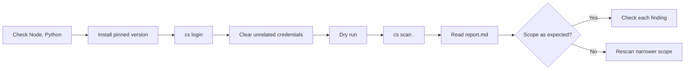

If you want to find vulnerabilities in your own code without setting up a whole security platform, try OpenAI's Codex Security. You run its command-line tool, `cs`, inside your repository. This post covers installing it and running a first scan, then uses a sample report to show how to check the scope and findings.

> The steps follow the npm-v0.10.1 [README](https://github.com/openai/codex-security/blob/npm-v0.10.1/README.md) and [CLI reference](https://github.com/openai/codex-security/blob/npm-v0.10.1/sdk/typescript/docs/cli.md) of [openai/codex-security](https://github.com/openai/codex-security), plus the official [CLI quickstart](https://learn.chatgpt.com/docs/security/cli), checked on 2026-11-24. The tool changes quickly, so trust `cs scan --help` from your installed version for options.
{: .prompt-info }

## Codex Security finds vulnerabilities, but it isn't a security audit

Codex Security is OpenAI's official vulnerability scanner, open source on GitHub under Apache-2.0. You can use it in a Codex conversation, from a terminal, or in CI (checks that run automatically on every push). This post covers only the terminal CLI.

Per the README, a scan finds suspected vulnerabilities, validates them against the source, and saves a report and a set of findings. It can also generate and verify patches for findings, which this post doesn't cover.

I don't treat its results as a formal security audit or a penetration test. The official docs say so too: a completed scan doesn't mean every file was reviewed, and a report with no findings doesn't rule out vulnerabilities. I treat the report as a list of where to look first.

Here is the flow of a first scan:



## Before you scan: it runs with your permissions, and results contain source code

The Codex Security CLI runs as your local user. Per the [official quickstart](https://learn.chatgpt.com/docs/security/cli), it doesn't stop to ask for approval during a scan. [SECURITY.md](https://github.com/openai/codex-security/blob/npm-v0.10.1/SECURITY.md) recommends scanning only repositories you trust and have permission to assess.

Check these before you start:

- **Scan processes inherit environment variables.** The docs warn that this includes unrelated API tokens and cloud credentials. Step 4 covers removing those variables before the scan.
- **A model analyzes your code.** OpenAI is the default model provider. You can switch to a provider such as Amazon Bedrock.
- **Reports and logs may contain sensitive information.** Reports include code excerpts and vulnerability details. Per the [official FAQ](https://learn.chatgpt.com/docs/security/cli/faq), `cs scans logs` displays unredacted logs that may contain source code or credentials. Review them before sharing.
- **Signing in doesn't mean you can scan.** Per the README, some cybersecurity requests and protected findings require [Trusted Access for Cyber](https://chatgpt.com/cyber). Without it, a scan can be refused. Step 4 covers what to do.

## Step 1: Check your Node.js and Python versions

The CLI supports Node.js 22.x from 22.13.0, plus 24.x and 26.x. Odd-numbered releases such as 23 and 25 aren't supported. It also needs Python 3.10 or later. Check what you have:

```bash
node --version
python3 --version
```
{: .nolineno }

On Python 3.10, also install `tomli`:

```bash
python3 -m pip install tomli
```
{: .nolineno }

## Step 2: Install the CLI and pin it to 0.10.1

Install globally with npm and an explicit version, so the options and output match this post:

```bash
npm install --global @openai/codex-security@0.10.1
```
{: .nolineno }

Check the version afterward. It should print `0.10.1`:

```bash
cs --version
```
{: .nolineno }

The install gives you two identical commands, `cs` and `codex-security`. If `cs` clashes with another command on your machine, use `codex-security`.

If you'd rather not install globally, or npm reports an `EEXIST` conflict, use npx and replace `cs` in every later step with `npx @openai/codex-security@0.10.1`. For example, to check the version:

```bash
npx @openai/codex-security@0.10.1 --version
```
{: .nolineno }

To upgrade later, read the notes on [GitHub Releases](https://github.com/openai/codex-security/releases) first, then reinstall with the new version number. `cs update` also works, but it goes straight to the latest release.

## Step 3: Sign in to your ChatGPT account with cs login

Before your first scan, run `cs login` and sign in with your ChatGPT account in the browser it opens. Then check the status:

```bash
cs login
cs login status
```
{: .nolineno }

**If you also use the Codex CLI and it stores its sign-in in a file, don't skip this step.** Per the CLI reference, when Codex Security has no sign-in of its own, a scan or status check imports the Codex sign-in. The two tools then share a single-use refresh token.

Once either tool refreshes that token, the other tool's next refresh can fail, even while its status says you're signed in.

On a remote machine without a browser, use device auth if your ChatGPT workspace allows it:

```bash
cs login --device-auth
```
{: .nolineno }

If your workspace disables device auth, follow the [SSH forwarding steps in the CLI reference](https://github.com/openai/codex-security/blob/npm-v0.10.1/sdk/typescript/docs/cli.md#remote-login-with-ssh-forwarding).

If Codex Security says the refresh token was already used, sign out and back in:

```bash
cs logout
cs login
```
{: .nolineno }

If the Codex CLI or app reports that error instead, sign out and back in there.

## Step 4: Clear unrelated credentials, dry-run, then scan

First, find credentials the scan doesn't need in the terminal you'll scan from. If any environment value spans multiple lines, such as a PEM private key, don't use the filter below, because it can print parts of that value. Otherwise, use it to list the names of likely credentials:

```bash
env | grep -iE 'token|secret|key|pass' | cut -d= -f1
```
{: .nolineno }

The filter also matches variable values, so some names may have nothing to do with credentials. After you identify the credentials your scan doesn't need, remove them with `unset`. The names below are examples, so replace them with the ones you found:

```bash
unset GITHUB_TOKEN AWS_ACCESS_KEY_ID AWS_SECRET_ACCESS_KEY
```
{: .nolineno }

`unset` affects only the current terminal, so scans you start from it won't inherit these variables. Your shell configuration and other open terminals are unaffected.

Go to the root of your repo and do a dry run:

```bash
cd /path/to/your-repo
cs scan . --dry-run
```
{: .nolineno }

A dry run checks only this scan's settings, such as what to scan, which mode (Standard by default), and where results go. It doesn't start a scan, load credentials, or check Python. So a passing dry run doesn't prove that sign-in and the runtime will work.

`stateDirectory` in the dry-run output is where scan history and default results go, usually `~/.codex/state/plugins/codex-security`. To save this scan's results in an empty directory outside the repository, pass the same `--output-dir` to both the dry run and the real scan.

To see what a report looks like first, run a mock scan. It needs no sign-in, makes no model calls, and analyzes no code, and its `[Mock]` findings are synthetic. The docs recommend giving mock scans a separate, temporary state directory so they stay out of your real scan history:

```bash
CODEX_SECURITY_STATE_DIR="$(mktemp -d)" cs scan . --mock
```
{: .nolineno }

If the dry-run settings look right, drop `--dry-run` and scan:

```bash
cs scan .
```
{: .nolineno }

The CLI reference says that when `OPENAI_API_KEY` or `CODEX_API_KEY` is set, non-interactive and JSON scans prefer that API key. Interactive scans let you choose between the API key and your ChatGPT sign-in. To always use your ChatGPT account, run this instead:

```bash
cs scan . --auth chatgpt
```
{: .nolineno }

In an interactive terminal, the scan shows a live dashboard. Press `d` for details. For plain progress lines instead, add `--headless`.

With a ChatGPT sign-in, if the CLI gets allowance data, progress shows the percentage used in each allowance window. To cap the cost of a single scan, give `--max-cost` a dollar amount:

```bash
cs scan . --max-cost 5
```
{: .nolineno }

The CLI estimates cost at the model's standard rates and stops the scan once the estimate passes the amount you set. Requests already in flight still finish, so the final cost can go over the limit. ChatGPT subscription allowance isn't part of the estimate.

When the scan finishes, the terminal prints a summary. Here is the example from the official docs:

```text
  REPORT    /path/outside/repository/codex-security-results/report.md
  FINDINGS  2 (2 confirmed this scan; 0 previously found; 1 high, 1 medium)
  SCOPE     repository: .
  ELAPSED   42s
  RESULTS   /path/outside/repository/codex-security-results
```
{: .nolineno }

`REPORT` is the report file, and `RESULTS` is this scan's results directory. A completed scan exits with 0 by default, even with findings, and input or execution errors exit with 2. With `--fail-on-severity high`, high or critical findings make it exit with 1.

A scan doesn't always get this far, though. It starts by outlining plausible attack scenarios, called the threat model. I tried it twice with a ChatGPT Team account, and both runs were blocked at that step with exit code 2. The CLI showed this message:

```text
This content was flagged for possible cybersecurity risk. If this seems wrong, try rephrasing your request. If you’re doing authorized security work that requires more cyber permissive safeguards, apply for Daybreak access via https://platform.openai.com/settings/organization/status-and-access before retrying.
```
{: .nolineno }

That means OpenAI's cybersecurity policy blocked the request. Daybreak, named in the message, is a more permissive access program for authorized security work.

Without that access, narrowing the scope doesn't help. My first run scanned the whole repo and the second only the code directories, and both were blocked. The scan log (`cs scans logs`) also said `Daybreak access: status=not_granted`.

Per the README, apply for [Trusted Access for Cyber](https://chatgpt.com/cyber) first. The GitHub Action docs add that if you scan with an API key, you also enable the program for the API project once your organization is approved, and use a key from that project. Approval reduces refusals, but it doesn't guarantee that every scan completes.

Per the CLI reference, once you have access, add `--codex daybreak=true` to your scans. The toggle is off by default, and turning it on doesn't grant access by itself:

```bash
cs scan . --codex daybreak=true
```
{: .nolineno }

## Step 5: Read the report's scope before its findings

These three files in the results directory matter most:

| File | What it's for |
| --- | --- |
| `report.md` | The human-readable report, covering scope and each finding |
| `findings.json` | Location and evidence for each finding, for tools to process |
| `scan-manifest.json` | Scan status, target, and scope; `scan.scope` records included and excluded paths |

A scan also tries to write `exports/results.sarif`. SARIF is a standard format for code scanning results, and GitHub and other platforms can read it. This export is optional, so a missing file doesn't mean the scan failed.

The section descriptions below, from top to bottom, come from the official docs and the mock scan's `report.md`:

1. **Scope** records the target, commit (Revision), included and excluded paths, and Limitations and exclusions.
2. **Scan Summary** gives the outcome, finding count, and breakdown by severity and confidence.
3. **Threat Model** summarizes the threat model the scan used.
4. **Findings** lists each finding's severity and confidence, followed by a detailed write-up.

I start with Scope and check that the repo, commit, and excluded paths match what I intended to scan. Then I read Limitations and exclusions to see what wasn't scanned and what still needs review.

Severity is how much damage a vulnerability could do if exploited. Confidence is how well the available evidence supports the finding, and the report uses three levels:

| Confidence | Meaning |
| --- | --- |
| high | Direct evidence supports it, with no material unresolved blocker |
| medium | Evidence suggests a plausible issue, but runtime or reachability proof is still missing |
| low | Evidence is incomplete, so it's kept for follow-up |

Each finding's write-up has sections such as Summary, Root Cause, and Remediation. The official quickstart suggests checking each finding for:

- Where the affected code is.
- What an attacker needs first.
- What the validation evidence is.
- What remains uncertain.

These findings come from reading the source, and they don't necessarily include a runtime reproduction. The docs advise fixing a finding only after the evidence shows the issue is real.

Then pick the next step based on how the scan went:

| Situation | Next step |
| --- | --- |
| The scan finished and the scope is what you wanted | Check each finding, and note the limitations the report lists |
| An important directory wasn't scanned, or the report lists open questions | Work out whether scope, access, or context is missing, then decide whether to rescan just those directories |
| The scan failed or was canceled | Use `cs scans logs` to find why that scan didn't finish, fix the cause, then rerun it |

Per the CLI reference, running the same scan again doesn't guarantee it fills the gaps. If you left out a path, use `--path`, described in the section on narrowing scope, to target that directory.

## Step 6: Find past results with cs scans show

Run this in the same repo with the same state directory to see the latest completed scan:

```bash
cs scans show
```
{: .nolineno }

The `artifacts` section lists paths to the report, result files, and exports. Per the CLI reference, `cs scans logs` instead defaults to the latest run, which can be a failed or running scan. The two commands may show different runs, so pass a scan ID to both when you compare them:

```bash
cs scans show SCAN_ID
cs scans logs SCAN_ID
```
{: .nolineno }

Use `cs scans list` to find scan IDs and this repo's scan history. Use `cs findings list` for findings that are still open across scans:

```bash
cs scans list
cs findings list
```
{: .nolineno }

`cs findings list` shows an occurrence ID for each open finding. When you've confirmed a finding is a false positive, record why with that ID:

```bash
cs findings false-positive OCCURRENCE_ID --reason "The framework escapes this input before it reaches the query"
```
{: .nolineno }

Later scans of the same repo use that reason as context. Per the official FAQ, they still check the current code independently and don't skip a whole class of issues.

Two scans of the same repo can return different results. To compare them, use `cs scans compare`, which defaults to the latest two completed scans:

```bash
cs scans compare
```
{: .nolineno }

## Narrow the scope: scan selected directories, or only your changes

For a large repo, or when you only care about one part, use these options:

```bash
# Scan only src and tests
cs scan . --path src --path tests

# Exclude the examples directory
cs scan . --exclude-path examples/

# Scan only committed changes from origin/main to HEAD
cs scan . --diff origin/main

# Give a Standard scan about 15 minutes of investigation time
cs scan . --max-time 15
```
{: .nolineno }

- **`--exclude-path` wins over `--path`.** Excluded files may still be read as context, but findings located entirely in excluded paths are removed from the results.
- **`--diff` needs a clean, full checkout.** You must be on the commit you're scanning, and you need to commit or stash local changes first. To scan uncommitted changes, use `--working-tree` instead.
- **`--max-time` is in minutes.** In Standard mode it's advisory: at the deadline the scan stops starting new investigations, and writing the report can take a little longer.

`--mode deep` runs Standard scans repeatedly in batches, then merges and deduplicates their findings. It costs more time and allowance. I suggest starting with the default Standard mode, then deciding on deep after you've read a report.

## Add it to CI: use an API key and the official GitHub Action

CI has no browser to sign in with, so use an API key instead. Set `OPENAI_API_KEY` or `CODEX_API_KEY` in the scan step's environment. Per the official CLI reference, expose the key only to that step in a trusted workflow.

There's also an official GitHub Action. Per the README, store an OpenAI API key as the repository secret `CODEX_SECURITY_API_KEY`, then copy the [weekly workflow example](https://github.com/openai/codex-security/blob/npm-v0.10.1/github-action/examples/repository.yml).

Replace `REPLACE_WITH_REVIEWED_COMMIT` with the commit SHA listed in an Action release that you've reviewed. For why you'd pin actions to a commit SHA, see [gh actions-lock Tutorial: Pin GitHub Actions Dependencies With a Lockfile](/posts/gh-actions-lock-workflow-lockfile/).

The example sets an estimated cost limit of $5 per scan. By default, findings are only reported and don't fail the job. The job fails only when the scan itself errors, and a policy block like the one in Step 4 counts.

To make CI fail on high or critical findings too, add `--fail-on-severity high` from Step 4 to the CLI. In the Action, set `fail-on-severity` to `high`.

## Conclusion

I suggest starting with a repo you know well, because you need to know the code to tell which findings are real. Pick the best-supported finding and check it against your code before you fix anything.

## Further Reading

- [openai/codex-security](https://github.com/openai/codex-security): source code, README, and release notes.
- [Codex Security CLI quickstart](https://learn.chatgpt.com/docs/security/cli): the official first-scan tutorial.
- [Codex Security CLI FAQ](https://learn.chatgpt.com/docs/security/cli/faq): false positives, varying results across scans, cost limits, and more.
- [OWASP Agentic Top 10 Checklist: Audit Your AI Workflow](/posts/owasp-agentic-top-10-ai-workflow-checklist/): a ten-question self-check for your coding agent, MCP, and CI.
- [Claude Code Sandbox Setup: Keep SSH Keys and Tokens Out](/posts/claude-code-sandbox-setup/): keep the commands an AI runs away from your keys and tokens.
- [Automating PR Review With GitHub Actions and an AI Agent: This Site as an Example](/posts/github-actions-ai-agent-pr-review/): a real example of Codex reviewing PRs in CI.
- [gh actions-lock Tutorial: Pin GitHub Actions Dependencies With a Lockfile](/posts/gh-actions-lock-workflow-lockfile/): lock the actions your workflows use to exact commits.
