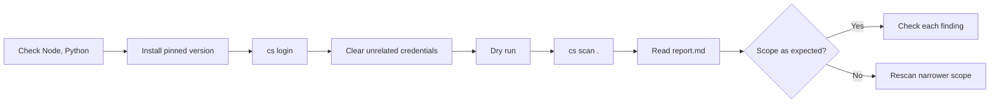

Want to know whether your code has vulnerabilities, without setting up a whole security platform first? OpenAI's Codex Security ships a command-line tool, `cs`. Run one command in your repo, and a model reads the code, validates suspected vulnerabilities, and saves a Markdown report. This post walks you through your first scan on your own machine and how to read that report.

> The steps follow the npm-v0.10.1 [README](https://github.com/openai/codex-security/blob/npm-v0.10.1/README.md) and [CLI reference](https://github.com/openai/codex-security/blob/npm-v0.10.1/sdk/typescript/docs/cli.md) of [openai/codex-security](https://github.com/openai/codex-security), plus the official [CLI quickstart](https://learn.chatgpt.com/docs/security/cli), checked on 2026-11-24. The tool changes quickly, so trust `cs scan --help` from your installed version for options.
{: .prompt-info }

## Codex Security finds vulnerabilities, but it isn't a security audit

Codex Security is OpenAI's official vulnerability scanner, open source on GitHub under Apache-2.0. You can use it in a Codex conversation, from a terminal, or in CI (checks that run automatically on every push). This post covers only the terminal CLI.

Per the README, a scan finds suspected vulnerabilities, validates them against the source, and saves a report and a set of findings. It can also generate and verify patches for findings, which this post doesn't cover.

I don't treat its results as a formal security audit or a penetration test. The official docs say so too: a completed scan doesn't mean every file was reviewed, and a report with no findings doesn't rule out vulnerabilities. I treat the report as a list of where to look first.

Here is the flow of a first scan:



## Before you scan: it runs with your permissions, and results contain source code

Codex Security runs under your local account and can do whatever you can. Per the [official quickstart](https://learn.chatgpt.com/docs/security/cli), the CLI doesn't pause to ask for approval. That's why [SECURITY.md](https://github.com/openai/codex-security/blob/npm-v0.10.1/SECURITY.md) says to scan only repositories you trust and have permission to assess.

Check these before you start:

- **Scan processes inherit your environment.** The docs warn this includes unrelated API tokens and cloud credentials, and say to remove them first.
- **Your code goes to a model for analysis.** The default provider is OpenAI. You can switch to Amazon Bedrock and other providers.
- **Results contain source code.** The report includes code excerpts and vulnerability details. Per the [official FAQ](https://learn.chatgpt.com/docs/security/cli/faq), logs from `cs scans logs` aren't redacted either. Review them before you share.
- **Your account may need cyber access first.** Per the README, some cybersecurity requests and protected findings require [Trusted Access for Cyber](https://chatgpt.com/cyber). Without it, a scan may be refused right at the start. Step 4 covers what to do.

To find environment variables in your current terminal that look like credentials, print only the names, not the values:

```bash
env | grep -iE 'token|secret|key|pass' | cut -d= -f1
```
{: .nolineno }

Clear the ones the scan doesn't need in this terminal. The names below are examples; use the ones you found:

```bash
unset GITHUB_TOKEN AWS_ACCESS_KEY_ID AWS_SECRET_ACCESS_KEY
```
{: .nolineno }

`unset` affects only the current terminal, and closing the window undoes it. `OPENAI_API_KEY` and `CODEX_API_KEY` change how you sign in; Step 3 covers them.

## Step 1: Check your Node.js and Python versions

The CLI needs Node.js 22.x from 22.13.0, or 24.x or 26.x, plus Python 3.10 or later. Check what you have:

```bash
node --version
python3 --version
```
{: .nolineno }

The package declares `^22.13.0 || ^24.0.0 || ^26.0.0`, so odd-numbered releases such as 23 and 25 aren't supported. On Python 3.10, also install `tomli`:

```bash
python3 -m pip install tomli
```
{: .nolineno }

## Step 2: Install the CLI and pin it to 0.10.1

Install globally with npm, with an explicit version:

```bash
npm install --global @openai/codex-security@0.10.1
```
{: .nolineno }

Check the version afterward. It should print `0.10.1`:

```bash
cs --version
```
{: .nolineno }

The install gives you two identical commands, `cs` and `codex-security`. If `cs` clashes with another command on your machine, use `codex-security`.

If you'd rather not install globally, or npm reports an `EEXIST` conflict, use npx. Replace `cs` in every later step with `npx @openai/codex-security@0.10.1`:

```bash
npx @openai/codex-security@0.10.1 --version
```
{: .nolineno }

To upgrade later, read the notes on [GitHub Releases](https://github.com/openai/codex-security/releases) first, then reinstall with the new version number. `cs update` also works, but it goes straight to the latest release.

## Step 3: Sign in to your ChatGPT account with cs login

**If you also use the Codex CLI, run `cs login` before your first scan or status check.** Per the CLI reference, Codex Security imports Codex's file-based sign-in when it has none of its own. The two clients then share a single-use refresh token.

The result: when one client renews the token, the other's next renewal can fail. Its status may still report that it's signed in.

Signing in opens a browser, where you use your ChatGPT account. Then check the status:

```bash
cs login
cs login status
```
{: .nolineno }

On a remote machine without a browser, use device auth if your workspace allows it:

```bash
cs login --device-auth
```
{: .nolineno }

If your workspace disables device auth, follow the [SSH forwarding steps in the CLI reference](https://github.com/openai/codex-security/blob/npm-v0.10.1/sdk/typescript/docs/cli.md#remote-login-with-ssh-forwarding).

If you see an error saying the refresh token was already used, sign out and back in:

```bash
cs logout
cs login
```
{: .nolineno }

When `OPENAI_API_KEY` or `CODEX_API_KEY` is set, non-interactive scans and scans with JSON output use that key by default. Interactive scans ask you which to use. To always use your ChatGPT sign-in, add `--auth chatgpt`:

```bash
cs scan . --auth chatgpt
```
{: .nolineno }

## Step 4: Dry-run first, then scan for real

Go to the root of your repo and do a dry run:

```bash
cd /path/to/your-repo
cs scan . --dry-run
```
{: .nolineno }

A dry run checks only local inputs: what to scan, which mode, and where results go. It doesn't start a scan, load credentials, or check Python. So a passing dry run doesn't prove that sign-in and the runtime will work.

`stateDirectory` in the output is where results are saved, by default `~/.codex/state/plugins/codex-security`. It sits outside your repo, so you won't commit results by accident. To save them elsewhere, add `--output-dir` with an empty directory outside the repo.

To see what a report looks like before spending any allowance, run a mock scan. It calls no model, analyzes no code, and needs no sign-in. It only creates made-up findings with `[Mock]` in their titles. Mock results go into scan history like real ones, so the docs suggest a separate, temporary state directory to keep them apart:

```bash
CODEX_SECURITY_STATE_DIR="$(mktemp -d)" cs scan . --mock
```
{: .nolineno }

When you're ready, drop `--dry-run` and scan:

```bash
cs scan .
```
{: .nolineno }

In an interactive terminal, the scan shows a live dashboard. Press `d` for details. For plain progress lines instead, add `--headless`.

With a ChatGPT sign-in, progress shows the percentage of your account allowance used in each window. To limit what one scan spends, set a dollar amount with `--max-cost`:

```bash
cs scan . --max-cost 5
```
{: .nolineno }

The amount is estimated at standard API rates, and the scan stops once the estimate goes over. It isn't a hard cap: requests already in flight can push actual usage past it.

When the scan finishes, the terminal prints a summary. Here is the example from the official docs:

```text
  REPORT    /path/outside/repository/codex-security-results/report.md
  FINDINGS  2 (2 confirmed this scan; 0 previously found; 1 high, 1 medium)
  SCOPE     repository: .
  ELAPSED   42s
  RESULTS   /path/outside/repository/codex-security-results
```
{: .nolineno }

`REPORT` is the report path, and `RESULTS` is this scan's results directory. By default, the scan exits with 0 even when it reports findings. It exits with 2 only when the scan itself fails.

A scan can also exit with 2 while it's still building the threat model, with this message:

```text
This content was flagged for possible cybersecurity risk. If this seems wrong, try rephrasing your request. If you’re doing authorized security work that requires more cyber permissive safeguards, apply for Daybreak access via https://platform.openai.com/settings/organization/status-and-access before retrying.
```
{: .nolineno }

That means OpenAI's cybersecurity policy blocked the request. Daybreak, named in the message, is a more permissive access program for authorized security work. Without it, narrowing the scan scope may not help, so apply through [Trusted Access for Cyber](https://chatgpt.com/cyber) first.

Per the CLI reference, once you have access, add `--codex daybreak=true` to your scans, because the toggle is off by default:

```bash
cs scan . --codex daybreak=true
```
{: .nolineno }

## Step 5: Read the report's scope before its findings

These three files in the results directory matter most:

| File | What it's for |
| --- | --- |
| `report.md` | The human-readable report, covering scope and each finding |
| `findings.json` | Location and evidence for each finding, for tools to process |
| `scan-manifest.json` | Scan status, target, and scope; `scan.scope` records included and excluded paths |

There's also `exports/results.sarif`. SARIF is the standard format for code scanning results, which platforms such as GitHub can read.

Mock scans go through the normal reporting flow. From top to bottom, the `report.md` they produce has:

1. **Scope**: the target, the commit (Revision), included and excluded paths, and Limitations and exclusions.
2. **Scan Summary**: the outcome, the finding count, and the mix of severity and confidence.
3. **Threat Model**: a summary of the threat model the scan used. A threat model lays out who might attack what, and from where.
4. **Findings**: a table of all findings, each row with its Severity and Confidence, followed by a write-up for each finding.

I start with Scope. Only when the repo, commit, and excluded paths are right do the findings mean anything. Limitations and exclusions lists what this scan didn't look at.

Confidence has three levels, defined in the report:

| Confidence | Meaning |
| --- | --- |
| high | Direct evidence supports it, with no material unresolved blocker |
| medium | Evidence suggests a plausible issue, but runtime or reachability proof is still missing |
| low | Evidence is incomplete; kept only for follow-up |

Each finding's write-up runs in sections, from Summary and Root Cause through to Remediation. The official quickstart suggests checking each finding for:

- Where the affected code is.
- What an attacker needs first.
- What the validation evidence is.
- What remains uncertain.

These findings come from source analysis, and they don't necessarily include a successful runtime reproduction. The docs advise picking a finding to fix only after its evidence supports the claimed issue.

After reading the scope and findings, pick the next step:

| Situation | Next step |
| --- | --- |
| The scan finished and the scope is what you wanted | Check each finding, and note the limitations the report lists |
| An important directory or question wasn't covered | Rescan that directory with `--path`; see the "narrow the scope" section below |
| The scan failed or was canceled | Find the cause with `cs scans logs`, fix it, then run again |

Per the CLI reference, repeating the same scan doesn't guarantee it will cover what it missed. If missing access or context is the cause, fix that first.

## Step 6: Find past results with cs scans show

Run this in the same repo to show its latest completed scan:

```bash
cs scans show
```
{: .nolineno }

The `artifacts` section of the output lists full paths to `report.md`, `findings.json`, `scan-manifest.json`, and the SARIF file. To see every scan of the repo, or the open findings across scans:

```bash
cs scans list
cs findings list
```
{: .nolineno }

`cs findings list` shows an occurrence ID for each open finding. When you've confirmed a finding is a false positive, record why with that ID:

```bash
cs findings false-positive OCCURRENCE_ID --reason "The framework escapes this input before it reaches the query"
```
{: .nolineno }

Later scans of the same repo receive that reason as context. Per the official FAQ, they still check the current code independently and don't skip a whole class of issues.

AI scans can return different results from run to run. To compare two scans, use `cs scans compare`, which defaults to the latest two completed scans:

```bash
cs scans compare
```
{: .nolineno }

## Narrow the scope: scan selected directories, or only your changes

For a large repo, or when you only care about one part, use these options:

```bash
# Scan only src and tests
cs scan . --path src --path tests

# Exclude the examples directory
cs scan . --exclude-path examples/

# Scan only committed changes from origin/main to HEAD
cs scan . --diff origin/main

# Give a Standard scan about 15 minutes of investigation time
cs scan . --max-time 15
```
{: .nolineno }

- **`--exclude-path` wins over `--path`.** Excluded files may still be read as context, but findings located entirely in excluded paths are removed from the results.
- **`--diff` needs a clean, full checkout.** You must be on the commit you're scanning, and you need to commit or stash local changes first. To scan uncommitted changes, use `--working-tree` instead.
- **`--max-time` is in minutes.** In Standard mode it's advisory: at the deadline the scan stops starting new investigations, and writing the report can take a little longer.

`--mode deep` runs Standard scans repeatedly in batches, then merges and deduplicates their findings. It costs more time and allowance. I suggest starting with the default Standard mode, then deciding on deep after you've read a report.

## Add it to CI: use an API key and the official GitHub Action

CI has no browser to sign in with, so use an API key: set `OPENAI_API_KEY` or `CODEX_API_KEY` in the scan process's environment. Per the official CLI reference, give that key only to the scan step, and run it in a trusted workflow.

There's also an official GitHub Action. Per the README, store an OpenAI API key as the repository secret `CODEX_SECURITY_API_KEY`, then copy the [weekly workflow example](https://github.com/openai/codex-security/blob/npm-v0.10.1/github-action/examples/repository.yml).

Replace `REPLACE_WITH_REVIEWED_COMMIT` with the commit SHA from an Action release that you've reviewed. For why you'd pin actions to a commit SHA, see [gh actions-lock Tutorial: Pin GitHub Actions Dependencies With a Lockfile](/posts/gh-actions-lock-workflow-lockfile/).

The example sets an estimated $5 limit per scan and only reports findings, without failing the job. To fail CI on high or critical findings, add `--fail-on-severity high` to the CLI, or set the Action's `fail-on-severity` input.

## Conclusion

I suggest starting with a repo you know well and the default Standard mode. When you read the report, check Scope first, then the evidence for each finding. The report gives you leads: before you fix anything, confirm the issue really holds in your system.

## Further Reading

- [openai/codex-security](https://github.com/openai/codex-security): source code, README, and release notes.
- [Codex Security CLI quickstart](https://learn.chatgpt.com/docs/security/cli): the official first-scan tutorial.
- [Codex Security CLI FAQ](https://learn.chatgpt.com/docs/security/cli/faq): false positives, varying results across scans, cost limits, and more.
- [OWASP Agentic Top 10 Checklist: Audit Your AI Workflow](/posts/owasp-agentic-top-10-ai-workflow-checklist/): a ten-question self-check for your coding agent, MCP, and CI.
- [Claude Code Sandbox Setup: Keep SSH Keys and Tokens Out](/posts/claude-code-sandbox-setup/): keep the commands an AI runs away from your keys and tokens.
- [Automating PR Review With GitHub Actions and an AI Agent: This Site as an Example](/posts/github-actions-ai-agent-pr-review/): a real example of Codex reviewing PRs in CI.
- [gh actions-lock Tutorial: Pin GitHub Actions Dependencies With a Lockfile](/posts/gh-actions-lock-workflow-lockfile/): lock the actions your workflows use to exact commits.
