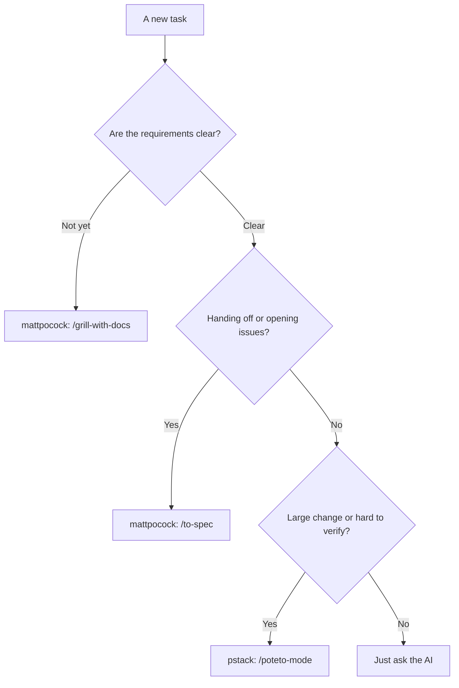

If you want an AI coding assistant to follow a fixed workflow, you'll likely run into two skill packs: mattpocock/skills and pstack. Both install into Claude Code, and I've written a full series on each. This post compares them from their source code, then suggests which one to install first based on the work in front of you.

> This comparison uses mattpocock/skills [`1.3.2`](https://github.com/mattpocock/skills/blob/d1478fcb140db0b93c0c8df17bcfd311844749d0/.claude-plugin/plugin.json#L3) and pstack [`0.15.48`](https://github.com/cursor/plugins/blob/9e278fe4d4ecd8bfe98b1b79bf4be662efb338cc/pstack/.cursor-plugin/plugin.json#L4), checked on 2026-11-24. The two series were written against the older `1.2.3` and `0.15.43`, so the numbers here follow the newer versions.
{: .prompt-info }

## The Biggest Difference Is Who Picks the Next Step

When you start with `/ask-matt`, you decide which skill to call next. When you start with `/poteto-mode`, pstack plans and runs the steps for your goal. You call both entry points manually.

- The mattpocock/skills entry point is `/ask-matt`. Its [`SKILL.md`](https://github.com/mattpocock/skills/blob/d1478fcb140db0b93c0c8df17bcfd311844749d0/skills/engineering/ask-matt/SKILL.md#L1-L9) describes it as a router over the other skills. You describe where you are, it suggests the next skill to call, and you call it.
- The pstack entry point is `/poteto-mode`. It matches the task to a playbook (a fixed set of steps written for one kind of task), copies the steps into a to-do list, and [starts working through them](https://github.com/cursor/plugins/blob/9e278fe4d4ecd8bfe98b1b79bf4be662efb338cc/pstack/skills/poteto-mode/SKILL.md#L108).

`/poteto-mode` reads the skills its playbook needs. It proceeds with reversible work and pauses before force-pushing a shared branch, deploying, or deleting data. [pstack autonomy rules](https://github.com/cursor/plugins/blob/9e278fe4d4ecd8bfe98b1b79bf4be662efb338cc/pstack/skills/poteto-mode/SKILL.md#L76-L78)

During an unattended run, pstack also hands back product decisions that need your judgment and blockers it can't resolve. [Autonomous run playbook](https://github.com/cursor/plugins/blob/9e278fe4d4ecd8bfe98b1b79bf4be662efb338cc/pstack/skills/poteto-mode/playbooks/autonomous-run.md#L3-L9)

## The Differences in One Table

| | mattpocock/skills | pstack |
| --- | --- | --- |
| Author | Matt Pocock | Lauren Tan (known online as poteto) |
| Where it lives | The author's own repo, [`mattpocock/skills`](https://github.com/mattpocock/skills), MIT license | Cursor's official plugin repo, [`cursor/plugins`](https://github.com/cursor/plugins/tree/9e278fe4d4ecd8bfe98b1b79bf4be662efb338cc/pstack), MIT license |
| Size | [27 skills](https://github.com/mattpocock/skills/blob/d1478fcb140db0b93c0c8df17bcfd311844749d0/.claude-plugin/plugin.json#L21-L49) in the official plugin | 59 skills (24 of them principles), plus 22 playbooks |
| Supported AI coding assistants | Plugins for Claude Code, Codex, and GitHub Copilot; Cursor and other tools install with `npx skills` | Cursor, and Claude Code through its plugin |
| Entry point | `/ask-matt` suggests the next skill | `/poteto-mode` picks a playbook and follows it |
| Who calls the other skills | You, following `/ask-matt`; the AI can also use 11 of them on its own | `/poteto-mode`, following the playbook; you can also call them directly |
| What first-time setup writes | `docs/agents/` in your repo, plus `AGENTS.md` or `CLAUDE.md` | A model config file in your user directory |
| Where work is recorded | Issues, a `GLOSSARY.md` glossary, decision records | Plan files, branches, and PRs |
| Which model it uses | Doesn't specify; the README says any model works | Set per role; reviews default to three panel seats |

In Claude Code, pstack skips steps that need Cursor Automations or need to start Bugbot. The review seat assigned to Gemini uses the current session model. [pstack's Claude Code compatibility notes](https://github.com/cursor/plugins/blob/9e278fe4d4ecd8bfe98b1b79bf4be662efb338cc/pstack/docs/harness/claude-code.md)

I got the numbers in the table by counting files in each repo at the versions above, so they differ from the two series.

The mattpocock/skills series says 25 skills. The newer version adds `implement-spec`, `pr`, and `retro`, and drops `resolving-merge-conflicts`. The pstack series says 58; `0.15.47` added `/reframe`.

## mattpocock/skills Keeps Decisions in the Repo

Most of what mattpocock/skills produces is files in your repo, so the next conversation or the next person can pick up from them. On first setup, `setup-matt-pocock-skills` [writes these](https://github.com/mattpocock/skills/blob/d1478fcb140db0b93c0c8df17bcfd311844749d0/skills/engineering/setup-matt-pocock-skills/SKILL.md#L69-L70):

- Three files under `docs/agents/` that record where issues live, what the triage labels are called, and where the domain docs are.
- An `## Agent skills` block in `AGENTS.md` or `CLAUDE.md`, so the AI reads it at the start of every session.

The later skills keep going in the same direction. Terms settled during a `grill-with-docs` interview go into `GLOSSARY.md`, and key decisions become ADRs (architecture decision records). `to-tickets` splits a spec into tickets (issues), each noting which others block it. For the full workflow, see [Part 2](/posts/mattpocock-skills-requirements-shared-language/) and [Part 3](/posts/mattpocock-skills-specs-work-breakdown/) of the mattpocock/skills series.

Once you have tickets, you can use `/implement-spec` to build the whole spec in one run. It uses ticket dependencies to decide which work can run in parallel and merges the results into one integration branch. [implement-spec steps](https://github.com/mattpocock/skills/blob/d1478fcb140db0b93c0c8df17bcfd311844749d0/skills/engineering/implement-spec/SKILL.md#L17-L33)

I think this pack fits best on projects with several maintainers, or where one feature takes several conversations to finish. The documents give whoever takes over a record of what the team decided.

## pstack Puts Its Effort Into Checks Before and After the Change

pstack's strength is understanding the code before changing it and proving the change works afterward. Its tools fall into roughly three stages:

- Understand and design: `/how` and `/why` read the code and its history, and `/architect` and `/arena` compare several designs ([Part 2](/posts/pstack-understand-design/)).
- Prove it works: `/interrogate` has several AIs look for holes in a change and keeps only the issues that reproduce. The verification skills turn manual checks into steps the AI can rerun ([Part 3](/posts/pstack-build-verify-merge/)).
- Run on its own: once you set permissions and a spending cap, it can finish a playbook while you're away ([Part 4](/posts/pstack-principles-customization/)).

pstack has tools for clarifying requirements too, but the results end up somewhere else. `/reframe` teaches you the expert vocabulary for the problem, and `/sharpen` digs deeper into the task; both end by rewriting your prompt for this session. Neither writes its conclusions into repo docs the way `grill-with-docs` does.

The cost is usage. pstack often sends out subagents, meaning it starts another AI to handle a subtask. Reviews and design comparisons default to [three panel seats](https://github.com/cursor/plugins/blob/9e278fe4d4ecd8bfe98b1b79bf4be662efb338cc/pstack/skills/poteto-mode/SKILL.md#L92) at once, each running its own subagent.

A few mattpocock/skills skills use subagents as well. [`code-review`](https://github.com/mattpocock/skills/blob/d1478fcb140db0b93c0c8df17bcfd311844749d0/skills/engineering/code-review/SKILL.md#L11), for example, splits the review between two subagents, but it doesn't pick models for you.

## You Can Install Both in the Same Claude Code

I have both installed in Claude Code. mattpocock/skills installs from the official Claude Code plugin marketplace. Run this in your terminal:

```bash
claude plugin install mattpocock-skills@claude-plugins-official
```

According to the [README](https://github.com/mattpocock/skills/blob/d1478fcb140db0b93c0c8df17bcfd311844749d0/README.md#L26), pick either the plugin or `npx skills`, not both, or every skill shows up twice.

For pstack, add Cursor's plugin repo first. Type this in Claude Code:

```text
/plugin marketplace add cursor/plugins
/plugin install pstack@cursor-plugins
```

Both packs have a `tdd` and a `teach`, but they don't overwrite each other. Claude Code puts the plugin name in front of each plugin command, so call them by the full name:

```text
/mattpocock-skills:tdd
/pstack:tdd
```

The same name doesn't mean the same approach. The mattpocock/skills [`tdd`](https://github.com/mattpocock/skills/blob/d1478fcb140db0b93c0c8df17bcfd311844749d0/skills/engineering/tdd/SKILL.md#L3) is a test-first red-green-refactor loop. The pstack [`tdd`](https://github.com/cursor/plugins/blob/9e278fe4d4ecd8bfe98b1b79bf4be662efb338cc/pstack/skills/tdd/SKILL.md#L3) only applies when you ask for it or when a cheap test is available.

I suggest choosing one workflow for each stage so whoever takes over knows which tool to use next.

Their update defaults differ too. The mattpocock/skills plugin [updates itself by default](https://github.com/mattpocock/skills/blob/d1478fcb140db0b93c0c8df17bcfd311844749d0/README.md#L35-L38). pstack comes from a third-party marketplace, so Claude Code [doesn't auto-update it by default](https://github.com/cursor/plugins/blob/9e278fe4d4ecd8bfe98b1b79bf4be662efb338cc/pstack/README.md#L28). To pin a pstack version, see [Part 1 of the pstack series](/posts/pstack-install-routing/).

## Choose Based on the Work in Front of You

Say you're adding an order CSV export to an admin dashboard. The team first needs to agree on which fields to export and who can download the file. You can use mattpocock/skills to discuss those questions and save the decisions in a spec for the next person. [Spec skill](https://github.com/mattpocock/skills/blob/d1478fcb140db0b93c0c8df17bcfd311844749d0/skills/engineering/to-spec/SKILL.md)

Once the spec and acceptance criteria are settled, you can hand the same task to pstack's feature playbook. It guides the design and implementation, verifies the export, and opens a PR. [Feature playbook](https://github.com/cursor/plugins/blob/9e278fe4d4ecd8bfe98b1b79bf4be662efb338cc/pstack/skills/poteto-mode/playbooks/feature.md)

If you want to install just one pack first, start with where your work is stuck.



Three situations settle the answer directly:

- You use Codex or GitHub Copilot: choose mattpocock/skills. pstack doesn't offer an install for either tool.
- You want the AI to finish while you're away: choose pstack, and read about permissions and spending caps in [Part 4](/posts/pstack-principles-customization/) first.
- Your usage budget is tight: I suggest starting with mattpocock/skills, since pstack reviews run three subagents at once.

If you still haven't decided, start with the stage where you get stuck most often. Both series guides have a table for picking a starting point, so you can choose your first post from there.

## Further Reading

- [mattpocock/skills Series Guide: What It Is, How to Start](/posts/mattpocock-skills-series-guide/): six parts in development order.
- [pstack Series Guide: What It Is and Where to Start](/posts/pstack-series-guide/): four parts in workflow order.
- [Write Your Own Agent Skill: From SKILL.md to Testing and Upkeep](/posts/agent-skill-authoring-guide/): write your own when neither pack fits.
- [Third-Party Skills and MCP Servers: The New Attack Surface in Your Coding Agent](/posts/coding-agent-supply-chain-permission-risks/): check permissions and pin versions before installing either pack.
- [mattpocock/skills README](https://github.com/mattpocock/skills/blob/d1478fcb140db0b93c0c8df17bcfd311844749d0/README.md): install instructions for each AI coding assistant (`1.3.2`).
- [pstack README](https://github.com/cursor/plugins/blob/9e278fe4d4ecd8bfe98b1b79bf4be662efb338cc/pstack/README.md): the author's design ideas and the Claude Code install steps (`0.15.48`).
