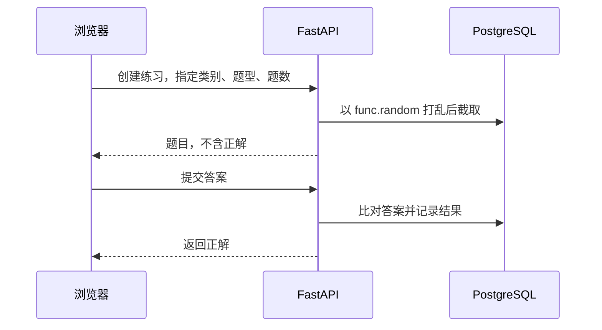
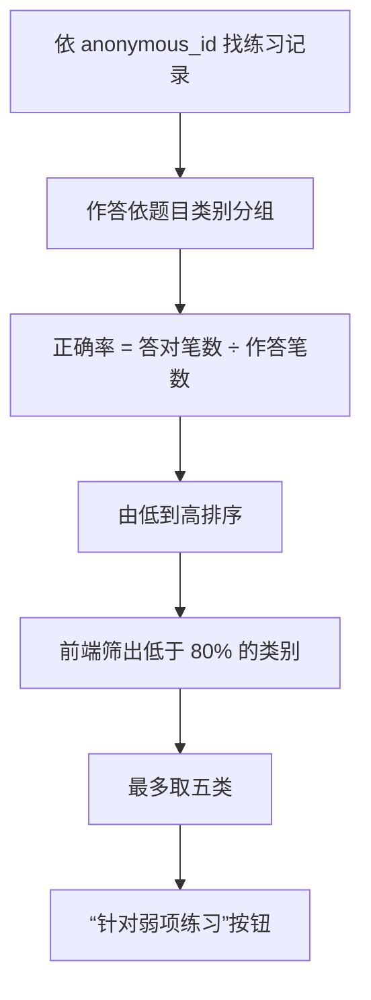

我做这个项目，是因为老婆报名了采购法资格考试。

直接照着 PDF 题库练习几次，很容易连题目顺序和答案一起记住。下一页还没翻，答案已经先浮出来。这种熟悉感让人分不清，记住的是题目内容，还是答案在 PDF 里的位置。

所以我要把固定题库改造成每轮顺序不同、还能留下弱项记录的练习。

{: width="800" height="430" }
_题序一洗牌，熟悉感就不能代替理解。_

> 本文检查的版本是 commit [`b29fe3f`](https://github.com/7a6ac0/gpa-question-webapp/tree/b29fe3fc0ccd9ba8b534a974d4c7921a78e007bb)。[`pyproject.toml`](https://github.com/7a6ac0/gpa-question-webapp/blob/b29fe3fc0ccd9ba8b534a974d4c7921a78e007bb/pyproject.toml#L5-L21) 声明的包版本是 `0.1.0`，需要 Python `3.11` 以上。
{: .prompt-info }

## 这是一套把官方题库变成练习记录的 Web App

[gpa-question-webapp](https://github.com/7a6ac0/gpa-question-webapp) 是一套政府采购法题库练习网站。它使用 FastAPI、SQLAlchemy、Jinja2、pdfplumber 与 python-docx，采用 [MIT License](https://github.com/7a6ac0/gpa-question-webapp/blob/b29fe3fc0ccd9ba8b534a974d4c7921a78e007bb/LICENSE#L1-L20)。

它有两条数据路径。导入时，[`parse_command`](https://github.com/7a6ac0/gpa-question-webapp/blob/b29fe3fc0ccd9ba8b534a974d4c7921a78e007bb/src/ingestion/cli.py#L39-L86) 读取已下载到本地的官方 PDF 或 DOCX，把题目写进 PostgreSQL。练习时，浏览器界面调用 FastAPI，读写题目、session 与作答记录。

{: width="1200" height="548" }
_架构图依据 commit `b29fe3f` 绘制；[打开交互版](/assets/img/posts/gpa-question-webapp-study-loop/system-architecture.html)。_

浏览器端的路由集中在 [`src/api/main.py`](https://github.com/7a6ac0/gpa-question-webapp/blob/b29fe3fc0ccd9ba8b534a974d4c7921a78e007bb/src/api/main.py#L5-L40)，提供四项功能：

- 随机练习
- 立即对答案
- 单次成绩
- 跨练习的弱项统计

## 数据怎么从 PDF 走到一道可作答的题目

第一段是导入。CLI 扫描输入目录里的 `.pdf` 和 `.docx`，依扩展名交给对应的解析器。没有指定类别时，文件名开头的 `1` 到 `13` 会被当成类别编号，实现见 [`src/ingestion/cli.py`](https://github.com/7a6ac0/gpa-question-webapp/blob/b29fe3fc0ccd9ba8b534a974d4c7921a78e007bb/src/ingestion/cli.py#L39-L84)。

PDF 解析器先用“是非题”与“选择题”切段，再用正则表达式识别题号和答案。选择题的答案 `1` 到 `4` 会转成 `A` 到 `D`。规则写在 [`src/ingestion/pdf_parser.py`](https://github.com/7a6ac0/gpa-question-webapp/blob/b29fe3fc0ccd9ba8b534a974d4c7921a78e007bb/src/ingestion/pdf_parser.py#L11-L19)：

```python
MC_QUESTION_START = re.compile(r"^\s*(\d+)\s+([1-4])\s+(.+)")
TF_QUESTION_START = re.compile(r"^\s*(\d+)\s+([OX])\s+(.+)")
ANSWER_NUM_TO_LETTER = {"1": "A", "2": "B", "3": "C", "4": "D"}
```
{: file="src/ingestion/pdf_parser.py" }

第二段是去重与更新。每题的 `source_hash`，是把类别、题型和题目文字拼接后算出的 SHA-256：

```python
@property
def source_hash(self) -> str:
    raw = f"{self.category_id}|{self.question_type}|{self.question_text}"
    return hashlib.sha256(raw.encode("utf-8")).hexdigest()
```
{: file="src/ingestion/base.py" }

再次导入时，哈希相同的题目会更新答案、选项或法规出处。来源里已经消失的题目，会标上 `deleted_at`。完整流程在 [`src/ingestion/base.py`](https://github.com/7a6ac0/gpa-question-webapp/blob/b29fe3fc0ccd9ba8b534a974d4c7921a78e007bb/src/ingestion/base.py#L13-L100)。

第三段才是练习。题目发到浏览器时不带正解，答案由服务器比对：



抽题在 [`create_session`](https://github.com/7a6ac0/gpa-question-webapp/blob/b29fe3fc0ccd9ba8b534a974d4c7921a78e007bb/src/api/routes/sessions.py#L32-L97)，它用 `func.random()` 打乱符合条件的题目。第一次拿到的 [`QuestionResponse`](https://github.com/7a6ac0/gpa-question-webapp/blob/b29fe3fc0ccd9ba8b534a974d4c7921a78e007bb/src/models/schemas.py#L15-L23) 没有正确答案字段，比对在 [`submit_answer`](https://github.com/7a6ac0/gpa-question-webapp/blob/b29fe3fc0ccd9ba8b534a974d4c7921a78e007bb/src/api/routes/sessions.py#L100-L170)。

## 弱项不是猜的，是按类别累积出来

这里我认为最需要确认的是“跨练习弱项”到底算了什么。

“跨练习弱项”算的是各类别的累积正确率，分母、门槛与排序方式都很明确：



后端的 [`get_weakness`](https://github.com/7a6ac0/gpa-question-webapp/blob/b29fe3fc0ccd9ba8b534a974d4c7921a78e007bb/src/api/routes/sessions.py#L173-L225) 算到排序为止。`80%` 的门槛与最多取五类，判断写在前端的 [`src/templates/weakness.html`](https://github.com/7a6ac0/gpa-question-webapp/blob/b29fe3fc0ccd9ba8b534a974d4c7921a78e007bb/src/templates/weakness.html#L48-L69)：

```javascript
const weakCats = data.categories.filter(c => c.percentage < 80).slice(0, 5);
const weakIds = weakCats.map(c => c.category_id).join(',');
```
{: file="src/templates/weakness.html" }

它不是能力测验模型，也不会替近期成绩加权。同一题做过多次，每次作答都会算进统计。这些界线是我从 `SessionAnswer.id` 的笔数汇总方式看出来的，不是来自 README 对功能的描述。

## 方便的代价是格式耦合与匿名识别

解析器直接依赖官方文档的布局文字与答案格式。段落标题不再是“是非题”或“选择题”，或选择题不再用 `1` 到 `4`，现有规则就认不出题目。这项维护成本，从 [`_split_sections`](https://github.com/7a6ac0/gpa-question-webapp/blob/b29fe3fc0ccd9ba8b534a974d4c7921a78e007bb/src/ingestion/pdf_parser.py#L57-L85) 与两个题型解析函数就看得出来。

运行环境也不是单一静态网页。[`docker-compose.yml`](https://github.com/7a6ac0/gpa-question-webapp/blob/b29fe3fc0ccd9ba8b534a974d4c7921a78e007bb/docker-compose.yml#L1-L29) 会启动应用程序与 PostgreSQL 16，数据存在 `pgdata` volume。练习记录若要能在磁盘故障后恢复，部署时得另外安排备份。

跨练习的身份只靠浏览器 `localStorage` 里的 `gpa_anonymous_id`。前端把它放进 `/api/weakness` 的查询参数，流程写在 [`src/templates/weakness.html`](https://github.com/7a6ac0/gpa-question-webapp/blob/b29fe3fc0ccd9ba8b534a974d4c7921a78e007bb/src/templates/weakness.html#L12-L36)。对应的路由只接收 `anonymous_id`，没有账号验证依赖。

我觉得这对家用工具很省事，但不是存放正式测验成绩该有的权限设计。

## 适合家用练习，不适合直接当正式考试系统

题库来源固定、用户范围明确，需求只是打乱题序并找出常错类别，这个项目已经把必要流程接起来。题库变动时，[`upsert_questions`](https://github.com/7a6ac0/gpa-question-webapp/blob/b29fe3fc0ccd9ba8b534a974d4c7921a78e007bb/src/ingestion/base.py#L28-L100) 能更新、保留或软删除现有题目，不必每次清空数据库。

要公开给多人使用，得先处理账号、授权、数据隔离与备份策略。题库布局若经常改动，还要替解析器准备失败报告与新格式测试。在我看来，现有代码适合当自用练习工具，不能直接当成正式考试平台。

## 先跑测试，再接自己的题库

先确认依赖、CLI 入口与核心行为都正常，再处理官方题库文件。下面的命令我在 macOS、Python `3.14.2`、uv `0.9.17` 上实际运行过：

```bash
git clone https://github.com/7a6ac0/gpa-question-webapp.git
cd gpa-question-webapp
uv sync --extra dev
uv run python -m src.ingestion.cli --help
uv run pytest -q
```
{: .nolineno }

我实测的结果是 `34 passed in 1.05s`，CLI 也列出了 `parse` 子命令。这只确认目前的 commit 能安装、测试能通过，不代表每个版本的官方 PDF 都能成功解析。

接着从[公共工程委员会题库页面](https://web.pcc.gov.tw/psms/plrtqdm/questionPublic/indexReadQuestion)下载一个类别的文件，放进 `data/`。再依[项目 README](https://github.com/7a6ac0/gpa-question-webapp/blob/b29fe3fc0ccd9ba8b534a974d4c7921a78e007bb/README.md#L47-L58) 的导入命令处理，验证解析结果。

## 真正有用的是留下可回头查的练习记录

上面查证的内容只能确认功能存在，无法证明它会提高考试成绩。我仍判断这个项目的价值在于补上一个复习循环。

固定的 PDF 只提供题目和答案，网站则把每次作答留成数据。随机组卷切断题序提示，类别统计指出下一轮该练哪里。对我家的需求来说，技术选型只是手段，能一直重复“作答、发现弱项、再练一次”才是成品。

## 延伸阅读

- [gpa-question-webapp 源代码](https://github.com/7a6ac0/gpa-question-webapp)：对照本文提到的导入、作答与弱项统计实现。
- [公共工程委员会采购专业人员题库](https://web.pcc.gov.tw/psms/plrtqdm/questionPublic/indexReadQuestion)：这个项目处理的官方题库来源。
- [FastAPI 官方文档](https://fastapi.tiangolo.com/)：路由、响应模型与依赖注入。
- [SQLAlchemy 2.0 文档](https://docs.sqlalchemy.org/en/20/)：session、查询与 ORM 关联。
