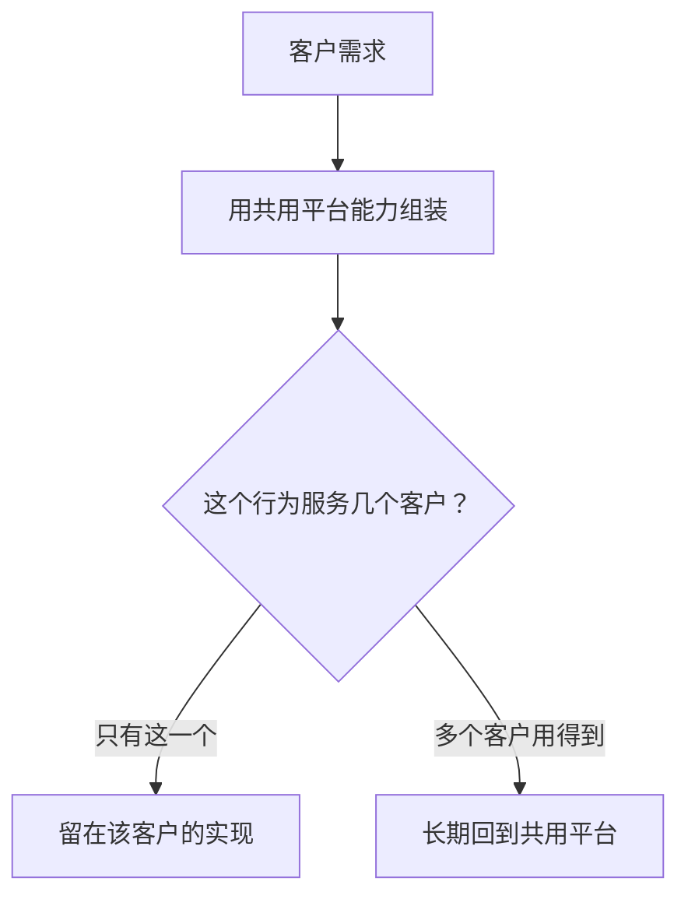
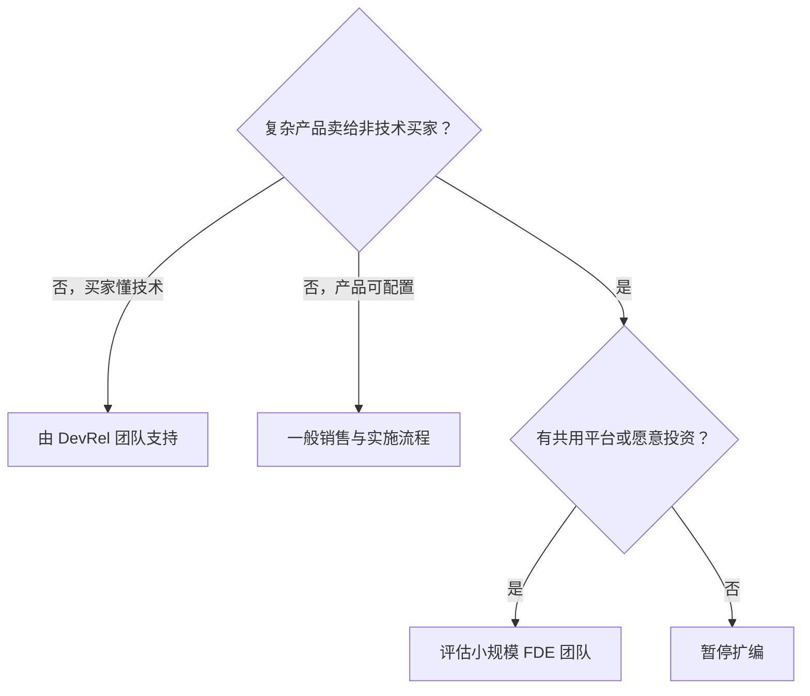

你把一套要在上面开发才能用的平台卖进企业，合同签了，第一场实施会议也开了。投影幕上却只有一张空白的工作流程图。客户知道要改善商品上架率或销售吞吐量，却不知道怎么把平台组成可用的方案。

眼前的问题是交付边界。客户买得起平台，却没有工程能力把它变成成果时，供应商该交付多少定制？又要怎么避免每个项目变成新的维护负债？

## FDE 交付的是平台上的客户成果

FDE 是 Forward Deployed Engineering 的缩写，指工程师直接和客户合作，在现有的软件平台上完成客户需要的方案。Kevin Bai 在演讲结尾把这个角色浓缩成一句话：[“面对客户的软件工程师”](https://www.youtube.com/watch?v=KwhgfwOSToQ&t=1019s)。

这篇整理的是 AI Engineer World's Fair 2026 的演讲 [Forward Deployed Engineering 101](https://ai.engineer/talks/KwhgfwOSToQ-forward-deployed-engineering-101)，官方页面记录的片长是 17 分 48 秒。Bai 在开场自我介绍，他任职于 Anthropic 的 applied AI 团队，先前是 Rippling FDE 团队最早加入的成员，更早以前在 Palantir。

这些经历决定了他的观察视角。我讨论的是这场演讲，不是 Anthropic 目前的工作。



Bai 在 [3:03 到 3:35](https://www.youtube.com/watch?v=KwhgfwOSToQ&t=183s) 说明 FDE 的交付物。客户同时取得软件与工程服务，最后验收的是建立在平台上的商业成果。工程师要先理解客户的业务，再用平台做出应用、工作流程或解决方案。

下文的 GTM（go-to-market）指公司用什么方式触及客户、完成成交并持续服务。

## 产品复杂度要和买家能力一起看

Bai 借用 Punnett square（生物学用的 2×2 对照表）说明 FDE 的适用条件。一个轴是使用产品需要多少技术能力，另一个轴是买家能不能消化这份复杂度。他在 [4:03 到 5:15](https://www.youtube.com/watch?v=KwhgfwOSToQ&t=243s) 谈了其中三种组合：

| 产品与平台 | 买家或用户 | 复杂度由谁处理 | 演讲中的判断 |
| --- | --- | --- | --- |
| GitHub、Datadog 这类技术产品 | CTO、CIO、软件工程师 | 技术用户自行学习与操作 | 不需要 FDE |
| Rippling、Jira、Slack 这类可配置工具 | 非技术买家与用户 | 用户通过配置完成工作 | 不需要 FDE |
| 需要在其上开发的技术平台 | 非技术业务买家 | 供应商派工程师完成客户方案 | 适合评估 FDE |

这张表是 Bai 在演讲里的分类，不是对这些产品完整能力的评测。演讲没有讨论第四种组合，所以我不自行补上第四个象限，也不把自己的推测当成讲者的结论。

关键在第三行。买家要的结果很明确，却没有能在平台上开发的工程团队。供应商若只交出工具，客户还得自己招聘、培训与管理工程师。Bai 在 [6:00](https://www.youtube.com/watch?v=KwhgfwOSToQ&t=360s) 形容 FDE 是把熟悉平台的工程能力借给客户。

## 共用平台把定制需求限制在可维护范围

FDE 会写定制代码，但不从空白项目开始。Bai 在 [8:42 到 9:05](https://www.youtube.com/watch?v=KwhgfwOSToQ&t=522s) 说，工程师应该用现有的共用平台能力组装应用与工作流程。这些能力由产品团队共同维护，客户方案只处理差异的部分。

Foundry Ontology 是演讲中唯一点名的例子。[Palantir 官方文档](https://www.palantir.com/docs/foundry/ontology/overview)把 Ontology 描述成位于数据集、虚拟数据表与模型之上的操作层。它把数据映射成业务对象、属性与关系，也提供动作、函数与动态权限。FDE 因此能直接使用已维护的数据与操作能力，不必替每个客户重建同一套基础。

定制工作仍要有边界。Bai 在 [16:10 到 16:48](https://www.youtube.com/watch?v=KwhgfwOSToQ&t=970s) 提出一个简单原则，依“服务几个客户”决定代码放在哪里：

演讲没有给“几个客户算可共用”的数字，所以我认为这个门槛仍要由产品团队决定。这条边界决定公司交付的是可维护的方案，还是一批各自演进的项目。

## 把 FDE 当成人力外派会看错成本结构

常见的说法是“FDE 就是把工程师派到客户那里接活”，但这并不准确。Bai 在 [8:13 到 8:52](https://www.youtube.com/watch?v=KwhgfwOSToQ&t=493s) 直接画出界线。每位工程师若替每个客户从头搭建一套系统，公司经营的是开发服务，不是他说的平台型 FDE。

改变成本结构的，是定制代码共享了多少已维护的能力，而不是工程师坐在哪里。没有平台时，每份新合同都会带来另一套依赖包、部署流程与支持责任。演讲用“工程师不想学 55 个 repo”形容这种维护局面，接着指出维护成本会侵蚀损益。

{: width="1200" height="675" }
_同样叫 FDE，底层平台会改变工程师每天维护的东西。_

演讲中的财务数字，也不能直接证明这套模式能获利。Bai 在 [6:39 到 7:07](https://www.youtube.com/watch?v=KwhgfwOSToQ&t=399s) 用 ACV（average contract value，平均合同价值）比较几家公司。他口头列出 Palantir 400 万美元、ServiceNow 120 万美元与 Workday 60 万美元，并用了“上次查看”与“印象中”这类限定语。

[官方校订稿](https://ai.engineer/talks/KwhgfwOSToQ-forward-deployed-engineering-101#commercial-case)明确注明，这些数字没有测量日期、计算方式或独立排名。所以我只把它们当成讲者的商业论证，不当成口径一致的公司比较。

## 平台只控制维护成本，不能消除它

有了共用平台，客户方案仍然要维护。Bai 在 [10:38 到 11:12](https://www.youtube.com/watch?v=KwhgfwOSToQ&t=638s) 把平台列为组建 FDE 团队的必要条件，同时强调平台再健全，维护负担仍然可观。平台能减少重复建造，不能让客户差异消失。

第二项成本是知识分散。Bai 在 [15:05 到 15:29](https://www.youtube.com/watch?v=KwhgfwOSToQ&t=905s) 的问答中，建议让多位 FDE 共同参与项目，以免全部上下文集中在一个人身上。团队因此要为交接、支持与建立共同理解保留时间。

人才条件也不会因为角色贴近客户而降低。Bai 在 [16:59 到 17:25](https://www.youtube.com/watch?v=KwhgfwOSToQ&t=1019s) 对理想人选有两项要求：通过软件工程师的招聘标准，以及让公司放心把客户沟通交给他们。公司要愿意用软件工程师的标准招人，也愿意让他们直接面对客户。

我的解读是，FDE 编制不能直接拿售前或客服的人力替换。招聘与培养方式，都要同时覆盖工程与客户沟通。

## 两道门槛决定公司需不需要 FDE

Bai 在 [9:50 到 11:12](https://www.youtube.com/watch?v=KwhgfwOSToQ&t=590s) 用两道门槛判断。第一道看产品与买家之间有没有能力缺口，第二道看共用平台：

DevRel 指开发者关系团队。没有共用平台也不准备建设时要暂停扩编，否则定制工作会变成各自维护的项目。

AI 没有取消这两道门槛。Bai 在 [11:28 到 12:35](https://www.youtube.com/watch?v=KwhgfwOSToQ&t=688s) 明确把一段话标注为个人假说：AI 降低了写代码和制作定制软件的难度，也让更多平台具备可定制的能力。

演讲没有提供跨行业的数据，证明这个趋势会扩及几乎所有平台。所以我只把 AI 当成重新检查两道门槛的理由，不当成组建 FDE 团队的充分条件。

## 用一张表跑一次 FDE 决策

> 我整理的这份推导流程，能排除明显不适用的情况，不能估算人力、合同毛利或部署周期。
{: .prompt-info }

先把演讲中的三类产品代入两道门槛：

| 例子 | 产品需要开发 | 买家能自行吸收复杂度 | 有共用平台 | 推导结果 |
| --- | --- | --- | --- | --- |
| GitHub、Datadog | 是 | 是 | 不需判定 | 技术型 GTM，不需 FDE |
| Jira、Slack | 以配置为主 | 否 | 不需判定 | 一般销售与实施，不需 FDE |
| Foundry 与非技术行业买家 | 是 | 否 | 是 | 符合 FDE 的两道门槛 |

套用到自己的公司时，拿最近一个企业销售机会，填完下面五个字段。只写已经知道的内容，空白的字段就是下一步要调查的事。

| 字段 | 要填的内容 |
| --- | --- |
| 客户成果 | 客户用什么业务结果验收，不写产品功能名称 |
| 开发需求 | 这个结果是否需要在产品上写代码，还是配置即可完成 |
| 客户能力 | 客户是否具备能完成并维护这段开发工作的工程团队 |
| 共用能力 | 数据模型、权限、动作与部署方式中，哪些由平台集中维护 |
| 长期归属 | 客户特有行为留在哪里，可共用能力由哪个产品团队接手 |

填完之后，我的建议如下：

- 产品需要开发、客户缺少工程能力，而且共用能力已经存在：进入 FDE 的小规模试点。
- 前两项成立，但共用能力栏仍是空白：先定义平台投资与维护责任。
- 产品与买家之间没有能力落差：沿用现有的 GTM 方式比较直接。

## 我的判断：先定平台边界，再开岗位

我把 FDE 视为产品架构与 GTM 的共同决策，工程师人数只是这项决策之后的编制结果。前面的逐字稿、平台文档与两道门槛都可以核对，这一节则是我的判断，现有证据不足以证明它适用于所有 B2B 软件公司。

产品团队若还没定义下面三件事，先招聘 FDE 只会增加客户项目的分支数：

- 哪些能力集中维护
- 客户差异留在哪里
- 前线需求怎么回到平台

平台边界清楚之后，FDE 才能把工程时间用在理解业务和组合方案，而不是重建基础能力。

AI 让代码生成得更快，却没有替公司决定支持责任由谁承担。定制变便宜时，公司更需要说清楚哪些代码由谁长期维护，所以产品架构必须和 GTM 一起设计。

开岗位之前，先挑一个最近的企业销售机会，把上面五个字段填完，确认交付缺口真的存在。

## 延伸阅读

- [Forward Deployed Engineering 101](https://ai.engineer/talks/KwhgfwOSToQ-forward-deployed-engineering-101)：官方页面，有校订稿、完整时间戳与演讲提到的资源，可逐句核对本文。
- [Palantir Ontology overview](https://www.palantir.com/docs/foundry/ontology/overview)：Ontology 的对象、关系、动作、函数与权限，也就是 Foundry 提供的共用平台能力。
- [What Is a Forward Deployed Engineer?](https://fdepod.substack.com/p/test)：Kevin Bai 的补充文章，把 FDE 拆成顾问、产品经理与工程师三种工作。他主张这个角色该用在高价值、定义模糊的问题上。
