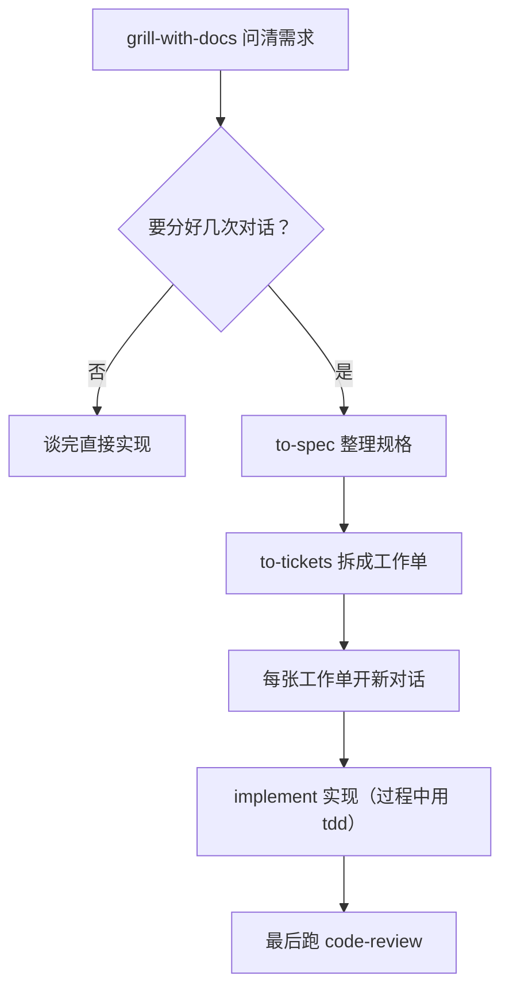

你可能听人提过 `mattpocock/skills`，打开仓库却看到一长串 skill 名称；也可能是从搜索点进其中一篇，想知道前后还有什么。这个系列共六篇，每篇处理开发流程里的一段。这篇导读说明六篇怎么串起来，并按你的情况建议从哪一篇读起。

> mattpocock/skills 系列｜导读
>
> - 从头开始（第 1 篇）：[先设置项目规则，再用 ask-matt 找下一步](/posts/mattpocock-skills-setup-routing-guide/)
>
> 这个系列我以 [`1.2.3` 版](https://github.com/mattpocock/skills/blob/c55ee46073ed923f86ce59a5eb3b6d895095d1b7/package.json#L2-L10)为准，各篇开头另外注明了之后的版本变动。
{: .prompt-info }

> 这六篇在 2026 年 9 月 21 日到 10 月 14 日之间发布，当时仓库还在更新。2026-10-04 发布的 [`1.3.0`](https://github.com/mattpocock/skills/releases/tag/v1.3.0) 和 [`1.3.1`](https://github.com/mattpocock/skills/releases/tag/v1.3.1)，把官方插件从下文所说的 25 个 skill 变为 27 个（2026-10-19 核实）：
>
> - [第 5 篇](/posts/mattpocock-skills-design-review-integration/)介绍的 `resolving-merge-conflicts` 已被移除，其余 24 个都还在。
> - 新增的 `implement-spec`、`pr`、`retro`，本系列还没有介绍。
> - [第 2 篇](/posts/mattpocock-skills-requirements-shared-language/)的词汇表 `CONTEXT.md` 改名为 `GLOSSARY.md`。
>
> 我之后会按新版全面更新这个系列。实际使用前，我建议对照仓库当前的版本。
{: .prompt-info }

## mattpocock/skills 是什么

[`mattpocock/skills`](https://github.com/mattpocock/skills) 是 Matt Pocock 公开的一整套 skill。我会把 skill 理解成一份告诉 AI 编程助手怎么完成某项工作的操作说明，比如怎么访谈需求，或者怎么把规格拆成一张张工作单。这里的 AI 编程助手，指的是 Claude Code、Codex 这类能读写项目文件、帮你写代码的工具。

作者在 [README](https://github.com/mattpocock/skills/blob/c55ee46073ed923f86ce59a5eb3b6d895095d1b7/README.md#L19) 里说，这些 skill 刻意做得小、容易改，也能自由组合。官方插件的 [`plugin.json`](https://github.com/mattpocock/skills/blob/c55ee46073ed923f86ce59a5eb3b6d895095d1b7/.claude-plugin/plugin.json#L21-L47) 收录了 25 个 skill，这个系列的六篇正好把它们都介绍了一遍。仓库里另外还有仍在试验或目前不主动推广的条目，不在系列范围内。

先知道两件事，后面会好读很多：

- **大部分工作要由你点名启动。** 很多 skill 设置成只能由人启动，AI 不会自己跑。
- **`ask-matt` 像服务台，不是总管。** 你描述现在卡在哪里，它建议下一个该用的 skill，但不会自动把整套流程跑完。

安装方式和第一次要做的设置，写在[第 1 篇](/posts/mattpocock-skills-setup-routing-guide/)。

## 适合多人、跨多次对话的项目

从六篇的内容来看，我认为这套 skill 最适合下面这类项目：

- 由好几个人一起维护，或者一个功能要分好几次对话才能做完。
- 用工作跟踪工具（比如 GitHub Issues）记录待办事项、交接工作。
- 你希望 AI 做事有固定步骤，而且每个关键点都留给人来确认。

反过来，有些情况用不到整套流程：

- 功能小到一次对话就能做完：需求谈完直接实现，不必再用 `to-spec`、`to-tickets` 写规格、拆工作单（第 3 篇）。
- 只是讨论一个还没成型的想法：用 `grill-me` 访谈一次就够了，不用给每个名词建文档（第 2 篇）。
- 不在项目文件夹里的一次性工作：不必为了一个 skill 建一整套项目设置（第 1 篇）。

它也有做不到的事。第 1 篇提过，这套流程不保证能缩短开发时间。它直接带来的好处，是把项目惯例写成文档，并在你不确定下一步时给出建议。

第 4 篇也提醒过，这些规则只是写在 Markdown 里的指令，没有程序强制执行。所以 AI 列出要测试的位置时，你如果没细看就点同意，这道把关就等于没起作用。

## 六篇按开发顺序排

我按一个功能从需求到合并的顺序排这六篇。前五篇是一条主线，第 6 篇处理写代码以外、却经常拖慢进度的事。

{: width="800" height="450" }
_六篇按开发顺序排列，每篇负责一段，第 6 篇补上写代码以外的事。_

主线上的 skill 大致这样衔接：

其他 skill 大多是岔路：

- 别人提交的反馈，交给 `triage`。
- 大到列不完决策的工作，交给 `wayfinder`。
- 出了 bug，用 `diagnosing-bugs`。

六篇用的是同一个例子：给一个订阅服务加上按席位计费。它从第 1 篇的模拟场景开始，一直沿用到第 6 篇，所以按顺序读，能看到同一个功能是怎么一步步往下推进的。

## 六篇各讲什么

### 第 1 篇：先设置项目规则，再用 ask-matt 找下一步

面对 25 个 skill，第一次该从哪里下手？这篇的答案是：不用先把每个 skill 都搞懂也能开始。它说明三件事：

- 两种安装方式怎么选。
- `setup-matt-pocock-skills` 会给项目留下哪些设置。
- 怎么用 `ask-matt` 找出下一步。

→ [第 1 篇：先设置项目规则，再用 ask-matt 找下一步](/posts/mattpocock-skills-setup-routing-guide/)

### 第 2 篇：把模糊需求问清楚，留下共用词汇

会议纪要里“成员”“用户”“席位”混着用，该怎么问清楚？这篇介绍 `grill-me`、`grill-with-docs`、`grilling`、`domain-modeling` 和 `wait-what`。

AI 会按问题的先后关系一轮一轮地问。用 `grill-with-docs` 时，确认过的词汇会写进项目的词汇表 `CONTEXT.md`，少数重要决定写成决策记录。

→ [第 2 篇：把模糊需求问清楚，留下共用词汇](/posts/mattpocock-skills-requirements-shared-language/)

### 第 3 篇：先找出缺口，再决定要写规格还是拆工作单

需求谈完了，下一步是写规格、拆工作单，还是去问掌握答案的人？这篇说明 `to-spec`、`to-tickets`、`triage`、`wayfinder` 和 `to-questionnaire` 各自补哪一种缺口。我认为关键是先看缺的是哪种信息，而不是把五个都跑一遍。

→ [第 3 篇：先找出缺口，再决定要写规格还是拆工作单](/posts/mattpocock-skills-specs-work-breakdown/)

### 第 4 篇：AI 开工写代码前，先决定要看哪一种信号

代码和测试都由 AI 写的时候，你要看什么才知道它做对了？这篇介绍 `implement`、`tdd`、`diagnosing-bugs` 和 `prototype`。答案是看 AI 自己改不了的东西：

- 你确认过的测试位置。
- 来自规格的预期值。
- 一条对 bug 亮过红灯的命令。

文中从红灯到绿灯的测试，是我实际跑过的。

→ [第 4 篇：AI 开工写代码前，先决定要看哪一种信号](/posts/mattpocock-skills-implementation-feedback-loops/)

### 第 5 篇：代码写完之后，谁来看结构、审修改、解冲突

测试通过，不代表结构没有越改越乱，也不代表修改符合需求。这篇介绍四个 skill：

- `codebase-design`、`improve-codebase-architecture`：管结构，定期给项目做体检。
- `code-review`：审查分“照规矩写了吗”和“照需求做了吗”两边看。
- `resolving-merge-conflicts`：遇到合并冲突，先弄清两边各想做什么。

文中的合并冲突是我实际制造出来的。

→ [第 5 篇：代码写完之后，谁来看结构、审修改、解冲突](/posts/mattpocock-skills-design-review-integration/)

### 第 6 篇：查资料、做交接、学新东西，都有固定做法

写代码以外的事也会拖慢进度，比如查官方文档、把工作交给下一个人、只有你能登录后台去做的设置、学一个新主题。这篇介绍 `research`、`handoff`、`wizard`、`teach` 和 `writing-for-agents`，每个都有一套固定做法。

→ [第 6 篇：查资料、做交接、学新东西，都有固定做法](/posts/mattpocock-skills-research-handoff/)

## 按卡住的地方选起点

不一定要从头读到尾。先想想你现在卡在哪里：

{: width="800" height="450" }
_先找到自己卡住的地方，再从对应的那一篇读起。_

| 你的情况 | 建议读 |
| --- | --- |
| 第一次用，想知道值不值得装 | 第 1 → 2 → 3 篇 |
| 需求总是说不清，大家的用词对不上 | 第 2 篇 |
| 需求谈完了，不知道该写规格还是开工作单 | 第 3 篇 |
| 想知道 AI 写的代码和测试靠不靠得住 | 第 4 → 5 篇 |
| 要审查修改、整理结构或处理合并冲突 | 第 5 篇 |
| 要交接工作、查资料，或者学一个新主题 | 第 6 篇 |
| 想看一个功能从头到尾怎么走 | 从第 1 篇按顺序读到第 6 篇 |

如果你已经装好了，也可以直接问 `ask-matt`。描述现在卡在哪一步，它会建议下一个该用的 skill，你再回来读介绍那个 skill 的那一篇。

## 延伸阅读

- [`mattpocock/skills`](https://github.com/mattpocock/skills)：官方仓库。
- [`README.md`](https://github.com/mattpocock/skills/blob/c55ee46073ed923f86ce59a5eb3b6d895095d1b7/README.md)：作者对这套 skill 的说明和安装方式（`1.2.3` 版）。
- [`plugin.json`](https://github.com/mattpocock/skills/blob/c55ee46073ed923f86ce59a5eb3b6d895095d1b7/.claude-plugin/plugin.json#L21-L47)：官方插件收录的 25 个 skill 清单。
- [`ask-matt/SKILL.md`](https://github.com/mattpocock/skills/blob/c55ee46073ed923f86ce59a5eb3b6d895095d1b7/skills/engineering/ask-matt/SKILL.md#L9-L90)：`ask-matt` 用来建议下一步的完整路线图。
- [pstack 系列导读：这套 skill 是什么、四篇该怎么读](/posts/pstack-series-guide/)：另一套 skill（pstack）的系列导读。
