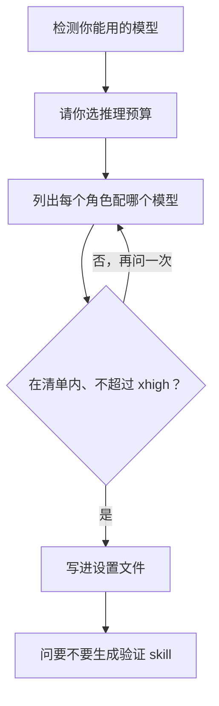
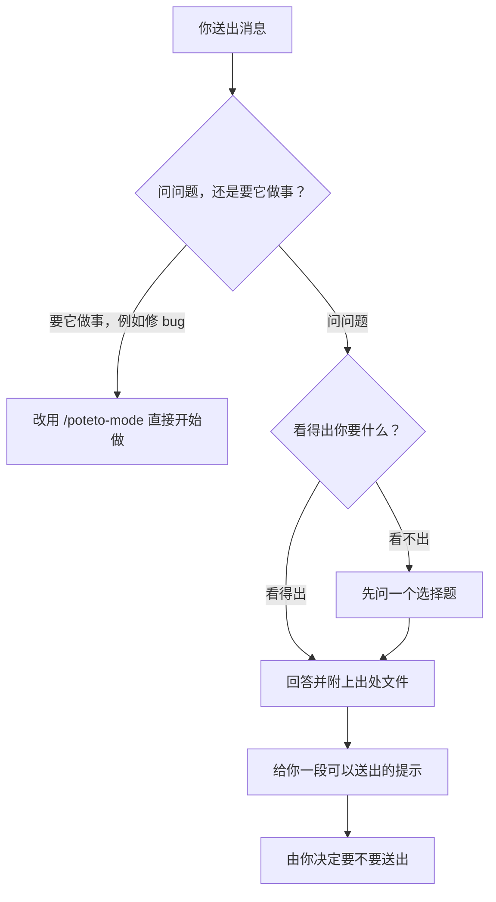

要在 Claude Code 安装 pstack，先添加 Cursor 官方的插件目录 `cursor/plugins`，再从里面安装；在 Cursor 只要一行命令。两种做法的命令都在下面的第 1 步。

pstack 能让 AI 编程助手做事更有条理，但打开一看，光是 skill 就有好几十个。这篇教你第一次怎么开始：装好 pstack、确认装到哪个版本、选好模型，之后每个任务都交给 `/poteto-mode`，不用先背下所有名字。文中的示例提示都是通用写法，你可以直接拷贝，再换成自己项目的内容。

> pstack 系列｜第 1 篇
>
> - 系列导读：[这套 skill 是什么、四篇该怎么读](/posts/pstack-series-guide/)
> - 下一篇（第 2 篇）：[改代码之前，先看懂再设计](/posts/pstack-understand-design/)
>
> **版本提醒**：这篇以 pstack [`0.15.43` 版](https://github.com/cursor/plugins/blob/2f87c854fe3e2fcda44ca86b46ede35aad3c46b7/pstack/.cursor-plugin/plugin.json)为准，搭配 Claude Code 2.1.326。这一版对应 `cursor/plugins` 的 commit `2f87c85`（2026-11-17 05:47，台北时间）。系列五篇在 2026-11-17 一起改以这一版查证，我查证时，`cursor/plugins` 的 main 在 `2f87c85` 之后没有改动 pstack。Claude Code 的命令和菜单，依 2026-10-24 查阅的[官方文档](https://code.claude.com/docs/en/plugins/install)。之后的版本，命令和行为可能会改变。
{: .prompt-info }

## 先认识几个名词

| 名词 | 意思 |
| --- | --- |
| AI 编程助手 | Cursor、Claude Code 这类能读写项目文件、替你写代码的工具 |
| skill | 一份“告诉 AI 怎么完成某类工作”的操作说明，用斜线命令调用，例如 `/poteto-mode` |
| pstack | Lauren Tan 在 Cursor 官方插件库 [`cursor/plugins`](https://github.com/cursor/plugins/tree/2f87c854fe3e2fcda44ca86b46ede35aad3c46b7/pstack) 里维护的一整组 skill |
| playbook | 针对一种任务写好的固定步骤，例如“修 bug”要先重现、再找原因、修完再验证 |
| subagent | 主对话另外派出去、专门做一小段工作的 AI |
| token | AI 计算用量的单位，读和写的内容越多，用掉的 token 越多 |

## pstack 装了什么

`0.15.43` 版有 58 个 skill，每个 skill 就是一个斜线命令。另外还有 `poteto-agent`、`comment-sicko` 两个专用的 subagent，以及 `poteto-mode` 底下的 22 个 playbook。

在 Claude Code 里，插件的命令前面要加插件名称。所以 Cursor 的 `/poteto-mode`，在 Claude Code 里写成 `/pstack:poteto-mode`（见 [README](https://github.com/cursor/plugins/blob/2f87c854fe3e2fcda44ca86b46ede35aad3c46b7/pstack/README.md#L30)）。下文的示例都用 Claude Code 的写法；在 Cursor 里，把 `pstack:` 拿掉就好。

两边的其他差异，列在官方的 [Claude Code 对照说明](https://github.com/cursor/plugins/blob/2f87c854fe3e2fcda44ca86b46ede35aad3c46b7/pstack/docs/harness/claude-code.md)。

{: width="800" height="450" }
_第一次使用的流程：安装、核对版本、选模型，再从 /poteto-mode 开始。_

## 第 1 步：安装

[README](https://github.com/cursor/plugins/blob/2f87c854fe3e2fcda44ca86b46ede35aad3c46b7/pstack/README.md#L15-L26) 和[设置指南](https://github.com/cursor/plugins/blob/2f87c854fe3e2fcda44ca86b46ede35aad3c46b7/pstack/docs/guide/01-setup.md#L5-L15)列出两种装法。在 Cursor 的对话里输入：

```text
/add-plugin pstack
```

在 Claude Code 里，先把 `cursor/plugins` 这个 GitHub repo（放代码的项目库）加成 marketplace（插件目录），再从这个目录安装 pstack：

```text
/plugin marketplace add cursor/plugins
/plugin install pstack@cursor-plugins
```

第二行的 `pstack@cursor-plugins`，意思是“从 cursor-plugins 这个目录安装 pstack”。

依 [Claude Code 文档](https://code.claude.com/docs/en/plugins/install#install-a-plugin)，在对话里输入 `/plugin install` 不会马上安装。它会先打开插件的说明页，让你看它会装哪些东西，再选安装范围。选“Install for you”（user scope），就是这台电脑上的所有项目都能用。

> 上面的命令都没有指定版本，装到的是当下 `cursor/plugins` 默认分支（branch，repo 里平常开发用的主线，通常叫 main）上的内容。装别人的插件之前该检查什么，我在[这篇供应链与权限风险的文章](/posts/coding-agent-supply-chain-permission-risks/)里讲过。
{: .prompt-tip }

网络上也有第三方整理的 pstack 移植版和镜像，例如 `michael-denyer/pstack-claude` 与 `backnotprop/pstack`。它们不是 `cursor/plugins` 官方维护的版本。要用的话，我建议先看完内容、锁定版本，理由同样见[供应链与权限风险的文章](/posts/coding-agent-supply-chain-permission-risks/)。

## 第 2 步：检查版本、更新，或固定版本

### 看装到哪个版本

装好之后，先确认装到的是哪个版本。依 [Claude Code 文档](https://code.claude.com/docs/en/plugins/install#install-a-plugin)，在终端（输入命令的窗口）运行下面这行，会列出每个插件的 `Version`、`Scope` 和 `Status`：

```bash
claude plugin list
```

在对话里打 `/plugin`，切到 Installed 标签页也看得到。把看到的版本号和 [`plugin.json`](https://github.com/cursor/plugins/blob/2f87c854fe3e2fcda44ca86b46ede35aad3c46b7/pstack/.cursor-plugin/plugin.json) 对一下，就知道自己装的是不是这篇依据的那一版。

### 更新：默认不会自动更新

依 [Claude Code 文档](https://code.claude.com/docs/en/plugins/install#keep-plugins-updated)，Claude Code 对第三方 marketplace 默认**不自动更新**，所以 pstack 会停在你安装时的版本。pstack 的 [README](https://github.com/cursor/plugins/blob/2f87c854fe3e2fcda44ca86b46ede35aad3c46b7/pstack/README.md#L28) 也写了同样的说明和下面两种做法。

- **想手动更新一次**：在终端运行下面这行。依 `claude plugin update --help` 的说明，更新后要重启 Claude Code 才会生效。
- **想开自动更新**：在对话里打 `/plugin`，切到 Marketplaces 标签页，选 `cursor-plugins`，再选 Enable auto-update。

```bash
claude plugin update pstack@cursor-plugins
```

> 在我看来，默认不自动更新反而让你有机会先检查。更新前，我建议先到 `cursor/plugins` 看看 pstack 这次改了什么，再决定要不要更新。开了自动更新，就等于每次都直接接受新内容。理由见[供应链与权限风险的文章](/posts/coding-agent-supply-chain-permission-risks/)。
{: .prompt-tip }

### 固定在某个 commit

commit 是 git（最常用的版本控制工具）里的一个版本记录，每个 commit 都有一串编号（SHA）。想让 pstack 一直停在你看过的那个 commit，可以用本地文件夹当 marketplace，因为其他做法在 `cursor/plugins` 上都固定不到 commit：

| 做法 | 能不能固定到 commit |
| --- | --- |
| `/plugin install` | 不能。官方[命令参考](https://code.claude.com/docs/en/plugins/cli-reference#plugin-install)里，它没有指定版本或 commit 的选项 |
| `/plugin marketplace add` 加 `#ref` | 只能[固定在某个分支或 tag](https://code.claude.com/docs/en/plugins/install#add-a-marketplace)（tag 是给某个 commit 取的固定名称，例如 v1.0）。我在 2026-11-17 查证时，`cursor/plugins` 没有任何 tag |
| `marketplace.json` 的 `sha` 字段 | 能，但这是目录维护者设置的（见 [marketplace 参考文档](https://code.claude.com/docs/en/plugins/marketplace-reference#plugin-sources)），`cursor/plugins` 的 pstack 条目没有设置 |
| 本地文件夹当 marketplace | 能，官方文档支持 |

做法是先把 repo 下载（clone）到自己电脑，切到你审过的 commit，再把这个文件夹加成 marketplace。以下以这篇的 commit 为例，在终端运行：

```bash
git clone https://github.com/cursor/plugins.git ~/src/cursor-plugins
git -C ~/src/cursor-plugins checkout 2f87c854fe3e2fcda44ca86b46ede35aad3c46b7
claude plugin marketplace add ~/src/cursor-plugins
claude plugin install pstack@cursor-plugins
```

如果你之前已经用 GitHub 来源加过 `cursor/plugins`，两个来源的目录名称都是 `cursor-plugins`。可以先移除旧的：

```bash
claude plugin marketplace remove cursor-plugins
```

再运行上面的四行命令。依 [Claude Code 文档](https://code.claude.com/docs/en/plugins/install#manage-marketplaces)，移除 marketplace 会一并卸载从它装的插件，所以移除后要重新安装。

这和我在[供应链与权限风险的文章](/posts/coding-agent-supply-chain-permission-risks/)里建议的“先 clone，再切到审过的 commit”是同一个做法。之后想升级，就在这个文件夹里切到新的 commit，再更新插件。

## 第 3 步：用 /setup-pstack 选模型

pstack 会把工作分给不同角色，例如写代码的、做判断的、组成评审小组的，每个角色可以用不同模型。[`/setup-pstack`](https://github.com/cursor/plugins/blob/2f87c854fe3e2fcda44ca86b46ede35aad3c46b7/pstack/skills/setup-pstack/SKILL.md) 负责替这些角色选模型。

装好之后跑一次。之后换了账号、换了方案、想改用别的模型，或更新了 pstack，再跑一次：

```text
/pstack:setup-pstack
```

依[设置指南](https://github.com/cursor/plugins/blob/2f87c854fe3e2fcda44ca86b46ede35aad3c46b7/pstack/docs/guide/01-setup.md#L29)，重跑会保留你改过的角色。如果 pstack 改了默认模型，旧的设置文件会一直停在旧的默认值，要重跑才会换成新的，它也会告诉你换了哪些。设置文件如果是旧版 `/setup-pstack` 写的，`/poteto-mode` 也会提醒你重跑（[SKILL.md](https://github.com/cursor/plugins/blob/2f87c854fe3e2fcda44ca86b46ede35aad3c46b7/pstack/skills/poteto-mode/SKILL.md#L88)）。

它会一步一步做下面这些事（[SKILL.md](https://github.com/cursor/plugins/blob/2f87c854fe3e2fcda44ca86b46ede35aad3c46b7/pstack/skills/setup-pstack/SKILL.md#L10-L78)）：



列出角色配置时，它会问你要照单全收，还是改掉某几个角色。

### 推理预算

推理预算决定模型“想多久”，也就是 effort。等级越高越仔细，但用的 token 越多。

预算有三种。依[设置指南](https://github.com/cursor/plugins/blob/2f87c854fe3e2fcda44ca86b46ede35aad3c46b7/pstack/docs/guide/01-setup.md#L27)，默认值就是 `large`，而且没有任何角色会超过 `xhigh`；另外两种会把每个角色从默认往下降：

| 预算 | 推理强度 |
| --- | --- |
| large（默认值） | 照默认，大多数角色是 `xhigh` |
| medium | 每个角色降一级，`xhigh` 变 `high` |
| small | 每个角色降两级，`xhigh` 变 `medium` |

### 验证用的 skill

最后一步会问要不要替项目生成两种验证用的 skill。两个都只会问一次，可以拒绝：

- **`/create-verification-skill`**：让 AI 能像用户一样实际操作你的程序、自己检查结果。如果项目已经有能实际操作程序来验证的方法（`verify-*` skill，或现成能操作程序的工具，也就是 harness），就不会问。
- **`/create-formal-verification-skill`**：形式验证，用来证明程序的某个关键性质在范围内的所有情况都成立，而不只是测试写到的情况。已经有形式验证 skill，就不会问。

### 设置写到哪里

设置会写进一份全局的模型设置文件。Cursor 写在 `~/.cursor/rules/pstack-models.mdc`，Claude Code 写在 `~/.claude/rules/pstack-models.md`。两个都在主目录底下，“全局”的意思是对你电脑上每个项目都生效，不是只对目前的项目。

依[对照说明](https://github.com/cursor/plugins/blob/2f87c854fe3e2fcda44ca86b46ede35aad3c46b7/pstack/docs/harness/claude-code.md#L38)，Claude Code 会在每个新对话开始时自动加载这份文件。设置完要开一个新对话，因为依[设置指南](https://github.com/cursor/plugins/blob/2f87c854fe3e2fcda44ca86b46ede35aad3c46b7/pstack/docs/guide/01-setup.md#L43)，模型设置只对新的对话生效。

> **只选你的账号实际能用的模型。** 依[对照说明](https://github.com/cursor/plugins/blob/2f87c854fe3e2fcda44ca86b46ede35aad3c46b7/pstack/docs/harness/claude-code.md#L45)，在 Claude Code 里，“检测到的模型”是 subagent 工具允许填的模型名称，不代表你的账号或方案每一个都能用。不确定时，我建议把角色设成 `inherit-parent` 或 `auto`，它就直接用主对话的模型（见[设置指南](https://github.com/cursor/plugins/blob/2f87c854fe3e2fcda44ca86b46ede35aad3c46b7/pstack/docs/guide/01-setup.md#L31)）。
{: .prompt-tip }

## 不确定时：问 /poteto-help

[`/poteto-help`](https://github.com/cursor/plugins/blob/2f87c854fe3e2fcda44ca86b46ede35aad3c46b7/pstack/skills/poteto-help/SKILL.md) 是 pstack 的说明台。不知道该用哪个 skill、不知道第一步做什么，或想知道怎么省 token 时，直接用一般的话问它：

```text
/pstack:poteto-help 我刚装好 pstack，第一步该做什么？
```

```text
/pstack:poteto-help 我想请 AI 在合并前审一次我的修改，该用哪个 skill？
```

```text
/pstack:poteto-help 用 pstack 很耗 token，有什么方法可以少用一点？
```

它收到消息后会这样处理（[SKILL.md](https://github.com/cursor/plugins/blob/2f87c854fe3e2fcda44ca86b46ede35aad3c46b7/pstack/skills/poteto-help/SKILL.md#L9-L34)）：



选择题的选项是设置、开始任务、挑 skill、处理出错的运行，或自定义 pstack。碰到“怎么做”的问题，它**不会**自己开始做，因为真的运行会用掉 token。如果你还没跑过 `/setup-pstack`，而这会影响答案，它会问你要不要现在设置。

## 每个任务：用 /poteto-mode 开头

[`/poteto-mode`](https://github.com/cursor/plugins/blob/2f87c854fe3e2fcda44ca86b46ede35aad3c46b7/pstack/skills/poteto-mode/SKILL.md) 是 pstack 的入口。你只要说清楚要什么，它会挑 playbook、照步骤做，需要时再调用其他 skill。

### 任务怎么写

依[指南第 2 章](https://github.com/cursor/plugins/blob/2f87c854fe3e2fcda44ca86b46ede35aad3c46b7/pstack/docs/guide/02-poteto-mode.md#L40-L59)，一段好的任务描述最多包含五个部分，每个部分一句话就够：

- **目标**：哪里坏了，或你想要什么。也就是“症状”。
- **怎样算完成**：要能判断“过”或“不过”。“让它更好”“做一小时”都不算。
- **你想看到的证据**：例如实际的命令输出、修改前后的数字。
- **你已经知道的事**：错误消息、重现步骤、相关链接，可以省下它找数据的时间。
- **真正的限制**：例如“先重现再修”“先不要改任何代码”“行为完全不能变”“动手前先给我看”。

有三件事不要写：

- **怎么做**：让它有机会找到更好的做法。
- **你对原因的猜测**：说出猜测会让它只往那个方向找。
- **要用哪些 skill**：playbook 已经排好顺序，自己逐一列出反而容易漏掉或打乱步骤（[指南第 2 章](https://github.com/cursor/plugins/blob/2f87c854fe3e2fcda44ca86b46ede35aad3c46b7/pstack/docs/guide/02-poteto-mode.md#L135)）。

### 三个可以直接改的示例

**调查问题**（只读不改）：

```text
/pstack:poteto-mode 用户退出登录之后，购物车的内容还留着。先查清楚是哪里把数据留下来的，先不要改任何代码。完成条件：说明数据存在哪里、什么时候该被清掉，并附上相关文件的位置。
```

依[指南第 2 章](https://github.com/cursor/plugins/blob/2f87c854fe3e2fcda44ca86b46ede35aad3c46b7/pstack/docs/guide/02-poteto-mode.md#L103)，“先不要改任何代码”这句话会把任务固定在“调查”的 playbook。

**修 bug**：

```text
/pstack:poteto-mode 导出 CSV 时最后一行会不见，昨天上线后才开始。先重现，再修。完成条件：用现有的测试数据导出，行数和数据库一致。给我看修改前后的行数。
```

**加功能**：

```text
/pstack:poteto-mode 帮这个命令加一个 --json 选项。原本的文本输出要完全不变。两种输出都要验证。
```

### 它会怎么做

{: width="800" height="450" }
_/poteto-mode 先判断任务类型，再照 playbook 的步骤走。_

1. **先说出它理解的目标。** 第一条回复会用自己的话重述你的目标，以及能达成目标的最小修改，然后直接开始做，不等你确认（[SKILL.md](https://github.com/cursor/plugins/blob/2f87c854fe3e2fcda44ca86b46ede35aad3c46b7/pstack/skills/poteto-mode/SKILL.md#L19)）。
2. **判断任务类型，挑一个 playbook。** [playbook 清单](https://github.com/cursor/plugins/blob/2f87c854fe3e2fcda44ca86b46ede35aad3c46b7/pstack/skills/poteto-mode/SKILL.md#L108-L110)涵盖调查（Investigation）、修 bug（Bug fix）、性能问题、新功能（Feature）、重构、原型、撰写 skill 等。规模大、跨很多地方的工作，或是你要离开、之后才回来看结果的工作，会交给 `figure-it-out` 这个 skill 另外设计一套流程。
3. **把 playbook 的步骤原样抄进待办清单**，排在其他待办前面。
4. **照步骤做**，步骤里用到的其他 skill 会由它自己调用。
5. **验证并回报。** “开 PR”以外的 playbook 结束时，都会接到“开 PR”的 playbook。PR（pull request）是请别人审查、合并修改的请求。

所以你会看到一份待办清单，前几项就是 playbook 的步骤。最后的回复开头会再写一次你的目标，其余内容由 playbook 规定，例如新功能会写做了什么、为什么这样选、还有哪些事要你决定（[feature.md](https://github.com/cursor/plugins/blob/2f87c854fe3e2fcda44ca86b46ede35aad3c46b7/pstack/skills/poteto-mode/playbooks/feature.md#L21)）。

依 [SKILL.md](https://github.com/cursor/plugins/blob/2f87c854fe3e2fcda44ca86b46ede35aad3c46b7/pstack/skills/poteto-mode/SKILL.md#L104)，回复用短句，先讲对你有什么改变，每个说法都附上证据，或标明是实测、推断还是猜测。

### 接着做、换主题、开新任务

- **接着做**：对话里已经有前后文时，短短一句就够，例如“do it”“continue”“keep going until done”（[指南第 2 章](https://github.com/cursor/plugins/blob/2f87c854fe3e2fcda44ca86b46ede35aad3c46b7/pstack/docs/guide/02-poteto-mode.md#L77-L93)）。
- **换主题**：在同一段对话里换任务，先说“new task”，它才会重新挑 playbook，不会把新问题当成上一个任务的下一步（[指南第 2 章](https://github.com/cursor/plugins/blob/2f87c854fe3e2fcda44ca86b46ede35aad3c46b7/pstack/docs/guide/02-poteto-mode.md#L95-L103)）。

```text
/pstack:poteto-mode new task. 查清楚为什么退出登录后缓存还在。先不要改任何代码。
```

- **每个新任务都重新叫一次**：包括 Claude Code 在内，每个新任务都用 `/pstack:poteto-mode` 开头。例外是 Cursor 的 Custom Mode，也就是在整段对话持续生效的模式。从 `/` 菜单用 Option+Enter（Mac）或 Alt+Enter（Windows）选 `/poteto-mode`，就能把它变成 Custom Mode。不过依 [`poteto-help` 的说明](https://github.com/cursor/plugins/blob/2f87c854fe3e2fcda44ca86b46ede35aad3c46b7/pstack/skills/poteto-help/SKILL.md#L54-L58)，Cursor 的文档只在 Agents 窗口和 CLI（在终端里用命令操作的程序）列出 Custom Mode。

## 想要完整功能，一起装 cursor-team-kit

[README](https://github.com/cursor/plugins/blob/2f87c854fe3e2fcda44ca86b46ede35aad3c46b7/pstack/README.md#L258-L266) 写明，`/poteto-mode` 会用到的三样东西不在 pstack 里，而是在另一个插件 `cursor-team-kit`：

- 清理代码的 `/deslop`。
- 操作 CLI 和浏览器画面的 `control-cli`、`control-ui`。

README 的建议是：想要完整功能，就把 `cursor-team-kit` 一起装。[指南第 5 章](https://github.com/cursor/plugins/blob/2f87c854fe3e2fcda44ca86b46ede35aad3c46b7/pstack/docs/guide/05-build-and-clean.md#L59)另外说明，开 PR 前的流程会跑 `/deslop`。没有它的话，就用白话要求同样的清理，例如删掉旁白式注释、没有根据的防御性代码，以及和这次无关的修改。

## 什么时候用哪个

| 情况 | 用哪个 |
| --- | --- |
| 刚装好 pstack | `/pstack:setup-pstack`，跑一次就好 |
| 换了账号、方案、想换模型，或更新了 pstack | 再跑一次 `/pstack:setup-pstack` |
| 不知道该用哪个 skill、第一步做什么 | `/pstack:poteto-help` |
| 任何需要严谨的任务：调查、修 bug、加功能 | `/pstack:poteto-mode`，写清楚目标和完成条件 |
| 同一段对话换主题 | `/pstack:poteto-mode new task. …` |
| 很小、很明显的修改 | 不用 pstack，直接跟 AI 说 |

## 一个完整的例子（虚构）

假设你刚加入一个网站项目，想用 pstack 处理一个用户回报：“忘记密码的邮件，链接点下去就说已过期。”

**1. 安装并核对版本。** 照第 1 步装好 pstack，再用第 2 步的命令列出插件，确认版本和你预期的一样。

**2. 选模型。** 照第 3 步运行一次设置，选 `large` 预算，只保留账号能用的模型。它问要不要生成验证用的 skill 时，如果这个项目还没有，可以先答应。设置完，开一个新对话。

**3. 不确定时先问。** 你不确定这算调查还是修 bug，可以先问：

```text
/pstack:poteto-help 用户说重设密码的链接一点就过期，我该怎么开始？
```

它会回你一段建议的提示，你看过、改好之后再送出。

**4. 交给 /poteto-mode。**

```text
/pstack:poteto-mode 用户回报：忘记密码邮件里的链接一点开就显示“已过期”。先重现，再修。完成条件：新寄出的链接在有效期限内可以正常重设密码，过期后才显示已过期。给我看修改前后的重现结果。
```

这段描述写了症状、完成条件和想看的证据，没有写你猜的原因，也没有列 skill。它的第一条回复会先重述你的目标，值得看一眼，确认它没有理解错。接着，待办清单应该会是修 bug 的 playbook 步骤。

**5. 接着做，或换主题。** 它停下来问你时，回答之后说“continue”。修完想接着加“重新寄送”按钮，就用 `new task` 开头，再描述新功能和完成条件。

## 什么时候不用 pstack，怎么省 token

- **小改动不需要 pstack。** [设置指南](https://github.com/cursor/plugins/blob/2f87c854fe3e2fcda44ca86b46ede35aad3c46b7/pstack/docs/guide/01-setup.md#L52)写得很清楚：很小、很明显的修改，直接说就好。
- **pstack 会多用 token。** 它会派 subagent、组评审小组，这是严谨的代价。[设置指南](https://github.com/cursor/plugins/blob/2f87c854fe3e2fcda44ca86b46ede35aad3c46b7/pstack/docs/guide/01-setup.md#L45-L52)列了几个省 token 的方法：
  - 重跑 `/setup-pstack`，选小一点的预算或便宜一点的模型。
  - 把角色设成 `auto` 或 `inherit-parent`，让它用主对话的模型。
  - 缩短评审小组的模型清单。清单上每多一个模型，就多派一个 subagent。
  - 只在需要严谨的工作才用 `/poteto-mode`。

## 结论

我认为第一次用 pstack，不需要先把所有 skill 记熟。照上面三步做一次，之后每个任务交给 `/poteto-mode` 就能开始。下一篇接着谈，改代码之前怎么用 pstack 先看懂代码、再做设计。

## 延伸阅读

- [pstack README](https://github.com/cursor/plugins/blob/2f87c854fe3e2fcda44ca86b46ede35aad3c46b7/pstack/README.md)：安装方式，以及不在 pstack 里的组件。
- [设置指南：Set up pstack](https://github.com/cursor/plugins/blob/2f87c854fe3e2fcda44ca86b46ede35aad3c46b7/pstack/docs/guide/01-setup.md)：预算、角色和省 token 的方法。
- [指南第 2 章：Route work through /poteto-mode](https://github.com/cursor/plugins/blob/2f87c854fe3e2fcda44ca86b46ede35aad3c46b7/pstack/docs/guide/02-poteto-mode.md)：任务描述的写法和更多示例。
- [Claude Code 对照说明](https://github.com/cursor/plugins/blob/2f87c854fe3e2fcda44ca86b46ede35aad3c46b7/pstack/docs/harness/claude-code.md)：Cursor 和 Claude Code 的差异。
- [`poteto-mode` 的 SKILL.md](https://github.com/cursor/plugins/blob/2f87c854fe3e2fcda44ca86b46ede35aad3c46b7/pstack/skills/poteto-mode/SKILL.md)：完整的 playbook 清单和挑选规则。
- [Claude Code：Install and manage plugins](https://code.claude.com/docs/en/plugins/install)：marketplace 的加入、版本、更新和移除方式。
- [装了第三方 skill 和 MCP 之后，你的 Coding Agent 多了哪些破口？](/posts/coding-agent-supply-chain-permission-risks/)：安装插件前该检查什么。
- [自己写 Agent Skill](/posts/agent-skill-authoring-guide/)：从写 skill 的角度看 description、测试与维护。
- [mattpocock/skills 系列第 1 篇](/posts/mattpocock-skills-setup-routing-guide/)和[系列导读](/posts/mattpocock-skills-series-guide/)：另一套“先设置、再由说明台建议下一步”的 skill。
