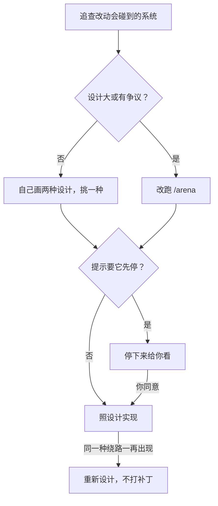
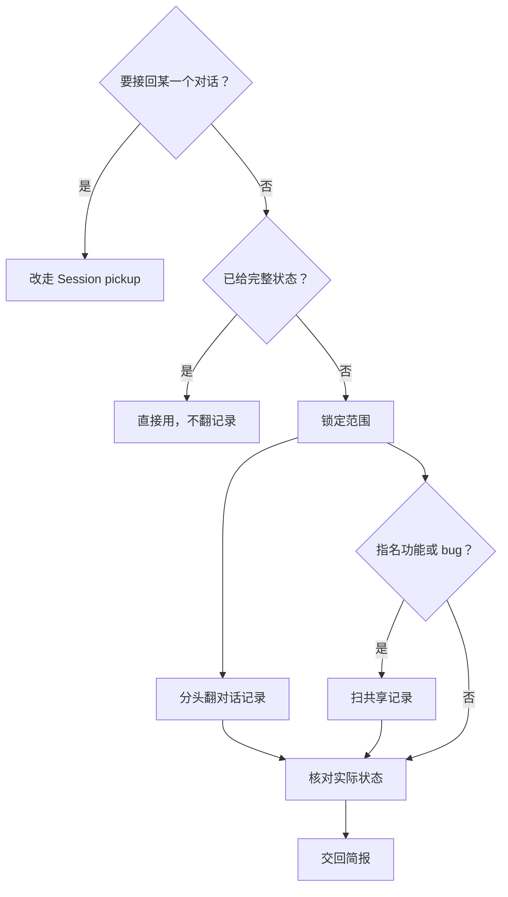
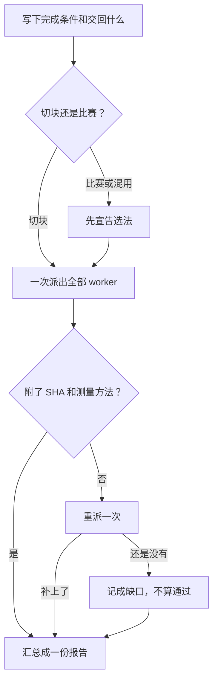

AI 编程助手接到“改一下这个功能”，常常直接从第一个看起来合理的地方动手，用的也是它第一个想到的做法。这篇教你用 pstack 的五个 skill 把顺序倒过来：先让 AI 说清楚代码现在怎么运行、为什么长这样，再比较几种设计，改完再找别的模型挑毛病。

> pstack 系列｜第 2 篇
>
> - 系列导读：[这套 skill 是什么、四篇该怎么读](/posts/pstack-series-guide/)
> - 上一篇（第 1 篇）：[安装、选模型，再用 /poteto-mode 挑 playbook](/posts/pstack-install-routing/)
> - 下一篇（第 3 篇）：[写完代码之后，先证明它能用再合并](/posts/pstack-build-verify-merge/)
{: .prompt-info }

> 这篇以 pstack [`0.15.43` 版](https://github.com/cursor/plugins/blob/2f87c854fe3e2fcda44ca86b46ede35aad3c46b7/pstack/.cursor-plugin/plugin.json)为准，搭配 Claude Code 2.1.326。这一版对应 `cursor/plugins` 的 commit `2f87c85`（2026-11-17 05:47，台北时间）。系列五篇我在 2026-11-17 一起以这一版查证，当时 main 在 `2f87c85` 之后没有改动 pstack；之后的版本，行为可能会改变。
{: .prompt-info }

## 开始之前

pstack 是 Cursor 官方插件库里的一整组 skill，skill 是告诉 AI 怎么完成某类工作的操作说明。安装和选模型写在[第 1 篇](/posts/pstack-install-routing/)，这篇假设你已经装好了。

pstack 的文档用 Cursor 的写法，例如 `/how`。Claude Code 的插件命令要加上插件名称，写成 `/pstack:how`。下面的示例都用 Claude Code 的写法，在 Cursor 里把 `pstack:` 拿掉就好。

这些 skill 都设置成不让 AI 自行调用，要你亲自输入命令。另一个做法是把任务交给 `/pstack:poteto-mode`，让它依任务排顺序。例如提示里写“先不要改任何代码”，它就走只读调查，先追查相关的代码，遇到“为什么”的问题再加上 `/why`。

skill 运行时会另外派出几个 AI 分头做事，每一个叫做子代理。

{: w="800" h="450" }
_先看懂，再设计，改完再审查。`/arena` 可以单独用；设计很大或有争议时，`/architect` 也会改用它。_

## /how：先弄懂代码现在怎么运行

要改一块不熟的代码之前，先用 `/how`。想问“这段代码该放在哪里、该由哪个模块负责、放在这一层对不对”，也用它。它只回答现在怎么运行，为什么这样写是 `/why` 的工作。

直接问你真正想知道的事，可以加上入口点和你最在意的部分：

```text
/pstack:how <功能或模块> 是怎么运行的？请从 <入口，例如某个 API 或命令> 开始，说明数据怎么一路流动、每个文件负责什么。我最想知道 <你在意的部分>。
```

例如：

```text
/pstack:how 用户登录之后，session 是在哪里创建、怎么过期的？过期之后前端会发生什么事？
```

它的流程很短：

1. 范围不清楚时，它先说出自己的理解就开始找，错了你再纠正。
2. 不管问题大小，都只派一个只读的子代理，一次读完代码、写好架构说明。说明写给不熟这一块的资深工程师，读完要能建立正确的理解、放心动手。
3. 把说明交给你，最多小幅润饰或补上对话里的上下文，不会大幅改写。

说明文件没有规定段落。pstack 指南说，它会讲到运行时的流程、关键的类型，以及不明显、容易踩到的地方。想要固定的段落，例如“开始动手时要看哪些文件”，就写进提示。

通过 `/pstack:poteto-mode` 走只读调查时，结果会整理成 Overview、Key Concepts、How It Works、Where Things Live、Gotchas 这几段。如果问的是几个选项怎么选，则改成一份附比较表的建议。

pstack 指南建议先 how 再 why：先弄懂机制，再查历史。

## /why：查出代码为什么长这样

想知道某段代码为什么这样写、当初为什么选这个做法、某个阈值从哪里来，或追查一次退化（原本正常、后来坏掉）的来龙去脉，就用 `/why`。它特别适合在动手改之前用，先知道哪些地方有它的道理、不能随便动。

指出目标和你的问题。如果是为了改它才问，把打算怎么改也写进去，再问当初的理由现在还成立吗：

```text
/pstack:why 为什么 <某段代码或某个决定> 要这样做？这个理由现在还成立吗？我打算 <你想做的修改>。
```

例如：

```text
/pstack:why 为什么 API 的重试上限设成 5 次？这个理由现在还成立吗？我打算把它改成可配置。
```

怀疑是历史包袱造成现在的混乱，也可以一次要两个：“先用 why 查历史，再用 how 说明现在怎么运行”。

说明文件只有一段话，没有规定要派几个子代理、要查哪几类来源，也没有固定的报告段落。照我的读法，它要做三件事：

1. **从记录找答案，不从代码猜。** 先读当初加入这段代码的 commit 和 PR 讨论，再读之后每一次修改它的 commit 和 PR。
2. **线索不够时，才看其他来源。** 你接了 MCP（让 AI 连到外部工具的接口，例如 issue 系统、Slack、Notion）的话，它可能会用上。
3. **分清楚哪些是有人写下的。** 引用作者当初写下的话，自己的推论标明是推论，记录里回答不了的直接说出来。

回答会附上来源。“没有人写下原因”本身也是一种答案。

要改代码的话，在提示最后请它列出哪些要**保留**、哪些可以**改**、哪些要**避免**，以及有什么**风险**。说明文件没有要它列这份清单，要你开口要。把清单带到 `/architect`，当作设计的限制条件。

> `/why` 可能通过你接上的 MCP 读到 issue、文档和聊天记录。开始之前，先确认你愿意让 AI 读到哪些数据。权限怎么收，可以参考我写的[装了第三方 skill 和 MCP 之后，你的 Coding Agent 多了哪些破口？](/posts/coding-agent-supply-chain-permission-risks/)。
{: .prompt-tip }

## /architect：写代码之前，先画设计草稿

不是小修小改、一动手就可能把结构定错的工作，用 `/architect`。pstack 指南的分法是：改动会跨过函数的边界，或会改变某段代码归谁负责，就值得用它。

说明要做什么，加上你最在意的地方。它画完设计默认会接着写代码，想先看设计，**一定要在提示里写明“设计完先停下来给我看”**：

```text
/pstack:architect 帮我设计 <要做的功能>。设计完先停下来给我看，不要实现，并说明你比较了哪两种设计、为什么选这一种。我最在意 <调用端怎么用／性能／之后好不好扩展>。限制：<上一步 /why 查到、不能动的地方>。
```

例如：

```text
/pstack:architect 帮我设计导入数据的流程，设计完先停下来给我看。我最在意调用端怎么用。
```

说明文件只有短短两段，流程整理如下：



两种设计都只有类型、函数签名和模块的分工。它挑最符合这三点的一种：每一份数据状态只由一个地方负责修改、同一件事只有一种做法、调用端需要知道的东西最少。改跑 `/arena` 时，由几个子代理各画一份再比较。

说明文件没有规定设计用什么格式交给你。想看两种设计怎么比、它为什么选这一种、还有哪些问题要你决定，就像上面的示例写进提示。

这个设计很重要、改错代价很高的话，可以在实现之前先对设计跑一次 `/interrogate`，让它派出的模型写个原型，或直接在现有代码上试，找出设计会在哪里出错。不然就等实现完，再对改动跑 `/interrogate`。

## /interrogate：找几个模型一起挑毛病

代码改完、合并之前，用 `/interrogate` 找出你和 AI 都没看到的问题。每个问题都要实际跑过才算数，所以它最适合审实际的代码改动。拿一份没有代码的计划去审，能打破的东西很少，开放的问题先用原型解决。

指出要审什么，范围可以是几个文件、一份 diff 或整个 branch。加上“先不要改任何东西”和“不要挑小毛病”，结果会更好用：

```text
/pstack:interrogate 审查这个 branch 的全部改动，要严格。先不要改任何东西。除非是真正的 bug 或行为退化，不要挑小毛病。
```

只审几个文件时：

```text
/pstack:interrogate 审查 <文件或文件夹>。这次改动的目的是 <你想达成的事>。
```

它的流程：

1. **确定范围。** 你指定了文件或 diff 就用那些。没指定时，它取当前 branch 从分出来的地方（merge base）一路到工作目录的所有改动，还没 commit 的也算。
2. **写下改动的意图。** 依据你的消息、commit 说明和 PR 说明，用自己的话写。意图不清楚时，它会先问你。
3. **派出对手。** 你在 `interrogate reviewers` 配置的每个模型各派一位对手（skill 里叫 adversary）。每位有自己的 worktree（同一个项目的另一份工作副本），还没 commit 的改动也会复制过去。
4. **重跑验证。** 它重跑每个发现附的命令。输出真的显示失败、而且这个失败违反改动的意图才留下，其余丢掉；根本原因相同的发现合并成一个。

每位对手拿到同样的范围、意图和指示：想办法弄坏这个改动，每个问题都要对真实的代码跑一次来证明，例如失败的测试、复现问题的脚本，或打印出错误行为的命令输出。审的是设计或计划时，就写个原型或直接在现有代码上试。

没跑过的不要报，包括风格、命名、结构，以及要等之后再改什么才会出事的风险。什么都没找到，也是合理的结果。

结论分成三段：

- **Intent**：它对这次改动意图的重述。
- **Findings**：每一个验证过的发现，附上命令、输出、怎么违反意图，以及哪几位对手找到。一个都没留下时，会写明没有验证过的发现。
- **Dropped**：每位对手被丢掉几项、为什么。

它不会自动改你的代码，要不要改、改哪些由你决定。先处理 Findings，每一项都附了命令，你可以自己重跑确认。Dropped 也要读，Findings 和 Dropped 的判断你都可以推翻。

{: w="800" h="450" }
_几个模型各自试着弄坏同一份改动，只留下重跑后仍失败的发现。_

## /arena：让几个 AI 各做一份，再挑最好的

只做一次很可能就把做法定错的事，交给 `/arena`。pstack 指南举的例子是命名、数据格式和算法这类单独的决定。你也可以拿它要第二意见：把你现在的设计当成其中一份，看看其他做法有没有更好的。

说清楚任务、为什么重要，以及要几份。决定越重要，可以要越多份：

```text
/pstack:arena <任务>。这件事很重要，因为 <之后很难改／会影响很多地方>。要 <N> 份候选，每份用自己的 worktree。
```

每份候选各有自己的工作位置，尽量用 git worktree。并行的 AI 共用一个工作目录会互相覆盖，也分不出谁改了什么，所以可以像上面一样在提示里要求。

例如：

```text
/pstack:arena 帮我决定缓存 key 的格式，要 3 份候选。这个格式之后很难改。
```

```text
/pstack:arena 针对我们现在的做法给第二意见。
```

它会先开一份待办清单，分成六个阶段：

1. **Frame（定规则）**：每份候选拿到完全相同的提示，所以提示就是约定。它先写清楚要交出什么，再订 3 到 6 条可以打分的评分标准，给评审和第 4 步选底稿用；候选只看到任务。
2. **Fan out（分头做）**：同时派出 N 个子代理各自完成任务，并说明考虑过哪些做法、为什么不选。有一份没交出东西，就用剩下的 N-1 份继续，并记下来。
3. **Cross-judge（评审）**：全部完成后，派一位只读的评审依评分标准逐条打分，推荐一份当底。评审一定要用和主对话不同厂商的模型（Fable 也算 Claude），找不到就跳过，并在说明里写明。
4. **Pick（选底稿）**：它自己也从头读完每份候选、逐条打分，有评审时再比较。一致就确定；不一致代表有一边有偏见或标准不清楚，要再读两边的理由。它选之后最好扩展、又不容易破坏既有规则的那份。
5. **Graft（嫁接）**：每份落选的候选通常挑一两个优点，亲手融进底稿，不直接粘贴。做法一致就直接用共同的做法；差太多代表第 1 步没讲清楚，要重新定规则再跑，而不是取平均。
6. **Verify（验证）**：像验证其他产出一样验证合并后的结果。有问题时，判断是第 1 步定错了（重来），还是某份候选其实抓到了、只是漏了嫁接（回到第 5 步）。

在 Claude Code 里，子代理只能用 Claude 的模型（Opus、Sonnet、Haiku、Fable）。评审名单里别家的模型（默认是 Gemini）会[改用主对话的模型](https://github.com/cursor/plugins/blob/2f87c854fe3e2fcda44ca86b46ede35aad3c46b7/pstack/docs/harness/claude-code.md#L36)来跑；名单里全是 Claude 的模型时，就跳过评审。不论哪一种，结果里都会写明。

你会拿到合并后的结果和一段说明：选了哪份当底和原因、评审的结论（或跳过了评审）、每项嫁接来自哪份、哪些被舍弃和原因、有没有候选收敛或缺席，以及验证结果。

产出是代码的话，合并前可以再跑 `/interrogate`。要的是“每个包都检查一遍”这种覆盖，而不是比较做法，就改用 `/swarm`。

{: w="800" h="450" }
_候选越多，派出的子代理就越多：N 份候选，再加最多一位评审。_

## 视情况加用：三个 skill 和两个 playbook

上面五个是主线，下面这几个只在特定情况下才用。原型和写计划是 `/poteto-mode` 下面的 playbook，要通过它来跑，没有单独的命令。

### /teach：摘要不够，要真的弄懂

`/how` 给的说明不够、想真的弄懂一个改动或一块代码时，用 `/teach`。例如要审一个 PR、接手不熟的模块，或想确认一个修法处理的是原因，而不是症状。它也能拿来问 AI 自己的做法（[指南第 3 章](https://github.com/cursor/plugins/blob/2f87c854fe3e2fcda44ca86b46ede35aad3c46b7/pstack/docs/guide/03-understand.md#L37-L51)）。

说出你想弄懂什么。指南建议加一句“说服我”，让说明变成一段你能检验的论证，而不只是导览：

```text
/pstack:teach 这个 PR 怎么改了重试的流程？说服我它修的是原因，不是症状。
```

问 AI 自己的做法：

```text
/pstack:teach 你为什么这样实现，而不是用队列？你取舍了什么、为什么？
```

指南提到，这对 AI 也有帮助：它得回去读代码、给每个说法找证据，不能很有把握地带过就算了。

它的做法（[SKILL.md](https://github.com/cursor/plugins/blob/2f87c854fe3e2fcda44ca86b46ede35aad3c46b7/pstack/skills/teach/SKILL.md#L11-L17)）：

1. **先决定你该带走哪几件事。** 从对话判断你为什么问（要改、要审、要调试，还是刚接手）和已经懂什么，再挑几个重点。你显然懂的就跳过，也不会出题考你。
2. **让 `/how` 和 `/why` 去查。** 它先自己读代码找方向，再并行跑 `/how` 和 `/why`，把结果合在一起。一整个子系统就两个都跑，小改动可能只跑其中一个。
3. **先给最短的完整答案。** 先用一两句说它是什么，再接到你眼前的案例，之后才往机制、理由和边界情况深入。你问了才加深，不会一次倒出一大段。
4. **图一张一张叠上去。** 有三个以上的部分时，它不画一张全挤在一起的大图，而是画一系列，每张重画前一张再多加一个部分。
5. **保留 `/why` 的不确定用语。** 为了教学它可以改写，但 `/why` 标成推论或“记录里找不到”的地方会原样保留，因为那是核实的结果，不是语气。

你会拿到一段大白话的解释，不是“我做了什么”的报告。它先讲重点，再说它是什么、怎么运行、为什么这样，最后列出值得再用 `/how` 或 `/why` 追下去的线索（[SKILL.md](https://github.com/cursor/plugins/blob/2f87c854fe3e2fcda44ca86b46ede35aad3c46b7/pstack/skills/teach/SKILL.md#L21)）。它的目标是让你懂，不会改任何代码（[SKILL.md](https://github.com/cursor/plugins/blob/2f87c854fe3e2fcda44ca86b46ede35aad3c46b7/pstack/skills/teach/SKILL.md#L9)）。

弄懂了、准备动手，就接 `/architect`。

### /recall：接回旧题目之前，先找回自己的上下文

要开始或接回一个做过的题目时，先用 `/recall` 找回自己最近做到了哪里。旧对话里有新开的 AI 不知道的上下文，所以指南建议先加载，再交代新的任务（[指南第 3 章](https://github.com/cursor/plugins/blob/2f87c854fe3e2fcda44ca86b46ede35aad3c46b7/pstack/docs/guide/03-understand.md#L53-L65)）。只要接回**某一个**对话的话，那是 Session pickup playbook 的工作，我写在[第 4 篇](/posts/pstack-principles-customization/)。

说清楚题目和时间范围；有新的资料要它处理，就接在后面：

```text
/pstack:recall 帮我整理上周做导出功能的进度
```

```text
/pstack:recall 我昨天在虚拟列表上做的事，然后读这份 bug 报告。
```

它的流程如下（[SKILL.md](https://github.com/cursor/plugins/blob/2f87c854fe3e2fcda44ca86b46ede35aad3c46b7/pstack/skills/recall/SKILL.md#L17-L22)）：



完整状态指路径、分支和改了什么。范围包括时间（“最近”默认是最近 7 天）、题目和项目（默认是当前这个，没有你的要求不读其他项目的记录），它会先把范围说给你听。

翻对话记录时，它并行派出几个用快速、便宜模型的子代理，各负责一部分，只读和题目有关的对话与段落。只有一两个对话时不派子代理，直接搜。

每个子代理用同样的格式汇报：题目、你的目标、做过的决定、还没完成的事、卡住或被纠正的地方，以及产出（PR、ticket、分支）。在 Claude Code 里，它读的是 `~/.claude/projects/` 下面这个项目的对话记录（`.jsonl` 文件）。它只读这个项目的文件夹（[Claude Code 对照文档](https://github.com/cursor/plugins/blob/2f87c854fe3e2fcda44ca86b46ede35aad3c46b7/pstack/docs/harness/claude-code.md#L57)）。

共享记录指版本控制、issue 系统、聊天频道、文档和错误追踪，每个来源各派一位子代理，问“现在的状态是什么、试过哪些没成功、用户还在反馈什么”。题目只要指名了功能、文件、子系统或 bug，这一步就一定会做，没接上的 MCP 才跳过并说明。

最后一步用 `git` 和 `gh` 核对找到的 PR、分支和 ticket 现在的状态。

简报按固定格式写（[SKILL.md](https://github.com/cursor/plugins/blob/2f87c854fe3e2fcda44ca86b46ede35aad3c46b7/pstack/skills/recall/SKILL.md#L24-L33)）：

- **Capsule**：最多 5 点，说明这件工作是什么、整体进行到哪里。
- **Threads**：每条工作一行，前面标一个状态，例如 `[merged #N]`、`[open PR #N]`、`[in flight <branch>]`、`[reverted #N]`。
- **Problems**：最多 5 个反复出现的问题，包括用户一直反馈的症状，以及上线后又被 revert 的修法，让下一次从上次失败的地方开始。
- **Next move**：最有用的下一步。

从对话记录找到的内容会附上对话 ID，从共享记录找到的会附上来源，例如 PR 编号或 ticket ID。按 Next move 开一个新任务，交给 `/pstack:poteto-mode`。

> `/recall` 会读你过去的对话记录，也可能通过你接上的 MCP 去读 issue、聊天频道和错误追踪。和 `/why` 一样，开始之前先确认你愿意让 AI 读到哪些资料。
{: .prompt-tip }

### /swarm：要的是覆盖，不是比较做法

并行做能换来覆盖，或能让几个独立的尝试比赛时，用 `/swarm`。例如每个包各检查一次，或让几个 worker 同时试着复现一个偶发的失败。

三个会并行派工的 skill，区别在怎么收敛结果：

| skill | 怎么派工 | 怎么收敛 |
| --- | --- | --- |
| `/arena` | 同一份任务做 N 次 | 评审打分，选底稿再嫁接优点 |
| `/interrogate` | 借用 `/arena` 的派工，每个模型一位对手 | 不评审、不选底稿也不嫁接；每位对手找到的失败不一样，所以保留每一个验证过的发现 |
| `/swarm` | 切成几块各做各的，或让几个 worker 拿同一份任务比赛 | 选法事先讲好，不选底稿也不嫁接（[指南第 4 章](https://github.com/cursor/plugins/blob/2f87c854fe3e2fcda44ca86b46ede35aad3c46b7/pstack/docs/guide/04-design.md#L47-L55)） |

说清楚怎么切、每一块怎么检查，以及最后要一份报告：

```text
/pstack:swarm 用每个包自己的 check.sh 检查 packages/ 下面的每个包。一个包一个 worker，最后给我一份报告。
```

要比赛时，事先讲好怎么选：

```text
/pstack:swarm 派 3 个 worker，各自试着复现这个偶发失败的测试。先复现的就算数。
```

它会先开一份待办清单，分成 Frame、Fan out、Aggregate、Report 四个阶段（[SKILL.md](https://github.com/cursor/plugins/blob/2f87c854fe3e2fcda44ca86b46ede35aad3c46b7/pstack/skills/swarm/SKILL.md#L11-L41)）：



选法有三种：`first pass`（第一个通过的）、`rank all`（全部排名）或 `best-of`（挑最好的）。worker 的模型读 `/setup-pstack` 设置里的 `swarm workers` 那一行，没有这一行就用 Opus 5.5（high）。

worker 要写文件时各有自己的输出位置；要验证或测量某些 commit 时，任务说明会写明确切的 SHA 和测量方法。

每份任务说明都能单独读懂，写明目标、范围、负责哪一块、怎么验证、汇报什么。汇报用 `PASS`、`ISSUES` 或 `BLOCKED` 并附证据，能证明有问题的 worker 要列出每一个能证明的问题，不能只报第一个。

在 Cursor 里 worker 默认跑在云端，在 Claude Code 里改成每个 worker 各用一个 worktree（[Claude Code 对照文档](https://github.com/cursor/plugins/blob/2f87c854fe3e2fcda44ca86b46ede35aad3c46b7/pstack/docs/harness/claude-code.md#L24)）。有 worker 没交东西，就用剩下的 N-1 个继续，并记下来。

汇总时，覆盖型的工作每一块都要有结果，比赛则按事先宣告的选法挑。报告在对话里交回，不贴 worker 的原始输出，内容是结果表、每个问题一行的摘要、缺口或缺席的 worker，比赛时再加上选法。

`ISSUES` 列出的问题一项一项修，`BLOCKED` 和缺口另外处理，不要当成通过。

### 原型：用跑得起来的东西做决定

做原型走的是 Prototype playbook，适合跑一下就能回答的开放问题，例如布局、交互、时序或某种做法。指南的建议是不要采用第一个设计，而是要几个方案，再从看得到的证据里挑；不只界面，行为和算法也适用（[指南第 4 章](https://github.com/cursor/plugins/blob/2f87c854fe3e2fcda44ca86b46ede35aad3c46b7/pstack/docs/guide/04-design.md#L67-L83)）。

`/poteto-mode` 遇到跑一下就能解决的分歧时，本来就会先做原型，而不是停下来问你（[SKILL.md](https://github.com/cursor/plugins/blob/2f87c854fe3e2fcda44ca86b46ede35aad3c46b7/pstack/skills/poteto-mode/SKILL.md#L21)）。

说出要比较什么，以及你想看到的证据：

```text
/pstack:poteto-mode 给新的下拉菜单做几个原型方案，放在同一个切换器后面，每个都截图给我比较。
```

设计比较大时，可以和 `/architect` 一起用，并留一个由你审查的关卡：

```text
/pstack:poteto-mode 我们要给外部 webhook 加上限流。先用 /architect 设计，开放的问题用原型回答。继续之前先让我看过。
```

这是唯一一个把“最小改动”和验证标准倒过来的 playbook。速度优先，代码质量不重要，也不做计划；严谨的地方在于用最低的成本选对设计，它也会提出你没要求的变化。步骤如下（[Prototype playbook](https://github.com/cursor/plugins/blob/2f87c854fe3e2fcda44ca86b46ede35aad3c46b7/pstack/skills/poteto-mode/playbooks/prototype.md#L5-L12)）：

1. **先讲清楚要做哪个决定。** 例如哪种布局、交互、密度，或哪种行为、时序、做法。没有要做的决定就不做原型，改走一般的 Feature playbook。
2. **方向还很开放时，先找参考。** 搜索前例，整理主题、配色和布局的参考，让你先挑方向。方向已经定了就跳过。
3. **在临时文件夹做一次性的版本，和正式代码分开。** 视觉的决定用能呈现想法的最轻技术，例如纯 HTML、CSS、JavaScript；行为或时序的决定写一个最小的脚本。不用正式框架、不写测试、不做抽象。
4. **方案放在同一个切换器后面。** 用按钮或快捷键切换，每个方案都标上名称。
5. **在对应的界面验证。** 视觉的决定给每个方案截图并实际操作，行为或时序的决定记录时间、打印输出或看画面，观察本身就是测试。截图要靠操作界面的 skill，例如 `cursor-team-kit` 的 `control-ui`（见[第 1 篇](/posts/pstack-install-routing/)）。
6. **列出方案、取舍和建议。**

你会拿到试过的方案、证据（视觉的决定是截图，行为的决定是观察到的输出或时间）、取舍、建议，以及临时文件夹的路径。它会明确说明原型是一次性的（[Prototype playbook](https://github.com/cursor/plugins/blob/2f87c854fe3e2fcda44ca86b46ede35aad3c46b7/pstack/skills/poteto-mode/playbooks/prototype.md#L14)）。选定方向后交给 Feature playbook 正式实现，或先用 `/architect` 定出形状，原型的代码不要直接合并进项目。

### 写计划：设计定了，再拆成 PR

写计划走的是 Multi-phase plan playbook。pstack 刻意没有做规划用的 skill；作者在 README 里写明自己不相信先做计划，认为最好的规格就是代码（[README](https://github.com/cursor/plugins/blob/2f87c854fe3e2fcda44ca86b46ede35aad3c46b7/pstack/README.md#L268-L270)）。

工作会跨好几个 PR、而且设计已经定了，才用它（[指南第 4 章](https://github.com/cursor/plugins/blob/2f87c854fe3e2fcda44ca86b46ede35aad3c46b7/pstack/docs/guide/04-design.md#L95-L111)）。提示里写出每个 PR 要怎么证明能用：

```text
/pstack:poteto-mode 把这个设计写成计划。拆成小的、可以验证的 PR，每个都有自己的验证步骤。
```

做迁移时，把标准写进提示：

```text
/pstack:poteto-mode 规划把 UI 组件库迁移到新的样式系统。拆成小的、可以验证的 PR，每个都要做视觉回归检查。结果要和原来完全一样，连 bug 也一样。
```

“连 bug 也一样”是为了不让迁移顺手修掉东西，不然新旧两边的结果就没法比对了。

步骤如下（[Multi-phase plan playbook](https://github.com/cursor/plugins/blob/2f87c854fe3e2fcda44ca86b46ede35aad3c46b7/pstack/skills/poteto-mode/playbooks/multi-phase-plan.md#L5-L9)）：

1. **改动小就跳过。** 只动一两个文件、做法很明显时，它说明不需要计划，然后停下。
2. **先用原型解决还没定的问题。** 只有跑什么都决定不了的产品或偏好问题，才问你。
3. **写计划文件的开头。** 写这次改了什么、PR 的合并顺序和依赖关系：哪些 PR 互相独立、可以直接从主干分出来，哪些要等谁，每个 PR 能碰哪些文件。
4. **每个 PR 一节。** 一个 PR 只做一件事、有自己的证据。每节用复选框列出依赖、要改的文件、要做的那个改动、你会看到的结果，以及怎么验证。
5. **只有测试不算验证。** 单元测试、实际操作和性能三格都要勾满：实际操作要在真实的界面跑一个具体场景并写出通过条件，性能要写出指标、测量方法、先测好的主干基准，以及超过多少算失败。改到交互的 PR，合并前要等你审过。
6. **交回计划文件的路径就停下。** 你明确说开始，它才会执行。

你会拿到计划文件的路径、各个 PR 的编号和依赖、哪些 PR 要你审过才能合并，以及还没证明的部分（[Multi-phase plan playbook](https://github.com/cursor/plugins/blob/2f87c854fe3e2fcda44ca86b46ede35aad3c46b7/pstack/skills/poteto-mode/playbooks/multi-phase-plan.md#L11)）。计划里也会写明之后由哪个 playbook 执行（[指南第 10 章](https://github.com/cursor/plugins/blob/2f87c854fe3e2fcda44ca86b46ede35aad3c46b7/pstack/docs/guide/10-recipes-and-pitfalls.md#L45)）。

工作会跨好几天时，指南建议可以暂时把计划 commit 进 repo，让其他 agent 看到进度，做完再删掉。

## 一个完整的例子（虚构）

> **以下是我虚构的情境**，只用来示范五个 skill 怎么接在一起。
{: .prompt-info }

假设你维护一个网站，现在每来一条通知（有人留言、有人点赞），系统就发一封邮件。你想加一个选项：用户可以改成每天只收一封摘要邮件。

**1. 先看懂现在的通知怎么发。**

```text
/pstack:how 通知是从哪里触发、怎么排进队列、最后由谁发出邮件的？我最想知道发邮件这一步跟用户偏好设置是怎么接起来的。
```

读它的说明，确认你知道发邮件的代码在哪里、有哪些容易踩到的地方。

**2. 查清楚为什么现在是一条一封。**

```text
/pstack:why 为什么通知是每来一条就马上发，而不是整批发？这个理由现在还成立吗？我打算加一个“每日摘要”的选项，最后请列出哪些要保留、哪些可以改、哪些要避免，以及有什么风险。
```

你在提示最后要了这份清单，报告就会附上。例如它可能提醒你，某类通知当初就是为了实时才这样设计，要保留。

**3. 先画设计，停下来给你看。**

```text
/pstack:architect 帮我设计“每日摘要邮件”这个选项。设计完先停下来给我看，不要实现，并说明你比较了哪两种设计、为什么选这一种。我最在意现有的实时通知不要受影响。限制：<粘贴第 2 步清单里要保留和要避免的部分>。
```

`/architect` 的第一步本来就会自己追查改动会碰到的代码，但说明文件没有要它查历史。想把当初的理由当成限制，就要像第 2 步这样自己先跑 `/why`。

前两步安排成手动跑，也是为了让你先看懂代码、检查 AI 的理解有没有偏。不需要这些的话，可以直接从这一步开始。

**4. 遇到一个单独的决定，交给 `/arena`。**

假设设计里还有一个没定的问题：摘要邮件的内容要依时间排，还是依通知类型分组？这种单独的决定，可以另外交给 `/arena`：

```text
/pstack:arena 帮我设计每日摘要邮件的内容格式，要 3 份候选。重点是让用户一眼看到最重要的通知。
```

**5. 改完之后，合并之前审查。**

```text
/pstack:interrogate 审查这个 branch 的全部改动，要严格。先不要改任何东西。除非是真正的 bug 或行为退化，不要挑小毛病。
```

先处理 Findings，再读一遍 Dropped。

> 这个例子我写成**逐一手动**调用每个 skill，好让你掌握每一步。平常可以直接把目标和限制交给 `/pstack:poteto-mode`，让它决定用哪些 skill、照什么顺序。这时不要在提示里逐一列出 skill，那会打乱它排好的顺序；只有想改变默认做法时，才点名某个 skill。
{: .prompt-tip }

## 什么时候用哪一个

pstack 指南先讲了一句很重要的话：**大部分的改动，这些都不需要。**下面是它建议的分法，我再加上 `/how`、`/why`、`/teach` 和 `/recall`：

| 情况 | 用哪个 |
| --- | --- |
| 要改一块不熟的代码，先弄懂它现在怎么运行 | `/how` |
| 想知道为什么这样写、改之前哪些不能动 | `/why`（要它最后列出哪些要保留、哪些要避免） |
| 摘要不够，想真的弄懂一个改动或一块代码 | `/teach` |
| 接回做过的题目，先找回自己做到哪里 | `/recall`（只接回某一个对话时，用 Session pickup） |
| 一个已经改完的小改动，但你不放心 | 只用 `/interrogate` |
| 改动会跨过函数的边界，或改变某段代码归谁负责 | `/architect`（设计大或有争议时，它会带上 `/arena`） |
| 一个单独的决定，例如命名、数据格式、算法 | 直接用 `/arena` |
| 有争议、改错代价很高的设计 | 先 `/architect`，合并前再 `/interrogate` |
| 要做覆盖，例如每个包都检查一遍，或让几个 worker 比赛 | `/swarm` |
| 跑一下就能回答的问题，例如布局、时序或做法 | 用 `/poteto-mode` 做原型，不要靠讨论 |
| 会跨好几个 PR 的工作 | 设计定了之后，用 `/poteto-mode` 写计划 |
| 想交给 AI 自己判断 | `/poteto-mode`，它已经内置这套分法 |

## 每个 skill 派出多少子代理

派出的子代理越多，通常越耗额度：

| skill | 派出的子代理 |
| --- | --- |
| `/how` | 一个 |
| `/why` | 说明文件没有规定 |
| `/teach` | 实际跑 `/how` 和 `/why`，小改动可能只跑一个 |
| `/recall` | 并行翻对话记录的子代理；题目指名功能或 bug 时，每个共享记录的来源再各派一位 |
| `/interrogate` | 每个模型一位对手，每位都在自己的 worktree 里实际跑代码 |
| `/arena` | N 份候选，再加最多一位评审 |
| `/architect` | 遇到大型或有争议的设计时跑一整场 `/arena`，这时派出的最多 |
| `/swarm` | 切成几块就派几个 worker |

小改动不值得动用 `/architect` 或 `/arena`。

## 结论

不是每次都要全部跑一遍。小改动直接改，改完不放心再用 `/interrogate` 审查；会动到结构的改动，先用 `/how`、`/why` 看懂，再让 `/architect` 停下来给你看设计。

## 延伸阅读

- [指南：Understand the code](https://github.com/cursor/plugins/blob/2f87c854fe3e2fcda44ca86b46ede35aad3c46b7/pstack/docs/guide/03-understand.md)：`/how`、`/why`、`/teach`、`/recall` 各自适合的情况。
- [指南：Design](https://github.com/cursor/plugins/blob/2f87c854fe3e2fcda44ca86b46ede35aad3c46b7/pstack/docs/guide/04-design.md)：`/architect`、`/arena`、`/swarm`、`/interrogate` 和原型。
- [指南：Recipes and pitfalls](https://github.com/cursor/plugins/blob/2f87c854fe3e2fcda44ca86b46ede35aad3c46b7/pstack/docs/guide/10-recipes-and-pitfalls.md)：可以直接复制的提示和常见陷阱。
- skill 的说明文件：[how](https://github.com/cursor/plugins/blob/2f87c854fe3e2fcda44ca86b46ede35aad3c46b7/pstack/skills/how/SKILL.md)、[why](https://github.com/cursor/plugins/blob/2f87c854fe3e2fcda44ca86b46ede35aad3c46b7/pstack/skills/why/SKILL.md)、[architect](https://github.com/cursor/plugins/blob/2f87c854fe3e2fcda44ca86b46ede35aad3c46b7/pstack/skills/architect/SKILL.md)、[interrogate](https://github.com/cursor/plugins/blob/2f87c854fe3e2fcda44ca86b46ede35aad3c46b7/pstack/skills/interrogate/SKILL.md)、[arena](https://github.com/cursor/plugins/blob/2f87c854fe3e2fcda44ca86b46ede35aad3c46b7/pstack/skills/arena/SKILL.md)、[teach](https://github.com/cursor/plugins/blob/2f87c854fe3e2fcda44ca86b46ede35aad3c46b7/pstack/skills/teach/SKILL.md)、[recall](https://github.com/cursor/plugins/blob/2f87c854fe3e2fcda44ca86b46ede35aad3c46b7/pstack/skills/recall/SKILL.md)、[swarm](https://github.com/cursor/plugins/blob/2f87c854fe3e2fcda44ca86b46ede35aad3c46b7/pstack/skills/swarm/SKILL.md)。
- playbook 的说明文件：[Prototype](https://github.com/cursor/plugins/blob/2f87c854fe3e2fcda44ca86b46ede35aad3c46b7/pstack/skills/poteto-mode/playbooks/prototype.md)、[Multi-phase plan](https://github.com/cursor/plugins/blob/2f87c854fe3e2fcda44ca86b46ede35aad3c46b7/pstack/skills/poteto-mode/playbooks/multi-phase-plan.md)。
- [pstack 系列（1）：安装、选模型，再用 /poteto-mode 挑 playbook](/posts/pstack-install-routing/)：怎么安装，以及 `/poteto-mode` 怎么替任务排顺序。
- [自己写 Agent Skill](/posts/agent-skill-authoring-guide/)：从写 skill 的角度看 SKILL.md 的结构和测试。
- [装了第三方 skill 和 MCP 之后，你的 Coding Agent 多了哪些破口？](/posts/coding-agent-supply-chain-permission-risks/)：agent 读得到哪些文件、权限怎么收。
- 另一套 skill 的做法：[mattpocock/skills 系列导读](/posts/mattpocock-skills-series-guide/)、[把模糊需求问清楚](/posts/mattpocock-skills-requirements-shared-language/)、[先找出缺口，再决定要写规格还是拆工作单](/posts/mattpocock-skills-specs-work-breakdown/)、[代码写完之后，谁来看结构、审修改、解冲突](/posts/mattpocock-skills-design-review-integration/)、[查资料、做交接、学新东西](/posts/mattpocock-skills-research-handoff/)。
