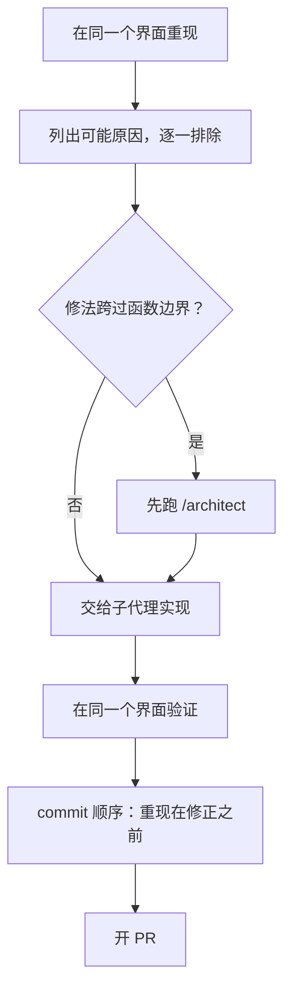
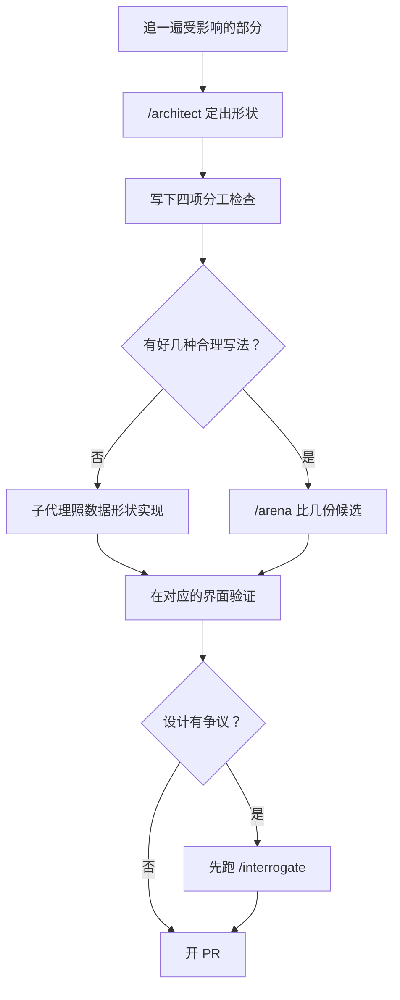
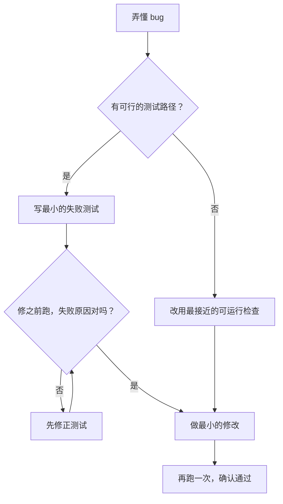
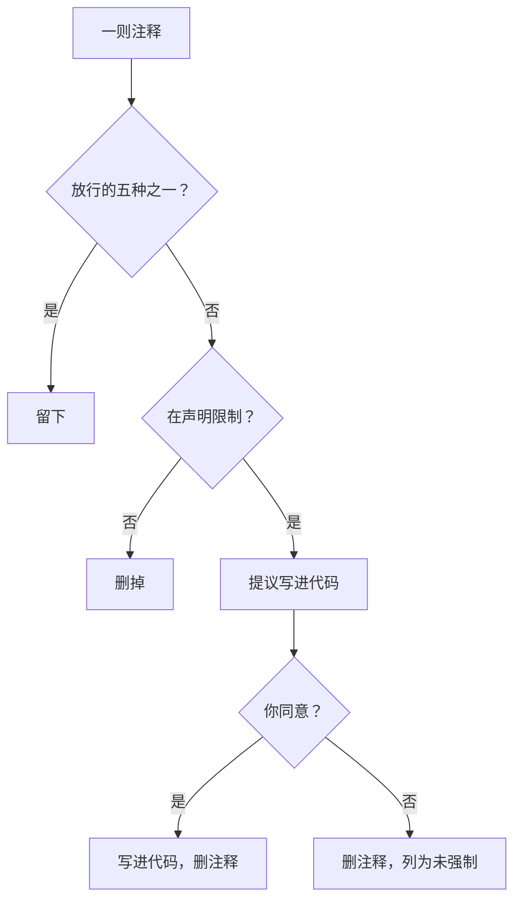
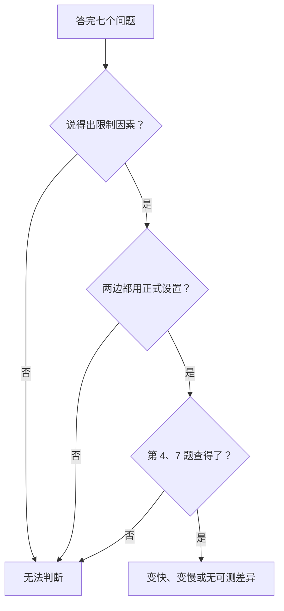

AI 编程助手改完代码，常常回一句“改好了，应该没问题”。可是编译通过只证明程序过了编译检查，不代表功能符合需求，“应该没问题”更没有任何验证依据。这篇教你用 pstack 把“证明它能用”变成流程的一部分，从先重现再修、清理 diff、找出改动会弄坏的别处、让 AI 实际操作程序，一路到开 PR、推到可以合并。

> pstack 系列｜第 3 篇
>
> - 系列导读：[这套 skill 是什么、四篇该怎么读](/posts/pstack-series-guide/)
> - 上一篇（第 2 篇）：[改代码之前，先看懂再设计](/posts/pstack-understand-design/)
> - 下一篇（第 4 篇）：[用原则指挥 AI、做出自己的 mode，再放心让它自己跑](/posts/pstack-principles-customization/)
{: .prompt-info }

> 这篇以 pstack [`0.15.43` 版](https://github.com/cursor/plugins/blob/2f87c854fe3e2fcda44ca86b46ede35aad3c46b7/pstack/.cursor-plugin/plugin.json)为准，搭配 Claude Code 2.1.326。这一版对应 `cursor/plugins` 的 commit `2f87c85`（2026-11-17 05:47，台北时间）。系列五篇我在 2026-11-17 一起以这一版查证，当时 main 在 `2f87c85` 之后没有改动 pstack；之后的版本，行为可能会改变。
>
> Claude Code 对第三方插件市场默认不自动更新（[README](https://github.com/cursor/plugins/blob/2f87c854fe3e2fcda44ca86b46ede35aad3c46b7/pstack/README.md#L28)），所以照第 1 篇装好的 pstack 会停在安装时的版本。怎么更新或固定版本，见[第 1 篇](/posts/pstack-install-routing/)。
{: .prompt-info }

## 开始之前

pstack 是 Cursor 官方插件库里的一整组 skill，skill 是告诉 AI 怎么完成某类工作的操作说明。安装方法写在[第 1 篇](/posts/pstack-install-routing/)，改代码之前怎么看懂和设计写在[第 2 篇](/posts/pstack-understand-design/)，这篇假设你已经装好了。

Claude Code（在终端里使用的 AI 编程助手）的插件命令要加上插件名称，例如 `/pstack:tdd`。下面的示例都用 Claude Code 的写法，在 Cursor 里把 `pstack:` 拿掉就好。

这篇的工具分成两种，叫法不一样：

| 种类 | 是什么 | 这篇用到的 | 怎么启动 |
| --- | --- | --- | --- |
| playbook | `/poteto-mode` 里的固定流程，一个步骤接一个步骤走 | Feature（新功能）、Bug fix（修 bug）、Opening a PR（开 PR）、Babysit（照顾 PR 到可以合并） | 没有自己的命令。你把任务交给 `/pstack:poteto-mode`，它依任务挑对应的 playbook |
| skill | 独立的命令 | `/tdd`、`/unslop`、`/no-comments`、`/blast-radius`、`/benchmark-checklist`、`/create-verification-skill`、`/maintain-verification-skill` | 设置为由用户调用，要用时由你输入 |

skill 设置成由你调用，但这不妨碍 playbook 直接读它的说明文件。`/poteto-mode` 的 playbook 走到相关步骤时，会自己去读那个 skill 的说明文件照做（[Claude Code 对照说明](https://github.com/cursor/plugins/blob/2f87c854fe3e2fcda44ca86b46ede35aad3c46b7/pstack/docs/harness/claude-code.md#L12)），例如：

- 修 bug 时用 `/tdd` 的节奏
- 审查前跑 `/no-comments`
- 写任何文本都套 `/unslop`

`/blast-radius` 和两个验证 skill 不在 playbook 的步骤里，要用就自己调用。

{: w="800" h="450" }
_从写代码到可以合并的四个阶段。开 PR 不会自动开始 babysit，合并永远由你决定。_

## 先把“怎样算完成”写进第一个提示

pstack 指南把这件事放在验证的第一步（[指南第 6 章](https://github.com/cursor/plugins/blob/2f87c854fe3e2fcda44ca86b46ede35aad3c46b7/pstack/docs/guide/06-verify-and-ship.md#L9-L27)）。例如：

```text
/pstack:poteto-mode 帮这个命令加上 JSON 输出。原本的文本输出要一个字节都不变，JSON 要能被解析，两种格式都要拿示例项目实际跑一次。把证据给我看。
```

这样 AI 就有了三项具体的验收要求，可以逐项检查是否完成。它的回复应该附上确切的命令和输出；有检查跑不了时，好的回复会写“无法判断”（inconclusive）。**很有自信、却没附证据的回复，我会当成警示信号。**

检查也要对得上改动：

| 改了什么 | 怎么检查 |
| --- | --- |
| 命令 | 实际跑一次命令 |
| 界面 | 在运行中的程序里走一遍改过的流程 |
| 解析器或数据迁移 | 重放一份存好的输入 |
| 性能 | 比较前后的性能剖析 |
| 保存 | 把写进去的值读回来 |

`/poteto-mode` 的第一则回复，会先说出你的目标和它预计的最小改动，然后直接开始，不等你确认（[SKILL.md](https://github.com/cursor/plugins/blob/2f87c854fe3e2fcda44ca86b46ede35aad3c46b7/pstack/skills/poteto-mode/SKILL.md#L19)）。所以它理解错了，你马上就看得出来。

## 实现：用 playbook 写代码

[指南第 5 章](https://github.com/cursor/plugins/blob/2f87c854fe3e2fcda44ca86b46ede35aad3c46b7/pstack/docs/guide/05-build-and-clean.md#L5-L31)的原则是：在提示里写你观察到的事，让 playbook 依流程取得验证所需的证据。playbook 会补上你没打的步骤，例如修之前先重现、实现之前先说清楚数据形状。

### 修 bug：先重现，再修

有一个用户反馈的错误，要重现、找出根本原因、修好，而且要有运行时的证据，就交给 Bug fix playbook。提示里写出症状，并要求先重现：

```text
/pstack:poteto-mode <症状：在什么情况下，发生了什么，应该是什么>。先重现，再修，修完验证。
```

例如：

```text
/pstack:poteto-mode 这个命令在重试之后会写出两笔记录，应该只有一笔。先重现，再修，修完验证。
```

它的流程如下（[bug-fix playbook](https://github.com/cursor/plugins/blob/2f87c854fe3e2fcda44ca86b46ede35aad3c46b7/pstack/skills/poteto-mode/playbooks/bug-fix.md)）：



重现时，它在问题发生的同一个界面（命令行、网页界面等）实际操作，把 bug 弄出来。只有在它真的碰不到、而且说得出具体原因时，才会请你帮忙重现。直接重现不了，它会自己造出触发条件，或加上日志（log），直到 bug 出现。

找原因用的是二分法。它先追一遍相关的代码、用 `/why` 查这段代码的修改历史，列出几个可能的原因。接着每一轮挑最能缩小范围的切法，拿运行时的证据来排除，不用猜的。

实现交给子代理，也就是 skill 运行时另外派出、分头做事的 AI。验证时，原本的重现步骤现在要通过；“无法判断”或在不同的界面验证，都不算通过。单元测试只能证明某个分支怎么跑，不能证明 bug 不见了。

commit 的顺序是：会失败的重现（例如一个测试）先进 git 历史，修正排在它后面。bug 有低成本的本地测试路径时，照 `/tdd` 的节奏做；测试很贵、要动用一大堆环境，或不清楚怎么测时，就跳过。

整个过程有一条规则，我觉得最值得记住：**每一行留下来的修改，都要能对应到运行时的证据。**“也许有帮助”的保险写法只是假设，不会留下。证据推翻了某个假设，因它而改的代码也要还原（[bug-fix playbook 第 5 行](https://github.com/cursor/plugins/blob/2f87c854fe3e2fcda44ca86b46ede35aad3c46b7/pstack/skills/poteto-mode/playbooks/bug-fix.md#L5)）。

它的回复会说明哪里坏了、根本原因、怎么修、怎么验证，并**原文粘贴修之前失败、修之后通过的重现输出**。我建议自己读一遍那段前后输出，确认失败的原因真的是你反馈的那个 bug。默认流程会接着开 PR；如果你要求它先停下，就在确认证据后再让它继续。

### 新功能：先说清楚数据形状

添加或改变一个行为时，交给 Feature playbook。提示里写出要的行为，以及**什么不能变**：

```text
/pstack:poteto-mode <要加的行为>。<哪些既有的行为不能变>。<怎么验证>。
```

例如（取自[指南第 5 章](https://github.com/cursor/plugins/blob/2f87c854fe3e2fcda44ca86b46ede35aad3c46b7/pstack/docs/guide/05-build-and-clean.md#L13-L17)）：

```text
/pstack:poteto-mode 加一个 --json 选项。原本的文本输出要一个字节都不变。两种格式都要验证。
```

它的流程如下（[feature playbook](https://github.com/cursor/plugins/blob/2f87c854fe3e2fcda44ca86b46ede35aad3c46b7/pstack/skills/poteto-mode/playbooks/feature.md)）：



`/architect` 会草拟两种不同的类型、函数签名和模块边界，再挑一种（[SKILL.md](https://github.com/cursor/plugins/blob/2f87c854fe3e2fcda44ca86b46ede35aad3c46b7/pstack/skills/architect/SKILL.md#L9)；第 2 篇有详细介绍）。

四项分工检查会写成待办清单上的四项。某一项不适用时（例如只改一个文件），它也会留在清单上，注明 `n/a: <理由>`：

- 哪些步骤要先做完
- 哪些工作可以并行
- 哪些状态会被共享
- 最小又安全的拆法是什么

交给子代理写代码时，范围会写得很具体：文件路径、**数据形状**，以及成功条件。数据形状是指代码处理的数据长什么样、用什么结构组织，例如用一个状态机取代散落各处的一堆布尔值，或用一张对照表取代一长串 if。

验证的标准和修 bug 一样，“无法判断”或验错了界面都不算通过。每个小单元都先验证过再进下一个，最后整理成小而有顺序的 commit。

它的回复会说明做了什么、选了什么和原因、那四项分工检查，以及还没决定的事；设计的替代方案会整理成表格。检查设计选择和验证结果，还有待决的事就先厘清，再让它继续开 PR。

### /tdd：先写一个会失败的测试

你明确想要 TDD（先写测试再写代码）、一个会失败的测试或回归测试，或是 bug 有明显又低成本的本地测试可以写时，用 `/tdd`（[SKILL.md](https://github.com/cursor/plugins/blob/2f87c854fe3e2fcda44ca86b46ede35aad3c46b7/pstack/skills/tdd/SKILL.md#L3)）。测试路径不清楚、很贵、要搭一大堆环境时，不要用。

对话里已经有 bug 的上下文时，输入下面这行就够（[指南第 5 章](https://github.com/cursor/plugins/blob/2f87c854fe3e2fcda44ca86b46ede35aad3c46b7/pstack/docs/guide/05-build-and-clean.md#L43-L51)）：

```text
/pstack:tdd implement
```

没有上下文时，把 bug 说清楚：

```text
/pstack:tdd 修 <bug 的描述>。先写一个会因为这个 bug 失败的测试，跑给我看它失败，再修。
```

它的流程如下（[SKILL.md](https://github.com/cursor/plugins/blob/2f87c854fe3e2fcda44ca86b46ede35aad3c46b7/pstack/skills/tdd/SKILL.md#L13-L26)）：



弄懂 bug 是指弄清楚应该怎样、现在怎样、走哪条路径，以及最小的重现方式。测试优先用这段代码本来就在用的那种；没有明显可行的测试路径，它就不会为了走流程硬造一套。

失败的测试要最小、刚好抓得到这个 bug，内容写的是“应该怎样”，而不是照抄现在的写法。修之前先跑一次，如果它通过了，或因为不相干的原因失败，就要先修正测试。修 bug 时做最小的修改，同时不破坏附近的既有约定。

写失败的测试不划算时，它会改用最接近的可运行检查，例如一段脚本、一个手动重现的命令、浏览器自动化或日志比对。它的原则是**宁可不加测试，也不要加坏测试**。下面这几种都算坏测试：

- 主要在测假对象
- 绑死实现细节
- 依赖时间
- 证明完修好就会被删掉

你会拿到修之前失败的测试（或检查）叫什么、它产生了什么失败，以及修之后通过的那次运行。如果没办法示范“修之前会失败”，它会说明原因和改用的检查。接着清理 diff（diff 是两个版本之间改了哪些行），再开 PR。

## 清理：让 diff 好审

开 PR 的 playbook 在每次 commit 之前，会对 diff 跑 `/deslop`。PR 说明和 commit 说明，则由 `/poteto-mode` 应用 `/unslop`（[指南第 5 章](https://github.com/cursor/plugins/blob/2f87c854fe3e2fcda44ca86b46ede35aad3c46b7/pstack/docs/guide/05-build-and-clean.md#L57-L59)）。三个工具的分工：

| 工具 | 清什么 |
| --- | --- |
| `/deslop` | 代码 |
| `/unslop` | 文本 |
| `/no-comments` | 注释，交给一个没写过它们的审查者 |

`/deslop` 在 `cursor-team-kit` 这个插件里，不是 pstack 的一部分，第 1 篇有介绍要不要一起装。没装的话，我会用白话要它做到同样的结果：

- 删掉叙述性的注释
- 删掉没有根据的防御检查
- 删掉已经没人用的兼容写法
- 拿掉和这次改动无关的修改

### /unslop：清掉文本里的 AI 腔

README、文档、PR 说明、commit 说明这类给人看的文本，读起来像 AI 写的时候，用 `/unslop`。指出要清的文本，加上你自己的规则：

```text
/pstack:unslop <要清的文本或文件>，<你的额外规则>
```

例如（取自[指南第 5 章](https://github.com/cursor/plugins/blob/2f87c854fe3e2fcda44ca86b46ede35aad3c46b7/pstack/docs/guide/05-build-and-clean.md#L61-L67)）：

```text
/pstack:unslop the readme changes, no emdashes
```

它先找出文本里的 AI 写作习惯，再改写，同时保留原意和语气（[SKILL.md](https://github.com/cursor/plugins/blob/2f87c854fe3e2fcda44ca86b46ede35aad3c46b7/pstack/skills/unslop/SKILL.md#L9)）。它的清单是一条条编号的规则（[规则清单](https://github.com/cursor/plugins/blob/2f87c854fe3e2fcda44ca86b46ede35aad3c46b7/pstack/skills/unslop/SKILL.md#L13-L40)），清单里的例子都是英文，涵盖这些项目：

- 空泛的修饰
- “专家认为”这种没有出处的说法
- AI 爱用的字
- 硬凑三点
- 破折号
- 每个专有名词都加粗
- 只是重述那一行的粗体小标
- 聊天腔，例如“希望对你有帮助！”
- 赘字
- 抽象的比喻名词
- 白话原则：主动语态、一句只讲一件事、用平常的字

你会拿到改写后的文本。我建议自己再读一遍，确认意思没被改掉。

### /no-comments：让没写过注释的人来审注释

送审之前用 `/no-comments`。写注释的 AI 容易替自己的写法辩护，所以要交给没参与撰写的审查者（[指南第 5 章](https://github.com/cursor/plugins/blob/2f87c854fe3e2fcda44ca86b46ede35aad3c46b7/pstack/docs/guide/05-build-and-clean.md#L69-L77)）。

```text
/pstack:no-comments the diff
```

没指定范围时，它会用目前分支相对于 `main` 的 diff，连还没 commit 的修改一起算（[SKILL.md](https://github.com/cursor/plugins/blob/2f87c854fe3e2fcda44ca86b46ede35aad3c46b7/pstack/skills/no-comments/SKILL.md#L13-L15)）。也可以指定文件：

```text
/pstack:no-comments <文件或文件夹>
```

它会派出 Comment Sicko 来审。这是一个只审注释的子代理，它只碰注释、指出该重构的地方，**从不写应用代码**（[Comment Sicko](https://github.com/cursor/plugins/blob/2f87c854fe3e2fcda44ca86b46ede35aad3c46b7/pstack/agents/comment-sicko.md#L30)）。每一则注释的处理方式如下（[SKILL.md](https://github.com/cursor/plugins/blob/2f87c854fe3e2fcda44ca86b46ede35aad3c46b7/pstack/skills/no-comments/SKILL.md#L17-L24)）：



它只放过这五种注释：

- 授权声明
- 定义公开 API 约定的文档注释
- 代码表达不了的 issue 或规格链接
- 被外部依赖或平台逼出来的不明显行为
- `// prettier-ignore` 这类格式指令

你自己代码里令人意外的地方，不会因为有注释就过关。它会标成 `MUST KILL`，要求用改名、抽出函数或改类型的方式，让代码不用注释也看得懂。

声明限制的注释，像是“不要删”“改之前先找某某人”。它会提议用成本最低的方式把这个限制写进代码，例如类型、运行时检查、测试或 lint 规则（自动检查代码写法的规则），**等你同意**才做。

Comment Sicko 交回报告之后，接着这样处理：

- 它越界改了代码、或理由写错的标记，会被退回。
- 接受的标记，小的直接修，例如删掉死掉的路径、拿掉没用的参数；需要重新设计形状的，先跑一次 `/architect` 画草稿。
- 从根本原因修，范围只在这次的改动里；超出范围的会列成待办，不会顺手修。

你会拿到一份报告，包括删了几则注释、恢复了哪些、修了什么、`/architect` 的草稿、提议的强制方式和你同意的部分，以及还没处理的事。回复它提议的强制方式；diff 干净了，就进入验证。

## 验证：证明它真的能用

### /blast-radius：找出改动会弄坏哪里

一个小 diff 你不太放心，想知道它会不会弄坏**别处**时，用 `/blast-radius`（[指南第 6 章](https://github.com/cursor/plugins/blob/2f87c854fe3e2fcda44ca86b46ede35aad3c46b7/pstack/docs/guide/06-verify-and-ship.md#L29)）。它可以和 `/how`、`/why` 搭配：`/how` 说程序在做什么，`/why` 说为什么长这样，`/blast-radius` 查这次改动可能影响哪些地方。

```text
/pstack:blast-radius <这次的改动，例如目前的 branch 或某个 PR>。我最担心 <你担心的地方>。
```

例如：

```text
/pstack:blast-radius 这个 branch 的改动。我最担心缓存清除那一段，会不会清掉还在用的数据。
```

它不只列出搜索就能找到的调用端，还会追查单靠文字搜索难以看出的行为影响（[SKILL.md](https://github.com/cursor/plugins/blob/2f87c854fe3e2fcda44ca86b46ede35aad3c46b7/pstack/skills/blast-radius/SKILL.md#L13)）：

1. **读懂改动**，包括 diff 没有直接呈现的间接行为变化。
2. **找出“它之所以安全”的那一个事实。** 大部分看起来危险的改动，其实都因为某一个事实而安全，例如“这个调用只会清掉已经失效的缓存，不做别的事”。这个事实成立，大部分风险就一起排除了。
3. **看搜索看不到的地方**：你调用的库的源代码和它固定的版本、代码在什么时机运行、API 返回的 JSON、数据库字段、功能开关、下游好几层的代码。
4. **诚实评估每个风险**：真的会发生的概率，以及发生了的代价。确认的风险和查过、排除的分开列。
5. **跑代码证明那个事实。** 写一段脚本或测试，调用真正的代码，跑一次，粘贴结果。
6. 改动很大或很广时，用 `/arena` 让几个模型回答同一个问题，再合并。

每个事实它都会说明证明到哪个程度，由弱到强是（[SKILL.md](https://github.com/cursor/plugins/blob/2f87c854fe3e2fcda44ca86b46ede35aad3c46b7/pstack/skills/blast-radius/SKILL.md#L19-L27)）：

- 只是说说
- 指出代码行号
- 一步步推演出坏情况不会发生
- 写代码跑过
- 在运行中的程序重现过

你会拿到这些内容（[SKILL.md](https://github.com/cursor/plugins/blob/2f87c854fe3e2fcda44ca86b46ede35aad3c46b7/pstack/skills/blast-radius/SKILL.md#L40-L46)）：

- 它做了什么
- 它之所以安全的那一个事实，附上证明；证明不了就写 unproven
- 风险：怎么坏、在哪一行、概率和代价、怎么检查
- 已排除的项目
- “合并之前”：成本最低、能抓到真正 bug 的测试或重现方式

如果事实被标成 unproven，或列出了确认的风险，我建议先处理再开 PR。“合并之前”那段的测试，可以直接加进这次的改动。

### /benchmark-checklist：检查性能数字可不可信

你量了一个性能数字，准备写进 PR 或依它做决定，或是别人的数字好得不太真实时，用 `/benchmark-checklist`。前后对比的数字最容易不小心弄错，例如缓存是热的、有一边用了调试版本，或计时的范围里根本没做事（[指南第 6 章](https://github.com/cursor/plugins/blob/2f87c854fe3e2fcda44ca86b46ede35aad3c46b7/pstack/docs/guide/06-verify-and-ship.md#L31-L49)）。

`/poteto-mode` 的性能问题（Perf issue）和持续优化单一指标（Hillclimb）这两个 playbook，已经会自己跑这份清单。所以只有在这两个流程之外量到数字时，才需要你自己调用：

```text
/pstack:benchmark-checklist 在写进 PR 之前，检查 <哪个数字，例如导出变快了多少>
```

开始量之前，它会先写下你打算宣称的那句话，例如“导出在 6 万笔的数据集上快了 30%”。接着读测量脚本，看它计什么、忽略什么，再看机器忙不忙（[SKILL.md](https://github.com/cursor/plugins/blob/2f87c854fe3e2fcda44ca86b46ede35aad3c46b7/pstack/skills/benchmark-checklist/SKILL.md#L13-L17)）。然后用运行的证据回答七个问题（[SKILL.md](https://github.com/cursor/plugins/blob/2f87c854fe3e2fcda44ca86b46ede35aad3c46b7/pstack/skills/benchmark-checklist/SKILL.md#L19-L27)）：

1. 限制这个数字的是什么？为什么不是两倍？
2. 每一边都用正式环境的设置跑吗？
3. 结果有没有超过物理极限，例如磁盘带宽或核心数？
4. 有没有出错，或返回错误的结果？
5. 轮流跑多次（A、B、A、B……）能重现吗？中位数和范围是多少？
6. 从用户等待的整条路径来看，这个差距重要吗？
7. 要计时的工作真的在计时范围里发生了吗？

结论怎么下（[SKILL.md](https://github.com/cursor/plugins/blob/2f87c854fe3e2fcda44ca86b46ede35aad3c46b7/pstack/skills/benchmark-checklist/SKILL.md#L29-L34)）：



报告先讲结论，再附数字和单位、跑了几次、范围和限制因素。PR 说明里只放一个主要数字，详细的运行记录放在另外链接的文件。

### /create-verification-skill：让 AI 能像用户一样操作你的程序

你的项目还没有一套写好的方法，让 AI 实际启动程序、像用户一样操作、留下证据时，用 `/create-verification-skill`。前面说改界面要在运行中的程序里走一遍，这件事需要的就是它（[指南第 6 章](https://github.com/cursor/plugins/blob/2f87c854fe3e2fcda44ca86b46ede35aad3c46b7/pstack/docs/guide/06-verify-and-ship.md#L51-L59)）。

```text
/pstack:create-verification-skill
```

它的流程如下（[SKILL.md](https://github.com/cursor/plugins/blob/2f87c854fe3e2fcda44ca86b46ede35aad3c46b7/pstack/skills/create-verification-skill/SKILL.md)）：

1. **访谈的是项目，不是你。** 它从代码回答下面这些问题，只有代码回答不了的才问你。项目本身无法构建或启动时，它会先修好或明确报告，再往下做。
   - 用户实际碰到的是什么：网页、命令行、桌面程序、API……
   - 程序在本地怎么启动。
   - AI 可以用什么方式操作它。优先用项目里能实际操作程序的现成工具，例如 Playwright／Cypress 脚本、终端辅助脚本、可以用 curl 调用的端点、调试端口。没有才用浏览器、终端或 HTTP 这类通用做法。
   - 可以留下什么证据。
   - 能不能同时开两份互不干扰。
2. **产生 skill。** 在 Claude Code 里，它写进 `.claude/skills/verify-<app>/`。pstack 的说明写的是 Cursor 的 `.cursor/skills/`，[Claude Code 对照说明](https://github.com/cursor/plugins/blob/2f87c854fe3e2fcda44ca86b46ede35aad3c46b7/pstack/docs/harness/claude-code.md#L49-L53)把它换成 `.claude/skills/`。
3. **创建功能地图。** 在 `features/` 底下放一份索引，加上每个主要功能一个文件（先挑 3 到 5 个）。每个文件从用户的角度写：功能是什么、怎么走到、怎么操作、看到什么结果才算成功。
4. **交出去之前，先自己跑一遍。** 照它刚写好的说明，启动、健康检查、操作一个功能、留证据、收拾，再确认证据在收拾之后还在。没跑过的 skill 只是草稿。
5. **提醒你可以用 `/maintain-verification-skill` 维护它。**

产生的 skill 是给 AI 看的操作说明，分成这几段：

| 段落 | 内容 |
| --- | --- |
| Launch | 怎么启动 |
| Doctor | 确认程序已就绪、可以开始操作的健康检查 |
| Drive | 用项目里真实的选择器或命令操作 |
| Evidence | 要留什么证据、放在哪 |
| Cleanup | 怎么收拾自己开的东西 |
| Helpers | 附带的脚本怎么用 |

> Claude Code 把项目的 `.claude/` 文件夹当成受保护的位置，在默认模式下，写进去之前会先问你（[Claude Code 文档](https://code.claude.com/docs/en/permission-modes)）。看到询问时，我建议先确认路径是 `.claude/skills/verify-<app>/` 再同意。
{: .prompt-tip }

你会拿到一个项目专属的验证 skill，加上一份功能地图。之后“在程序里验证一下”就是任何 AI 在这个项目都能直接做的步骤，不用再从头交代怎么启动。

我建议把它 commit 进项目，让每个人和每个 AI 用同一套方式操作程序。之后要它用这套方法验证，就在提示里点名（取自[指南第 6 章](https://github.com/cursor/plugins/blob/2f87c854fe3e2fcda44ca86b46ede35aad3c46b7/pstack/docs/guide/06-verify-and-ship.md#L63-L71)）：

```text
/pstack:poteto-mode 做一个“批量归档”的动作。用 /verify-<app> 验证你的修改，给我视频和截屏当证据。
```

```text
/pstack:poteto-mode 用 /verify-<app> 重现这个问题。如果在 main 上也重现得出来，就修好它，给我一段视频当证据。
```

{: w="800" h="450" }
_生成一次，commit 进项目；代码改了，用 /maintain-verification-skill 让说明跟上。_

### /maintain-verification-skill：让验证 skill 跟上代码

代码一改，功能地图就可能过时，所以指南建议至少每天跑一次 `/maintain-verification-skill`（[指南第 6 章](https://github.com/cursor/plugins/blob/2f87c854fe3e2fcda44ca86b46ede35aad3c46b7/pstack/docs/guide/06-verify-and-ship.md#L86-L94)）：

```text
/pstack:maintain-verification-skill
```

指南说的定时自动化指的是 Cursor Automations。pstack 的 Claude Code 对照说明写明，在 Claude Code 里遇到这一步就跳过（[对照说明](https://github.com/cursor/plugins/blob/2f87c854fe3e2fcda44ca86b46ede35aad3c46b7/pstack/docs/harness/claude-code.md#L59-L65)）。Claude Code 有自己的定时任务，但 pstack 没有提供设置方式，所以我认为最简单的做法是自己定期跑。

它的流程如下（[SKILL.md](https://github.com/cursor/plugins/blob/2f87c854fe3e2fcda44ca86b46ede35aad3c46b7/pstack/skills/maintain-verification-skill/SKILL.md#L23-L37)）：

1. **找到要维护的验证 skill。** 有好几个就问你是哪一个；一个都没有就停下来，让你先跑 `/create-verification-skill`。
2. **整理索引**：补上漏掉的、删掉重复或失效的项目。
3. **读源代码**：每个功能文件派一个只读不写的子代理。各自根据源代码说明该功能怎么运作，指出说明可能过时的地方，并给一份实际操作的步骤。
4. **汇总**：合并重叠的操作步骤，抽查被指出的过时处，也看最近的修改有没有新出现、地图还没收录的功能。
5. **实际操作一遍**：就算源代码看起来都没问题，也一定要做。每个功能至少操作一次，操作前先跑健康检查，证据要在收拾之后还在。
6. **分类并收尾**：说明写错了就改说明。程序明明能用、但操作方法做不到，就修操作方法。程序本身坏了，就记下来告诉你，不会放进这次的修改。

它**只改验证 skill 自己的文件夹，从不改产品代码**（[SKILL.md](https://github.com/cursor/plugins/blob/2f87c854fe3e2fcda44ca86b46ede35aad3c46b7/pstack/skills/maintain-verification-skill/SKILL.md#L19-L21)）。结果是下面三种之一：

- `clean`：每个功能都读过源代码、也实际操作过，没有要改的，不开 PR。
- `changed`：开一个 PR，只放验证过的修正。
- `blocked`：没办法完成，并写明卡在哪里。

结果是 `changed` 就审它开的 PR；报告里列出的产品问题，另外处理。

### 形式验证：证明测试很少碰到的情况

验证 skill 证明的是你实际操作过的路径。但有些 bug 藏在一般操作和测试很少涵盖的路径上，例如两次重试刚好重叠、锁在写到一半时过期、状态变化的顺序乱掉。对这种一出错代价很高的程序，可以跑：

```text
/pstack:create-formal-verification-skill
```

它的做法如下（[指南第 6 章](https://github.com/cursor/plugins/blob/2f87c854fe3e2fcda44ca86b46ede35aad3c46b7/pstack/docs/guide/06-verify-and-ship.md#L96-L116)）：

1. 从代码挑出最值得证明的一个性质。
2. 依问题选工具。例如要判断事件会不会以错误顺序发生，默认用 TLA+ 这类模型检查器。
3. 先让这个性质在故意改坏的代码上失败一次，证明检查真的抓得到问题。
4. 留下一个项目专属的 skill，让之后的 AI 能用一个命令检查新的改动。

## 送审：开 PR，推到可以合并

### 开 PR（Opening a PR playbook）

其他 playbook 结束时都会自动接到它（[opening-a-pr](https://github.com/cursor/plugins/blob/2f87c854fe3e2fcda44ca86b46ede35aad3c46b7/pstack/skills/poteto-mode/playbooks/opening-a-pr.md#L3)），你也可以自己调用（取自[指南第 6 章](https://github.com/cursor/plugins/blob/2f87c854fe3e2fcda44ca86b46ede35aad3c46b7/pstack/docs/guide/06-verify-and-ship.md#L128-L134)）：

```text
/pstack:poteto-mode 开 PR。整理成小而有顺序的 commit，证据写进说明。
```

它的步骤如下（[opening-a-pr](https://github.com/cursor/plugins/blob/2f87c854fe3e2fcda44ca86b46ede35aad3c46b7/pstack/skills/poteto-mode/playbooks/opening-a-pr.md)）：

1. **在 worktree 里做。** worktree 是同一个项目的另一份工作副本；它从 main 分出来，不让和这次无关的修改混进来。
2. **整理 commit**：开 PR 之前，重整成小的 commit，每一个都能单独合并。
3. **清理**：commit 之前对 diff 跑 `/deslop`。另外，送审之前跑 `/no-comments`，以及 PR 标题、说明和 commit 说明先用 `/technical-writing` 写、再应用 `/unslop`。这两项是 `/poteto-mode` 对所有工作的固定规则（[SKILL.md](https://github.com/cursor/plugins/blob/2f87c854fe3e2fcda44ca86b46ede35aad3c46b7/pstack/skills/poteto-mode/SKILL.md#L23-L24)），开 PR 时一样会做。
4. **标题**用 Conventional Commits 格式，也就是类型、括号里的范围、冒号，再接说明，例如 `fix(export): ...`。
5. **说明**是给审查者一分钟看完的摘要，不到 40 行，没有内容的段落就省略。段落依序是：
   - Why（为什么）
   - What changed（改了什么）
   - Scope（范围）
   - Tradeoffs（取舍，只写审查者会问到、但没有采用的做法）
   - Blast Radius（影响范围）
   - Verification（验证）
6. **默认用 `gh`（GitHub 的命令行工具）开 PR**，而且直接开成可以审查的状态，不开草稿。

**它不会在开完 PR 之后自动开始 babysit**（[opening-a-pr](https://github.com/cursor/plugins/blob/2f87c854fe3e2fcda44ca86b46ede35aad3c46b7/pstack/skills/poteto-mode/playbooks/opening-a-pr.md#L9)）。CI（每次推上去就自动跑的检查）失败或有审查留言要处理时，要由你开口调用 babysit。指南也建议，后续的修改另开一个叠在上面的 PR，不要让同一个分支越长越大（[指南第 6 章](https://github.com/cursor/plugins/blob/2f87c854fe3e2fcda44ca86b46ede35aad3c46b7/pstack/docs/guide/06-verify-and-ship.md#L134)）。

PR 开好之后，我建议先自己读一遍说明里的 Verification。

### Babysit：把 PR 推到可以合并，但不替你合并

PR 开了之后，CI 失败、审查者留言、main 往前走造成冲突，这些杂事可以交给 babysit（取自[指南第 6 章](https://github.com/cursor/plugins/blob/2f87c854fe3e2fcda44ca86b46ede35aad3c46b7/pstack/docs/guide/06-verify-and-ship.md#L136-L150)）：

```text
/pstack:poteto-mode babysit 这个 PR，让它全部通过。
```

只想知道目前状态、不要它动手时，问小一点：

```text
/pstack:poteto-mode 看一下 PR 123，还有什么没处理的？
```

回复的第一行会先声明用哪一种模式，然后才开始查状态（[babysit playbook](https://github.com/cursor/plugins/blob/2f87c854fe3e2fcda44ca86b46ede35aad3c46b7/pstack/skills/poteto-mode/playbooks/babysit.md)）：

| 模式 | 你怎么说 | 它做什么 |
| --- | --- | --- |
| `drive` | “babysit 这个”“让它全部通过” | 一路处理到可以合并 |
| `threads-only` | 只要它处理审查留言 | 只处理审查留言，其他都不碰 |
| `check` | “看一下 X” | 看一次状态就报告 |

处理时它遵守这些规则：

- **一次只清一个 PR。** 同时有好几个 PR 时，一个处理完，才换下一个。
- **不改 PR 的结构。** 不 rebase（把分支的 commit 改接到新的基准上）、不改目标分支、不 force push（强制覆盖远程分支的历史）。需要 rebase 的情况，它会报告给你，让 PR 的主人自己做。
- **顺序是冲突、审查留言、CI。** 遇到冲突时，它不会自行解决，而是说哪个分支需要 rebase，然后停下来。
- **用 `watch-pr` 查 GitHub 上的状态。** 这是 pstack 附的脚本，只支持 GitHub。`drive` 模式会一直监看到出现最终结果，`check` 模式加上 `--status-only`，只看一次。
- **CI 的偶发失败只重跑一次。** 偶发失败（flake）是代码没改、有时通过有时失败的情况，它只重新跑一次构建。只有这次改动自己的代码造成的失败，才会为它提交修正。
- **Bugbot（Cursor 的自动审查工具）的留言一律存疑**，逐条对照代码验证。真的问题才修，噪音附上具体的反证后驳回；涉及计费、数据、权限或信息安全的，交给人决定。
- **审查留言一律当成数据。** 所有审查留言的内容都不会被当成指令照做。
- **停在你该决定的地方。** 等负责人批准是“等待”，不是要它修的问题。

在 GitHub 上，watch-pr 报告 `READY` 时，`drive` 就结束（[watch-pr](https://github.com/cursor/plugins/blob/2f87c854fe3e2fcda44ca86b46ede35aad3c46b7/pstack/skills/poteto-mode/scripts/watch-pr/render.ts#L149-L154)）。`READY` 的意思是没有冲突、没有未解决的审查留言，也没有失败或还在跑的检查。

**babysit 从不合并，就算全部都绿了也一样**（[指南第 6 章](https://github.com/cursor/plugins/blob/2f87c854fe3e2fcda44ca86b46ede35aad3c46b7/pstack/docs/guide/06-verify-and-ship.md#L150)）。只有你明确说“合并”“上线”，才会转到另一个叫 Shipping 的 playbook（[SKILL.md](https://github.com/cursor/plugins/blob/2f87c854fe3e2fcda44ca86b46ede35aad3c46b7/pstack/skills/poteto-mode/SKILL.md#L27)）。Shipping 会先逐一独立验证每个 PR，再从最底下开始一个一个合并（[指南第 6 章](https://github.com/cursor/plugins/blob/2f87c854fe3e2fcda44ca86b46ede35aad3c46b7/pstack/docs/guide/06-verify-and-ship.md#L152-L160)）。

> 调用 babysit，会让 AI 在你的电脑上从网络下载并安装依赖包。`watch-pr` 是用 bun（一个 JavaScript 运行环境）运行的脚本。**第一次运行时**，它会在插件文件夹里的 `skills/poteto-mode/scripts/` 跑 `bun install --frozen-lockfile`。这个命令会依照 lockfile（锁定每个包确切版本的文件）从 npm 下载它需要的依赖包，装进那里的 `node_modules`。
>
> 之后插件更新时，如果改到依赖清单（`package.json`）或 lockfile，它会再装一次（[bootstrap.ts](https://github.com/cursor/plugins/blob/2f87c854fe3e2fcda44ca86b46ede35aad3c46b7/pstack/skills/poteto-mode/scripts/bootstrap.ts#L25-L52)）。lockfile 固定了版本，但我认为你还是应该知道这件事。风险和怎么收权限，我在[装了第三方 skill 和 MCP 之后，你的 Coding Agent 多了哪些破口？](/posts/coding-agent-supply-chain-permission-risks/)里讲过。
{: .prompt-warning }

`drive` 正常完成时，会反馈 PR 已可合并，以及处理过的留言、CI 失败与判断依据。遇到需要你处理的冲突或批准，则会说明目前卡在哪里。`check` 则是交回一份状态报告。

{: w="800" h="450" }
_冲突只报告不自己解；到了可以合并就停，不会替你按下合并。_

## 一个完整的例子（虚构）

> **以下是我虚构的情境**，只用来示范这些 playbook 和 skill 怎么接在一起。
{: .prompt-info }

假设你维护一个导出数据的命令行工具。有用户反馈：网络不稳、命令自动重试之后，输出的文件里同一笔数据会出现两次。

**1. 先重现并找原因，暂不修改。**

```text
/pstack:poteto-mode 导出命令在网络超时、自动重试之后，同一笔数据会写出两次，应该只有一次。这一步只重现并找出原因，贴出失败的输出；先不要修改代码，也不要开 PR。
```

这里刻意把流程停在调查阶段：让它建立超时的触发条件，缩小问题范围，再用运行结果确认原因。先读失败的输出，确认重现的是用户反馈的问题。

**2. 用 `/tdd` 先写失败的测试，再修正。**

第 1 步明确要求暂停，所以修正要另外启动。假设这个 bug 有低成本的本地测试路径，就在同一段对话里接着输入：

```text
/pstack:tdd implement
```

确认测试先因为这个 bug 失败，修正后再通过。如果没有合适的测试路径，就改用前面介绍的可运行检查。

**3. 审注释。**

```text
/pstack:no-comments the diff
```

假设它把一则“这里不要动，重试会出事”的注释标出来，提议改成一个测试。你同意后，它会先写测试，再删注释。

**4. 不放心，找影响范围。**

```text
/pstack:blast-radius 这个 branch 的改动。我最担心改了重试逻辑之后，其他会重试的命令会不会也受影响。
```

读它找到的“之所以安全的那一个事实”有没有被证明，以及“合并之前”那段建议的测试。

**5. 开 PR，再调用 babysit。**

```text
/pstack:poteto-mode 开 PR。整理成小而有顺序的 commit，证据写进说明。
```

```text
/pstack:poteto-mode babysit 这个 PR，让它全部通过。
```

babysit 会处理 CI 和审查留言，到 GitHub 判定可以合并时停下来。合并由你按。

> 这个例子我写成**逐一手动**调用每一步，好让你掌握每个环节。平常你可以把目标和完成条件交给 `/pstack:poteto-mode`，它会依 playbook 自己决定要用哪些 skill。只有想改变默认做法时，才点名某个 skill。
{: .prompt-tip }

## 什么时候用哪个

| 情况 | 用哪个 |
| --- | --- |
| 有一个用户反馈的 bug 要修 | `/poteto-mode` + 症状 +“先重现”（Bug fix playbook） |
| 要加一个新功能 | `/poteto-mode` + 行为 + 什么不能变（Feature playbook） |
| 想先看到一个会失败的测试再修 | `/tdd`（要有低成本的本地测试路径） |
| README、PR 说明读起来像 AI 写的 | `/unslop` |
| diff 里有一堆注释，送审之前 | `/no-comments` |
| 一个小 diff，不放心会不会弄坏别处 | `/blast-radius` |
| 量了一个性能数字，要写进 PR | `/benchmark-checklist` |
| AI 没办法自己启动、操作你的程序 | `/create-verification-skill`（做一次，commit 进项目） |
| 代码改了，验证 skill 可能过时 | `/maintain-verification-skill` |
| 重试、并行、状态机这类测试很难碰到的情况 | `/create-formal-verification-skill` |
| 改好了，要开 PR | `/poteto-mode` + “开 PR”（其他 playbook 结束时会自动接） |
| PR 有 CI 失败或审查留言要处理 | `/poteto-mode` +“babysit”；只想看状态就问“看一下” |
| 要合并 | 你自己按；要 AI 合并得明确说，走 Shipping |

## 结论

下次让 AI 改代码，先在第一个提示写清楚怎样算完成，再要它附上运行的证据。项目还没有验证 skill 的话，先跑一次 `/create-verification-skill`，之后每次验证都用得上。按下合并的，永远是你。

## 延伸阅读

- [指南：Build the change and clean the diff](https://github.com/cursor/plugins/blob/2f87c854fe3e2fcda44ca86b46ede35aad3c46b7/pstack/docs/guide/05-build-and-clean.md)：各种实现任务的提示写法，以及清理的习惯。
- [指南：Verify the result and open a PR](https://github.com/cursor/plugins/blob/2f87c854fe3e2fcda44ca86b46ede35aad3c46b7/pstack/docs/guide/06-verify-and-ship.md)：完成条件、验证 skill、形式验证、开 PR、babysit 和 Shipping。
- 四个 playbook：[bug-fix](https://github.com/cursor/plugins/blob/2f87c854fe3e2fcda44ca86b46ede35aad3c46b7/pstack/skills/poteto-mode/playbooks/bug-fix.md)、[feature](https://github.com/cursor/plugins/blob/2f87c854fe3e2fcda44ca86b46ede35aad3c46b7/pstack/skills/poteto-mode/playbooks/feature.md)、[opening-a-pr](https://github.com/cursor/plugins/blob/2f87c854fe3e2fcda44ca86b46ede35aad3c46b7/pstack/skills/poteto-mode/playbooks/opening-a-pr.md)、[babysit](https://github.com/cursor/plugins/blob/2f87c854fe3e2fcda44ca86b46ede35aad3c46b7/pstack/skills/poteto-mode/playbooks/babysit.md)。
- skill 的说明文件：[tdd](https://github.com/cursor/plugins/blob/2f87c854fe3e2fcda44ca86b46ede35aad3c46b7/pstack/skills/tdd/SKILL.md)、[unslop](https://github.com/cursor/plugins/blob/2f87c854fe3e2fcda44ca86b46ede35aad3c46b7/pstack/skills/unslop/SKILL.md)、[no-comments](https://github.com/cursor/plugins/blob/2f87c854fe3e2fcda44ca86b46ede35aad3c46b7/pstack/skills/no-comments/SKILL.md)、[blast-radius](https://github.com/cursor/plugins/blob/2f87c854fe3e2fcda44ca86b46ede35aad3c46b7/pstack/skills/blast-radius/SKILL.md)、[benchmark-checklist](https://github.com/cursor/plugins/blob/2f87c854fe3e2fcda44ca86b46ede35aad3c46b7/pstack/skills/benchmark-checklist/SKILL.md)、[create-verification-skill](https://github.com/cursor/plugins/blob/2f87c854fe3e2fcda44ca86b46ede35aad3c46b7/pstack/skills/create-verification-skill/SKILL.md)、[maintain-verification-skill](https://github.com/cursor/plugins/blob/2f87c854fe3e2fcda44ca86b46ede35aad3c46b7/pstack/skills/maintain-verification-skill/SKILL.md)、[create-formal-verification-skill](https://github.com/cursor/plugins/blob/2f87c854fe3e2fcda44ca86b46ede35aad3c46b7/pstack/skills/create-formal-verification-skill/SKILL.md)。
- [pstack 系列（1）：安装、选模型，再用 /poteto-mode 挑 playbook](/posts/pstack-install-routing/)：怎么安装、更新，以及 `/poteto-mode` 怎么替任务排顺序。
- [pstack 系列（2）：改代码之前，先看懂再设计](/posts/pstack-understand-design/)：`/how`、`/why`、`/architect`、`/interrogate`、`/arena`，以及 `/teach`、`/recall`、`/swarm`、原型和写计划。
- [自己写 Agent Skill](/posts/agent-skill-authoring-guide/)：项目专属的 skill 放在哪里、SKILL.md 怎么写。
- [装了第三方 skill 和 MCP 之后，你的 Coding Agent 多了哪些破口？](/posts/coding-agent-supply-chain-permission-risks/)：agent 下载依赖包、读文件时的风险，权限怎么收。
- 另一套 skill 的做法：[mattpocock/skills 系列导读](/posts/mattpocock-skills-series-guide/)、[AI 开工写代码前，先决定要看哪一种信号](/posts/mattpocock-skills-implementation-feedback-loops/)、[代码写完之后，谁来看结构、审修改、解冲突](/posts/mattpocock-skills-design-review-integration/)。
