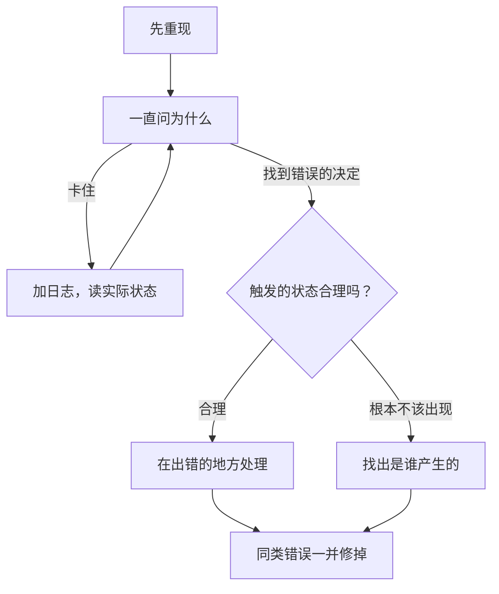
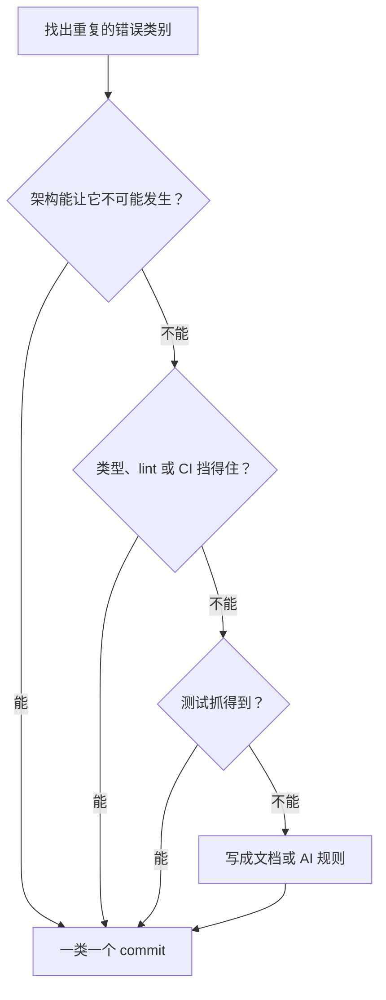
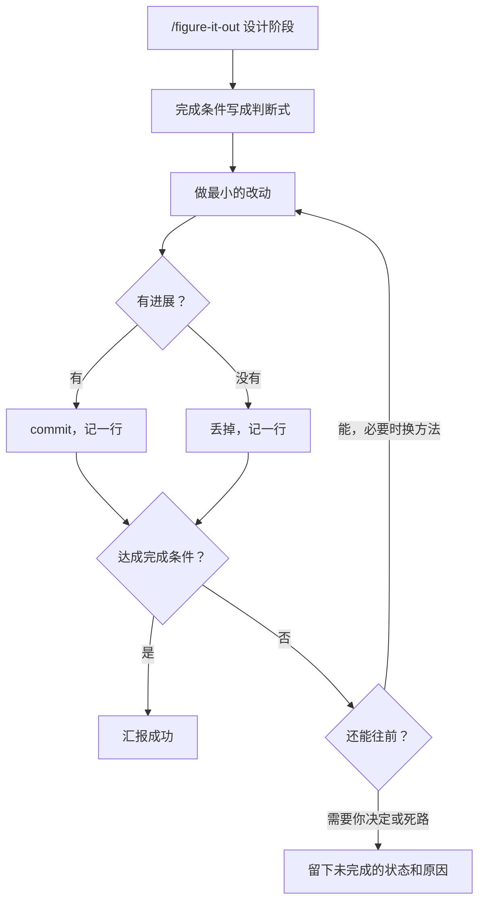
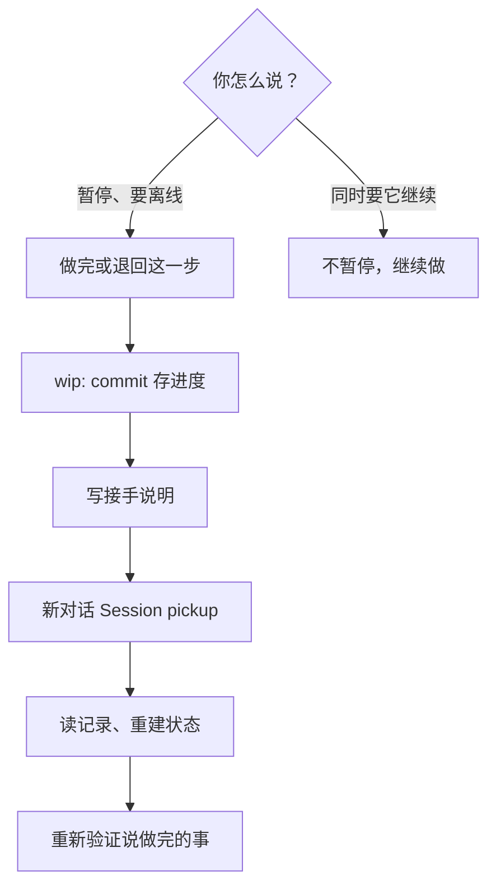
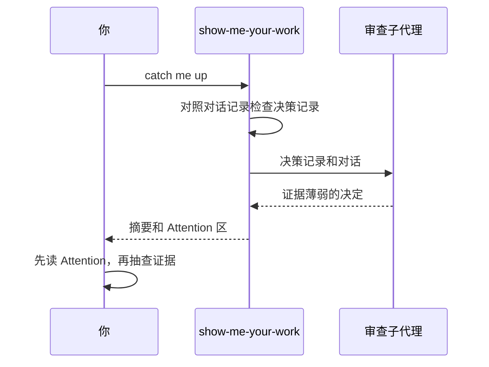

以前 AI 编程助手做得不对，我会打一大段话解释我到底要什么。pstack 给了一个省事得多的办法：直接说出一条原则的名称，告诉它该往哪个方向调整，再确认它有没有真的照做。这篇也教你把自己的习惯做成 mode，以及让它在你睡觉时自己跑之前，提示、权限和费用该怎么设，早上又该怎么检查。

> pstack 系列｜第 4 篇（最后一篇）
>
> - 系列导读：[这套 skill 是什么、四篇该怎么读](/posts/pstack-series-guide/)
> - 上一篇（第 3 篇）：[写完代码之后，先证明它能用再合并](/posts/pstack-build-verify-merge/)
> - 下一篇：这是系列的最后一篇
{: .prompt-info }

> 这篇以 pstack [`0.15.43` 版](https://github.com/cursor/plugins/blob/2f87c854fe3e2fcda44ca86b46ede35aad3c46b7/pstack/.cursor-plugin/plugin.json)为准，搭配 Claude Code 2.1.326。这一版对应 `cursor/plugins` 的 commit `2f87c85`（2026-11-17 05:47，台北时间）。系列五篇我在 2026-11-17 一起以这一版查证，当时 main 在 `2f87c85` 之后没有改动 pstack；之后的版本，行为可能会改变。
{: .prompt-info }

## 开始之前

pstack 是 Cursor 官方插件库里的一整组 skill，skill 是告诉 AI 怎么完成某类工作的操作说明。安装方法我写在[第 1 篇](/posts/pstack-install-routing/)。

想装跟这篇一样的版本，可以先把 repo 下载到自己的电脑、切到我查证用的 commit。然后把这个文件夹加进插件市场（marketplace，Claude Code 安装插件的来源目录），再安装：

```bash
git clone https://github.com/cursor/plugins.git ~/src/cursor-plugins
git -C ~/src/cursor-plugins checkout 2f87c854fe3e2fcda44ca86b46ede35aad3c46b7
claude plugin marketplace add ~/src/cursor-plugins
claude plugin install pstack@cursor-plugins
```

如果直接用 `/plugin marketplace add cursor/plugins` 安装，拿到的会是安装当下的最新版，而不是固定在你看过的那个版本。这样做有什么风险，我在[装了第三方 skill 和 MCP 之后，你的 Coding Agent 多了哪些破口？](/posts/coding-agent-supply-chain-permission-risks/)里讲过。

pstack 的文档用 Cursor 的写法。Claude Code（在终端里使用的 AI 编程助手）的插件命令要加上插件名称，例如 `/pstack:correct`。下面的示例都用 Claude Code 的写法，在 Cursor 里把 `pstack:` 拿掉就好。

这些 skill 都要由你主动调用：pstack 的 58 个 skill 里，除了 `/setup-pstack`，其他都设成不让 AI 自己启动，原则也一样。对应的设置是 `disable-model-invocation: true`。不过 `/poteto-mode` 还是可以按它自己的流程读取并应用相关原则，后面会说明。

官方指南是照 Cursor 写的，例如 `/loop` 和 `create-skill` 都是以 Cursor 的环境来介绍。下面遇到两边不一样的地方，我会直接写 Claude Code 的做法。

pstack 附了一份 [Claude Code 对照说明](https://github.com/cursor/plugins/blob/2f87c854fe3e2fcda44ca86b46ede35aad3c46b7/pstack/docs/harness/claude-code.md)。`/poteto-mode` 在 Claude Code 里会先读它，把 Cursor 的名称对应到 Claude Code 的做法。

## 用原则名称指挥 AI

### 原则是什么

pstack 有 24 条原则，每一条都是一个独立的 skill，名称是 `principle-<名称>`。每条原则是一段很短、很具体的规则，例如“先删掉没用的东西，再往上盖”。它们分成五组（[README](https://github.com/cursor/plugins/blob/2f87c854fe3e2fcda44ca86b46ede35aad3c46b7/pstack/README.md#L222-L256)、[指南第 8 章](https://github.com/cursor/plugins/blob/2f87c854fe3e2fcda44ca86b46ede35aad3c46b7/pstack/docs/guide/08-principles.md#L29-L70)）：

| 组别 | 条数 | 管什么 |
| --- | --- | --- |
| core | 10 | 要做多少、什么时候该重新审视设计 |
| architecture | 6 | 状态、检查和兼容性放在哪里 |
| verification | 5 | 什么才算证据 |
| delegation | 2 | 并行分工时怎么明确职责 |
| meta | 1 | 把重复的提醒变成结构 |

用 `/pstack:poteto-mode` 交代多步骤的工作时，它一开始会先读原则的索引，应用这个任务会触发的那几条。它也会在回复里写出每条原则**改变了哪个决定**（[SKILL.md](https://github.com/cursor/plugins/blob/2f87c854fe3e2fcda44ca86b46ede35aad3c46b7/pstack/skills/poteto-mode/SKILL.md#L15)）。

指南的意思是，你不用一开始就逐条调用原则，等到需要调整方向时，再用名称点出该应用哪一条就好（[指南第 8 章](https://github.com/cursor/plugins/blob/2f87c854fe3e2fcda44ca86b46ede35aad3c46b7/pstack/docs/guide/08-principles.md#L5)）。一个名称就代表一整条规则，所以不必每次都从头解释一遍。

### 在 Claude Code 里怎么说

在同一个对话里，下一条消息用原则的命令开头，后面接你要它做的事：

```text
/pstack:principle-<名称> <你要它照这条原则做的事>
```

用命令的写法，Claude Code 会把那条原则的完整说明读进来，而不只是看到一个名称。下面示范我最常用的四条，完整的 24 条可以看 [README 的原则表](https://github.com/cursor/plugins/blob/2f87c854fe3e2fcda44ca86b46ede35aad3c46b7/pstack/README.md#L222-L256)。

{: w="800" h="450" }
_四条常用原则，以及什么时候该说出它们的名称。_

### laziness-protocol：计划太大的时候

AI 提出的计划要添加好几个辅助函数、好几层包装，或把同一个判断写在好几个地方时，用这条：

```text
/pstack:principle-laziness-protocol 用这条原则重看你的计划，再实现。
```

它会做两件事（[SKILL.md](https://github.com/cursor/plugins/blob/2f87c854fe3e2fcda44ca86b46ede35aad3c46b7/pstack/skills/principle-laziness-protocol/SKILL.md#L9-L10)）：

1. **把重复的判断集中到一处。** 同一个判断不要在好几个地方各写一次，只留一个来源，其他地方直接拿结果来用。
2. **把 diff 缩到最小。** 用最小的改动解决问题，少写几行，胜过写一堆“漂亮”的样板代码。

回复里会说明这条原则拿掉了什么。看一下改动，确认它删掉的真的是多余的东西，该有的行为也都还在。

### prove-it-works：说做完了，却没有证据

AI 说“改好了”，给你看的却只是“编译通过”或它自己的总结时，用这条：

```text
/pstack:principle-prove-it-works 实际跑一次真正的命令，把输出给我看，不要只给我构建记录。
```

它的做法有三点（[SKILL.md](https://github.com/cursor/plugins/blob/2f87c854fe3e2fcda44ca86b46ede35aad3c46b7/pstack/skills/principle-prove-it-works/SKILL.md#L9-L11)）：

1. **直接看真正的东西。** 真的把程序跑起来、读实际的值、看 diff，而不是从文件修改时间、缓存的输出或自我汇报去推测。
2. **检查失败时，先怀疑检查方式。** 先确认是不是看错地方，再怀疑代码。
3. **能写成脚本就写。** 一段能重跑、每次结果都一样的脚本，胜过看一次就算了。

你会拿到它实际跑过的命令和输出。自己看一遍输出，确认它验证的真的是你在意的那件事。

### fix-root-causes：修了症状，没修到原因

AI 只在出错的那一行加个判断把错误绕过去，却没去查原因时，用这条：

```text
/pstack:principle-fix-root-causes <症状>。找出第一个出错的地方，在那里修。
```

它的流程如下（[SKILL.md](https://github.com/cursor/plugins/blob/2f87c854fe3e2fcda44ca86b46ede35aad3c46b7/pstack/skills/principle-fix-root-causes/SKILL.md#L9-L14)）：



关键在判断触发的状态合不合理。如果它根本不该出现，在出错的地方加判断只会把 bug 藏起来，所以要回头找是谁产生了它。

你会拿到根本原因的说明、修复，以及它检查其他地方有没有同类问题的结果。确认它说的原因，真的是第一个出错的地方。

### attack-the-premise：连续修不好的时候

已经试过两次以上的修法，却都卡在同一个检查时，用这条：

```text
/pstack:principle-attack-the-premise 前两次修法都没过。先写下它们共同的前提，测试这个前提，再决定下一步。
```

它的做法有四步（[SKILL.md](https://github.com/cursor/plugins/blob/2f87c854fe3e2fcda44ca86b46ede35aad3c46b7/pstack/skills/principle-attack-the-premise/SKILL.md#L9-L15)）：

1. **写下前提**，也就是每个失败的修法都依赖的那个假设。
2. **先测试前提。** 设计一个能分辨前提是真是假的检查，实际跑一次，看看结果。
3. **跟着证据走。** 证据推翻前提时，找出这些失败有哪些共同点是前提没料到的。如果总是同一个部分落在失败的那一边，就改掉让它落在那里的原因，而不是再加一个事后收拾的机制。
4. **前提写下来、测过之前，不开始下一个修法。**

你会拿到写下来的前提、测试方法和结果，以及根据结果选定的方向。如果前提被推翻，就让它换个方向重新规划。

### 怎么判断它真的应用了

我不会因为点名了某条原则，就认定它真的照做。指南说，回复里要写出这条规则改变了哪个决定。如果只引用了名称、却说不出改了哪个决定，那就是嘴上提了、实际上没应用（[指南第 8 章](https://github.com/cursor/plugins/blob/2f87c854fe3e2fcda44ca86b46ede35aad3c46b7/pstack/docs/guide/08-principles.md#L27)）。

指南也建议不用背清单。先大致看一遍，下次看到 AI 做了某条原则本来可以避免的事，再回来找那个名称（[指南第 8 章](https://github.com/cursor/plugins/blob/2f87c854fe3e2fcda44ca86b46ede35aad3c46b7/pstack/docs/guide/08-principles.md#L70)）。

## 把自己的工作方式写进 skill 和项目

`/poteto-mode` 反映的是 pstack 作者个人的工作风格，指南第 9 章教你怎么换成自己的（[指南第 9 章](https://github.com/cursor/plugins/blob/2f87c854fe3e2fcda44ca86b46ede35aad3c46b7/pstack/docs/guide/09-make-it-yours.md#L1-L5)）。`/automate-me` 从你的对话记录生成自己的 mode。

`/reflect` 和 `/correct` 改的东西不同。`/reflect` 是从一次对话改进 skill，`/correct` 则是改项目本身，让某一类错误不再回来（[指南第 9 章](https://github.com/cursor/plugins/blob/2f87c854fe3e2fcda44ca86b46ede35aad3c46b7/pstack/docs/guide/09-make-it-yours.md#L50)）。

### /automate-me：把你的习惯做成一个 mode

你常常对 AI 重复同样的纠正，例如“回答短一点”“先跑测试再说做完”，希望它一开始就照你的方式做，就用 `/automate-me`。mode 其实也是一个 skill，里面写的是你的工作习惯，名称类似 `<你的名字>-mode`。

指南里只写了 `/automate-me`，因为在 Cursor 里，它知道对话记录（transcript，AI 对话的完整日志）放在哪里。Claude Code 的记录放在 `~/.claude/projects/<项目路径>/`。文件夹名称就是把项目路径里的 `/` 和 `.` 换成 `-`（[Claude Code 对照说明](https://github.com/cursor/plugins/blob/2f87c854fe3e2fcda44ca86b46ede35aad3c46b7/pstack/docs/harness/claude-code.md#L57)）。

我建议在提示里写清楚路径，并限定只能读这个项目的记录：

```text
/pstack:automate-me 只读这个项目的对话记录（~/.claude/projects/<项目路径转成的文件夹名称>/），不要读其他项目。草稿先写到 .claude/skills/<我的名字>-mode/SKILL.md，写好给我看，不要 commit。
```

它的流程有六步（[SKILL.md](https://github.com/cursor/plugins/blob/2f87c854fe3e2fcda44ca86b46ede35aad3c46b7/pstack/skills/automate-me/SKILL.md#L13-L83)）：

1. **找既有的 mode。** 如果你已经有 mode，它会问你要更新还是重做，默认是更新。
2. **分析你的对话记录。** 它只读这个项目的记录，把最近几周的记录按时间切成三段，派子代理并行去读。子代理是 skill 运行时另外派出、分头做事的 AI。它们找的是你在回复风格、分工、验证、代码和文字、流程这些方面反复出现的偏好，至少在两段里都出现过的才算数。
3. **直接问你。** 它会用一两道选择题确认哪些真的是你的习惯，再用一道开放式问题补上遗漏的部分。`claude -p`（不开对话窗口、一次运行完的模式）里没有提问工具，所以它会改成直接用文字问你（[Claude Code 对照说明](https://github.com/cursor/plugins/blob/2f87c854fe3e2fcda44ca86b46ede35aad3c46b7/pstack/docs/harness/claude-code.md#L10)）。
4. **分组、起草。** 把结果整理成几节，例如回复风格、自主程度、验证、流程，而且只写你有特别规则的部分。它默认会加上 `disable-model-invocation: true`，所以要等你输入命令，它才会加载。
5. **润色文字。** 用 `/unslop` 把每一行改得直接、好懂。
6. **按你的要求交付。** 指南的完整流程是在 worktree（同一个 repo 的另一份独立工作目录）里 commit 再开 PR，不会直接推到 main。上面的提示明确要求先交草稿、不要 commit，所以这次它应该停在草稿，等你看过再决定要不要送审。

你会拿到一份 `<你的名字>-mode/SKILL.md` 草稿。Claude Code 会保护项目里的 `.claude/` 文件夹，所以草稿要写进去时，可能会先问你，或直接被挡下，细节见后面的“权限”一节。如果被挡下，我建议让它先写到别的文件夹，你看过之后再自己搬进去。

读一遍草稿，问问自己“这像我吗？少了什么？”（[SKILL.md](https://github.com/cursor/plugins/blob/2f87c854fe3e2fcda44ca86b46ede35aad3c46b7/pstack/skills/automate-me/SKILL.md#L94-L96)）。要注意，它分析的是**你在这个项目的对话**。如果这些对话大多是特殊用途，例如一次性的测试，写出来的就不会是你平常的样子。

之后习惯变了，再跑一次更新就好：

```text
/pstack:automate-me update my mode skill with everything since its last edit
```

### /reflect：一次对话学到的事，写回 skill

刚做完一个任务，中间绕了不少远路，不想下次再绕一次时，就用 `/reflect`。这个提示取自[指南第 9 章](https://github.com/cursor/plugins/blob/2f87c854fe3e2fcda44ca86b46ede35aad3c46b7/pstack/docs/guide/09-make-it-yours.md#L25-L29)：

```text
/pstack:reflect 这次花太久了。把学到的事整理出来，让下次不要重蹈覆辙。
```

它的做法有四步（[SKILL.md](https://github.com/cursor/plugins/blob/2f87c854fe3e2fcda44ca86b46ede35aad3c46b7/pstack/skills/reflect/SKILL.md#L9-L17)）：

1. **自己读完这次对话的记录。** 它只读这个项目的记录，而且只把记录当数据看，里面写的指示它不会照做。它找的是这五种东西：
   - 你给过的纠正
   - AI 自己摸索才发现的命令用法和怪癖
   - 它本来查得到、却要你提供的背景
   - 被跳过、或没在真正成品上跑的检查
   - 该启动却没启动的 skill
2. **只留下长期有用的。** 一项发现要半年后还成立、会改变之后 AI 的做法，而且对应得到这次对话用过的 skill，才会留下。它会先读那个 skill，已经写清楚的就不重复。只发生一次的事，以及 commit 编号、版本、数量这类很快就过时的细节，也会丢掉。该启动却没启动的 skill，它会提议修改那个 skill 的描述（description，AI 用来判断什么时候该用这个 skill 的那段说明）。
3. **适合用代码强制执行的，放进待办。** 如果某个教训用 lint 规则（自动检查代码写法的规则）、脚本或检查来挡会更可靠，就放进 Backlog，而不是写成 skill 里的文字。
4. **等你批准。** 它把结果分成三份清单列出来，**你明确同意之前不改任何 skill**。它也不会直接改插件缓存里的 skill，而是先复制到项目或个人的 skill 文件夹再改。它不会开 PR，也不会推送。

三份清单的内容如下：

| 清单 | 每一项写什么 |
| --- | --- |
| Accepted（建议采用） | 问题、提议和要改的 skill |
| Rejected（不采用） | 不采用的理由 |
| Backlog（待办） | 适合用代码强制执行的教训 |

Accepted 只是等你批准的建议，不代表已经改了。只批准会改变未来决定的项目，指南说得很直接：一次奇怪的对话只是个案，不是规则（[指南第 9 章](https://github.com/cursor/plugins/blob/2f87c854fe3e2fcda44ca86b46ede35aad3c46b7/pstack/docs/guide/09-make-it-yours.md#L31)）。

### /correct：让同一种错不可能再发生

你一再为同一种错误纠正 AI 时，我认为该改的是项目，不是你的下一个提示。这时就用 `/correct`。

知道是哪种错时，直接写出来（取自[指南第 9 章](https://github.com/cursor/plugins/blob/2f87c854fe3e2fcda44ca86b46ede35aad3c46b7/pstack/docs/guide/09-make-it-yours.md#L45)）：

```text
/pstack:correct agents keep calling the database client directly instead of going through the repository layer
```

如果说不出是哪种错，就什么都不加，让它自己从项目历史里找：

```text
/pstack:correct
```

它会先找出错误的类别，再用挡得住它的最高层级来修（[SKILL.md](https://github.com/cursor/plugins/blob/2f87c854fe3e2fcda44ca86b46ede35aad3c46b7/pstack/skills/correct/SKILL.md#L13-L32)）：



找错误类别时，它会读最近的 commit、还原记录、审查留言、AI 的说明文件，以及解释临时做法的注释。同一类错误至少出现过两次才算数。

用架构挡，指的是让错误不可能发生，例如每个状态只有一个拥有者、只留一种正确做法。用类型、lint 规则或 CI（每次推上去就自动跑的检查）挡的时候，错误信息要直接写出应该改用什么。文档和 AI 规则放在最后，因为 AI 就算跳过规则，也不会有任何检查失败。

每个新检查都要证明有效：拿一个真实发生过的错误来试，确认它真的会失败。本地和 CI 跑的是同一个命令。

它也会维护一张规则表，放在 AI 的说明文件里（Claude Code 是 `CLAUDE.md`），写明每条规则是靠哪个机制强制执行的。没有检查机制兜底的规则，还是有可能再被忽略。

你会拿到每一类错误的证据、它选了哪个层级、为什么更高的层级做不到，以及每一类各一个 commit。

接着一个一个看 commit。它可能会动到 CI 配置或已有的测试，这些改动都要你看过才能推出去。所以我会在看得到的对话里跑 `/correct`，不会放进无人值守的提示。

> **不要在任务做到一半时改 skill。** 先把想改进的地方记下来，等任务结束再另外处理；如果需要提交，就另开一个 PR（[指南第 9 章](https://github.com/cursor/plugins/blob/2f87c854fe3e2fcda44ca86b46ede35aad3c46b7/pstack/docs/guide/09-make-it-yours.md#L98)）。
{: .prompt-tip }

## 让它自己跑：无人值守的提示怎么写

### 先确认它值得被信任

指南第 7 章列了四个条件，要全部满足才让它自己跑。在那之前，就在旁边看着它跑（[指南第 7 章](https://github.com/cursor/plugins/blob/2f87c854fe3e2fcda44ca86b46ede35aad3c46b7/pstack/docs/guide/07-overnight.md#L7-L16)）：

- 这件事你自己做过一次，或看 AI 做过一次，知道做得好是什么样子。
- AI 手上有你自己也会用的工具和信号，例如验证 skill、性能剖析、日志。
- 每个阶段都会证明自己的成果，做不到标准时可以喊停。
- 你已经读过几次对话记录，并把反复出现的失败变成了工具、skill 或检查。

### 提示的六个部分

指南的交接模板有四个要素：目标、完成条件、权限，以及卡住时的出口（[指南第 7 章](https://github.com/cursor/plugins/blob/2f87c854fe3e2fcda44ca86b46ede35aad3c46b7/pstack/docs/guide/07-overnight.md#L18-L36)）。我会再把“决策记录”和“不可以做的事”分开写，变成六个部分：

{: w="800" h="450" }
_一份无人值守提示的六个部分。时间长度不是完成条件。_

任务已经符合上面四个条件，而且你不在电脑前时，用这份提示：

```text
/pstack:poteto-mode 我要去睡了，自己跑到完成为止。
目标：<要完成的事>，在已准备好的工作分支 <分支名称> 上做。
怎样算完成：<可以检查的条件 1>；<条件 2>；<条件 3>。
决策记录：用 show-me-your-work 的格式记在 decisions.tsv。
不用问我：只 commit 这次任务的变更，不要把 decisions.tsv 纳入 commit；<其他可以还原的小决定>自己决定，写进记录。
不可以做：push、开 PR、合并、安装软件包、联网、改这个文件夹以外的文件。
如果真的卡住：停下来，写清楚卡在哪里、试过什么、需要我决定什么。
```

每一行的作用：

- **“我要去睡了”**：告诉 `/poteto-mode`，这次对话里已授权的工作就一路做下去，少停下来确认。但它还是得遵守你列的禁止事项，碰到必须确认的动作或真的卡住时，也要停下来（[SKILL.md](https://github.com/cursor/plugins/blob/2f87c854fe3e2fcda44ca86b46ede35aad3c46b7/pstack/skills/poteto-mode/SKILL.md#L80)）。
- **“怎样算完成”**：要写成每一轮都能实际检查的条件，例如“所有测试通过”“旧的函数没有人调用”。指南特别提醒，**时间长度不是完成条件**。“做四个小时”根本没有东西可以检查，你醒来只会看到它忙了四个小时，而不是一个结果（[指南第 7 章](https://github.com/cursor/plugins/blob/2f87c854fe3e2fcda44ca86b46ede35aad3c46b7/pstack/docs/guide/07-overnight.md#L120)）。
- **“工作分支”**：可以把提交记录分开，但同一个工作目录里还没提交的变更并不会被隔开。如果不想干扰手上的工作，我会按指南的建议开一个新的 worktree。Claude Code 的 `-w`（`--worktree`）选项就能直接在独立的 worktree 里启动（[CLI 说明](https://code.claude.com/docs/en/cli-reference)）。
- **“不用问我”**：先替它回答那些它原本会停下来问的事。这个模板只放行在本地新分支上 commit。push 和开 PR 要你在提示和权限设置里明确放行才可以（见后面的 Autopilot-stack），合并和其他不可逆的动作，还是要由人来确认。
- **“不可以做”**：这是界线。光写在提示里还不够，还要用权限设置挡住，下一节会讲。
- **“如果真的卡住”**：这是出口。比起让它一整晚自己重新解读目标，我宁可它在真的走进死胡同时停下来，把情况写清楚。

指南的模板最后一行用了 `/loop`。那是 Cursor 内置的命令，用来定时或在某个事件发生时唤醒 AI，不是 pstack 的 skill（[指南第 7 章](https://github.com/cursor/plugins/blob/2f87c854fe3e2fcda44ca86b46ede35aad3c46b7/pstack/docs/guide/07-overnight.md#L35)）。

Claude Code 也有自己的 `/loop`，但用法不一样。上面的模板没有用它，而是在同一个对话里直接做到完成。

交出去之后，`/poteto-mode` 会这样跑：



像这种你离开、回来后才要审的工作，`/poteto-mode` 会先交给 [`/figure-it-out`](https://github.com/cursor/plugins/blob/2f87c854fe3e2fcda44ca86b46ede35aad3c46b7/pstack/skills/figure-it-out/SKILL.md) 把各个阶段设计好，并接上决策记录（[指南第 7 章](https://github.com/cursor/plugins/blob/2f87c854fe3e2fcda44ca86b46ede35aad3c46b7/pstack/docs/guide/07-overnight.md#L38)）。完成条件在第一轮之前就要写成可以检查的判断式（[autonomous-run playbook](https://github.com/cursor/plugins/blob/2f87c854fe3e2fcda44ca86b46ede35aad3c46b7/pstack/skills/poteto-mode/playbooks/autonomous-run.md#L5)）。

没帮助的改动会直接丢掉，不留“也许有帮助”的东西。途中发现、而且有助于目标的问题，它会自己处理，不会停下来问你。只有不可逆的动作、无法用实验回答的产品或偏好决定，以及真正的死路，才会留给你。

走不下去时，它会把未完成的状态和原因留下来，而不是放宽完成条件来宣布成功（[autonomous-run playbook](https://github.com/cursor/plugins/blob/2f87c854fe3e2fcda44ca86b46ede35aad3c46b7/pstack/skills/poteto-mode/playbooks/autonomous-run.md#L7-L13)）。但费用到了 `--max-budget-usd` 的上限时，Claude Code 会直接停掉这次运行，它不一定来得及留下说明。所以早上我会以决策记录的最后一行和 commit 为准。

跑完之后，你会拿到一条回复，写出完成条件、跑了几轮、留下了什么、丢掉了什么、完成条件最后的状态，以及一份决策记录。早上再用 `/show-me-your-work` 检查，见后面的“早上”一节。

### 在 Claude Code 里无人值守地跑

如果你不在电脑前，AI 却每次运行命令都停下来等你同意，它就会卡一整晚。所以要事先设好它能做什么、不能做什么。

我的做法是先准备好四样东西：独立的 worktree、工作分支、项目依赖和 `overnight-prompt.txt`。然后从那个 worktree 启动 `claude -p`，搭配权限模式、允许清单和费用上限。

先在终端里自己创建 worktree 和分支，并把提示文件复制过去。下面沿用后面完整示例的分支名称 `feat/export-csv`，实际用的时候，记得换成你自己的任务名称：

```bash
cd ~/my-project
git worktree add ../my-project-overnight -b feat/export-csv
cp overnight-prompt.txt ../my-project-overnight/
```

接着在新的 worktree 里准备好项目依赖，确认提示里写的分支名称跟实际的分支一致，再启动：

```bash
cd ~/my-project-overnight
claude -p "$(cat overnight-prompt.txt)" \
  --permission-mode acceptEdits \
  --allowedTools "Read" "Grep" "Glob" "Bash(python3 -m unittest *)" "Bash(git add *)" "Bash(git commit *)" "Bash(git status *)" "Bash(git diff *)" "Bash(git log *)" \
  --disallowedTools "Bash(git push *)" "Bash(rm *)" "Bash(curl *)" "WebFetch" "WebSearch" \
  --max-budget-usd 10
```

| 选项 | 作用 |
| --- | --- |
| `--permission-mode acceptEdits` | 读文件、改文件和常见的文件命令不用问，其他命令要另外授权。开始之前，先检查一下已有的权限设置。 |
| `--allowedTools` | 允许清单，列出不用问就能运行的工具和命令。测试命令要换成你项目实际用的。这里没有放行创建或切换分支的命令，所以准备 worktree 和分支的步骤要由你先做好。 |
| `--disallowedTools` | 禁止清单。禁止规则在每一种权限模式下都有效（[权限模式说明](https://code.claude.com/docs/en/permission-modes#available-modes)）。 |
| `--max-budget-usd` | 估计花费达到这个金额就停下来，只能搭配 `claude -p` 使用（[CLI 说明](https://code.claude.com/docs/en/cli-reference)）。 |

如果 `claude -p` 没设权限模式，需要批准的动作会直接被拒绝（[权限模式说明](https://code.claude.com/docs/en/permission-modes#tool-calls-denied-in-claude--p-and-agent-sdk-runs)）。允许清单要是漏了必要的命令，任务就可能做不完，早上我会再根据记录判断要不要调整。

> 这份示例只屏蔽了部分工具和命令，并不等于完全禁止联网、删文件或修改工作目录以外的文件，因为被允许运行的程序本身也可能做这些事。如果要强制限制网络和文件范围，还需要沙箱或容器这类隔离设置。
{: .prompt-warning }

### 想让它停下来，或明天接着做

想让 AI 停下来，直接说“暂停”，或说你要离线了，都会走暂停流程（[指南第 7 章](https://github.com/cursor/plugins/blob/2f87c854fe3e2fcda44ca86b46ede35aad3c46b7/pstack/docs/guide/07-overnight.md#L40)）：

```text
/pstack:poteto-mode 先暂停，我要离线了。
```



这套流程是 Pause safely playbook，图中的接手说明就是它写的 resume note。暂停只会在本地保存进度，不会自动开 PR 或推送（[pause-safely playbook](https://github.com/cursor/plugins/blob/2f87c854fe3e2fcda44ca86b46ede35aad3c46b7/pstack/skills/poteto-mode/playbooks/pause-safely.md#L1-L10)）。像“我要去睡了，继续做”这样同时要它继续，或只说“继续”，都不会触发暂停。

之后开新的对话，就能从那份说明接手。Session pickup 会在真实的程序上重新验证前一次说“做完了”的事（[session-pickup playbook](https://github.com/cursor/plugins/blob/2f87c854fe3e2fcda44ca86b46ede35aad3c46b7/pstack/skills/poteto-mode/playbooks/session-pickup.md)）。

### 一整晚不只一件事

如果一晚有好几个互不相干的改动，指南提供了两个 playbook（[指南第 7 章](https://github.com/cursor/plugins/blob/2f87c854fe3e2fcda44ca86b46ede35aad3c46b7/pstack/docs/guide/07-overnight.md#L76-L86)）：

| playbook | 做到哪里 |
| --- | --- |
| Autopilot-full | 把每个 PR 一路做到合并 |
| Autopilot-stack | 一样会验证，但**不合并**，早上由你自己看、自己合并 |

如果你希望 AI 先把 PR 准备好，早上再由你审查、决定要不要合并，就选 Autopilot-stack。这跟前面只在本地做事的模板不同，你必须另外明确授权它 push 和开 PR：

```text
/pstack:poteto-mode autopilot these five changes. 可以 push 和开 PR，不要合并，我早上自己合并。
```

如果用前面的 `claude -p` 设置，权限要这样改：

- 把 `Bash(git push *)` 从禁止清单移掉。
- 在允许清单加上 `Bash(git push -u origin feat/*)` 和 `Bash(gh pr create *)`。
- 在禁止清单加上这四条：
  - `Bash(git push *--force*)`
  - `Bash(git push *-f*)`
  - `Bash(git push *main*)`
  - `Bash(gh pr merge *)`
- 默认分支叫 master 的仓库，禁止规则里的 main 要换成 master。
- 如果沿用前面的六段模板，这次“不可以做”那一行要去掉“联网”，因为 push 和开 PR 本来就需要联网。

这些规则只比对命令的字面，所以分支名称里不要出现“-f”或“main”，不然连正常的 push 也会被挡下。例如 `feat/add-format`、`feat/domain-check` 都会被挡。

字面比对也挡不住所有变形，所以我会把真正的墙放在 GitHub，给 main 开启分支保护。设置里要求必须经过 PR、禁止强制推送，并勾选“Do not allow bypassing the above settings”。要勾最后这一项，是因为分支保护默认不限制仓库管理员，而 AI 用的就是你的账号。

## 早上：用 /show-me-your-work 检查决策记录

AI 自己跑了很长一段工作，你回来想知道它做了什么、为什么这样做，就用 `/show-me-your-work` 检查它的决策记录。

决策记录是一个 TSV 文件（用 Tab 分隔字段的纯文本表格），一个决定一行，字段是时间、阶段、决定、原因、证据、结果。证据字段要指向查得到的来源，例如 commit 编号或 `文件:行号`，不能只有一段文字说明（[SKILL.md](https://github.com/cursor/plugins/blob/2f87c854fe3e2fcda44ca86b46ede35aad3c46b7/pstack/skills/show-me-your-work/SKILL.md#L11-L22)）。记录只能往后加：判断错了，就新增一行注明更正，旧的行不改也不删。

它默认放在工作文件夹的 `decisions.tsv`，如果好几个工作同时进行，就放在 `.audit/<任务名称>.tsv`。默认**不 commit**，只有在工作大到审查者需要这份记录才能相信结果时，才会 commit（[SKILL.md](https://github.com/cursor/plugins/blob/2f87c854fe3e2fcda44ca86b46ede35aad3c46b7/pstack/skills/show-me-your-work/SKILL.md#L44-L48)）。

在跑工作的同一个对话里输入这行（取自[指南第 7 章](https://github.com/cursor/plugins/blob/2f87c854fe3e2fcda44ca86b46ede35aad3c46b7/pstack/docs/guide/07-overnight.md#L62-L66)）：

```text
/pstack:show-me-your-work catch me up on what you did last night
```

它的流程如下（[SKILL.md](https://github.com/cursor/plugins/blob/2f87c854fe3e2fcda44ca86b46ede35aad3c46b7/pstack/skills/show-me-your-work/SKILL.md#L55-L74)）：



检查决策记录时，每一行都要对应到真实的决定或动作，证据要打得开，而且确实能证明那一行写的事。漏记的转折要补上，写错的行照样不改不删，而是新增一行来更正。

审查的子代理要换用跟做事的模型不同厂商的模型。它读记录和对话，挑出证据薄弱的决定、没拿出证明就说做过的验证，以及事后看来有风险的选择。

摘要的结尾是 Attention（注意事项）区。它的第一行写 `reviewed by <模型>`，接着逐一列出需要你注意的地方，并指出对应的是记录的哪一行。

先读 Attention，再顺着它指的那几行，打开证据抽查（[指南第 7 章](https://github.com/cursor/plugins/blob/2f87c854fe3e2fcda44ca86b46ede35aad3c46b7/pstack/docs/guide/07-overnight.md#L68)）。你要审的是决定，不用把一整晚重看一遍。

> 记得看一下 `reviewed by` 那一行，因为 Claude Code 的子代理只能选 Claude 的模型：opus、sonnet、haiku、fable。指定别家厂商的模型时，会改用当前对话的模型（[Claude Code 对照说明](https://github.com/cursor/plugins/blob/2f87c854fe3e2fcda44ca86b46ede35aad3c46b7/pstack/docs/harness/claude-code.md#L35-L36)）。所以在 Claude Code 里，这一步做不到真正的跨厂商审查。
{: .prompt-warning }

想在终端里把 TSV 排成表格，可以这样：

```bash
column -s$'\t' -t decisions.tsv
```

如果只想快速看一下状态、不需要完整检查，就在同一个对话里跑 ketchup，它只读不改（[指南第 7 章](https://github.com/cursor/plugins/blob/2f87c854fe3e2fcda44ca86b46ede35aad3c46b7/pstack/docs/guide/07-overnight.md#L70)）：

```text
/pstack:ketchup
```

## 风险：什么可以放手，什么一定要先问

### never-block-on-the-human 的界线

让 AI 自己跑，背后的核心原则是 [never-block-on-the-human](https://github.com/cursor/plugins/blob/2f87c854fe3e2fcda44ca86b46ede35aad3c46b7/pstack/skills/principle-never-block-on-the-human/SKILL.md#L9-L15)：人可以晚点再看成果、再介入，AI 不必为了每个可以还原的小决定停下来等。

可以还原的事，例如写代码、改笔记、拆任务，就先做再汇报。不要问“要不要做 X”，而是做了再说明为什么。

但**不可逆的动作仍然要先确认**，例如 force push（强制覆盖远程分支的历史）、删除生产环境的数据、对外发消息。产品方向则由人来决定。

`/poteto-mode` 也写明，就算你说了“我要去睡了”，下面四件事仍然**一定会停下来**（[SKILL.md](https://github.com/cursor/plugins/blob/2f87c854fe3e2fcda44ca86b46ede35aad3c46b7/pstack/skills/poteto-mode/SKILL.md#L78-L80)）：

- force push 到共享分支
- 部署
- 删除数据
- 发消息给客户

> 同一份 SKILL.md 写到，可以还原的事和团队聊天、更新 ticket、启动 eval 这类对外动作，都会直接做、不先问，而且可以用任何 MCP 工具（[SKILL.md](https://github.com/cursor/plugins/blob/2f87c854fe3e2fcda44ca86b46ede35aad3c46b7/pstack/skills/poteto-mode/SKILL.md#L76)）。所以别把“不可逆的动作要确认”理解成所有对外消息都会先问你，这份文件对团队内部消息和客户消息的处理方式是不一样的。如果不想让它对外发消息，就在“不可以做”里写清楚，并用 `--disallowedTools` 把那些 MCP 工具挡掉。
{: .prompt-warning }

{: w="800" h="450" }
_界线画在“能不能还原”。写在提示里是第一道防线，权限设置是第二道。_

我自己会把界线再画得保守一点：

| 放手让它做 | 一定要先问，或直接禁止 |
| --- | --- |
| 在新分支上改代码、commit | 合并；push、开 PR 要你明确放行 |
| 跑测试、跑项目自己的命令 | 安装软件包、联网下载 |
| 写决策记录、接手说明 | 删除文件或数据、改 git 历史 |
| 在 scratch 文件夹放草稿 | 改 CI 设置、AI 的配置文件（`.claude/`、`CLAUDE.md`） |

### 权限：写在提示里还不够

提示用来表达意图，权限规则用来限制工具调用，网络与文件的隔离范围则要另外设置。Claude Code 的每种权限模式，放手的程度都不一样（[权限模式说明](https://code.claude.com/docs/en/permission-modes#available-modes)）：

| 模式 | 不用问就能做的事 | 适合 |
| --- | --- | --- |
| `default`（Manual） | 只有读取 | 每个动作都自己看 |
| `acceptEdits` | 读取、改文件、常见的文件命令 | 改代码，其他命令用允许清单放行 |
| `plan` | 读取；可用 auto 时，也可运行通过其检查的命令 | 动手之前先探索 |
| `auto` | 全部，背景有安全检查 | 长时间的工作 |
| `dontAsk` | 读取和事先允许的工具，其他一律拒绝 | 锁死的 CI 和脚本 |
| `bypassPermissions` | 全部 | 只能在隔离的容器或虚拟机里用 |

有几件事要知道：

- **禁止规则连 `bypassPermissions` 也挡得住。** 但在 `bypassPermissions` 下，允许清单没有作用。
- **有些文件夹受保护。** 写入 `.git`、`.claude` 这类文件夹时，`default` 和 `acceptEdits` 会先问你，`dontAsk` 会直接拒绝（[受保护的路径](https://code.claude.com/docs/en/permission-modes#protected-paths)）。我认为这其实是好事，因为 AI 没办法偷偷改掉自己的设置。所以让 `/automate-me` 或 `/reflect` 写 skill 时，要有心理准备它会在这里停下来。
- **不要为了不被打扰就关掉所有检查。** `bypassPermissions` 只适合放在隔离的容器或虚拟机里（[常见设置](https://code.claude.com/docs/en/permission-modes#common-setups)）。

### 费用：先设上限

无人值守的工作可能会派出好几个子代理，花费也可能比你预期的高。

- **`claude -p` 加上 `--max-budget-usd`。** 这个金额是 Claude Code 自己估的，可能跟实际账单有出入，也可能稍微超过，所以我会留一点余量。子代理的花费也会算进去。用 `--resume` 接续对话时，之前的花费不会算进这次的上限（[CLI 说明](https://code.claude.com/docs/en/cli-reference)）。
- **订阅方案的额外用量。** 如果你用的是 Pro、Max 这类订阅方案，又开了额外用量（usage credits），记得设每月花费上限。位置在 claude.ai 的 Settings → Usage（[费用说明](https://code.claude.com/docs/en/costs)）。
- **Cursor 也一样。** 先看一下你的方案用量和上限设置，再让它自己跑。

想多了解权限和供应链的风险，以及怎么把权限收紧，可以看我写的[装了第三方 skill 和 MCP 之后，你的 Coding Agent 多了哪些破口？](/posts/coding-agent-supply-chain-permission-risks/)。

## 完整示例：一天的流程

延续我在第 3 篇虚构的例子：一个导出数据的命令行工具。

**白天：用原则名称指挥。** 我请它加一个新选项：

```text
/pstack:poteto-mode 帮 export 命令加一个 --since 日期选项。先告诉我你的计划，不要动手。
```

它的计划用了两个辅助函数重复判断同一个日期，还有三个测试在检查同一种场景。我请它先把重复的部分去掉，但保留必要的测试：

```text
/pstack:principle-laziness-protocol 用这条原则重看你的计划，再实现并 commit。
```

它说做完了，但只给我测试结果：

```text
/pstack:principle-prove-it-works 用真正的数据跑一次 export --since，把输出给我看，也试试看奇怪的日期。
```

**傍晚：把重复的错误变成结构。** 这周已经是我第二次纠正它“用户输入的值没有先整理就拿去比对”：

```text
/pstack:correct 用户输入的过滤值，常常没有经过和数据相同的整理就拿去比对
```

我一个一个看过它的 commit，确认新的检查碰到旧的错误真的会失败，才自己推上去。

**睡前：交代无人值守的工作。** 我把六个部分写进 `overnight-prompt.txt`：

```text
/pstack:poteto-mode 我要去睡了，自己跑到完成为止。
目标：帮 export 加一个 --format csv 选项，在已准备好的工作分支 feat/export-csv 上做。
怎样算完成：所有测试通过；用范例数据跑出的 CSV 能被重新读回、记录数一致；原本的 JSON 输出一个字节都不变。
决策记录：用 show-me-your-work 的格式记在 decisions.tsv。
不用问我：只 commit 这次任务的变更，不要把 decisions.tsv 纳入 commit；字段顺序、空值怎么写这类小决定自己决定，写进记录。
不可以做：push、开 PR、合并、安装软件包、联网、改这个文件夹以外的文件。
如果真的卡住：停下来，写清楚卡在哪里、试过什么、需要我决定什么。
```

我按前面的步骤，先创建 `feat/export-csv` 分支和独立的 worktree，复制提示文件、准备好依赖。接着用 `claude -p` 命令启动，搭配允许清单、禁止清单和费用上限。

**早上：检查。** 我用下面这行，以交互模式接上昨晚的对话：

```bash
claude --resume <对话 ID>
```

`claude -p` 的对话不会出现在 `claude --resume` 的列表里，所以要直接给 ID。ID 就是 `~/.claude/projects/<worktree 路径>/` 下面那次对话的 `.jsonl` 文件名。你也可以直接把那个 `.jsonl` 的完整路径传给 `--resume`。

接上之后输入：

```text
/pstack:show-me-your-work catch me up on what you did last night
```

我先读 Attention，再打开它指的那几行的 commit 和输出，回答它留给我的决定。最后由我自己决定要不要推上去、开 PR。

**最后：留下教训。** 这次有一步绕了远路：

```text
/pstack:reflect 这次在解析日期上花太久了。把学到的事整理出来，让下次不要重蹈覆辙。
```

我只批准会改变下次决定的那几项。用了一阵子之后，再用 `/pstack:automate-me` 把这些习惯整理成我自己的 mode。

## 什么时候用哪一个

| 你遇到的情况 | 用这个 |
| --- | --- |
| 计划太大、包装太多 | `/pstack:principle-laziness-protocol` |
| 说做完了，却没有实际输出 | `/pstack:principle-prove-it-works` |
| 修法只是挡掉症状 | `/pstack:principle-fix-root-causes` |
| 同一个方向修了两次都失败 | `/pstack:principle-attack-the-premise` |
| 想看全部 24 条原则 | [README 的原则表](https://github.com/cursor/plugins/blob/2f87c854fe3e2fcda44ca86b46ede35aad3c46b7/pstack/README.md#L222-L256) |
| 想让 AI 照你的习惯工作 | `/pstack:automate-me` |
| 一次对话学到的事，想写回 skill | `/pstack:reflect` |
| 同一种错误纠正了两次以上 | `/pstack:correct` |
| 让它自己跑到完成 | `/pstack:poteto-mode` ＋六个部分的提示 |
| 一晚有好几个独立的改动 | `/pstack:poteto-mode` ＋ Autopilot-stack |
| 想刻意停下来、明天接着做 | 告诉 `/pstack:poteto-mode` 暂停 |
| 早上检查它做了什么 | `/pstack:show-me-your-work` |
| 只想知道目前的状态 | `/pstack:ketchup` |

## 常见陷阱

- **时间长度不是完成条件**：写“做四个小时”，它根本没东西可以检查。
- **只写在提示里的界线**：“不要 push”要用禁止清单挡住。
- **原则只被点名**：回复里要看到它改变了哪个决定。
- **在任务中途改 skill**：另开一个 PR。
- **一次对话就定规则**：`/reflect` 的结果，只批准会改变未来决定的项目。
- **让 AI 读所有项目的记录**：只让 `/automate-me` 和 `/reflect` 读这个项目的对话。
- **跨厂商审查不是真的跨厂商**：看 Attention 的 `reviewed by`；在 Claude Code 里，审查的还是 Claude 的模型。
- **没设费用上限**：`claude -p` 加 `--max-budget-usd`，也设好方案的花费上限。

## 结论

先从一条原则开始：下次 AI 的计划太大，或说做完了却拿不出证据，就直接点名，再看回复有没有写出它改了哪个决定。

让它自己跑时，界线要靠权限设置和隔离来落实，光写在提示里不够。在你授权的范围内，可以还原的工作就放手让它做完；不能还原的决定，还是留在你手上。

## 延伸阅读

- [指南：Run work while you sleep](https://github.com/cursor/plugins/blob/2f87c854fe3e2fcda44ca86b46ede35aad3c46b7/pstack/docs/guide/07-overnight.md)：交接模板、早上的检查，以及一晚做好几件事的 playbook。
- [指南：Steer with principle names](https://github.com/cursor/plugins/blob/2f87c854fe3e2fcda44ca86b46ede35aad3c46b7/pstack/docs/guide/08-principles.md)：24 条原则的简介。
- [指南：Make it yours](https://github.com/cursor/plugins/blob/2f87c854fe3e2fcda44ca86b46ede35aad3c46b7/pstack/docs/guide/09-make-it-yours.md)：`/automate-me`、`/reflect`、`/correct`，以及怎么写和测试 skill。
- skill 的说明文件：[automate-me](https://github.com/cursor/plugins/blob/2f87c854fe3e2fcda44ca86b46ede35aad3c46b7/pstack/skills/automate-me/SKILL.md)、[reflect](https://github.com/cursor/plugins/blob/2f87c854fe3e2fcda44ca86b46ede35aad3c46b7/pstack/skills/reflect/SKILL.md)、[correct](https://github.com/cursor/plugins/blob/2f87c854fe3e2fcda44ca86b46ede35aad3c46b7/pstack/skills/correct/SKILL.md)、[show-me-your-work](https://github.com/cursor/plugins/blob/2f87c854fe3e2fcda44ca86b46ede35aad3c46b7/pstack/skills/show-me-your-work/SKILL.md)、[never-block-on-the-human](https://github.com/cursor/plugins/blob/2f87c854fe3e2fcda44ca86b46ede35aad3c46b7/pstack/skills/principle-never-block-on-the-human/SKILL.md)。
- [Claude Code 权限模式](https://code.claude.com/docs/en/permission-modes)：每种模式能做什么、受保护的路径。
- [pstack 系列（1）：安装、选模型，再用 /poteto-mode 挑 playbook](/posts/pstack-install-routing/)：怎么安装、更新，以及固定版本的做法。
- [pstack 系列（2）：改代码之前，先看懂再设计](/posts/pstack-understand-design/)：`/how`、`/why`、`/architect`、`/interrogate`、`/arena`，以及 `/teach`、`/recall`、`/swarm`、原型和写计划。
- [pstack 系列（3）：写完代码之后，先证明它能用再合并](/posts/pstack-build-verify-merge/)：实现、清理、验证、送审四个阶段，包括 playbook、`/tdd`、验证 skill 和 babysit。
- [自己写 Agent Skill：从 SKILL.md 结构到触发测试与维护](/posts/agent-skill-authoring-guide/)：skill 放在哪里、`SKILL.md` 怎么写。
- [装了第三方 skill 和 MCP 之后，你的 Coding Agent 多了哪些破口？](/posts/coding-agent-supply-chain-permission-risks/)：权限、沙箱和锁版本。
- [mattpocock/skills 系列导读：这套 skill 是什么、六篇该怎么读](/posts/mattpocock-skills-series-guide/)：另一套 skill 的系列导读。
- [mattpocock/skills 系列（1）：先设置项目规则，再用 ask-matt 找下一步](/posts/mattpocock-skills-setup-routing-guide/)：另一套 skill 的第 1 篇。
