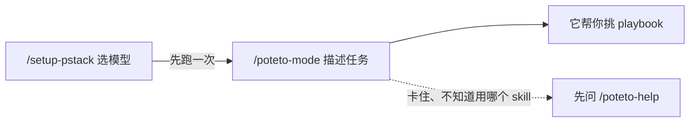
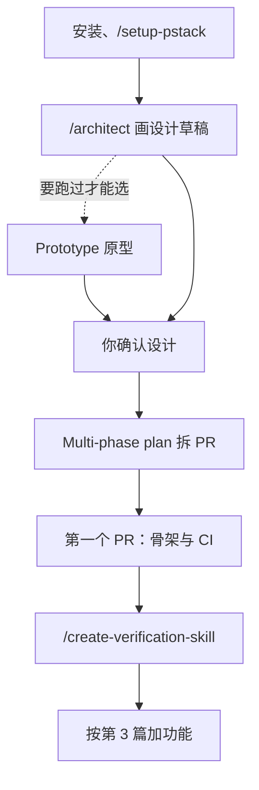

你可能听人提过 pstack，打开 repo 却只看到一长串 skill 名称；也可能是从搜索点进其中一篇，想知道前后还有哪些。这个系列有四篇，每篇处理用 AI 写代码时的其中一段流程。这篇导读不重讲细节，只说明 pstack 是什么，并依你的情况建议从哪一篇开始。

> pstack 系列｜导读
>
> - 从头开始（第 1 篇）：[安装、选模型，再用 /poteto-mode 挑 playbook](/posts/pstack-install-routing/)
>
> 这个系列的五篇都以 pstack [`0.15.43`](https://github.com/cursor/plugins/blob/2f87c854fe3e2fcda44ca86b46ede35aad3c46b7/pstack/.cursor-plugin/plugin.json) 为准，搭配 Claude Code 2.1.326。这一版对应 `cursor/plugins` 的 commit `2f87c85`（2026-11-17 05:47，台北时间）。五篇在 2026-11-17 一起改以这一版查证，我查证时，`cursor/plugins` 的 main 在 `2f87c85` 之后没有改动 pstack。之后的版本，数量和行为都可能改变。
{: .prompt-info }

## pstack 是什么

[pstack](https://github.com/cursor/plugins/tree/2f87c854fe3e2fcda44ca86b46ede35aad3c46b7/pstack) 是 [Lauren Tan](https://x.com/poteto)（网络昵称 poteto）在 Cursor 官方插件库 [`cursor/plugins`](https://github.com/cursor/plugins) 里维护的一整组 skill，采用 MIT 许可。它给 Cursor、Claude Code 这类 AI 编程助手使用，也就是能读写项目文件、帮你写代码的工具。

`0.15.43` 这一版的内容如下：

| 类型 | 数量 | 是什么 |
| --- | --- | --- |
| skill | 58 | 一份操作说明，告诉 AI 编程助手怎么完成某一类工作 |
| 原则 | 24 | 每条都是简短而具体的规则，名称都是 `principle-*` |
| playbook | 22 | 针对某一种任务写好的固定步骤，挂在 `/poteto-mode` 下面 |

别把它和 Unix 命令 `pstack`（用来打印进程的调用栈）搞混，这里说的是这套 AI skill。

有两件事先知道，后面会比较好读：

- **几乎每个 skill 都要你亲自调用。** 除了 `/setup-pstack`，其他 skill 都设置成不让 AI 自己启动。
- **平时只要记住一个入口。** 凡是需要严谨流程的任务，都用 `/poteto-mode` 开头，并写清楚目标和“怎样算完成”。

整个用法是这样：



安装方式、怎么固定版本，以及 Claude Code 里的命令要加 `/pstack:` 前缀，都写在[第 1 篇](/posts/pstack-install-routing/)。想装和这个系列相同的版本，我建议先 clone 下来、checkout 到 `2f87c85`，再加进 marketplace。详细步骤和不钉版本的风险，见[第 1 篇](/posts/pstack-install-routing/)和[供应链与权限风险](/posts/coding-agent-supply-chain-permission-risks/)。

## 适合谁、不适合谁

综合四篇里写过的看法，这套 skill 比较适合下面这几种情况：

- 你用 Cursor 或 Claude Code，想让 AI 做事更有条理，但不想先背几十个 skill 名字（[第 1 篇](/posts/pstack-install-routing/)）。
- 改不熟的代码之前，想先弄懂机制与“为什么长这样”，再比较几种设计（[第 2 篇](/posts/pstack-understand-design/)）。
- 希望“证明它能用”变成固定流程：重现、清理、检查影响范围、用验证 skill 实际操作、开 PR，最后由你自己点合并（[第 3 篇](/posts/pstack-build-verify-merge/)）。
- 想用原则名称中途指挥 AI、把习惯做成自己的 mode，并在权限与费用上限内让它无人值守地跑（[第 4 篇](/posts/pstack-principles-customization/)）。

反过来说，我认为下面这些情况不必动用整套：

- **很小、很明显的修改**：直接跟 AI 说就好，不用 pstack。第 1、2 篇都提过这点，第 2 篇更直接说，大部分改动其实用不到那些工具。
- **不愿意为严谨流程多花用量**：pstack 会派出子代理、组评审，读写的内容越多，花掉的用量就越多（见第 1、2 篇的注意事项）。
- **无人值守却想关掉所有检查**，或在没有隔离的环境里用 `bypassPermissions`：我在第 4 篇明确反对这么做。合并、force push、删数据、对客户发消息这类不可逆的操作，还是要由人来决定。

## 四篇按工作流程排列

四篇按一件工作的流程排：先装好工具，再看懂、设计，接着证明能用，最后用原则指挥，让它在边界内自己跑。

{: w="800" h="450" }
_四篇按工作流程排列，每篇处理其中一段，细节都写在各篇里。_

### 第 1 篇：安装、选模型，再用 /poteto-mode 挑 playbook

第一次用，该从哪里开始？这篇讲四件事：

- 两种安装方式。
- 怎么检查并固定版本。
- 怎么用 `/setup-pstack` 选模型。
- `/poteto-mode` 的任务描述该怎么写。

读完你会知道，不必先背下所有 skill 名字也能上手。

→ [第 1 篇：安装、选模型，再用 /poteto-mode 挑 playbook](/posts/pstack-install-routing/)

### 第 2 篇：改代码之前，先看懂再设计

面对不熟的代码，怎么让 AI 先搞懂再动手？这篇介绍两组工具：

- 主要的五个：`/how`、`/why`、`/architect`、`/interrogate` 和 `/arena`。每个都讲什么时候用、命令怎么写、会拿到什么，以及下一步怎么接。
- 视情况加用的：`/teach`、`/recall`、`/swarm`，以及原型和写计划两个 playbook。

大部分小改动并不需要它们。真的需要时，顺序是先看懂、比较设计，最后才动手改。

→ [第 2 篇：改代码之前，先看懂再设计](/posts/pstack-understand-design/)

### 第 3 篇：写完代码之后，先证明它能用再合并

代码写完了，怎样才算真的能用？这篇把流程拆成实现、清理、验证、送审四个阶段，会讲到 playbook、`/tdd`、验证 skill、开 PR 和 babysit。开 PR 不会自动开始 babysit，要不要合并永远由你决定。

→ [第 3 篇：写完代码之后，先证明它能用再合并](/posts/pstack-build-verify-merge/)

### 第 4 篇：用原则指挥 AI、做出自己的 mode，再放心让它自己跑

想改 AI 的做法，不必每次都写一大段话。这篇讲四件事：

- 怎么用原则名称中途指挥 AI。
- 怎么用 `/automate-me`、`/reflect`、`/correct` 做出自己的工作方式。
- 让它无人值守之前，要先写好的六段提示、权限与费用上限。
- 第二天早上怎么用 `/show-me-your-work` 检查决策记录。

→ [第 4 篇：用原则指挥 AI、做出自己的 mode，再放心让它自己跑](/posts/pstack-principles-customization/)

## 依你的情况选起点

{: w="800" h="450" }
_先找出你现在卡在哪一步，再点进对应的那一篇；不必把四篇按顺序读完才动手。_

| 你的情况 | 建议从哪里开始 |
| --- | --- |
| 还没装过，或不知道命令怎么调用 | [第 1 篇](/posts/pstack-install-routing/) |
| 手上只有一个空仓库 | [从空仓库开始](#starting-from-an-empty-repo) |
| 已会用 `/poteto-mode`，但经常一动手就改错方向 | [第 2 篇](/posts/pstack-understand-design/) |
| 功能写完了，卡在“怎样才算证明能用”或开 PR | [第 3 篇](/posts/pstack-build-verify-merge/) |
| 日常使用已经上手，想用原则指挥、做自己的 mode，或让它无人值守地跑 | [第 4 篇](/posts/pstack-principles-customization/) |
| 只想先知道这套东西是什么 | 先读完这篇，再按上表跳过去 |

### 从空仓库开始 {#starting-from-an-empty-repo}

手上只有一个空仓库时，我会先想清楚项目要做什么，再搭一个能跑的骨架。CI、测试和确定会共享的类型也可以一起加进去，以后加功能就用得上。这是我把 pstack 的 [`foundational-thinking` 原则](https://github.com/cursor/plugins/blob/2f87c854fe3e2fcda44ca86b46ede35aad3c46b7/pstack/skills/principle-foundational-thinking/SKILL.md#L9-L13) 用在新项目上的做法。

整个顺序如下，每一步的细节写在图后面的清单：



1. 按[第 1 篇](/posts/pstack-install-routing/)安装 pstack 并配置模型。如果 `/setup-pstack` 问要不要生成验证用的 skill，等项目能跑了再做。
2. 空仓库还用不上[第 2 篇](/posts/pstack-understand-design/)里读代码的 `/how` 和查历史的 `/why`。设计还拿不定主意时，请 `/architect` 画个草稿。有些问题跑一下就知道答案，比如两种写法的输出是否一致。这时可以在同一条提示里请 `/pstack:poteto-mode` 用 Prototype playbook 做个原型。

   ```text
   /pstack:poteto-mode 我想做〈一句话说明项目要做什么〉。先用 /architect 画出主要的类型和模块边界。遇到光看设计看不出差别的地方，用 Prototype playbook 试一下。把设计和原型结果给我看，等我确认再写正式代码。
   ```

3. 要分几个 PR 来做时，可以请 `/pstack:poteto-mode` 用 [Multi-phase plan playbook](https://github.com/cursor/plugins/blob/2f87c854fe3e2fcda44ca86b46ede35aad3c46b7/pstack/skills/poteto-mode/playbooks/multi-phase-plan.md) 写计划。它会把计划保存成文件，等你看过并明确让它开始，才动手实现。

   ```text
   /pstack:poteto-mode 用 Multi-phase plan playbook 把这个设计拆成几个 PR。第一个 PR 先搭项目骨架，让 CI 跑一个最简单的测试，并写清楚怎么在本地确认项目能跑。已经确定会共享的类型也可以放进这个 PR。后面的 PR 各做一项改动，写清楚怎么验证。
   ```

   测试框架先搭好，以后修 bug 就有地方加回归测试。找不到适合补测试的地方时，[`/tdd` 会改用其他能执行的检查](https://github.com/cursor/plugins/blob/2f87c854fe3e2fcda44ca86b46ede35aad3c46b7/pstack/skills/tdd/SKILL.md#L16-L24)。

4. 第一个 PR 先在本地确认项目骨架能跑，再检查 CI 有没有跑到测试。等第一个功能能用了，比如 CLI 已经能执行一条命令，就用 [`/create-verification-skill`](https://github.com/cursor/plugins/blob/2f87c854fe3e2fcda44ca86b46ede35aad3c46b7/pstack/skills/create-verification-skill/SKILL.md#L11-L21) 把手动验证过的步骤写成 AI 能重复运行的 skill。在 Claude Code 里直接调用时，命令是 `/pstack:create-verification-skill`。
5. 以后加功能时，按[第 3 篇](/posts/pstack-build-verify-merge/)实现、验证、提 PR。写提示时，列出这次改动需要保留的行为。比如加一个 CLI 子命令时，可能已经有脚本依赖原有命令的输出格式。

## 结论

四篇不必按顺序读完。还没装过就从第 1 篇开始；已经在用的话，找出自己卡在哪一步，从那一篇读起就好。

## 延伸阅读

- [官方 pstack（本导读钉选的 commit）](https://github.com/cursor/plugins/tree/2f87c854fe3e2fcda44ca86b46ede35aad3c46b7/pstack)：README、指南与各个 skill。
- [指南目录](https://github.com/cursor/plugins/tree/2f87c854fe3e2fcda44ca86b46ede35aad3c46b7/pstack/docs/guide/)：从安装、overnight、原则到做出自己的 mode。
- [第 1 篇](/posts/pstack-install-routing/)｜[第 2 篇](/posts/pstack-understand-design/)｜[第 3 篇](/posts/pstack-build-verify-merge/)｜[第 4 篇](/posts/pstack-principles-customization/)
- [mattpocock/skills 系列导读](/posts/mattpocock-skills-series-guide/)和[系列（1）](/posts/mattpocock-skills-setup-routing-guide/)：另一套 skill 的系列文章。
- [mattpocock/skills 与 pstack 对比：两套 skill 该装哪一套](/posts/mattpocock-skills-vs-pstack/)：两套的差别，以及该先装哪一套。
- [自己写 Agent Skill：从 SKILL.md 结构到触发测试与维护](/posts/agent-skill-authoring-guide/)：skill 放哪里、`SKILL.md` 怎么写。
- [装了第三方 skill 和 MCP 之后，你的 Coding Agent 多了哪些破口？](/posts/coding-agent-supply-chain-permission-risks/)：权限、沙箱和锁版本。
