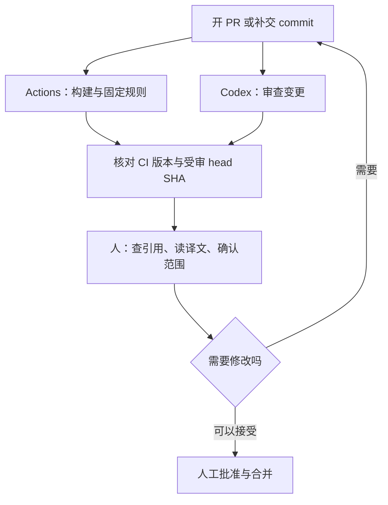

文章改完、提交审查了，GitHub 上的自动检查亮起绿灯，AI 也没提出问题，可以合并了吗？先别急，还有三件事要确认：AI 看的是哪一版？自动检查有没有确认外部链接仍然有效？审查之后才补上的翻译修正，有没有人再看过？

这篇用本站一次真实的文章送审，说明怎么让 GitHub Actions 和 AI Agent 组成一个能追溯来龙去脉的审查流程。开始前，先认识三个最常出现的词：

- **PR（Pull Request）**：把一批修改提交出去、请人审核后再并入正式版本的申请。
- **commit**：一次保存的版本记录。PR 提交后再补的修改，也会成为新的 commit。
- **AI Agent**：能自己读取文件、比对内容并提出意见的 AI 助手。本站公开 PR 上看到的审查，来自 OpenAI 的 Codex。

其他术语会在第一次出现时说明。我想解决的问题很具体：**每次送审，都能说清楚检查了什么、检查的是哪一版，以及还有哪些事必须由人决定。**

> **查证范围**：本文于 2026-11-07 查阅本站源代码与公开 PR。站点配置以 commit [`15a6041`](https://github.com/justmaocom/justmaocom.github.io/tree/15a6041c0974248f91f3dd678a35ace5d1bec995) 为准，案例是已合并的 [PR #29](https://github.com/justmaocom/justmaocom.github.io/pull/29)。文末的自定义 Codex Action 只是扩展示例：本文没有替本站安装或启用它，文中配置也不代表已验证、可直接使用。
{: .prompt-info }

## 什么时候需要这套流程

只要遇到下面任一种情况，就值得把「谁检查了什么、检查的是哪一版」记清楚：

- 审查结束后还会补交修改，例如改字、修翻译、换链接。
- 同一篇内容有多个语言版本，或文中描述了外部工具的行为。
- 已经有自动检查和 AI 审查，却说不出它们各自覆盖到哪里。

本文的案例 PR #29，就同时遇到前两种情况。

## 本站现有的两种自动检查

### Actions：按固定规则检查

**GitHub Actions** 是 GitHub 内置的自动化服务。仓库（repository，存放网站源文件与修改记录的地方）发生你指定的事件时，它就按配置执行任务。一份自动化配置叫做 **workflow**，里面可以再分成几个 **job**，也就是各自执行的工作单元。其中「每次修改都自动重跑同一套检查」叫做 **CI**（Continuous Integration，持续集成）。同一个 workflow 也可以负责部署，那一步就不是检查。

本站的 [Build and Deploy workflow](https://github.com/justmaocom/justmaocom.github.io/blob/15a6041c0974248f91f3dd678a35ace5d1bec995/.github/workflows/pages-deploy.yml) 有三个 job：

| job | 做什么 | 成功代表什么 |
| --- | --- | --- |
| `build` | 用 Ruby 3.4 构建正式版（production）网站，检查各语言网址，再用 html-proofer 检查网页链接 | 网站能顺利生成；受检查的网址格式与站内链接符合规则 |
| `lib` | 执行 `npm ci` 与 `npm run sync-lib`，比对 `assets/lib` | 提交的前端资源和锁定版本的 npm 包一致 |
| `deploy` | 前两个 job 都成功后，部署到 GitHub Pages（GitHub 的网站托管服务） | 发布出去的是通过这些检查的构建产物 |

PR 触发时只会运行前两个 job；`deploy` 的执行条件是 `github.event_name != 'pull_request'`，所以 PR 的检查不会直接发布网站。不过，这个 workflow 也会在有人推送到 `main`／`master` 分支，或手动触发时运行，因此不能说「只有合并 PR 才可能部署」。push 有 `paths-ignore`，但只排除 `.gitignore`、`README.md` 与 `LICENSE`；`pull_request` 没有路径过滤，只新增文章的 PR 仍会运行 `build` 和 `lib`。

固定规则有明确的边界，通过不代表内容没有问题：

- html-proofer 带了 `--disable-external` 参数，**外部链接是否有效，不在检查范围内**。
- `check-i18n.rb` 会检查各语言的 `og:url`、搜索数据、feed、sitemap 等网址，但不会判断英文是否自然，也不会发现简体中文是否还留着台湾用语。

### Codex：在 PR 里做 AI 审查

另一种检查出现在 PR 的讨论区。[PR #29 的 Codex 摘要](https://github.com/justmaocom/justmaocom.github.io/pull/29#issuecomment-6655342679) 显示，开 PR 时已经有一次完成的 Codex Code Review，那一行的触发栏写的是 PR opened。这条评论来自 Codex 的 GitHub 集成（账号 `chatgpt-codex-connector`），不写在上面那份 workflow 里。所以，workflow 中找不到 `openai/codex-action`，不代表本站没有 AI 审查；也不能说这次审查是由 Actions 启动的。

AI 审查的长处是能读懂文字、比对前后说法，找出需要推理才看得出的疑点；但它提出的意见，仍要由人回到来源核对。

## 案例：PR #29 审完之后，内容又改了

这个 PR 新增三语版本的 [pstack 系列导读](/posts/pstack-series-guide/)，同时修改四篇文章的导航链接，涵盖繁体中文、英文与简体中文。本站三个语言版本怎么维护，见[Jekyll 多语言博客：用 polyglot 维护繁简英三版](/posts/jekyll-blog-three-languages/)。

要判断「审的是哪一版」，得先认得版本编号。每个 commit 都有一组由英文字母和数字组成的唯一编号，称为 **SHA**，本文只列出前七位；PR 当前最新的那个 commit，则称为 **head**。这个案例只需要看两个版本：

- [`6857f1f`](https://github.com/justmaocom/justmaocom.github.io/commit/6857f1fc9eae761b018d8c48ad6b77c017d991ab)：初版。Codex 摘要记载的受审 commit 就是这一版，状态为完成，没有 findings（审查提出的问题）。
- [`ff4455b`](https://github.com/justmaocom/justmaocom.github.io/commit/ff4455b570ad97936f0cce3083fdf8c4ccfecee3)：合并前的 head。初版之后，先有一个 commit 修改三语文字；最后这个 commit 再把指向 GitHub 目录的链接从 `blob` 改成 `tree`，并把简体中文的「关光」改成「关掉」。

由此只能得出有限的结论：**摘要里那次 Codex 审查对应的是初版 `6857f1f`，不能拿来证明最后的 `ff4455b` 也经过同一次审查。** 公开摘要没有列出的检查，我不推测它做过，也不据此断言后来的修改完全没人看过。

最后这两项修正，正好说明为什么需要分工：GitHub 链接的路径对不对，要查原始资料或另外做外部链接检查；「关光」这类用词，要靠语言审稿。网站构建成功、AI 没提出问题，都无法单独覆盖这两件事。这也不表示 Codex 漏看了最后的修正，因为我们手上的摘要，本来就只对应更早的版本。

## 分工：固定规则、AI 推理、人工批准

我会先沿用本站已有的 Actions 与 Codex 集成，让三方在同一个 PR 里各自提供证据：



**固定规则交给 Actions。** front matter（文章开头记录标题、日期等信息的配置区）能不能解析、网站能不能构建、各语言网址有没有放错位置，这些都有明确的对错，也能重复检查。想先在自己的电脑上检查，可以在本站仓库运行：

```bash
bash tools/test.sh
```

它会重建正式版网站，再检查各语言网址与站内链接，但不包含 `lib` job 的 npm 资源比对。CI 失败时，就算 AI 没提出问题，也不能算通过。

**需要推理的疑点交给 AI Agent。** 例如文章说某个 action 默认会为所有用户的 PR 执行，但引用的版本其实限制了触发者的权限；或三种语言对同一个选项的说明互相矛盾。要求 Agent 指出具体的文件、段落、依据与影响，会比一句「帮我全面审查」更容易验证。

**引用、语气与发布决定由人负责。** 尤其是「我实测过」「本站目前已启用」这类句子，要有实际执行记录或配置支持。AI 提出的建议，也要回到来源核对。没有 findings 只表示这次审查没有提出问题，不能取代编辑校对、事实核查或合并批准。

{: w="800" h="450" }
_三件事分开做：固定规则、需要推理的疑点，以及能不能合并。_

## 操作步骤

### 步骤一：用现有的 Codex 集成触发审查

不必急着多装一个 bot（自动执行任务的机器人账号）。[Codex 官方文档](https://developers.openai.com/codex/cloud/code-review) 说明了两种启动方式：在 Codex 设置中为仓库开启自动审查，或在 PR 中发表评论：

```text
@codex review
```

这行是给读者参考的操作指令，本文没有替案例 PR 发表新评论。一次性的重点可以接在后面，例如官方文档的 `@codex review for issues in the database migration`。下一节的审查要求也可以这样交给它；要每次都沿用，做法见下一节。

PR #29 那条摘要的触发栏是 PR opened。同一条公开评论列出的触发方式是：开启 PR、把草稿标成可审查，或评论 `@codex review`。它没有把补交 commit 列进去。设置页还可以另外选择 Review trigger，所以这一次记录不能当成以后每次补交都会重审。

### 步骤二：附上审查要求（可复制）

以文章为主的仓库，可以给 Agent 下面这份审查要求：

```text
只审查本次 PR 引入的问题，并列出受审的 head SHA。
核对文章对工具行为的描述，是否符合文中固定的来源版本。
比较繁体中文、英文、简体中文的指令、数字、限制条件是否一致。
指出没有记录支持的「已实测」「已启用」等主张。
每个问题附文件、段落、依据、影响与建议修法。
无法取得来源或只看过部分变更时，明说限制，不宣称全数通过。
```

使用前先了解两点：

- 这份要求表达的是希望审查关注的方向。查阅时的官方文档写明，GitHub 上的 Code Review 只标出 P0、P1 这类高优先级问题（最严重、最该先处理的问题），不保证逐项回复。若要逐段校对文字，或一定要拿到固定字段的完整报告，需要另外设计流程。
- 长期沿用时，官方文档是把规则写进仓库里的 `AGENTS.md`（写给 Agent 读的项目规则文件），并用 `## Code Review Rules` 当标题。Codex 在 GitHub 上读的是仓库里的文件。本站目前把 `AGENTS.md` 列在 `.gitignore`（不纳入版本控制的文件清单），未提交的文件不会出现在公开 PR 里。要让团队和 GitHub 上的审查共用这份规则，必须另外决定如何跟踪这个文件。这份文件的写法见 [AGENTS.md 怎么写：让 Coding Agent 读懂你的项目规则](/posts/agents-md-project-rules-for-coding-agents/)。

### 步骤三：补交 commit 后，确认审到的是新版

以 PR #29 为例，我希望合并前看到的不是一句「审完了」。文章改过之后，旧的审查仍属于旧版，新版要重新核对。

{: w="800" h="450" }
_旧版上的审查便条不能直接拿来证明新版；改过的段落要重新看过。_

下面这份记录是建议的格式，不是案例中已存在的记录：

```text
PR：#29
目前 head：ff4455b
CI：连到检查此版本的 workflow run，列出 build／lib 结果
AI：列出受审 head、报告链接、未涵盖范围
人工：核对 GitHub 目录链接，读过三语修正段落
待处理：列出尚未解决的问题；没有则明写无
```

检查顺序可以很简单：

1. **先处理 CI 失败。** 网站构建不起来、翻译网址错了，就先修这些可以复现的问题。
2. **逐项看 AI 建议的依据。** 接受就修改，不接受就留下理由。报告缺上下文时补充资料，不要硬把它算成通过；若因变更太大、读不到来源或超时而只完成部分审查，也要标示为未完成，不把没有结果解读成没有问题。
3. **有新 commit，就重新核对版本。** 本站这份 workflow 取出代码时没有另外指定版本。依 [GitHub 文档](https://docs.github.com/en/actions/reference/workflows-and-actions/events-that-trigger-workflows#pull_request)，`pull_request` 的 `GITHUB_SHA`（这次运行实际取出的版本编号）是 PR 与目标分支合成的 merge commit（临时合并后的版本）。默认的 checkout 步骤取出的就是它，不是 PR head 本身。GitHub 仍把检查结果标在 PR head 上；PR #29 最后一次 `build`／`lib` 的 head 就是 `ff4455b`。要比对时同时记下这个 head。PR 有合并冲突时，这次 `pull_request` workflow 不会运行，要先解决冲突。AI 受审的 head 也要对得上，必要时重审。
4. **最后才由人批准与合并。** GitHub 的必要检查（required checks）与批准（approval），要在 ruleset 或 branch protection（分支保护规则）里设置；仓库里有 workflow 配置文件，不代表它已经是合并门槛。

## 进阶：何时才需要自定义 Codex Action

> 本站没有安装或启用这一节的配置。以下是扩展示例，不是本站现行的流程。
{: .prompt-info }

如果你需要固定的报告格式、让文章和代码使用不同的审查提示，或把结果接到已有的审核工具，可以考虑 [`openai/codex-action`](https://github.com/openai/codex-action/tree/bdf19a4a223ec2549a3e2274a0cf61556bc07675)。它会在 runner（实际执行 Actions 任务的机器）上安装 Codex CLI（Codex 的命令行工具），通过 API 执行任务；API key（调用服务用的密钥）与用量都要自行配置与管理。这和本站 PR 里看到的 Codex GitHub 集成，是不同的接入方式。

下面只示范**审查 job 里的 Codex 步骤（step）**，不是粘贴就能运行的完整 workflow。前面的步骤必须先准备受信任的审查规则、完整的 PR diff（修改前后的差异）与所需上下文，记下 base／head SHA（比较基准与最新版本的编号），并检查变更有没有被截断。**不要先执行 PR 提供的安装脚本，再把 API key 带进同一个环境。**


```yaml
- name: Review the prepared PR diff
  id: review
  uses: openai/codex-action@bdf19a4a223ec2549a3e2274a0cf61556bc07675 # v1.13
  with:
    openai-api-key: ${{ secrets.OPENAI_API_KEY }}
    permission-profile: ":read-only"
    safety-strategy: drop-sudo
    prompt-file: review-input/prompt.md
```


简单来说，`openai-api-key` 从 GitHub 的 secrets（加密保存的机密配置）读取密钥，`prompt-file` 指向事先准备好的审查提示词，另外两项用来限制 Codex 的权限。

这个示例固定在特定版本的 [README](https://github.com/openai/codex-action/blob/bdf19a4a223ec2549a3e2274a0cf61556bc07675/README.md) 说明，permission profiles 需要 Codex CLI `0.138.0` 以上，查阅时仍是 beta（测试阶段）。`:read-only` 限制命令能访问的文件与网络；`drop-sudo` 处理进程的权限，两者分工不同。不要同时填写 `permission-profile` 和旧的 `sandbox` input，action 会在启动前拒绝。`safety-strategy: read-only` 会改走旧的只读 sandbox，因此也不能和 permission profile 一起用；它不是 `:read-only` 的另一种写法。

`uses` 那一行最后的长编号就是 SHA，用来固定 action 的版本。但它只固定 action 本身，不会自动固定它安装的 Codex CLI 或使用的模型。正式引入时，还要选定测过的 `codex-version`、模型与报告格式，记录这些版本，并确认 runner 支持所需的隔离机制。本文不替没跑过的组合填入一组看似保证可用的版本号。

按照[官方安全建议](https://github.com/openai/codex-action/blob/bdf19a4a223ec2549a3e2274a0cf61556bc07675/docs/security.md)：

- 把 Codex 放在 job 的最后一步。
- 需要在 PR 发表评论时，先把 `steps.review.outputs.final-message` 映射为该 job 的 output，再由另一个新 job 通过 `needs` 读取，只给它发表评论所需的权限。
- 报告是数据，不要插进 shell 或 JavaScript 源代码里执行。
- 先采用建议模式，让人读完再决定要不要修；「action 执行成功」不等于「内容获得批准」。

如果你自定义了反馈程序，发出结果前还要重新读取一次 PR 的 head。若 head 已经改变，就把旧报告标示为过期，并安排审查最新版本。`concurrency` 用来限制同一个分组不要同时运行。只写分组时，新的 run 会等待，并取消还在排队的旧 run；要连进行中的也停掉，必须另外设置 `cancel-in-progress: true`。本站的 Build and Deploy workflow 有这组设置，取消的是同一 ref 上尚未完成的构建或部署。把它用在自定义审查时，也只能停掉还没跑完的 run，不能撤回已经发出的报告，更不能取代版本核对。

### 触发条件与权限也要一起设计

[GitHub 的事件文档](https://docs.github.com/en/actions/reference/workflows-and-actions/events-that-trigger-workflows#pull_request) 说明，`pull_request` 默认处理 `opened`（开启）、`synchronize`（推送新的 commit）、`reopened`（重新开启）。自定义审查若也要在草稿转为正式时执行，可以明确列出 `ready_for_review`；若要跳过草稿，则另加 draft 条件。

`synchronize` 能覆盖补交的 commit，但不代表 Codex Action 一定能执行：

- 它默认只接受对仓库有写入权限的触发者。
- 来自 fork（别人复制出去的仓库副本）的 PR，通常拿不到 Actions secrets，也就没有 API key 可运行。

能不能把结果留在 PR 上，是另一件事。`GITHUB_TOKEN` 是 workflow 运行时自动获得的令牌。来自 fork 的 PR，这个令牌是只读的；同一个仓库的 PR，则看 workflow 或仓库怎么设置权限。本站现有 workflow 在顶层把 `contents` 设成 `read`，也没有给 `pull-requests: write`，所以那份 workflow 不能拿它发表审查评论。自定义审查若要发表评论，得在另一个 job 明确给出发文权限。

遇到 fork PR 没有 secret，或触发者没有权限时，应明确跳过或等维护者处理，不要为了让它运行而放宽所有人的权限。第一版可以只处理同一仓库内、可信任协作者的 PR；有外部投稿需求时，再把信任、隔离与反馈方式设计完整。

**不要为了取得 secret，就改用 `pull_request_target`，再 checkout（检出）并执行外部 PR 的代码。** PR 的文字、diff 和新增的 `AGENTS.md`，都可能夹带不可信任的指令。提示词里的提醒有帮助，但真正的权限仍要靠 runner、token 与隔离设置约束。也不要为了方便，用 `allow-users: "*"` 对所有人开放 API 用量。这些限制在 [GitHub 安全指南](https://docs.github.com/en/actions/security-for-github-actions/security-guides/security-hardening-for-github-actions) 与上述 Codex Action 安全文档中都有说明。

## 成果与下一步

按这套流程，每个 PR 合并前都会留下一份可追溯的记录：自动检查运行的是哪一版、AI 审的是哪一版又覆盖到哪里、人看过哪些内容、还剩哪些问题。下一次打开 PR，你会知道自己正在批准什么。

接下来可以这样做：

1. 到 Codex 设置页确认自动审查会在哪些事件触发，并决定补交 commit 后由谁、在什么时候要求重审。
2. 决定是否把 `AGENTS.md` 纳入版本控制，让团队能共用上面的审查要求。
3. 如果还没设置，在 ruleset 或 branch protection 中把必要检查与人工批准设为合并门槛。
4. 只有在需要固定报告格式、分开文章与代码的提示词，或对接已有工具时，才评估自定义 Codex Action；先限同一仓库、可信任协作者的 PR，并从建议模式开始。
5. 引入后回头看实际记录：哪些建议被采用、哪些只是噪音、每次审查花了多少时间与用量。

本站的案例给我的提醒是：先把现有证据串好，往往就能改善审查。Actions 负责可复现的检查，Agent 提出有依据的疑点，人核对引用、文字与发布范围；三者都对应到同一份变更，批准才有意义。

## 参考资料与延伸阅读

- [本站 workflow：`15a6041` 版本](https://github.com/justmaocom/justmaocom.github.io/blob/15a6041c0974248f91f3dd678a35ace5d1bec995/.github/workflows/pages-deploy.yml)与 [PR #29](https://github.com/justmaocom/justmaocom.github.io/pull/29)：现状与案例的依据。
- [Codex Code Review 官方文档](https://developers.openai.com/codex/cloud/code-review)：GitHub 集成、自动审查、审查规则与手动触发。
- [Codex Action 固定版本 README](https://github.com/openai/codex-action/blob/bdf19a4a223ec2549a3e2274a0cf61556bc07675/README.md)与[安全文档](https://github.com/openai/codex-action/blob/bdf19a4a223ec2549a3e2274a0cf61556bc07675/docs/security.md)：input、输出、权限与 job 分工。
- [GitHub：workflow 触发事件](https://docs.github.com/en/actions/reference/workflows-and-actions/events-that-trigger-workflows#pull_request)、[安全指南](https://docs.github.com/en/actions/security-for-github-actions/security-guides/security-hardening-for-github-actions)、[受保护分支](https://docs.github.com/en/repositories/configuring-branches-and-merges-in-your-repository/managing-protected-branches/about-protected-branches)：事件、token 与合并门槛。
- [pstack 系列（3）：写完代码之后，先证明它能用再合并](/posts/pstack-build-verify-merge/)：把验证和送审排进 Agent 的工作流程。
- [装了第三方 skill 和 MCP 之后，你的 Coding Agent 多了哪些破口？](/posts/coding-agent-supply-chain-permission-risks/)：为什么读取文件、运行命令与持有凭据要分开考虑。
- [Claude Code hooks 教程：自动排版、跑测试与敏感文件提醒](/posts/claude-code-hooks-automate-checks/)：提交 PR 之前，先在 Claude Code 的会话里自动排版、跑测试。
- [AI 写代码更快了，产品为什么还是交付不了？我如何理解 AI 原生开发流程](/posts/ai-native-sdlc-playbook/)：从需求到上线的六个阶段里，PR 评审的前后各接着什么。
