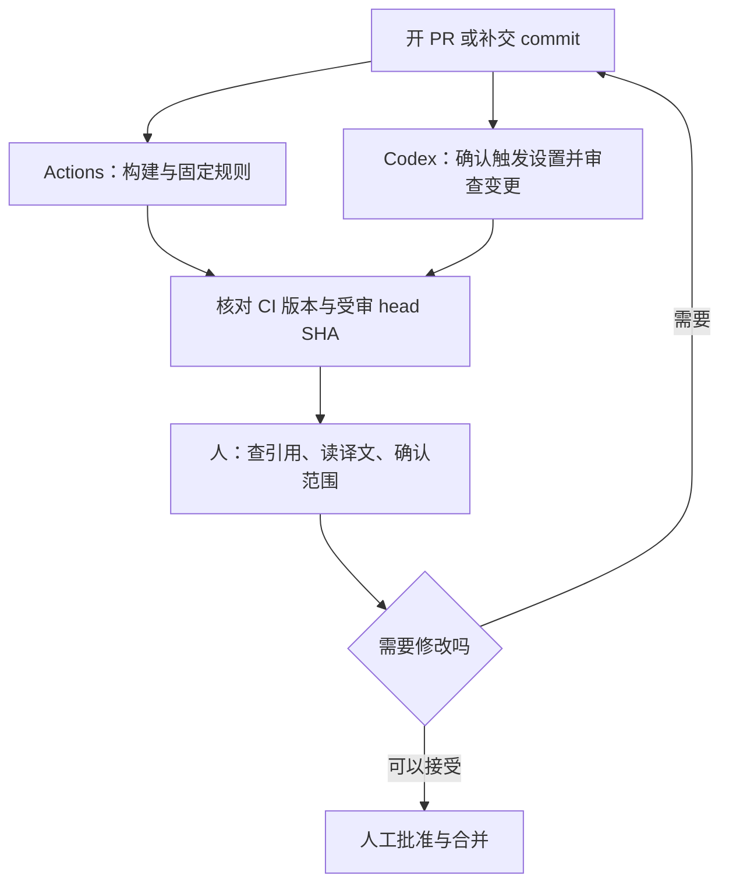

文章改完、PR 开好了，Actions 显示绿灯，AI 也没提出问题，可以合并了吗？先看一下：AI 审的是哪一个 commit？CI 有检查外部引用吗？后来补上的翻译修正，有没有再被看过？

这篇用本站的 Jekyll 文章 PR，说明怎么把 GitHub Actions 和 AI Agent 接成一个可追查的审查流程。读者只要知道 PR 是用来送审的变更、commit 是一次版本记录，就能跟上；需要自定义 workflow 的部分另放在后面。

我想解决的问题很具体：**每次送审，都能知道检查了什么、检查到哪个版本，以及还有哪些事要由人决定。**

> **查证范围**：本文于 2026-11-07 查阅本站源代码与公开 PR。站点设置以 commit [`15a6041`](https://github.com/justmaocom/justmaocom.github.io/tree/15a6041c0974248f91f3dd678a35ace5d1bec995) 为准，案例是已合并的 [PR #29](https://github.com/justmaocom/justmaocom.github.io/pull/29)。后面的 Codex Action 是扩展方案，本文没有替本站安装或启用它，也没有宣称完成过该方案的端到端测试。
{: .prompt-info }

## 本站已经有两条自动检查路径

先看现有设置，才能决定要补什么。本站的 [Build and Deploy workflow](https://github.com/justmaocom/justmaocom.github.io/blob/15a6041c0974248f91f3dd678a35ace5d1bec995/.github/workflows/pages-deploy.yml) 有 `build`、`lib`、`deploy` 三个 job。

| 工作 | 现在会做什么 | 能证明的范围 |
| --- | --- | --- |
| `build` | 用 Ruby 3.4 构建 production 网站，检查多语言网址，再跑 html-proofer | 网站能产生、受检查的网址格式与站内链接符合规则 |
| `lib` | 执行 `npm ci` 与 `npm run sync-lib`，比对 `assets/lib` | 提交的前端资源和锁定的 npm 包一致 |
| `deploy` | 等前两个 job 成功，再部署 GitHub Pages | 发布通过这些检查的构建产物 |

PR 事件会跑前两个 job；`deploy` 的条件是 `github.event_name != 'pull_request'`，因此 PR 的检查不会直接发布网站。workflow 另外接受 `main`／`master` 的 push 和手动触发，所以也不能把它描述成「只有合并 PR 才可能部署」。

这些检查各有明确边界。例如 html-proofer 带了 `--disable-external`，**外部引用是否有效，不在这个检查范围内**。`check-i18n.rb` 会检查各语言的 `og:url`、搜索数据、feed、sitemap 等网址，但不会判断英文是否自然、简体中文是否还留着台湾用语。

另一条路径在 PR 讨论里。[PR #29 的 Codex 摘要](https://github.com/justmaocom/justmaocom.github.io/pull/29#issuecomment-6655342679) 显示，开 PR 时已有 Codex Code Review。这是 Codex 的 GitHub 整合；在上述 workflow 里找不到 `openai/codex-action`，不能因此说本站没有 AI 审查，也不能说这次审查是 Actions 启动的。

## PR #29：完成审查之后，内容还会继续变

这个 PR 新增 [pstack 系列导读](/posts/pstack-series-guide/)，同时修改四篇文章的导览链接，涵盖繁体中文、英文与简体中文。它的公开版本记录可以整理成这样：

| 版本或记录 | 可观察到的事实 |
| --- | --- |
| [`6857f1f`](https://github.com/justmaocom/justmaocom.github.io/commit/6857f1fc9eae761b018d8c48ad6b77c017d991ab) | 新增三语导读与系列导览链接；Codex 摘要记载的受审 commit 是这一版，状态为完成、没有 findings |
| [`3e0be05`](https://github.com/justmaocom/justmaocom.github.io/commit/3e0be05e3136aeb8d4d6b80bee4aaf1bc02b1657) | 后续修改三语文章的文字 |
| [`ff4455b`](https://github.com/justmaocom/justmaocom.github.io/commit/ff4455b570ad97936f0cce3083fdf8c4ccfecee3) | 把指向 GitHub 目录的 `blob` 链接改成 `tree`，并调整简体中文的「关光」为「关掉」；这是 PR 合并前的 head |

这里能得出的结论是：**摘要里的那次 Codex 审查，对应初版 `6857f1f`，不能直接拿来证明后来的 `ff4455b` 也受过同一次审查。** 公开摘要没有列出的检查，我不推测它曾经做过，也不据此断言完全没有人审过。

这个例子也说明了分工的价值。GitHub 外部链接的路径问题，需要查原始资料或另做外部链接检查；「关光」这种用语，则要靠语言审稿。构建成功和 AI 没提出问题，都无法单独涵盖这两件事。这也不表示 Codex 漏报了最后那个修正，因为我们手上的摘要对应的是更早的版本。

## 先让 CI、Agent 和人各自负责一件事

我会先沿用本站已有的 Actions 与 Codex 整合，让它们在同一个 PR 里提供不同证据：



**固定规则交给 Actions。** front matter 能不能解析、网站能不能建、多语言网址有没有跑错位置，都有可以重复执行的检查。对本站，在本机可先跑：

```bash
bash tools/test.sh
```

它会重建 production 网站，再做多语言网址与站内链接检查；它没有包含 `lib` job 的 npm 资源同步比对。这次只新增文章时，仍会由 PR 上的完整 workflow 执行 `lib`。

**需要推理的疑点交给 Agent。** 例如文章说某个 action 默认能执行所有用户的 PR，但引用的版本其实限制触发者权限；或者三语文章对同一个选项的说明互相矛盾。要求它指出具体文件、段落、依据与影响，会比「帮我全面审查」更容易验证。

**引用、语气与发布决定由人负责。** 尤其是「我实测过」「本站目前已启用」这类句子，要有实际执行记录或设置支持。AI 产生的建议，也要回到来源核对。没有 findings 只表示这次审查没有提出问题；它不是编辑校对、事实核查或批准合并的替代品。

## 先用现有 Codex 整合，不必急着多装一个 bot

[Codex 官方文件](https://developers.openai.com/codex/cloud/code-review) 说明了两种入口：在 Codex 设置中开启 repository 的自动审查，或在 PR 留言要求：

```text
@codex review
```

这行是给读者参考的操作指令，不代表本文已替案例 PR 送出新留言。自动触发的事件与个人偏好要回设置页确认；不能从一次「PR opened」的记录推定每次 push 都会重审。

对文章型 repository，可以提供这样的审查要求；若要长期沿用，再整理进版本控制中的 `AGENTS.md`。本站目前把 `AGENTS.md` 列在 `.gitignore`，要让团队共用规则，必须另外处理跟踪方式。

```text
只审查本次 PR 引入的问题，并列出受审的 head SHA。
核对文章对工具行为的描述，是否符合文中固定的来源版本。
比较繁体中文、英文、简体中文的指令、数字、限制条件是否一致。
指出没有记录支持的「已实测」「已启用」等主张。
每个问题附文件、段落、依据、影响与建议修法。
无法取得来源或只看过部分变更时，明说限制，不宣称全数通过。
```

这是希望审查关注的方向，不保证整合会逐项回复。查阅时的官方文件说明，GitHub Code Review 聚焦 P0、P1 等高优先级问题；想拿它做逐段编辑校对，或一定要拿到固定字段的完整报告，就需要另外设计流程。

## 何时才需要自定义 Codex Action

如果你需要固定报告格式、让文章和代码走不同的审查提示，或把结果接到既有的审核工具，就可以考虑 [`openai/codex-action`](https://github.com/openai/codex-action/tree/bdf19a4a223ec2549a3e2274a0cf61556bc07675)。它在 runner 上安装 Codex CLI，通过 API 执行任务，需要自行设置 API key 与用量；这和本站 PR 里的 Codex GitHub 整合是不同的接法。

下面只示范**审查 job 里的 Codex step**，不是可直接贴上就运作的完整 workflow。前置步骤必须准备受信任的审查规则、完整的 PR diff 与所需上下文，记下 base／head SHA，并先检查变更是否被截断。不要先执行 PR 提供的安装脚本，再把 API key 带进同一个环境。


```yaml
- name: Review the prepared PR diff
  id: review
  uses: openai/codex-action@bdf19a4a223ec2549a3e2274a0cf61556bc07675 # v1.13
  with:
    openai-api-key: ${{ secrets.OPENAI_API_KEY }}
    permission-profile: ":read-only"
    safety-strategy: drop-sudo
    prompt-file: review-input/prompt.md
```


这个示例固定的 [README](https://github.com/openai/codex-action/blob/bdf19a4a223ec2549a3e2274a0cf61556bc07675/README.md) 说明，permission profiles 需要 Codex CLI `0.138.0` 以上，查阅时仍是 beta。`:read-only` 限制命令的文件与网络访问；`drop-sudo` 处理程序的权限，两者分工不同。不要把 `permission-profile` 和旧的 `sandbox` input 一起填，也不要把 `safety-strategy: read-only` 当成这两项设置的同义写法。

Action 的 SHA 只固定 action 本身，没有自动固定它安装的 Codex CLI 或所用模型。正式导入时，还要选定测过的 `codex-version`、模型与报告格式，记录这些版本，并检查 runner 是否支持需要的隔离机制。本文不替未跑过的组合填入一组看似保证可用的版本号。

依[官方安全建议](https://github.com/openai/codex-action/blob/bdf19a4a223ec2549a3e2274a0cf61556bc07675/docs/security.md)，把 Codex 放在 job 最后一步；需要留言时，先把 `steps.review.outputs.final-message` 映射为该 job 的 output，再由另一个新 job 通过 `needs` 读取，只给发文所需的权限。报告是数据，不要插入 shell 或 JavaScript 源代码里执行。先采用建议模式，让人读完再决定要不要修，不把「action 执行成功」当成「内容获得批准」。

### 触发与权限也属于设计的一部分

[GitHub 的事件文件](https://docs.github.com/en/actions/reference/workflows-and-actions/events-that-trigger-workflows#pull_request) 说明，`pull_request` 默认处理 `opened`、`synchronize`、`reopened`。自定义审查若还要涵盖草稿转正式，可明列 `ready_for_review`；要跳过草稿，则另加 draft 条件。

`synchronize` 能涵盖补交 commit，但不代表 Codex Action 一定可执行：它默认限制有 repository 写入权限的触发者，fork PR 也通常拿不到 Actions secrets，只读的 `GITHUB_TOKEN` 亦不能直接发审查留言。第一版可以先限同一 repository、可信任的协作者的 PR；有外部投稿需求时，再把信任、隔离与回报方式设计完整。

不要为了取得 secret，直接改成 `pull_request_target` 后 checkout 并执行外部 PR 程序。PR 的文字、diff 和新增的 `AGENTS.md` 都可能带入不可信任指令；提示词提醒有帮助，真正的权限仍要由 runner、token 与隔离设置约束。Action 也不要用 `allow-users: "*"` 来图方便开放 API 用量。这些限制在 [GitHub 安全指南](https://docs.github.com/en/actions/security-for-github-actions/security-guides/security-hardening-for-github-actions)与上述 Codex Action 安全文件都有说明。

## 补交 commit 后，怎么确认真的审到新版

以 PR #29 为例，我希望合并前能看到的不是一句「审完了」，而是下面这份记录。这是建议的记录格式，不是案例中已存在的执行结果：

```text
PR：#29
目前 head：ff4455b
CI：连到检查此版本的 workflow run，列出 build／lib 结果
AI：列出受审 head、报告链接、未涵盖范围
人工：核对 GitHub 目录链接，读过三语修正段落
待处理：列出尚未解决的问题；没有则明写无
```

检查顺序也可以很简单：

1. **先处理 CI 失败。** 网站建不起来、翻译网址错了，就先修这些可重现的问题。
2. **看每一项 AI 建议的证据。** 接受就修改，不接受就留下理由；报告缺上下文时补充资料，不硬把它算成通过。
3. **有新 commit，就重新核对版本。** 确认 CI 检查的是最新变更；若 `pull_request` run 用的是合成的 merge commit，同时记下对应 PR head。AI 的受审 head 也要对得上，必要时重审。
4. **最后才人工批准与合并。** GitHub 的 required checks 与 approval 要在 ruleset／branch protection 里设置；workflow YAML 的存在不代表它们已是合并门槛。

自定义回报程序还要在发出结果前，重新读一次 PR 的 head。若它已改变，就把旧报告标示为过期，安排最新版本的审查。`concurrency` 可以取消尚未完成的旧 run、减少用量，却不能撤回早已发出的旧报告，也无法取代这个版本核对。

## 导入时，先验这几种情况

审查 bot 上线前，可以用小型测试 PR 确认流程，而不是先追求它能找出多少问题：

| 情况 | 预期结果 |
| --- | --- |
| 新增一篇正常文章 | CI 通过；AI 报告可追到受审版本，结果由人判读 |
| 故意放一个坏掉的站内链接 | CI 失败，即使 AI 没发现也不能算通过 |
| AI 审完后再推一个 commit | 新版重新检查，旧报告有明确版本标示 |
| diff 太大、来源读不到、API 超时 | 显示未完成或部分审查，不把缺少结果解读成没问题 |
| fork PR 没有 secret，或触发者无权限 | 明确跳过或等待维护者处理，不为了执行而放宽所有人的权限 |

这是一份建议验收清单，本文没有宣称已替自定义 Action 跑完它。导入后再看实际记录：哪些建议被采用、哪些只是噪音、每次审查花多久与多少用量。数据不足时，不先写「省下多少时间」或「提升多少准确率」。

本站的案例给我的提醒是：先把现有证据串好，往往就能改善审查。Actions 负责可重现的检查，Agent 提出有依据的疑点，人核对引用、文字与发布范围；三者都对应到同一份变更，下一次打开 PR 时才知道自己正在批准什么。

## 参考资料与延伸阅读

- [本站 workflow：`15a6041` 版本](https://github.com/justmaocom/justmaocom.github.io/blob/15a6041c0974248f91f3dd678a35ace5d1bec995/.github/workflows/pages-deploy.yml)与 [PR #29](https://github.com/justmaocom/justmaocom.github.io/pull/29)：现况与案例的依据。
- [Codex Code Review 官方文件](https://developers.openai.com/codex/cloud/code-review)：GitHub 整合、自动审查、审查规则与手动触发。
- [Codex Action 固定版本 README](https://github.com/openai/codex-action/blob/bdf19a4a223ec2549a3e2274a0cf61556bc07675/README.md)与[安全文件](https://github.com/openai/codex-action/blob/bdf19a4a223ec2549a3e2274a0cf61556bc07675/docs/security.md)：input、输出、权限与 job 分工。
- [GitHub：workflow 触发事件](https://docs.github.com/en/actions/reference/workflows-and-actions/events-that-trigger-workflows#pull_request)、[安全指南](https://docs.github.com/en/actions/security-for-github-actions/security-guides/security-hardening-for-github-actions)、[受保护分支](https://docs.github.com/en/repositories/configuring-branches-and-merges-in-your-repository/managing-protected-branches/about-protected-branches)：事件、token 与合并门槛。
- [写完代码之后，先证明它能用再合并](/posts/pstack-build-verify-merge/)：把验证和送审排进 Agent 的工作流程。
- [装了第三方 skill 和 MCP 之后，你的 Coding Agent 多了哪些破口？](/posts/coding-agent-supply-chain-permission-risks/)：为什么读取文件、运行命令与持有凭据要分开考虑。
