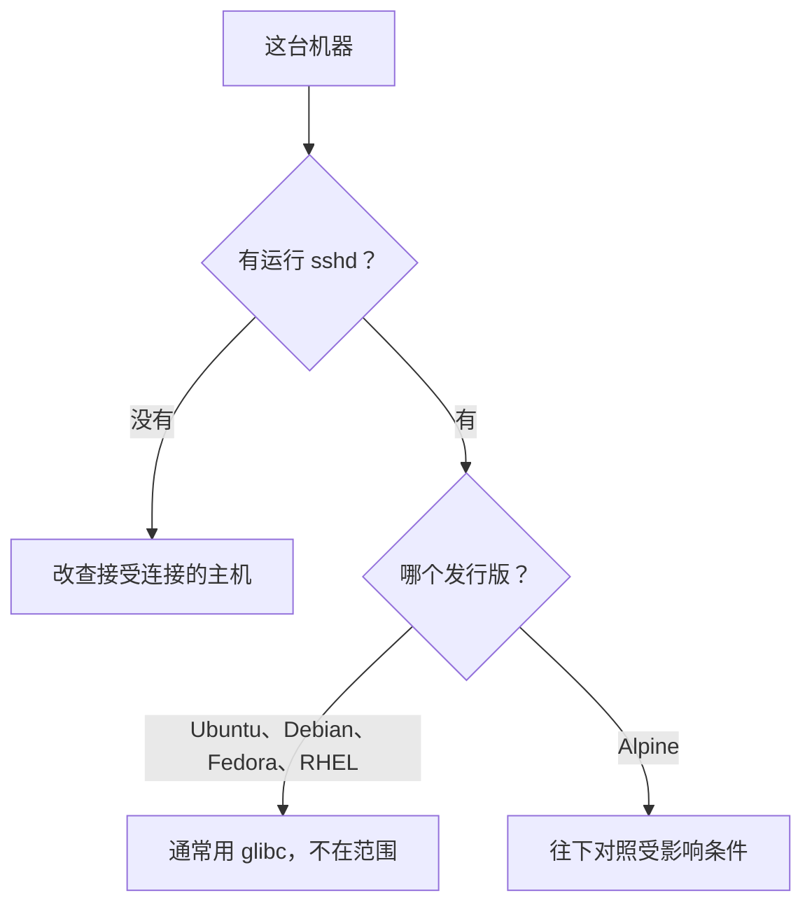
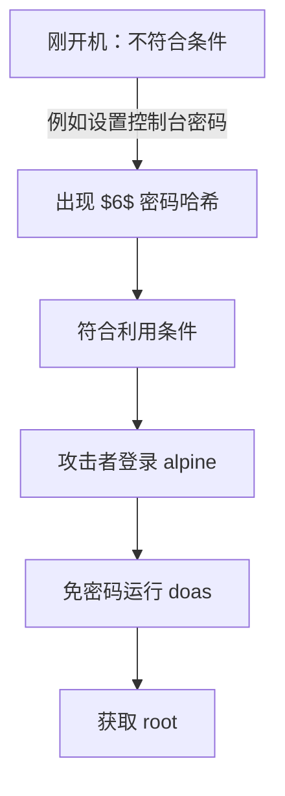
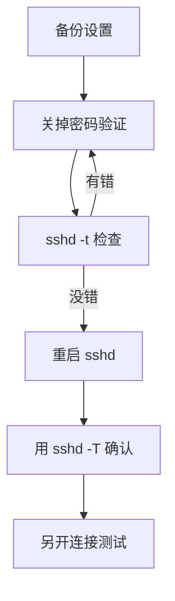
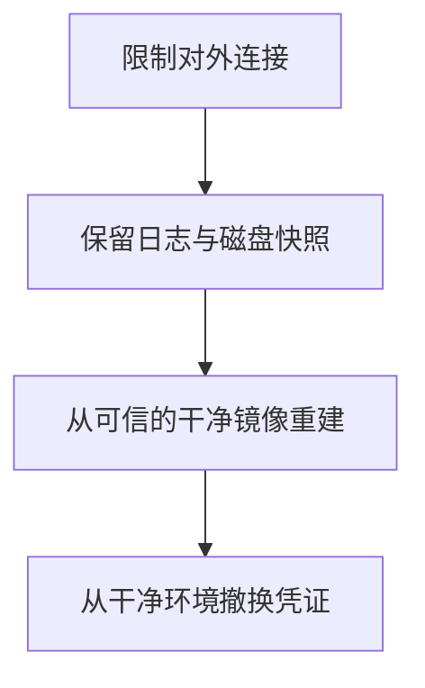

看到“OpenSSH 出现密码验证绕过漏洞”，最直接的疑问是：自己的主机有没有事？这次的 **CVE-2026-123158**，让攻击者在特定系统与账号设置下，不必知道正确密码就可能登录主机。但受影响的只有服务器端接受连接的 `sshd`，而且要好几个条件同时成立。

> 内容依据 OpenSSH 与 Alpine 的官方公告，查证日期是 2026-11-07（台北时间）。漏洞状态与软件包版本若有后续更新，以官方最新信息为准。
{: .prompt-info }

我会先确认主机用什么系统、有没有提供 SSH 远程登录，再决定要不要往下查：



只用电脑上的 `ssh` 连接到其他主机，或容器里没有运行 sshd，问题就不在这些客户端或容器本身。用 Alpine 又提供 SSH 登录服务的话，不能因为自己平常用密钥登录就放心，原因在后面的条件里。

不是管理服务器的人，可以先把这篇交给运维或 IT 人员确认。后面的命令是给主机管理者用的，不需要每位读者都亲自操作。

## 先认识三个名词

**sshd 是接受远程登录的程序。** 它在服务器上等待别人连接进来，`ssh` 则是用来连接到其他主机的客户端。这次要修补的是 sshd。

**musl 和 glibc 是系统底层的 C 函数库。** 它们是程序共用的基础工具，提供密码运算等功能。Alpine 使用 musl，多数常见的 Linux 发行版使用 glibc，这次公告针对的是使用 musl 的环境。

**PAM 是处理登录验证的框架。** sshd 可以把密码验证交给 PAM，也可以直接调用系统函数处理。这次出问题的是不经过 PAM 的那条验证流程。

## 11 月 5 日已发布修补，严重程度评为 High

OpenSSH 在 2026-11-05 发布 [Portable OpenSSH 10.6p2](https://www.openssh.org/txt/release-10.6p2)，在 sshd 里加入防护，挡下这次的密码验证绕过。OpenSSH 认为根本原因在 sshd 之外，但因为能通过 sshd 触发，所以先在这里阻挡。

同一天，[Alpine 发布安全公告](https://alpinelinux.org/posts/2026-11-05-openssh-password-authentication-bypass/)，提供 3.16 到 edge 各分支的修补软件包。根据 Alpine 的说明，利用条件成立时，攻击者只要知道账号名称就可能登录，不需要猜中密码。所以我会优先确认两件事：有没有修补，以及能否从外部连接到主机。

严重程度有三个来源，说法各不相同：

| 来源 | 严重程度 |
| --- | --- |
| OpenSSH 版本说明 | “critical security workaround” |
| [CVE 记录](https://cveawg.mitre.org/api/cve/CVE-2026-123158)，由 MITRE 提供 | CVSS 3.1 分数 8.1，等级 High |
| [NVD](https://services.nvd.nist.gov/rest/json/cves/2.0?cveId=CVE-2026-123158) | 截至 2026-11-07 仍标示为 Received，尚未提供自己的评分 |

项目的紧急提醒和 CVSS 评分来自不同来源，我会分开看。

Alpine 公告里写的“尚未分配 CVE”，是公告撰写时的状态。这笔 CVE 记录已在 2026-11-05 23:46（台北时间）发布，Alpine 安全数据库也已列出对应的修补版本。

## 五个条件同时成立，才会受影响

根据 Alpine 公告，下面五个条件要同时成立：

1. **主机采用基于 musl 的 Linux，且正在运行的 sshd 尚未修补。** 已安装发行版的修补软件包、并重新启动 sshd 的主机，不受这个漏洞影响。
2. **sshd 没有通过 PAM 验证密码。** 在 Alpine 上，这包括 `openssh-server`，以及设置为 `UsePAM no` 的 `openssh-server-pam`。后者设为 `UsePAM yes` 则不受影响。
3. **仍允许密码验证，也就是 `PasswordAuthentication yes`。** 这是 OpenSSH 的上游默认值，但主机可能另有设置，要以实际应用的内容为准。
4. **有密码字段为 `*` 的账号。** 例如部分只用密钥登录、没有设置可用密码的账号。Alpine 也列出通过 musl-nscd 获取的目录服务用户，这类账号来自集中式账号系统，本机没有密码记录。
5. **至少有另一个本机账号，存有 `$5$` 或 `$6$` 开头的密码哈希。** 哈希是系统用来验证密码的运算结果。这个条件表示，其他账号的密码设置也会影响风险。

攻击者还必须能连接到 SSH 端口，并知道目标账号名称。目标账号也要能通过其他登录限制，例如禁止该账号登录的规则，不会因为密码比对被绕过就失效。

所以我不会只看到一个 `*`，就判定主机一定能被登录。但也不会因为平常没用密码登录，就省略这些检查。

有两个地方容易混淆：

- **`*` 代表没有可用的密码哈希，不是空白密码，也不代表账号完全不能登录。** 这种账号仍可能用密钥登录。Alpine 公告另外指出，密码字段为 `!` 的锁定账号不受这个漏洞影响。
- **平常用密钥登录，不代表服务器已关闭密码验证。** 我会检查 `PasswordAuthentication` 的实际值，而不是依自己的使用习惯判断。

### Alpine 云镜像：刚开机没事，不代表之后安全

Alpine 公告把官方 tiny-cloud 镜像的 3.18.11 到 3.24.3 列为受影响版本。这些镜像的 `alpine` 账号密码字段是 `*`，而且可以免密码使用 `doas` 获取 root，也就是系统管理员权限。

公告说这些镜像刚开机时不符合利用条件。但**风险会随账号设置改变，不能把“刚开机时没事”当成之后都安全**：



默认的 `PermitRootLogin prohibit-password` 只禁止 root 直接用密码登录。攻击者先登录 `alpine`、再用 `doas` 获取 root，这项设置挡不住。

用 cloud-init 设置的镜像，Alpine 列为不受影响，因为 cloud-init 会写入 `PasswordAuthentication no`。但后续修改可能重新打开密码验证，所以我仍会确认目前设置。

## 错误返回的 `*` 被当成密码相符

我把正常流程简化成两步：sshd 用 `crypt()` 函数把输入的密码转成哈希，再和账号保存的值比对。

密码字段只有 `*` 时，里面没有正常哈希需要的 salt，也就是密码运算的附加参数。这时 sshd 会借用另一个账号的参数来计算，所以其他账号有没有设置密码，会影响结果。

根据 Alpine 的说明，musl 的 `crypt()` 遇到超过 256 字节的密码时，会返回 `*` 表示错误。未修补的 sshd 把这个返回值拿去和账号密码字段比较，而密码字段刚好也是 `*`，于是误判为验证成功。**原本应该拒绝登录的运算错误，被当成了密码相符。**

[OpenSSH 的修补](https://github.com/openssh/openssh-portable/commit/4353fdc43ef646c43a8dda7025cc1a898caf1482)增加了保存哈希的长度检查，让 `*` 这类过短的值无法通过比对。Alpine 旧分支的软件包也带有对应修补。

{: w="1280" h="720" }
_我用图中的 `* = *` 表示这次的误判：运算错误的返回值刚好与账号保存值相同，于是被当成密码正确。_

## 检查主机：先看系统与软件包，再看设置与账号

以下是给 Alpine 主机管理者的只读检查。读取 `/etc/shadow`、运行 sshd 检查，以及后面的更新步骤，都要在有 root 权限的管理 shell 中操作。

### 1. 确认系统与已安装的软件包

```sh
cat /etc/os-release
apk info -v | grep openssh
```

第一行确认是不是 Alpine，以及属于哪个版本。第二行列出已安装的 OpenSSH 软件包，供后面对照修补版本号。不是 Alpine 的话，改用该发行版的软件包工具与安全公告。

我不会只看 `ssh -V`。它显示的是客户端版本，无法确认服务器是否已应用发行版的修补。

### 2. 检查 sshd 会应用的设置

```sh
sshd -T | grep -Ei '^(usepam|passwordauthentication|permitrootlogin) '
```

先看 `passwordauthentication` 是 `yes` 还是 `no`，再搭配 PAM 软件包与设置判断。没有 PAM 支持的版本可能不会列出 `usepam`，没有输出不代表已启用 PAM。

`sshd -T` 读取磁盘上的配置文件，再输出解析结果，**不会询问正在运行的服务目前用了什么设置**。所以改完文件后看到 `no`，仍要让服务重新加载设置才会生效。

这些命令以默认配置文件为准。服务若使用自定义路径或启动参数，检查时也要保持一致。

设置中有 `Match`，也就是针对特定账号或来源的例外规则时，要再指定连接场景检查。例如账号 `deploy` 从 `203.0.113.10` 连接进来：

```sh
sshd -T -C user=deploy,addr=203.0.113.10 | grep -i passwordauthentication
```

把示例账号与 IP 换成实际值。依 [sshd 说明文档](https://man.openbsd.org/sshd.8)，规则还比对其他条件时，要补上对应的参数：

- 比对来源主机名称：补上 `host=`。
- 比对服务器的 IP 或端口：补上 `laddr=`、`lport=`。

`Include` 加载的其他配置文件也要一起检查，只看主配置文件的一行并不够。

### 3. 只列出相关账号，不输出密码哈希

```sh
awk -F: '$2=="*"{print "密码字段为 *:", $1} $2 ~ /^\$[56]\$/{print "有 SHA 密码哈希:", $1}' /etc/shadow
```

这行确认是否同时存在两类账号，只输出账号名称，不输出哈希内容。看到两类账号，代表要继续对照其他条件，不能单凭这份清单判定能否被利用。

这也不是完整的账号盘点，因为通过 musl-nscd 获取的目录服务账号，不在本机 `/etc/shadow` 里。完整的 `/etc/shadow` 含有敏感数据，我不会把它贴到论坛、聊天群组或 AI 工具里。

## 更新：依分支版本号判断修补，最后要重启 sshd

判断是否已修补，要看 **Alpine 分支对应的软件包版本号**。Alpine 把修正应用到旧版软件包，这叫作 backport，所以不必每台主机都升到 OpenSSH 10.6p2。

根据 Alpine 公告，下表是部分分支第一个包含修补的版本。同一分支之后包含该修正的新版也适用：

| Alpine 分支 | 已修补的 openssh 软件包版本 |
| --- | --- |
| edge | `10.6_p2-r0` |
| 3.24 | `10.3_p1-r2` |
| 3.23 | `10.2_p1-r1` |
| 3.22 | `10.0_p1-r11` |

3.16 到 3.21 请对照[官方公告的完整表格](https://alpinelinux.org/posts/2026-11-05-openssh-password-authentication-bypass/)。公告也提醒，3.21 已在 2026-11-01 结束支持，更旧的分支同样不再有例行更新。**这次拿到修补，不代表旧系统恢复长期支持**，我仍会安排迁移到受支持的版本。

动手前，先准备好退路：

- 在另一个窗口确认密钥登录可用。
- 保留目前的 SSH 连接。
- 确认能通过云控制台或其他管理渠道救援。

官方建议的 `apk upgrade -U -a` 会更新整个系统的软件包，不只 OpenSSH，所以要安排维护时段。接着依次操作，**每一步成功才继续**：

1. 先更新软件包索引，再预览变动，依次执行：

   ```sh
   apk update
   apk upgrade -a --simulate
   ```

   预览不会实际升级软件包。

2. 确认影响范围后更新：

   ```sh
   apk upgrade -U -a
   ```

3. 检查 sshd 设置：

   ```sh
   sshd -t
   ```

   若有错误，先修正，不继续重启。

4. 重新启动服务，并确认命令成功：

   ```sh
   rc-service sshd restart
   ```

5. 再查一次软件包版本号与相关设置，然后开一条新的 SSH 连接测试登录。
6. 新连接正常后，才关闭原本保留的连接。

**装好修补软件包之后，还要成功重启 sshd。** Alpine 公告特别提醒，更新软件包不会替换正在运行的服务。只做更新的话，旧程序可能仍在接受连接。

新连接测试只确认服务可用，不能单靠“还能登录”证明漏洞已修补。

{: w="1280" h="720" }
_我会按图中的 1 → 2 → 3 操作：保留现有连接，更新并重启 sshd，再测试新连接；确认成功后才关闭旧连接。_

换镜像、在容器里运行 sshd，或自行编译时：

- **新镜像**：Alpine 3.21.10、3.22.8、3.23.8、3.24.4 镜像已包含修补软件包，但换成新镜像不会自动修好既有主机。
- **容器里运行 sshd**：更新构建使用的软件包，重建镜像，再重新部署运行中的容器。
- **自行编译 OpenSSH**：升级到 10.6p2 或之后包含修补的版本，并确认服务已改用新程序。

## 暂时不能更新：先关掉密码验证

Alpine 提供的暂时处理方式，是设置 `PasswordAuthentication no`，关掉这次漏洞利用的密码验证途径。这只是暂时挡住利用途径，之后仍要安排正式更新。

**先确认密钥登录可用，再改设置**，避免把自己锁在主机外。

修改要涵盖每个会加载设置的地方，因为：

- `Match` 块可能另设 `PasswordAuthentication yes`。
- Alpine 默认从 3.19 起才读取 `/etc/ssh/sshd_config.d/` 这个额外设置文件夹，更旧的版本不会自动读取。
- 自定义设置也可能和默认不同。

先备份设置，再对照[官方公告的“If you cannot update”段落](https://alpinelinux.org/posts/2026-11-05-openssh-password-authentication-bypass/)修改，涵盖主配置文件、其他加载的配置文件与相关的 `Match` 规则。完整流程如下：



检查设置有没有错误：

```sh
sshd -t
```

重启后，用前面的 `sshd -T` 与 `-C`，确认相关场景都是 `passwordauthentication no`。

如果长期目标是“只准密钥登录”，还要检查其他验证方式。例如 [keyboard-interactive 验证](https://man.openbsd.org/sshd_config#KbdInteractiveAuthentication)可能经由 PAM，要求输入密码或一次性验证码。

所以只设 `PasswordAuthentication no`，不代表所有交互式密码提示都已停用。原本有多因素验证的话，也要先确认需求再调整。

## 怀疑已被登录：查记录，无法排除就重建

截至 2026-11-07，我查到的 OpenSSH 与 Alpine 公告没有提到已知的实际攻击事件。CVE 记录中，CISA 把利用状态标为 `poc`，表示已有概念验证。这不等于已证实有实际攻击，也不能用来保证没有人利用过。

主机曾暴露在网络上、又符合受影响条件时，我会根据 Alpine 建议检查：

- `/var/log/messages` 中的 `Accepted password for` 记录，尤其是本来没有可用密码、应该只用密钥的账号。日志另有集中保存的话，也要一起看。
- `doas` 的使用记录，确认有没有不明的管理员权限操作。
- 最近添加的账号、文件，以及 `authorized_keys` 里不认得的登录密钥。

“没查到记录”不能证明主机安全，因为日志可能没保存、已轮转或被篡改。Alpine 建议，无法排除曾被登录时，就把主机视为已遭入侵。我的处理顺序是：



要撤销并更换的，是可能外泄的凭证，例如主机持有的私钥、密码与 API token。**修补漏洞只能阻止后续利用，无法清除已留下的入侵痕迹。**

## 分开确认“我怎么登录”与“服务器允许怎么登录”

这次最值得留下的习惯，是把“我平常怎么登录”和“服务器允许怎么登录”分开确认。需要密钥登录的主机，我会明确检查验证设置。

判断是否修补时，我会一起看发行版公告、软件包版本号，以及服务是否已重新启动。三件事一起确认，才不容易出现软件包已更新、旧服务却还在对外接受连接的落差。

只看版本号也会判错修补状态，这点我在[从一张 HEIF 图片看 SSO 如何把论坛事故带进 Codex](/posts/openai-libheif-sso-attack-chain/)也遇到过。那次是发行版向后移植了安全修复，上游版本号却没有变。

## 主要来源

- [OpenSSH 10.6p2 release notes](https://www.openssh.org/txt/release-10.6p2)
- [OpenSSH 密码验证绕过修补](https://github.com/openssh/openssh-portable/commit/4353fdc43ef646c43a8dda7025cc1a898caf1482)
- [Alpine Linux 安全公告与完整修补版本表](https://alpinelinux.org/posts/2026-11-05-openssh-password-authentication-bypass/)
- [Alpine secdb（v3.24 main）](https://secdb.alpinelinux.org/v3.24/main.json)与 [v3.22 main](https://secdb.alpinelinux.org/v3.22/main.json)：CVE 与修补版本的对应
- [CVE-2026-123158 记录（CVE Services API）](https://cveawg.mitre.org/api/cve/CVE-2026-123158)
- [NVD 上的 CVE-2026-123158（API）](https://services.nvd.nist.gov/rest/json/cves/2.0?cveId=CVE-2026-123158)
- [sshd 检查参数说明](https://man.openbsd.org/sshd.8)与 [sshd_config 验证设置说明](https://man.openbsd.org/sshd_config)
