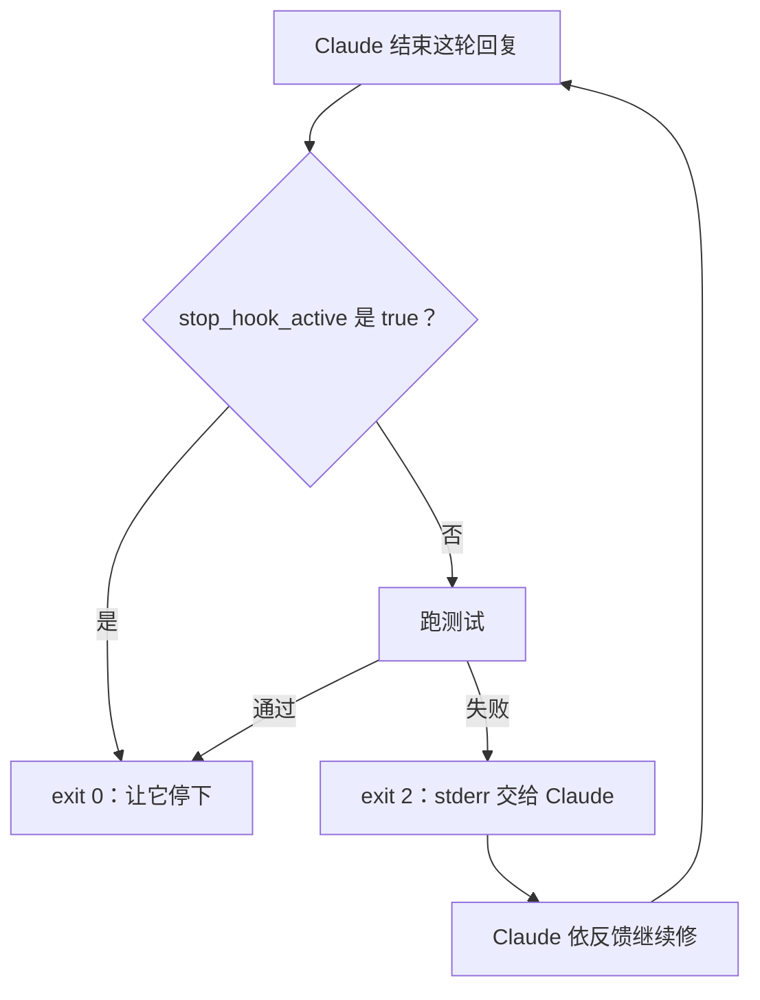

每次请 AI 改完文件，我都还要自己问：排版跑了没？测试过了没？有没有动到 `.env`？Claude Code 的 hooks 让这些检查在固定时机自动运行，不必等 AI 自己决定要不要做。

这篇设置四个常用的 hook，最后说明它挡不下什么。

> 依据官方的 [Claude Code hooks 指南](https://code.claude.com/docs/en/hooks-guide)、[Hooks reference](https://code.claude.com/docs/en/hooks)与 [Security considerations](https://code.claude.com/docs/en/hooks#security-considerations)。查证日期是 2026-11-10（台北时间），当天 npm 上最新的 Claude Code 是 2.1.322。之后的版本可能调整事件与字段。
{: .prompt-info }

第三方 skill 和 MCP 的权限风险，我在[先前这篇](/posts/coding-agent-supply-chain-permission-risks/)谈过。这篇只谈你自己设置的日常检查。

## hooks 是什么

Hook 是你写好的命令，Claude Code 会在对话的固定时机运行它。它适合每次都该做、不需要临场判断的事，例如排版、跑测试、拦下对特定文件的修改。需要斟酌的决定，留给你或权限设置。

最常用的四个时机：

- **PreToolUse**：工具（改文件、运行命令等）运行前，可以拦下这次调用。
- **PostToolUse**：工具成功运行后，例如排版刚改过的文件。
- **Stop**：Claude 结束这轮回复时。每次回复结束都会触发，不只在整个任务完成时。
- **SessionStart**：会话开始或恢复时。matcher 设成 `compact`，就只在压缩后运行。

完整的事件列表见 [Hooks reference](https://code.claude.com/docs/en/hooks#hook-lifecycle)。

{: w="1280" h="720" }
_概念图，不是实际界面。四个时机依序是：工具运行前、运行成功后、这轮回复结束、会话开始或被压缩之后。_

同一件事你已经提醒过不止一次，而且规则写得清楚，例如“改完 JavaScript 就排版”“不要用 Edit 或 Write 改 `.env`”，就适合写成 hook。

## 设置放在哪里

这篇的示例都写在项目根目录的 `.claude/settings.json`，可以提交到 repo 让团队共用。另外两个位置：

- `~/.claude/settings.json`：作用于你本机的所有项目。
- `.claude/settings.local.json`：不进版本控制。

各层的 hooks 会合并生效，不会互相取代。

设置文件是 JSON，不能有注释，最后一项后面不能有逗号。结构分三层，依序是事件名称、带 matcher 的规则、要运行的 hooks。

Matcher 决定这次要不要跑。在 PreToolUse 和 PostToolUse，它比对工具名称，大小写要完全一致。`"Edit|Write"` 只在 Claude 用 `Edit` 或 `Write` 时触发，写成 `"Edit, Write"` 也一样。不写 matcher 或写 `"*"`，该事件每次发生都会运行。

示例需要 [`jq`](https://jqlang.org/) 从 hook 收到的 JSON 取出字段，排版那一项另外需要 Node.js 的 `npx`。macOS 和 Linux 上的 hook 脚本要有执行权限：

```bash
chmod +x .claude/hooks/*.sh
```

## 改完文件自动排版：PostToolUse

把这段加进 `.claude/settings.json`。文件里已经有 `"hooks"` 的话，只在里面加 `PostToolUse`，不要整份覆盖：

```json
{
  "hooks": {
    "PostToolUse": [
      {
        "matcher": "Edit|Write",
        "hooks": [
          {
            "type": "command",
            "command": "f=$(jq -r '.tool_input.file_path'); npx prettier --write \"$f\""
          }
        ]
      }
    ]
  }
}
```

`Edit` 或 `Write` 成功后，这条命令从输入的 JSON 取出文件路径，交给 `npx prettier --write` 就地排版。它改写自官方指南的 Prettier 示例：路径先存进变量再加引号，含空格或单引号也不会被拆开。

成功时对话里通常没有消息，要打开文件看有没有被重排。官方的测法是请 Claude 在 JavaScript 文件里加一个单引号字符串，再确认它有没有变成双引号（Prettier 默认）。

## 改到敏感文件时拦下：PreToolUse

Claude 用 `Edit` 或 `Write` 改 `.env`、`.git/` 里的文件或 `package-lock.json` 时，这个 hook 会拦下那一次调用。拦下的原因会反馈给 Claude。它不代表 AI 碰不到这些文件。

新增 `.claude/hooks/protect-files.sh`。写法来自官方指南的保护文件示例，另外处理了 Windows 路径的反斜杠：

```bash
#!/bin/bash
# protect-files.sh — based on official Claude Code hooks guide example
INPUT=$(cat)
FILE_PATH=$(echo "$INPUT" | jq -r '.tool_input.file_path // empty')

# Normalize Windows backslash separators so the patterns below match
FILE_PATH="${FILE_PATH//\\//}"

PROTECTED_PATTERNS=(".env" "package-lock.json" ".git/")

for pattern in "${PROTECTED_PATTERNS[@]}"; do
  if [[ "$FILE_PATH" == *"$pattern"* ]]; then
    echo "Blocked: $FILE_PATH matches protected pattern '$pattern'" >&2
    exit 2
  fi
done

exit 0
```

再在 `.claude/settings.json` 的 `"hooks"` 里加上：

```json
"PreToolUse": [
  {
    "matcher": "Edit|Write",
    "hooks": [
      {
        "type": "command",
        "command": "\"$CLAUDE_PROJECT_DIR\"/.claude/hooks/protect-files.sh"
      }
    ]
  }
]
```

`$CLAUDE_PROJECT_DIR` 是 Claude Code 提供的环境变量，指向项目根目录。脚本以退出码 `2` 拦下这次调用，写到 stderr 的 `Blocked:` 说明会反馈给 Claude。退出码 `0` 只代表 hook 没有意见，接着走原本的权限流程，不等于批准。

{: w="1280" h="720" }
_概念图，不是实际权限画面。这个 hook 挡的是该次 Edit 或 Write，不是所有可能改到这个文件的路径。_

只比对 `Edit|Write` 拦不住通过 `Bash` 或 `PowerShell` 改文件，补法见最后的限制一节。

## 结束这轮时跑测试：Stop

这个 hook 在 Claude 结束这轮回复时跑测试，失败就把原因交回去，让它继续修。

Stop hook 没有 matcher，每次回复结束都会跑，用户中断时不跑。它要防的是无限循环：hook 让对话继续之后，下一次收到的 `stop_hook_active` 会是 `true`，脚本看到它就要放行。



官方要求一定要检查 `stop_hook_active`，或改读对话记录，以免在永远不会满足的条件上一直拦。连续拦下八次后，Claude Code 会强制结束这一轮；Claude 只要再调用工具，计数就归零。

新增 `.claude/hooks/run-tests-on-stop.sh`。这里用 `bun test` 配合后面的场景，请换成你的测试命令，例如 `npm test` 或 `pytest`：

```bash
#!/bin/bash
# run-tests-on-stop.sh — Stop hook with official stop_hook_active guard
INPUT=$(cat)
if [ "$(echo "$INPUT" | jq -r '.stop_hook_active')" = "true" ]; then
  exit 0  # Allow Claude to stop
fi

PROJECT_DIR="${CLAUDE_PROJECT_DIR:-$(cd "$(dirname "$0")/../.." && pwd)}"
if ! (cd "$PROJECT_DIR" && bun test) >&2; then
  echo "Blocked stop: tests failed. Fix the failing tests before finishing." >&2
  exit 2
fi
exit 0
```

对应的设置：

```json
"Stop": [
  {
    "hooks": [
      {
        "type": "command",
        "command": "\"$CLAUDE_PROJECT_DIR\"/.claude/hooks/run-tests-on-stop.sh"
      }
    ]
  }
]
```

退出码 `2` 在三个事件的效果不同：

| 事件 | 退出码 `2` 的效果 |
| --- | --- |
| PreToolUse | 拦下这次工具调用，stderr 反馈给 Claude |
| PostToolUse | 工具已经运行完，无法撤回，只把 stderr 交给 Claude |
| Stop | 不让 Claude 停下，stderr 成为继续工作的理由 |

## 压缩后把规则补回来：SessionStart

对话太长时，Claude Code 会做 compaction（压缩），把先前的对话摘要成较短的内容，细节可能因此丢失。官方建议用 matcher 为 `compact` 的 SessionStart hook，每次压缩后把关键规则再写进上下文。命令打印到 stdout 的纯文本会加进 Claude 的上下文：

```json
"SessionStart": [
  {
    "matcher": "compact",
    "hooks": [
      {
        "type": "command",
        "command": "echo 'Reminder: use Bun, not npm. Run bun test before committing. Current sprint: auth refactor.'"
      }
    ]
  }
]
```

把提醒换成你的项目规则。`compact` 涵盖自动与手动压缩，SessionStart 拦不住压缩本身。不常变的规则也可以改放在 `CLAUDE.md`。

## 用 /hooks 检查设置

在 Claude Code 提示符输入 `/hooks`，会打开只读的浏览界面。每条 hook 都标出来源：用户设置、项目设置、本地设置、插件或当前这次会话。选一条可以看它实际运行的命令，以及定义它的设置文件或插件。切到 `All events` 会连没设置的事件一起列出。

这个界面只能看。要改设置，得编辑对应的 JSON 文件。

## 完整示例：一个小项目的一天

假设你维护一个小网站：改完 JavaScript 要排版，不能用 Edit 或 Write 改 `.env`，每次回复结束先跑测试，压缩后还要记得“用 Bun、提交前先测”。

1. 在项目根目录建立 `.claude/settings.json`，放入上面四个事件的设置。建立 `protect-files.sh` 和 `run-tests-on-stop.sh`，把测试命令换成你的，再运行前面的 `chmod`。
2. 确认装了 `jq`，以及能运行 `npx prettier` 的 Node.js。
3. 启动 Claude Code 输入 `/hooks`，确认 PostToolUse、PreToolUse、Stop、SessionStart 都在列表里，来源是项目设置。
4. 请 Claude 在 `.js` 文件加功能。它用 Edit 或 Write 改完后，Prettier 会接着排版。
5. 它试着用 Edit 或 Write 改 `.env` 时，那次修改会被拦下，并带回 `Blocked:` 说明。
6. 它说做完时，Stop hook 会跑测试，失败就依反馈继续修。
7. 对话经过压缩后，SessionStart 会把你的提醒送回上下文。

四个 hook 可以分开加，不必一次全开。

## 该用哪个 hook

| 你的情况 | 用这个 |
| --- | --- |
| 用 Edit 或 Write 改完文件，要自动排版 | PostToolUse，matcher 设 `Edit\|Write` |
| 不要让该次 Edit 或 Write 改到 `.env`、`.git/` 等文件 | PreToolUse，matcher 设 `Edit\|Write`，退出码 2 拦下并说明原因 |
| 不论谁改了某个文件，都要在文件写入后做扫描 | FileChanged（文件写入后才跑，不能事先拦住） |
| 这轮回复结束时先跑测试或扫描工作目录 | Stop，并检查 `stop_hook_active` |
| 压缩后把项目规则补回上下文 | SessionStart，matcher 设 `compact` |
| 只想确认目前设置了哪些 hooks | `/hooks`（只读浏览） |

## 它挡不下什么

**Matcher 只比对工具名称。** Claude 改用 `Bash` 或 `PowerShell` 改文件时，`"Edit|Write"` 不会触发。官方的补法有三种：

- 要看到每一轮的所有改动（合规扫描、审计记录）：加一个 Stop hook，在每轮结束时扫描工作目录。
- 要在每次调用时都看到：另外 match `Bash|PowerShell`，用 `git status --porcelain` 列出已修改和未跟踪的文件。
- 只在意某个文件被写入，不论是谁写的：用 [FileChanged](https://code.claude.com/docs/en/hooks#filechanged)。

{: w="1280" h="720" }
_概念图。Matcher 守的是指定的工具名称；经由 Bash 或 PowerShell 改文件，会走另一条路。_

**`if` 只能尽力过滤。** 工具事件可以加 `if`，用权限规则的语法依工具名称和参数决定要不要启动，例如 `"Edit(*.ts)"`。官方写明它是 best-effort，不保证每次都过滤对，要强制允许或禁止就用权限系统。`if` 只对工具事件有效，加在其他事件上会让 hook 完全不跑。

**Hook 返回 allow 不会绕过 deny。** 设置里的拒绝规则，包括组织托管的拒绝列表，仍然有效。反过来，hook 的 deny 在每种权限模式都有效。

**PostToolUse 不能还原已经发生的事。** 这时文件已经写入、命令已经运行、网络请求已经发出。要事先阻止或改写调用，用 PreToolUse。

**Hook 以你的完整用户权限运行。** 它能读、改、删你的账号碰得到的任何文件。加进设置前先读过命令，在安全的环境试跑；用在共享或生产环境前，先读 [Security considerations](https://code.claude.com/docs/en/hooks#security-considerations)。

交互模式会先问你是否信任这个文件夹。`claude -p` 和 SDK 不会问，直接视为已信任。所以 repo 里的 `.claude/settings.json`，可能在你从没确认过的目录里运行。

Hooks 不是安全边界。要由操作系统限制命令能读写的范围，见 [Claude Code 沙箱设置教程：挡住 SSH 密钥与 token](/posts/claude-code-sandbox-setup/)。

## 结论

先在项目的 `.claude/settings.json` 加一个 hook，用 `/hooks` 确认它在列表里，再按需要往上加。把它当成省事的固定检查，不要当成最后一道防线。

## 延伸阅读

- [Claude Code hooks 指南](https://code.claude.com/docs/en/hooks-guide)：常见用法与可拷贝的示例。
- [Hooks reference](https://code.claude.com/docs/en/hooks)：事件、输入输出与 [Security considerations](https://code.claude.com/docs/en/hooks#security-considerations)。
- [装了第三方 skill 和 MCP 之后，你的 Coding Agent 多了哪些破口？](/posts/coding-agent-supply-chain-permission-risks/)：权限与供应链风险。
- [AI 写代码更快了，产品为什么还是交付不了？我如何理解 AI 原生开发流程](/posts/ai-native-sdlc-playbook/)：skill 和 hook 的差别。
- [用 GitHub Actions 加 AI Agent 自动化审查：以本站 PR 为例](/posts/github-actions-ai-agent-pr-review/)：PR 提交后的规则检查、AI 审查与人工批准。
- [AGENTS.md 怎么写：让 Coding Agent 读懂你的项目规则](/posts/agents-md-project-rules-for-coding-agents/)：只需要让 AI 知道、不必强制执行的规则。
- [Claude Code plugin 安全安装：装之前先看哪些文件](/posts/claude-code-plugin-safe-install/)：plugin 可能带进别人写的 hook。
