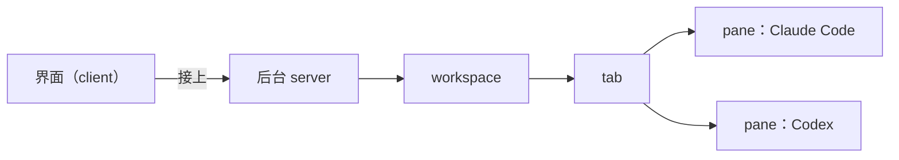
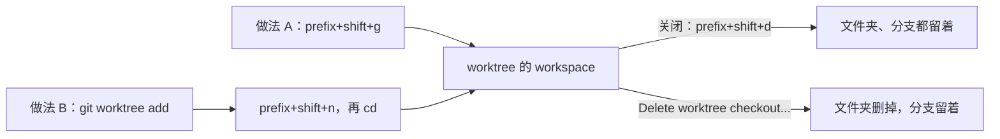
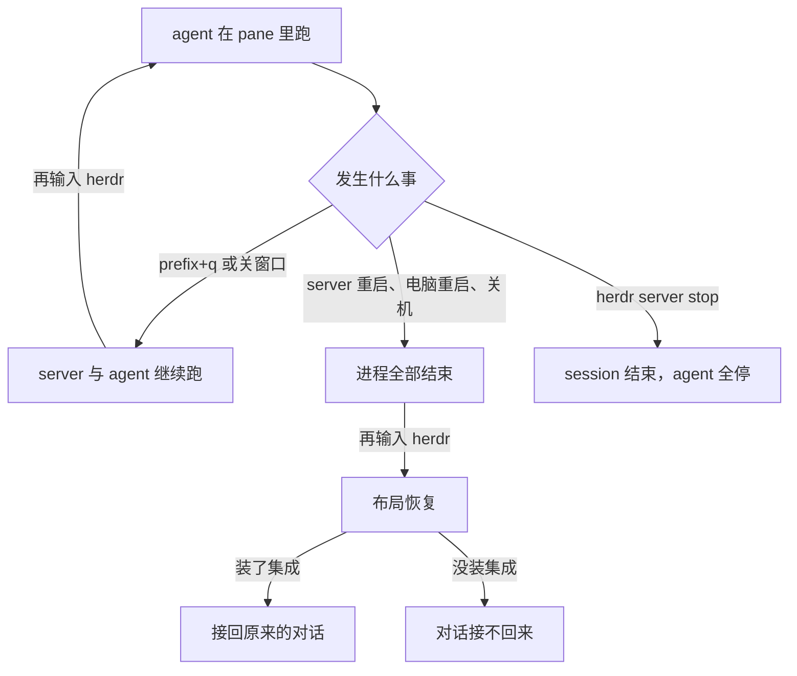

如果你按[git worktree 教程：让两个 AI 在同一个 repo 分开工作](/posts/git-worktree-parallel-ai-agents/)让两三个 coding agent 同时干活，下一个麻烦通常是分不清哪个在等你点“允许”、哪个还在跑。你得一个窗口一个窗口切过去看。终端一关，或 SSH 连接一断，做到一半的工作也可能跟着停掉。

herdr 是在终端里管理多个工作区和分屏的工具，官方也称它为 terminal workspace manager。它把每个 agent 放进自己的分屏（pane），认出里面跑的是哪个 coding agent，再用侧栏不同颜色的圆点标出它在跑、在等你，还是已经做完。

关掉你看到的界面，后台的工作也能继续。官方的说法是“the runtime your coding agents live on”。

herdr 不会包住或取代你的 agent，README 写：“herdr doesn't wrap or replace them; it owns their terminals.”它管的是终端，agent 还是你原来用的那个。

这篇讲的是终端里的 Herdr TUI（[herdr.dev/tui](https://herdr.dev/tui)）。herdr.dev 首页现在主推的 Herdr desktop App（[herdr-app](https://github.com/herdrdev/herdr-app)）是另一个程序，在其中一个里启动的 agent，不会出现在另一个里。桌面 App 的用法见[Herdr 桌面 App 入门：用 space 与标签页管理多个 AI](/posts/herdr-app-desktop-manage-ai-agents/)。

文中以 macOS 和 Linux 为主，用 Claude Code 与 Codex 当例子，官方支持的其他 agent 见[Agents](https://herdr.dev/tui/docs/0.9.5/agents/)。Windows 已有原生支持，但有已知限制，见[Windows support](https://herdr.dev/tui/docs/0.9.5/windows-beta/)。

> 按 herdr v0.9.5 的官方文档，这一版在 2026-10-15 发布，我在 2026-11-12 确认它仍是最新稳定版。herdr 还是 0.x 版，更新很快，命令与快捷键以[官方文档](https://herdr.dev/tui/docs/0.9.5/)为准。
{: .prompt-info }

## 先说几个词

- **终端（terminal）**：输入命令的文本窗口。
- **detach（离开）／reattach（接回）**：暂时离开界面，之后再接回同一个 session。
- **prefix 键**：先按 `ctrl+b` 再松开，接着按下一个键。官方[Keyboard](https://herdr.dev/tui/docs/0.9.5/keyboard/)的例子是“`prefix+c` means: press `ctrl+b`, release, then press `c`.”`prefix+shift+g` 就是松开 `ctrl+b` 之后按 `shift+g`。Mac 上是 control 键，不是 command 键；用过 tmux 的人会觉得眼熟。
- **包管理器**：像 Homebrew（`brew`）和 mise 这类帮你安装、升级、卸载工具的程序。
- **coding agent、worktree、分支**：沿用 worktree 篇的说法，agent 会自己改文件、跑命令。worktree 是同一个 repo 里另一份独立的工作目录。分支是 git 里一条独立的修改记录，每份工作目录各自停在一条分支上。

herdr 本身分成下面几层：



- **后台 server／client**：herdr 把终端放在后台的 server 里跑，你看到的界面只是接上去的 client。
- **workspace**：一个项目或任务，官方建议 one workspace per repo, task, or investigation。
- **tab**：workspace 里的一个布局。
- **pane**：真正的终端分屏，官方原话是“A pane is a real terminal.”

命令、快捷键、状态定义和断线后的行为，我都以官方文档为准并附上链接。“用 brew 或 mise 安装”“一个 worktree 配一个 workspace”“先处理 blocked”是我的建议，文中会注明。

## 什么时候值得用

同时跑两个以上的 agent，或经常要离开座位、用 SSH 连远程机器时，我建议用 herdr。只跑一个 agent，或已经有顺手的安排，不一定要换。

## 开始前要准备

- 一台 macOS 或 Linux 电脑，以及终端。macOS 用自带的“终端”App 就可以。
- Homebrew 或 mise 其中一个。两个都没用过的话，macOS 可以先按 [Homebrew 官网](https://brew.sh/)的说明装好 Homebrew。
- 一个用 git 管理、至少有过一次 commit 的项目文件夹，步骤 3 创建 worktree 时会用到。
- 已经装好并登录 Claude Code 或 Codex：在普通终端输入 `claude` 或 `codex`，能正常启动。

装好 herdr 之后，每一轮的用法是下图的五步，分别对应步骤 2 到 6。

{: w="1600" h="900" }
_概念图：一轮的五个步骤是开 herdr、开工作目录、跑 agent、找卡住的、离开再接回。prefix 是先按 ctrl+b 松开，再按下一个键。_

## 步骤 1：安装

{: w="1600" h="900" }
_概念图：左边是本站建议的做法，用 brew 或 mise 安装与升级；右边是官方 Install／TUI 页的一行安装，若要用，先下载脚本、看过再执行。_

已经在用 [Homebrew](https://formulae.brew.sh/formula/herdr) 的人，我建议用 brew 安装：

```bash
brew install herdr
```

已经在用 [mise](https://mise.jdx.dev/) 的人，用 mise 安装：

```bash
mise use -g herdr
```

这两种都列在官方[Install](https://herdr.dev/tui/docs/0.9.5/install/)页。用 mise 时若出现 `herdr not found in mise tool registry`，按官方说法，先更新 mise 再试一次。用 brew 装的 mise 执行：

```bash
brew upgrade mise
```

其他方式装的 mise 执行：

```bash
mise self-update
```

### 官方的一行安装：先下载、看过再执行

官方 Install／TUI 页另外提供一行安装命令 `curl -fsSL https://herdr.dev/install.sh | sh`。我建议不要直接粘贴执行，原因有两个：

- 这样跑的是服务器当下返回、你没看过的内容，下次执行也可能不一样。
- 它会装到 `~/.local/bin`，之后靠 `herdr update` 自己更新，不会出现在包管理器的列表里。日后比较难查到装了什么，也比较难卸载。用 brew 或 mise 装，版本查得到，升级和卸载也都用同一套命令。

这不是说安装脚本有问题，而是出于我“先看过再执行”的习惯，原因我在[装了第三方 skill 和 MCP 之后，你的 Coding Agent 多了哪些破口？](/posts/coding-agent-supply-chain-permission-risks/)谈过。

若一定要用官方脚本，先把它下载成文件：

```bash
curl -fsSL https://herdr.dev/install.sh -o herdr-install.sh
```

用文本编辑器打开看过。也可以在终端用 less 看，看完按 `q` 退出：

```bash
less herdr-install.sh
```

确认没问题再执行：

```bash
sh herdr-install.sh
```

看不懂脚本在做什么的话，改用 brew 或 mise。

### 确认装好

装好后执行：

```bash
herdr --version
```

按官方文档，这会显示版本号，例如 0.9.5。用中文、日文或韩文输入法时，如果 prefix 快捷键没反应，请确认版本是 0.9.5 或更新，官方在这一版修过这个问题。

### 更新：用原来安装的那套工具

官方原文是：“Use `herdr update` only for installs managed by Herdr's own installer. Update Homebrew, mise, and Nix installs through those package managers instead.”用 brew 装的执行：

```bash
brew upgrade herdr
```

用 mise 装的执行：

```bash
mise upgrade herdr
```

包管理器更新之后，再输入一次 `herdr`，就会用新版界面接上。原来在跑的后台 server 和 agent 不受影响。

要连 server 也换成新版，先停掉 server 再重新启动，见 Install 页的 Update 节。停掉 server 会停掉所有正在跑的 agent（见步骤 6）。依次执行：

```bash
herdr server stop
herdr
```

不想让 herdr 在后台连 herdr.dev，就关掉配置文件里 `[update]` 下面的这两项，见[Configuration](https://herdr.dev/tui/docs/0.9.5/configuration/)。配置文件是 `~/.config/herdr/config.toml`，没有就自己创建：

```toml
[update]
version_check = false
manifest_check = false
```

## 步骤 2：在项目文件夹打开 herdr

在终端进入项目文件夹，再输入 `herdr`，例如：

```bash
cd ~/projects/demo-app
herdr
```

按[Quick start](https://herdr.dev/tui/docs/0.9.5/quick-start/)，这会启动或接上默认的后台 session。session 里还没有 workspace 时，会自动开一个，也就是下图侧栏的 demo-app。之后每创建一个 worktree，就多一个 workspace（步骤 3）。

{: w="1600" h="900" }
_实际画面：在 demo-app 文件夹打开 herdr，再用 prefix+v 分出第二个 pane。这两个 pane 运行的是普通 shell，不是 agent，所以 agents 区是空的。_

herdr 可以全程用鼠标操作：点一下切换 pane、tab、workspace 和 agent，拖动边框调整大小，右键拆分。官方说鼠标能完成所有操作，键盘快捷键是可选的，所以下文的快捷键记不住也没关系。

## 步骤 3：每个工作目录一个 workspace

我建议每个 worktree 配一个 workspace，让每个 agent 只改自己的那份工作目录，两个 agent 就不会同时改到同一个文件。这和 worktree 篇的原则相同。

做完之后怎么合并、怎么删分支，以及有 submodule 的 repo 为什么不建议用 worktree，见[git worktree 教程：让两个 AI 在同一个 repo 分开工作](/posts/git-worktree-parallel-ai-agents/)。

创建方式有两种，选一种即可，底层都是 `git worktree`。收尾时要分清楚，关闭 workspace 和删掉 worktree 是两回事：



**做法 A：用 herdr 创建。**

1. 在项目的 workspace 里按 `prefix+shift+g`，或在侧栏 workspace 那一行选 `New worktree`，会弹出 new worktree 窗口。
2. 分支栏一开始会填好随机名称。先按 ctrl+c 清空，再输入你要的分支名称，例如 `login-page`。
3. 按 Enter。herdr 会建好 git worktree，并把它打开成一个新的 workspace，排在原项目下面。点侧栏的名称就能切换。

这个操作等同在项目文件夹内执行：

```bash
herdr worktree create --branch login-page
```

{: w="1600" h="900" }
_实际画面：按 prefix+shift+g 创建 worktree。分支栏一开始会填好随机名称，先按 ctrl+c 清空再输入；按 Enter 会创建并打开成新的 workspace。_

默认位置是 `~/.herdr/worktrees/<repo>/<分支>`。要改位置，在 `~/.config/herdr/config.toml` 设置 `[worktrees] directory`，见[Configuration](https://herdr.dev/tui/docs/0.9.5/configuration/)。

**做法 B：沿用 worktree 篇。** 先在项目文件夹内用 git 建好文件夹，例如：

```bash
git worktree add -b login-page ../demo-app-login-page
```

再在 herdr 按 `prefix+shift+n` 新建 workspace，然后在里面进入刚才建好的文件夹：

```bash
cd ../demo-app-login-page
```

按官方说明，关闭项目那一行时，排在它下面的 worktree workspace 也会一起关闭。

要删掉 worktree 的文件夹，在侧栏选中那个 worktree 的 workspace（排在项目下面的那一行），用 `Delete worktree checkout...`。它的底层是 `git worktree remove`，你也可以自己执行。不论哪一种，分支都要另外删。

## 步骤 4：在 pane 里启动 agent

切到要工作的 workspace，在 pane 里输入 `claude` 或 `codex`，跟在普通终端启动一样。按 Quick start，herdr 会自动认出这是哪个 agent，侧栏的 agents 区会多出一行。

官方还支持 Cursor Agent CLI、GitHub Copilot CLI、OpenCode 等，完整列表见[Agents](https://herdr.dev/tui/docs/0.9.5/agents/)。同一个 workspace 里若还要多开一个终端，例如跑测试，就拆分 pane：`prefix+v` 向右，`prefix+minus` 向下。

集成（integration）是可选的。不装也能看状态；装了之后，herdr 的后台 server 重启时，才能接回同一段对话。Claude Code 的安装命令是：

```bash
herdr integration install claude
```

Codex 的安装命令是：

```bash
herdr integration install codex
```

集成会改 agent 的配置，见[Integrations](https://herdr.dev/tui/docs/0.9.5/integrations/)：

- Claude Code：多一个 hook 脚本，并在 `settings.json` 加上对应的 hook 配置。
- Codex：多一个 hook 脚本，改 `hooks.json`，并在 `config.toml` 开启 `[features] hooks = true`。

要卸载时执行下面这行，Codex 把 `claude` 换成 `codex`。卸载后，Codex 的 `config.toml` 不会被改回去。

```bash
herdr integration uninstall claude
```

hook 是什么，可以参考我写的[Claude Code hooks 教程：自动排版、跑测试与敏感文件提醒](/posts/claude-code-hooks-automate-checks/)。

## 步骤 5：看状态，找出卡住的那个

{: w="1600" h="900" }
_概念图：五种状态的意思，以及本站建议你该做的事。blocked 要先处理；新的提示界面可能先显示成 idle，看到 idle 也不代表可以不看内容就点“允许”。图上的颜色是本站配图用的，不是 herdr 界面的配色。_

侧栏用不同颜色的圆点标出每个 agent 的状态。同一个 workspace 里有 agent 是 blocked 时，workspace 自己的那一行也会换成 blocked 的颜色。官方定义了五种状态，表格最右栏“你该做什么”是我的建议。

| 状态 | 官方定义（白话） | 本站建议你该做什么 |
| --- | --- | --- |
| blocked | 在等你回答、批准或做决定 | 先处理：打开看清楚再回答 |
| working | 正在跑 | 不用管，让它做 |
| done | 做完了，你还没看 | 去看结果、检查改了什么 |
| idle | 做完了或在等下一个指示，而且你已经看过 | 可以交代下一件事 |
| unknown | herdr 认不出状态 | 自己点进去看一眼 |

{: w="1600" h="900" }
_实际画面（herdr 默认主题）：黄点 working、红点 blocked、青绿点 done、空心绿圈 idle。演示用的“agent”是用 herdr pane report-agent 上报状态的 shell 脚本，不是 Claude Code 或 Codex。_

侧栏只有圆点。要看写成文字的状态名称，或快速找到卡住的 agent，按 `prefix+g` 打开 Go to 列表。

在列表里按 `b` 只看 blocked；`w`、`i`、`d` 分别只看 working、idle、done，`a` 看全部。用方向键选好后按 Enter 跳过去。

{: w="1600" h="900" }
_实际画面：按 prefix+g 打开 Go to，状态直接写成文字；再按 b 只留下 blocked 的那一行，按 Enter 跳过去。列表里演示的“agent”是用 herdr pane report-agent 上报状态的 shell 脚本，不是 Claude Code 或 Codex。_

### idle 不代表可以批准

按官方[Agents](https://herdr.dev/tui/docs/0.9.5/agents/)页，blocked 的判断故意从严：herdr 没见过的新提示界面，一开始可能显示成 idle，而不是 blocked。同一页也写明“idle status is not authorization to approve an action”，也就是看到 idle，不代表可以直接批准。

所以跳过去之后，要看清楚再点允许。这和我在[OWASP Agentic Top 10 检查表：AI 工作流十项风险与修复方法](/posts/owasp-agentic-top-10-ai-workflow-checklist/)里谈的过度信任、审批疲劳是同一件事。

状态看起来不对时，用下面这行查看 herdr 的判断依据，见[Agents](https://herdr.dev/tui/docs/0.9.5/agents/)：

```bash
herdr agent explain <目标>
```

### 通知默认关闭

herdr 默认不会弹出通知。配置文件里 `[ui.toast]` 的 `delivery` 决定通知出现在哪里：

| `delivery` | 通知出现在哪里 |
| --- | --- |
| `off`（默认） | 不弹出通知 |
| `herdr` | herdr 界面里 |
| `system` | 操作系统的通知；macOS 会优先通过 terminal-notifier 发送 |

要开启 herdr 界面里的通知，在配置文件 `~/.config/herdr/config.toml` 加上：

```toml
[ui.toast]
delivery = "herdr"
```

保存后执行下面这行，或按 `prefix+shift+r`，配置就会生效：

```bash
herdr server reload-config
```

改用 `system` 的话，官方建议 macOS 先安装 terminal-notifier：

```bash
brew install terminal-notifier
```

其他选项见[Configuration](https://herdr.dev/tui/docs/0.9.5/configuration/)或[Config reference](https://herdr.dev/tui/docs/0.9.5/config-reference/)。

## 步骤 6：离开，再接回来

要离开时，按 `prefix+q`（先 `ctrl+b` 再 `q`），或直接关终端窗口。按 Quick start，之后再输入 `herdr` 就会接回同一个 session。不同情况下，agent 会怎样：



server 重启或电脑重启那一条，README 的原文是“the original processes do not survive”，agent 也包括在内。图中的布局指 workspace、tab、pane 的排列，集成是步骤 4 装的 integration。什么会留下、什么不会，完整的表见官方[Session state](https://herdr.dev/tui/docs/0.9.5/session-state/)。

用 SSH 连远程机器干活时，直接在远程执行 `herdr`，断线后工作仍可继续。另一种做法是用 `--remote` 指定主机，见[How to work](https://herdr.dev/tui/docs/0.9.5/how-to-work/)：

```bash
herdr --remote <主机>
```

全部收工时执行：

```bash
herdr server stop
```

官方说明是结束这个 session，并停止里面的 pane。请注意，这会停掉所有 pane 里正在跑的 agent。

## 快捷键速查

忘记时按 `prefix+?` 可查看全部快捷键。

| 按键 | 作用 |
| --- | --- |
| `prefix+v`／`prefix+minus` | 向右／向下拆分 pane |
| `prefix+h`／`j`／`k`／`l` | 移到左／下／上／右边的 pane |
| `prefix+c` | 新建 tab（会先弹出命名窗口，按 Enter 创建） |
| `prefix+w` | 打开 workspace 导航，切换 workspace |
| `prefix+shift+n` | 新建 workspace |
| `prefix+shift+g` | 新建 worktree |
| `prefix+shift+d` | 关闭选中的 workspace |
| `prefix+g` | 打开 Go to（再按 `b` 只看 blocked） |
| `prefix+z` | 放大当前 pane |
| `prefix+x` | 关闭当前 pane |
| `prefix+q` | 离开（detach） |
| `prefix+?` | 查看全部快捷键 |

## 下一步

官方也提供让 agent 自己操作 herdr 的 skill。下面这行会打印与当前版本相符的内容：

```bash
herdr --skill
```

装任何第三方 skill 之前，我建议先读过内容，原因见[装了第三方 skill 和 MCP 之后，你的 Coding Agent 多了哪些破口？](/posts/coding-agent-supply-chain-permission-risks/)。

延伸阅读： [herdr README](https://github.com/herdrdev/herdr)、[v0.9.5 release](https://github.com/herdrdev/herdr/releases/tag/v0.9.5)、[文档首页](https://herdr.dev/tui/docs/0.9.5/)、[Install](https://herdr.dev/tui/docs/0.9.5/install/)、[Quick start](https://herdr.dev/tui/docs/0.9.5/quick-start/)、[Concepts](https://herdr.dev/tui/docs/0.9.5/concepts/)、[Keyboard](https://herdr.dev/tui/docs/0.9.5/keyboard/)、[Agents](https://herdr.dev/tui/docs/0.9.5/agents/)、[Integrations](https://herdr.dev/tui/docs/0.9.5/integrations/)、[Session state](https://herdr.dev/tui/docs/0.9.5/session-state/)、[Configuration](https://herdr.dev/tui/docs/0.9.5/configuration/)、[Windows support](https://herdr.dev/tui/docs/0.9.5/windows-beta/)、[Homebrew formula](https://formulae.brew.sh/formula/herdr)。
