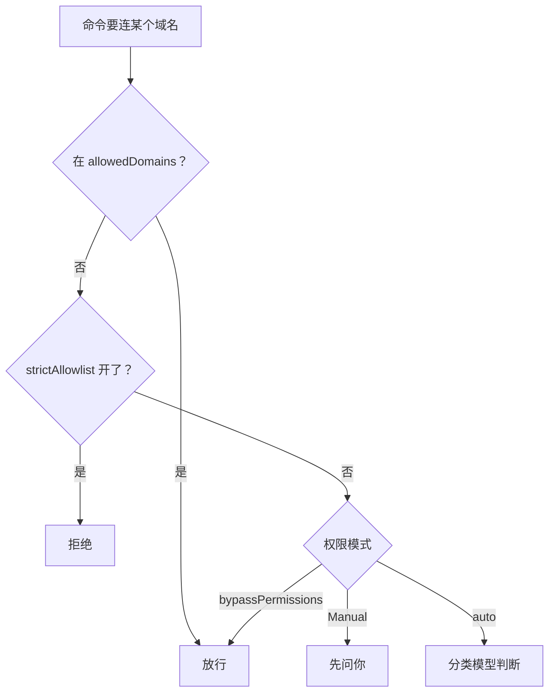
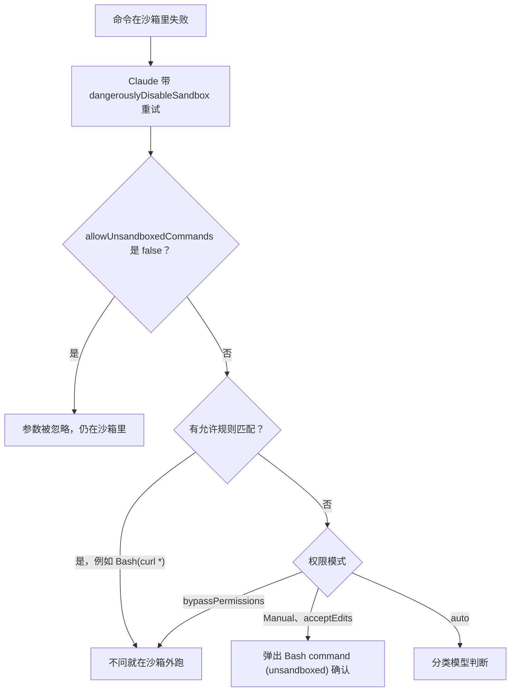
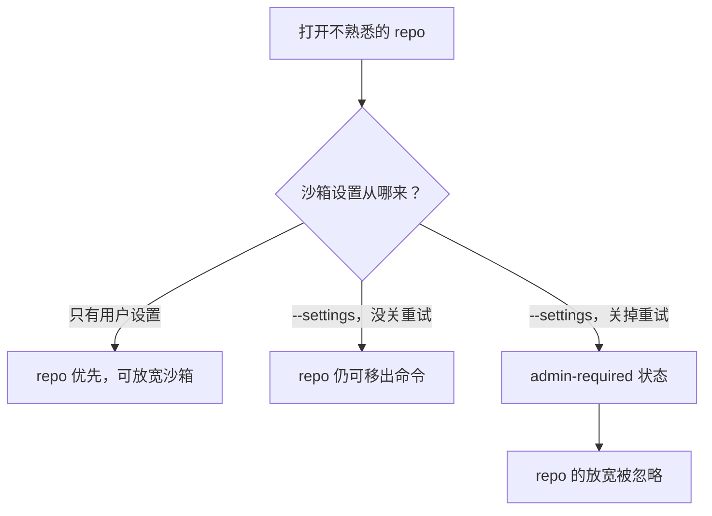

Claude Code（在终端里使用的 AI 编程助手）会自己执行命令：跑测试、装依赖、调用 `git`。这些命令用的是你的账号，所以默认能读你读得到的所有文件，包括 SSH 密钥和云服务凭证。Claude Code 内置沙箱（sandbox），可以把这些命令关在操作系统强制执行的范围里，限制它们能写到哪里、能连到哪些网站。

但沙箱**默认是关闭的**。就算打开了，官方文档也写明：默认仍读得到 `~/.ssh` 和 `~/.aws/credentials`。很多人以为“开了就安全”，我认为其实还差几步。

这篇一步步把这几步补上，每一步都附上我在自己的 Mac 上实际跑出来的结果，文末有一份可以直接复制的 `settings.json`。

> 依据 2026-11-13（台北时间）当天的 [Sandboxing](https://code.claude.com/docs/en/sandboxing)、[Permissions](https://code.claude.com/docs/en/permissions)、[Settings reference](https://code.claude.com/docs/en/settings-reference) 与 [changelog](https://code.claude.com/docs/en/changelog)。我在同一天用 macOS 上的 Claude Code 2.1.323（当天最新版，11 月 12 日发布）实际跑过一遍。
{: .prompt-info }

11 月的几个版本接连修复了沙箱与权限规则的问题：

- 2.1.321 修复了只读命令未经提示就在沙箱外执行，以及 `cp`／`mv` 写入文件夹时拒绝规则失效。
- 2.1.323 修复了沙箱可能在对话中途关闭，以及 `excludedCommands` 让没列出的命令跑出沙箱。

照着做之前，请先在终端依次执行这两行，更新后再确认版本：

```bash
claude update
claude --version
```

这篇是[OWASP Agentic Top 10 检查表：AI 工作流十项风险与修复方法](/posts/owasp-agentic-top-10-ai-workflow-checklist/)的实操续篇。那篇我只请你“确认 `/sandbox` 有没有开”，这篇示范开了之后怎么设置。为什么要限制 agent 的权限，我在[装了第三方 skill 和 MCP 之后，你的 Coding Agent 多了哪些破口？](/posts/coding-agent-supply-chain-permission-risks/)里谈过，这里不再重讲。

## 先认识几个术语

- **沙箱（sandbox）**：一个由操作系统看守的围栏。程序在里面照常运行，但只能碰到围栏允许的文件和网络。
- **token**：一串代替密码的字符，工具用它登录 GitHub、npm 这类服务。被别人拿到，就等于对方能以你的身份操作。
- **环境变量**：程序启动时从终端带进去的一组配置值。很多工具把 token 放在这里，例如 `GITHUB_TOKEN`。
- **域名（domain）**：网站的名字，例如 `example.com`、`github.com`。
- **允许列表（allowlist）**：你事先列好“可以连”的域名，不在列表上的要另外处理。
- **代理（proxy）**：帮忙转发网络连接的中转站。沙箱里的命令要联网，都得经过 Claude Code 在你电脑上开的代理，由它检查域名。
- **权限模式**：决定 Claude 做事前要不要先问你。默认的 Manual 模式会逐个询问，auto 模式交给另一个 AI 分类模型判断，`bypassPermissions` 模式什么都不问。
- **`!` 命令**：在 Claude Code 的输入框开头输入 `!`，后面接的命令会直接在你的终端执行，不经过 Claude。

## 我是怎么实测的

为了让结果可以复现，先交代我的做法：

- **环境**：macOS（Apple Silicon）、Claude Code 2.1.323，2026-11-13 上午（台北时间）。
- **方式**：`/sandbox` 面板只能在交互界面里操作。非交互模式是 `claude -p`：把问题直接作为参数交给 Claude，跑完就退出。在这个模式下，`/sandbox` 会回复 `/sandbox isn't available in this environment.`。所以我把每一步的设置写成 JSON 文件，用 `claude -p "请用 Bash 执行……" --settings 文件` 传入。这和在面板或 `settings.json` 里设置的是同一组键值。
- **不拿真的密钥测**：我建了一个假的“诱饵文件” `~/.sandboxlab-canary/secret.txt` 代替 `~/.ssh`。它的内容是 `FAKE-SECRET-FOR-TEST`，21 bytes。假的环境变量 `SANDBOXLAB_FAKE_TOKEN` 则代替 `GITHUB_TOKEN`。测完都删掉了。
- **没有人能点“允许”**：非交互模式没人回答询问，所以凡是“会弹出询问”的情况，下面的结果都是被拒绝。你在平常的交互界面里操作时，会看到确认对话框。
- **输出有改写**：主目录路径改写成 `~`，测试文件夹缩写成 `…/sandboxlab`，我只删掉了 curl 的进度条，其余照原样。

## 沙箱挡什么、默认放行什么

沙箱只包住“命令”：Claude 通过 Bash、PowerShell 和 Monitor 工具跑的命令，以及这些命令再启动的程序。限制由操作系统执行，各平台用的机制不同：

| 平台 | 沙箱机制 |
| --- | --- |
| macOS | 内置的 Seatbelt |
| Linux、WSL2 | bubblewrap |
| WSL1 | 不支持，请先升级到 WSL2 |
| 原生 Windows | 不支持，Claude Code 会直接在沙箱外跑命令。要在 Windows 上用沙箱，得把 Claude Code 装在 WSL2 里 |

官方文档列出开启后的默认值：

| 项目 | 默认 | 用哪个设置调整 |
| --- | --- | --- |
| 写入 | 只能写工作目录（你启动 Claude Code 的那个文件夹）、一个每位用户专用的临时文件夹，以及你另外加入的文件夹。其中 Claude Code 的配置文件、`.mcp.json`、`.git/hooks` 这类受保护的路径仍然不能写 | `filesystem.allowWrite`、`filesystem.denyWrite` |
| 读取 | 几乎整台电脑都读得到，**包括 `~/.ssh`、`~/.aws/credentials`** | `filesystem.denyRead`、`credentials` |
| 网络 | 不能直接联网。连接都要经过本地的代理，代理会比对你允许的域名，而允许列表一开始是空的。不在列表上的域名怎么处理，**看你的权限模式**（见步骤一的图） | `network.allowedDomains`、`network.deniedDomains`、`network.strictAllowlist` |
| 环境变量 | 沿用 Claude Code 的环境，**包括里面的 token** | `credentials` |

{: w="1600" h="900" }
_概念图，不是实际界面。沙箱只管命令，其他组件按权限规则或以你的完整权限执行。_

写入和网络默认就收得很紧，读取和环境变量则几乎没挡。我只开沙箱、其他什么都不设，让 Claude 检查诱饵文件和假 token，结果和沙箱关闭时一模一样：

```text
# 设置：{"sandbox": {"enabled": true}}，让 Claude 执行：
# wc -c ~/.sandboxlab-canary/secret.txt; test -n "$SANDBOXLAB_FAKE_TOKEN" && echo set || echo unset
      21 ~/.sandboxlab-canary/secret.txt
set
```

`21` 表示读得到文件，`set` 表示拿得到 token。这就是第三步要补的地方。

## 什么时候该开

符合下面任一种情况，就值得开：

- 你常点“允许”让 Claude 跑命令，或想让它不必每次问你就能跑。开了沙箱之后，越界的操作由沙箱挡下，不必再靠你逐条检查每个命令。
- 你会让 Claude 读不是你写的东西，例如别人的 repo、issue、网页或依赖包的源代码。这些内容可能藏着要 AI 执行命令的文字。
- 你的电脑上有密钥、云服务凭证或 token，而且不想让 AI 跑的命令读到它们。

## 步骤一：用 /sandbox 开启

**macOS** 不用另外安装。**Linux 和 WSL2** 要先装 bubblewrap 和 socat：

```bash
# Ubuntu / Debian
sudo apt-get install bubblewrap socat

# Fedora
sudo dnf install bubblewrap socat
```

装好后重新启动 Claude Code，因为它只在启动时检查这些依赖。较新的 Ubuntu 默认用 AppArmor 限制用户命名空间，会导致 bubblewrap 无法启动。`/sandbox` 会指出这个问题，解决方法见官方的 [Add an AppArmor profile for bubblewrap](https://code.claude.com/docs/en/sandboxing#add-an-apparmor-profile-for-bubblewrap)。

接着在 Claude Code 里输入：

```text
/sandbox
```

会打开沙箱面板，有三个标签页：

- **Mode**：选择沙箱里的命令要怎么批准。
- **Overrides**：在沙箱里失败的命令，能不能改到沙箱外重跑。第四步会关掉它。
- **Config**：查看当前生效的沙箱设置。

在 Linux 上，面板还可能出现 Dependencies 标签页：

- 面板**只有** Dependencies 标签页：沙箱还无法启动。按标签页列出的缺失项（或 AppArmor 限制）处理后重启。
- Dependencies 出现在其他标签页旁边：缺的只是可选组件（seccomp filter），沙箱照样能运行。

在 Mode 标签页二选一：

| 模式 | 沙箱里的命令 | 适合 |
| --- | --- | --- |
| auto-allow | 不再逐条询问你。拒绝规则仍然有效，`Bash(git push *)` 这类指定内容的询问规则也照样会弹出确认 | 想少点几次“允许” |
| regular permissions | 沙箱照样限制，但每条命令仍按一般权限流程问你 | 想每条命令都自己看过 |

两种模式的文件与网络限制完全相同，差别只在要不要问你。选了 auto-allow 之后，Claude 用命令改工作目录里的文件就不会再问你，即使你用的是平时改文件都会先问的 Manual 模式也一样。

在面板选的模式只会存进**这个项目**的 `.claude/settings.local.json`。要让所有项目都开沙箱，在 `~/.claude/settings.json` 设置 `"sandbox": { "enabled": true }`。

只写 `enabled` 时，默认就是 auto-allow。要改成 regular permissions，再加上 `"autoAllowBashIfSandboxed": false`。

开启之后，Claude 跑的命令就受沙箱限制。命令第一次要连某个域名时，按下图决定放不放行：



不想让任何模式放行列表外的域名，就打开 `strictAllowlist`。在用户设置（或 `--settings` 传入的文件）的 `sandbox` 里加上 `"network": { "strictAllowlist": true }` 即可。

这个设置 2.1.219 起才有，写在 repo 的配置文件里无效。打开之后，需要的域名改写进 `allowedDomains`。

我让 Claude 执行 `curl -sS -o /dev/null -w "%{http_code}\n" https://example.com`，换了四种设置。这行只输出网站返回的状态码，`200` 表示连上了：

```text
# 1. 允许列表为空，Manual 模式（非交互，没人回答询问 → 拒绝）
curl: (56) CONNECT tunnel failed, response 403
000

<sandbox_violations>
deny network-outbound example.com:443 (user denied)
</sandbox_violations>

# 2. 把 example.com 加进 allowedDomains，Manual 模式
200

# 3. 允许列表为空，bypassPermissions 模式（没有询问就放行了）
200

# 4. 加上 strictAllowlist: true，bypassPermissions 模式
curl: (56) CONNECT tunnel failed, response 403
000

<sandbox_violations>
deny network-outbound example.com:443 (host is not on the allow list)
</sandbox_violations>
```

第 3 组和第 4 组的对比最值得注意：在 `bypassPermissions` 模式下，列表外的域名会不问就放行，要加 `strictAllowlist` 才挡得住。

## 步骤二：确认真的挡得住

官方给了两行检查命令。请**让 Claude 执行**，不要自己在 `!` 后面输入，因为你自己用 `!` 输入的命令大多本来就在沙箱外跑，测不出沙箱有没有起作用：

```bash
touch ~/sandbox-probe
curl --noproxy '*' https://example.com
```

| 命令 | 测什么 | 沙箱起作用时的结果 |
| --- | --- | --- |
| 第一行 `touch` | 在主目录建一个空文件，测试“写不到工作目录以外” | macOS 显示 `Operation not permitted`；Linux 和 WSL2 显示 `Read-only file system` |
| 第二行 `curl` | 让 curl 不走代理、直接联网，测试“没办法自己联网” | 显示 `Could not resolve host`，因为这条命令绕不过沙箱的代理 |

检查时，注意三件事：

1. **用 Manual 模式。** 如果 Claude 问你要不要改到沙箱外重试，**拒绝**。在 `bypassPermissions` 模式，或有允许规则刚好匹配这条命令时，重试会不问就在沙箱外跑，检查就不准了（第四步会关掉这个重试）。
2. **不要在主目录启动 Claude Code。** 如果你在主目录启动，或把主目录加成了工作目录，`touch` 本来就写得进去，换一个项目文件夹再测。
3. **排除上面两种情况后 `touch` 仍然成功**，先删掉 `~/sandbox-probe`，再执行 `/sandbox` 确认沙箱已经开启、依赖都装好了。

我在 macOS 上跑出来的结果：

```text
# 让 Claude 执行：touch ~/sandbox-probe
touch: ~/sandbox-probe: Operation not permitted
# 退出码 1

# 让 Claude 执行：curl --noproxy '*' https://example.com
curl: (6) Could not resolve host: example.com
# 退出码 6
```

两行都失败，说明写入和网络限制在起作用。

## 步骤三：把密钥和 token 挡在外面

沙箱**没有内置的凭证列表**，只有你列出来的文件和变量才会被挡。要保护的项目，用 `sandbox.credentials` 列出。

下面是官方示例。它挡住 AWS 凭证文件和整个 SSH 文件夹，并把 `GITHUB_TOKEN`、`NPM_TOKEN` 从沙箱命令的环境里移除：

```json
{
  "sandbox": {
    "enabled": true,
    "credentials": {
      "files": [
        { "path": "~/.aws/credentials", "mode": "deny" },
        { "path": "~/.ssh", "mode": "deny" }
      ],
      "envVars": [
        { "name": "GITHUB_TOKEN", "mode": "deny" },
        { "name": "NPM_TOKEN", "mode": "deny" }
      ]
    }
  }
}
```

`"mode": "deny"` 用在文件，表示沙箱里的命令不能读；用在环境变量，表示每条沙箱命令执行前先把它移除。把列表换成你电脑上真的有的凭证，例如其他云服务的配置文件，或其他存放 token 的环境变量。

我建议放在用户设置 `~/.claude/settings.json`，所有项目都会生效。各层设置的 `deny` 会合并：任何一层都可以再加，但没有一层能去掉别层加的 `deny`。

不过，这不代表别人的 repo 就动不了你的保护。repo 的设置优先于用户设置，还有别的办法放宽沙箱，步骤五会说明怎么防。

确认的方法如下。两个检查都只输出“文件大小”或“有没有设置”，不会把密钥或 token 的内容输出到对话里。

1. 自己在 `!` 后面输入这行（换成你电脑上确实存在的文件）：

   ```bash
   wc -c ~/.ssh/known_hosts
   ```

   这是在沙箱外跑，会输出文件大小。
2. 再让 Claude 跑同一行。设置生效后，它应该读不到这个文件。
3. 环境变量也一样，先自己用 `!` 跑这行：

   ```bash
   test -n "$GITHUB_TOKEN" && echo set || echo unset
   ```

   确认输出 `set`，说明你的 shell 本来就有这个变量。再让 Claude 跑，生效后应该输出 `unset`。
4. 如果 Claude 要求改到沙箱外重试，拒绝。

不想拿真正的密钥测，也可以照我的做法：自己建一个内容是假字符串的文件和一个假的环境变量，把它们写进 `credentials`，测完再删掉。

我把诱饵文件夹 `~/.sandboxlab-canary` 和假 token `SANDBOXLAB_FAKE_TOKEN` 都设成 `"mode": "deny"`，再让 Claude 跑和前面同一行：

```text
# 设置 credentials 之前（只开沙箱）
      21 ~/.sandboxlab-canary/secret.txt
set

# 设置 credentials 之后
wc: ~/.sandboxlab-canary/secret.txt: open: Operation not permitted
unset
```

文件打不开，token 也从环境里消失了。

挡掉 `~/.ssh` 的代价是，沙箱里走 SSH 的 `git push`、`git pull` 会失败。其实在 macOS 上，就算没挡 `~/.ssh`，沙箱里的 SSH remote 本来也连不上。解决方法有三种：

- 最简单：推送时自己在 `!` 后面输入：

  ```bash
  git push
  ```

  它在沙箱外跑。

- 把 remote 换成 HTTPS。但这需要 personal access token 之类的 HTTPS 凭证，而上面的设置已经把 `GITHUB_TOKEN` 从沙箱里移除了，要自己权衡。

- 用官方的 `excludedCommands` 把 `git push` 等命令移出沙箱。但被移出的命令会用你的完整权限执行、能连任何主机，用之前请想清楚。

> 想让工具在沙箱里照常登录、又不让它看到真正的 token，官方另有 `"mode": "mask"`。命令只看到一个替代值，代理在发出请求时才换成真的。它要搭配实验性的 `network.tlsTerminate`，而且 macOS 上对文件使用 `mask` 的效果等于 `deny`。设置较复杂，入门先用 `deny`，细节见 [Mask credentials](https://code.claude.com/docs/en/sandboxing#mask-credentials)。
{: .prompt-tip }

## 步骤四：关掉“沙箱外重试”

命令在沙箱里失败时，Claude 可以带上 `dangerouslyDisableSandbox` 参数，要求在沙箱外重跑一次。这是给不兼容沙箱的工具用的逃生口。这次重跑会不会发生、由谁批准，按下图决定，第一个判断就是这一步要加的设置：



我先在 `bypassPermissions` 模式、没关掉重试的情况下测。让 Claude 在工作目录外建文件，失败就带 `dangerouslyDisableSandbox` 重试：

```text
# 第一次（在沙箱里）
touch: ../outside/probe-T12.txt: Operation not permitted

# 第二次（dangerouslyDisableSandbox: true，没有任何询问）
(Bash completed with no output)
```

第二次成功了，文件真的建在了工作目录外面。换成 Manual 模式时，重试会停在确认步骤。我用的是非交互模式，没有人点“允许”，结果是 `Run outside of the sandbox` 被拒绝。

想让 Claude 跑的命令都留在沙箱里，我会关掉这个逃生口：

```json
{
  "sandbox": {
    "enabled": true,
    "allowUnsandboxedCommands": false,
    "failIfUnavailable": true
  }
}
```

- `allowUnsandboxedCommands: false`：Claude Code 会忽略 `dangerouslyDisableSandbox`。之后 Claude 跑的命令，除了匹配 `excludedCommands` 的以外，都在沙箱里执行。`/sandbox` 的 Overrides 标签页把这个状态叫做 **Strict sandbox mode**。
- `failIfUnavailable: true`：沙箱启动不了时（平台不支持或缺依赖），Claude Code 直接在启动时报错退出。没有这一项，Claude Code 只会在启动时显示警告，**照样在沙箱外跑命令**。代价是在原生 Windows 这类不支持的平台上，或 Ubuntu 的 AppArmor 限制还没处理时，Claude Code 会无法启动。

从 2.1.285 起，用户设置里的 `allowUnsandboxedCommands: false`，就算项目设置写 `true` 也不会被覆盖。

同样的要求、同样是 `bypassPermissions` 模式，我加上 `allowUnsandboxedCommands: false` 之后再跑一次：

```text
# 第一次（在沙箱里）
touch: ../outside/probe-T13.txt: Operation not permitted

# 第二次（Claude 照样带了 dangerouslyDisableSandbox: true，但被忽略，仍在沙箱里）
touch: ../outside/probe-T13.txt: Operation not permitted
```

现在命令在沙箱里失败就是失败。Claude 会报告错误，由你决定要不要调整设置，而不是自己跑到沙箱外。

代价是和沙箱不兼容的工具会直接失败，Claude 也不能再改到沙箱外重试。官方故障排查列出的例子有：

- `docker`、`jest`
- macOS 上的 `gh`、`gcloud`、`terraform` 这类用 Go 写的工具
- 需要打开浏览器的登录流程

遇到时自己用 `!` 执行。

如果觉得完全关掉太严，另一个做法是保留重试，但在 `permissions.ask` 里加一条询问规则 `Bash(dangerouslyDisableSandbox:true)`。之后每次要到沙箱外重试都会先问你，连 auto 模式和 `bypassPermissions` 模式也一样。

我在 `bypassPermissions` 模式下加了这条规则，Claude 的重试就被拦在确认步骤，文件没有建立。非交互模式下，它显示为 `Run outside of the sandbox` 被拒绝。

## 步骤五：沙箱管不到什么

下面这些不在沙箱的范围内，要用别的方法补。

**Claude 的文件工具和网络工具。** Read、Edit、Write、WebFetch、WebSearch 是 Claude Code 内置的工具，按权限规则决定能不能用，不受沙箱限制。官方特别写明：`denyRead` 挡不住 Read 工具，`allowedDomains` 也限制不了 WebFetch。

所以就算沙箱挡住了 `cat ~/.ssh/id_ed25519`，Claude 还是可以用 Read 工具去读。我沿用步骤三的设置（诱饵文件夹已设成 `deny`），让 Claude 改用 Read 工具读同一个文件：

```text
# Read 工具的结果（行号是 Read 工具自己加的）
1	FAKE-SECRET-FOR-TEST
```

沙箱里的 `wc` 打不开的文件，Read 工具照样读到了内容。

还有个插曲。第一次问时，Claude 自己拒绝用 Read，说要尊重沙箱的设置；但我说明这是授权测试、文件是假的之后，它就读了。所以我不会把 AI 的“自觉”当成防线，藏在网页或 repo 里的文字一样可能说服它。

要真正补上这一块，我会在权限设置里加拒绝规则：

```json
{
  "permissions": {
    "deny": [
      "Read(~/.ssh/**)",
      "Read(~/.aws/credentials)"
    ],
    "blockWritesOutsideWorkingDirectories": true
  }
}
```

`Read(...)` 拒绝规则会挡住：

- Claude 的文件工具读这个路径
- Claude Code 认得的 `cat`、`head` 这类读文件命令
- 用 Edit 和 Write 改同一个路径（NotebookEdit 例外）

开了沙箱时，Claude Code 也会把它加进沙箱的读取拒绝列表。路径写法和沙箱不同：`~/` 代表主目录，绝对路径要写成 `//` 开头。

`blockWritesOutsideWorkingDirectories`（2.1.314 起）让 Write、Edit、NotebookEdit 在任何权限模式下，都拒绝写到工作目录以外。它不限制命令，命令的写入范围由沙箱负责，两者刚好互补。

开了它要知道两个副作用：

- Claude 不能再改 Claude Code 的配置文件，连项目里的也不行，要自己改。
- Claude 的 `EnterWorktree`、`ExitWorktree` 工具会被移除。

要关掉它，得从每个配置文件删掉这个键再重启。想连读取也限制在工作目录内，还有 `blockReadsOutsideWorkingDirectories`（2.1.257 起）可用。

我加上这两条规则后，Read 工具改为直接被拒绝。在 `bypassPermissions` 模式下让 Write 工具写到工作目录外，也被拒绝：

```text
# Read 工具读诱饵文件
File is in a directory that is denied by your permission settings.

# Write 工具写 ../outside/probe-T16.txt
…/sandboxlab/outside/probe-T16.txt is outside …/sandboxlab/project; the
permissions.blockWritesOutsideWorkingDirectories setting blocks writes outside
the working directories. Ask the user to add the directory with /add-dir, or to
remove that setting.
```

**Claude Code 自己启动的程序。** 下面这些都以你的完整权限执行，沙箱帮不上忙：

- [Hooks](/posts/claude-code-hooks-automate-checks/)
- 本地的 MCP server
- 插件的 monitor、LSP server
- 状态栏命令、`apiKeyHelper`
- Mod（在 Claude Code 里执行自己代码的插件）

所以装之前我会先看清楚它会做什么。想让这些程序也拿不到凭证类的环境变量，官方提供 `CLAUDE_CODE_SUBPROCESS_ENV_SCRUB` 环境变量。不管有没有沙箱，它都会把凭证从所有子进程的环境里移除。

**你自己用 `!` 输入的命令。** 它们大多在沙箱外执行，即使开了 Strict sandbox mode 也一样。步骤三自己输入 `git push` 推送，靠的就是这一点；反过来说，在这里输入的命令没有沙箱帮你挡。

**`excludedCommands` 列出的命令。** 被列进去的命令完全不受沙箱限制，条目写得越宽（例如 `docker *`），沙箱外能做的事就越多。

官方建议，工具只是需要多写一个文件夹或多连一个域名时，改用 `allowWrite` 或 `allowedDomains`，让它留在沙箱里。

**别人 repo 里的配置文件。** repo 的 `.claude/settings.json` 和 `.claude/settings.local.json` 优先于你的用户设置。一般情况下，它们可以：

- 写 `"enabled": false` 把沙箱关掉。
- 加 `excludedCommands` 把命令移出沙箱（被移出的命令读得到 `~/.ssh` 和 token）。
- 用更窄的 `allowRead` 重新打开你挡掉的路径。
- 加 `allowWrite`、`allowedDomains` 放宽写入和网络。

只写在 `~/.claude/settings.json` 的设置挡不住这些，所以打开不熟悉的 repo 前，我会先看一下这两个文件。

我觉得更稳妥的做法是把沙箱设置另存一份，例如 `~/.claude/sandbox-strict.json`，再用 `--settings` 传入启动。文件内容是下一节完整设置里的 `sandbox` 那一段，最外层是 `{ "sandbox": { ... } }`：

```bash
claude --settings ~/.claude/sandbox-strict.json
```

repo 能不能放宽沙箱，要看你怎么传入设置：



从 2.1.285 起，用 `--settings` 关掉沙箱外重试时，沙箱会进入官方说的“admin-required”状态。这时 Claude Code 会忽略 repo 设置里的这些项目：

- `excludedCommands`
- `allowedDomains`
- 写入权限
- 把 `enabled` 改成 `false` 的设置

`--settings` 里的 `credentials` 挡掉的路径，repo 也不能再用 `allowRead` 打开。

代价是 `/sandbox` 不再打开面板，而是显示 `Sandbox settings are overridden by a higher-priority configuration`。要确认设置来源，改用 `/status` 看 `Setting sources`。

我做了一个“不怀好意”的测试 repo 来验证。它的 `.claude/settings.json` 只写了 `{"sandbox": {"excludedCommands": ["touch *"]}}`。我在里面让 Claude 执行 `touch`，在 repo 外面建一个空文件：

```text
# --settings 只开沙箱：repo 把 touch 移出了沙箱，文件建立成功
(Bash completed with no output)

# --settings 加上 allowUnsandboxedCommands: false：repo 的 excludedCommands 被忽略
touch: ../outside/probe-T15b.txt: Operation not permitted
```

**域名允许列表只看主机名。** 代理按连接请求的主机名放行，默认不解密、也不检查加密流量的内容。官方警告，允许 `github.com` 这类范围很大的域名，可能成为把数据送出去的通道，所以允许列表我只会放真正需要的域名。

另外，在网络确认对话框选“Yes, and don't ask again”时，Claude Code 会保存一条 `WebFetch(domain:...)` 允许规则。这条规则也让 WebFetch 工具可以连到那个域名。

**git worktree。** 如果你按照[git worktree 教程：让两个 AI 在同一个 repo 分开工作](/posts/git-worktree-parallel-ai-agents/)的方式在 worktree 里开 Claude Code，沙箱会允许写入主 repo 共用的 `.git` 文件夹。所以 `git commit` 照常工作，但其中的 `hooks/` 和 `config` 仍不能写。

从 2.1.323 起，沙箱里的 `git worktree add`、`move`、`remove` 会因为只读而失败。在不是这次对话开启或加入的 worktree 里 commit，也会失败。创建和移除 worktree，请自己在终端里做。

想把上面这些也一起关起来，就要把整个 Claude Code 放进容器、虚拟机或官方的 sandbox runtime 里运行。各种方式的比较见官方的 [Sandbox environments](https://code.claude.com/docs/en/sandbox-environments)。

## 完整的 settings.json

下面这份是我把前面几步合起来的设置，可以放在 `~/.claude/settings.json`。如果文件里已经有 `permissions` 或 `sandbox`，把内容合并进去，不要整份覆盖：

```json
{
  "permissions": {
    "deny": [
      "Read(~/.ssh/**)",
      "Read(~/.aws/credentials)"
    ],
    "blockWritesOutsideWorkingDirectories": true
  },
  "sandbox": {
    "enabled": true,
    "failIfUnavailable": true,
    "allowUnsandboxedCommands": false,
    "credentials": {
      "files": [
        { "path": "~/.aws/credentials", "mode": "deny" },
        { "path": "~/.ssh", "mode": "deny" }
      ],
      "envVars": [
        { "name": "GITHUB_TOKEN", "mode": "deny" },
        { "name": "NPM_TOKEN", "mode": "deny" }
      ]
    }
  }
}
```

这份设置做了这些事：

- 所有项目默认都开沙箱，沙箱开不了就不启动。
- Claude 跑的命令不能改到沙箱外重试。
- 沙箱里的命令读不到 SSH 密钥和 AWS 凭证，也拿不到 `GITHUB_TOKEN`、`NPM_TOKEN`。
- Claude 的文件工具读不到同样的文件，也不能写到工作目录以外。

这些都是“repo 没有另外放宽”时的效果。要挡住 repo 放宽，按步骤五把 `sandbox` 那一段另存成 `~/.claude/sandbox-strict.json`，用 `--settings` 启动。文件本身仍是一个 JSON 对象，最外层是 `{ "sandbox": { ... } }`。

保存后重启 Claude Code，执行 `/sandbox`，到 Config 标签页确认设置已经生效。用 `--settings` 启动时，改看 `/status` 的 `Setting sources`。最后按步骤二和步骤三的方法再检查一次。

## 被挡住了怎么办、怎么关掉

开了沙箱之后，偶尔会遇到正常的工作也被挡。先看错误信息判断是哪一种：

| 你看到的信息 | 表示什么 | 怎么处理 |
| --- | --- | --- |
| `Operation not permitted`（Linux 上是 `Read-only file system`） | 命令想写到允许范围以外，或读了被你挡掉的文件 | 确定需要的话，把那个文件夹加进 `filesystem.allowWrite`；不确定就自己用 `!` 执行 |
| `CONNECT tunnel failed, response 403`，或 `<sandbox_violations>` 里写着 `deny network-outbound 域名` | 连到不在允许列表上的域名 | 确定需要的话，把域名加进 `allowedDomains`，或在确认对话框点允许 |
| `Could not resolve host` | 工具没有走代理，自己直接联网 | 多半是不支持代理的工具（例如直接用 `ssh`、数据库客户端），自己用 `!` 执行 |

我的原则是：只开刚好够用的那一个文件夹或域名，不要为了省事把整个工具丢进 `excludedCommands`。

要暂时或永久关掉沙箱，到你当初开启它的那个配置文件，把 `"enabled"` 改成 `false`，保存后重启 Claude Code：

- 用面板开的：在项目的 `.claude/settings.local.json`。
- 设在用户设置的：在 `~/.claude/settings.json`。
- 用 `--settings` 传入的：下次启动时不带那个文件就好。

## 结论

我按这篇的顺序实际跑过一遍，实测到的每一项都和官方文档说的一致。建议你也从步骤一做到步骤四，再按步骤五补上沙箱管不到的地方。最后一个提醒：沙箱只包住命令，实测中 Read 工具就直接绕过了它。

## 延伸阅读

- [Sandboxing](https://code.claude.com/docs/en/sandboxing)：官方的完整说明，包括故障排查与组织级的强制设置。
- [Permissions](https://code.claude.com/docs/en/permissions)：权限规则的写法，以及怎么限制文件工具。
- [OWASP Agentic Top 10 检查表：AI 工作流十项风险与修复方法](/posts/owasp-agentic-top-10-ai-workflow-checklist/)：这篇的起点，十道自我检查题。
- [装了第三方 skill 和 MCP 之后，你的 Coding Agent 多了哪些破口？](/posts/coding-agent-supply-chain-permission-risks/)：MCP server 和插件在沙箱外执行带来的风险。
- [Claude Code hooks 教程：自动排版、跑测试与敏感文件提醒](/posts/claude-code-hooks-automate-checks/)：hooks 以你的完整权限执行，不受沙箱限制。
- [Claude Code plugin 安全安装：装之前先看哪些文件](/posts/claude-code-plugin-safe-install/)：plugin 可能带进在沙箱外执行的 hook 和 MCP server，安装前要看哪些文件。
