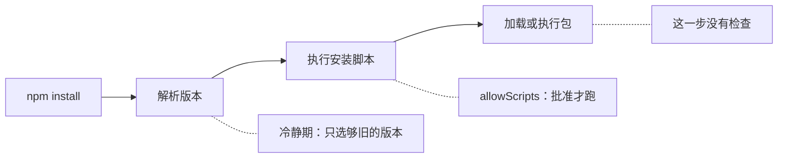
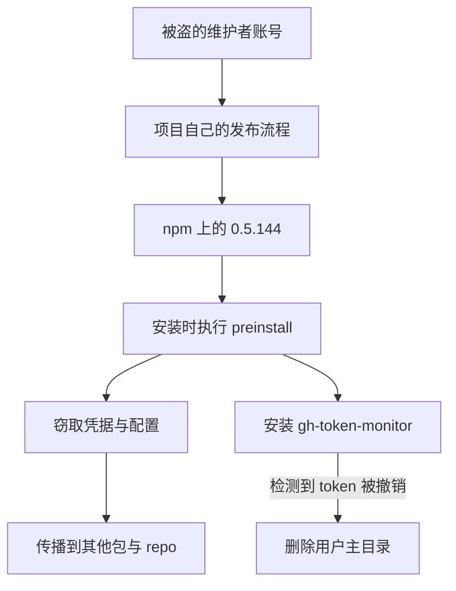

升级到 npm 12 之后，`npm install` 顺利结束，包也装进来了，某个功能却不能用。原因可能是依赖包的安装脚本被跳过了，因为 npm 12 默认不再执行这些脚本。

这篇说明怎么找出需要审查的包、确认脚本的用途与来源，再批准必要的项目并提交名单。另外可以加上 7 天冷静期，减少第一时间装到恶意新版本的机会。我认为这两道防线各有用途，也各有限制。步骤都是我根据官方文档整理的。

先认识几个词：

- **依赖包**（dependency）：你的项目用到的包，以及它们再用到的包。
- **安装脚本**（install script）：包安装时自动执行的命令，常见名称是 `preinstall`、`install`、`postinstall`。它以运行 npm 的账号权限执行，能访问该账号可读的文件与凭据。
- **`package.json`**：记录项目配置与依赖包的文件，npm 12 的脚本批准名单也放在这里。
- **lockfile**（`package-lock.json`）：记录解析出的依赖包版本与来源，让后续安装能使用同一组版本。
- **`.npmrc`**：npm 的配置文件。本文把团队共用的配置放在项目根目录。
- **token**（令牌）：一串用来验证身份的凭据，拿到的人就能在它的权限范围内操作。

安装脚本值得审查，是因为恶意程序在安装阶段就能执行，不必等你的程序加载包。2026 年 10 月 8 日的 `tensorlake@0.5.144` 就是例子。根据[官方安全公告](https://github.com/tensorlakeai/tensorlake/security/advisories/GHSA-8g63-53c9-65j2)，它在 `preinstall` 阶段窃取 token 与凭据。

发布者那一端的做法，我在[npm Trusted Publishing 设置教程：发布包不再放长期 token](/posts/npm-trusted-publishing-github-actions/)谈过。这篇从安装包的人出发：怎么管理脚本、避开刚发布的版本，以及 tensorlake 事件为什么要特别注意处理顺序。

> 步骤根据 npm CLI 12.2.2 的官方文档整理，查证日期是 2026-11-13。依据的文档是〈[npm-install-scripts](https://docs.npmjs.com/cli/v12/commands/npm-install-scripts/)〉、〈[npm-approve-scripts](https://docs.npmjs.com/cli/v12/commands/npm-approve-scripts/)〉、〈[config](https://docs.npmjs.com/cli/v12/using-npm/config/)〉，以及 GitHub 的 [npm v12 变更公告](https://github.blog/changelog/2026-07-08-npm-install-time-security-and-gat-bypass2fa-deprecation/)。命令与默认值以对应版本的官方文档为准。
{: .prompt-info }

## npm 12 改了什么

GitHub 在 2026-07-08 的[变更公告](https://github.blog/changelog/2026-07-08-npm-install-time-security-and-gat-bypass2fa-deprecation/)宣布 npm v12 正式发布，并标成 `latest`。和这篇有关的改变有三项：

- **依赖包的安装脚本默认不跑。** 包括 `preinstall`、`install`、`postinstall`，以及由 `binding.gyp` 隐含触发的 node-gyp 编译。从 git、本地文件或链接安装的依赖包，其 `prepare` 脚本也受管控。
- **默认会跳过脚本，让安装继续。** 安装结束时，npm 会列出尚未批准的包供你审查。所以安装成功只代表包已经装进来了，不代表它需要的构建或下载步骤已经完成。
- **批准与拒绝名单放在 `package.json` 的 `allowScripts`。** 符合允许规则的脚本可以执行。明确拒绝的会被跳过，也不再列为待审条目。

同一版本也默认禁止 git 依赖包（`allow-git`）和远程网址依赖包（`allow-remote`，例如直接指向 `.tgz`）。来源是否允许、脚本是否允许，是两个不同的检查，批准脚本不会顺便放行来源。用到这些来源的项目，要另外看相关配置。

{: w="1600" h="900" }
_在默认配置下，符合批准规则的脚本才会执行；明确拒绝的直接跳过，尚未审查的也跳过并列出。批准默认会固定版本，升级后需要重新审查。_

最容易受影响的，是图像处理、数据库驱动这类需要编译或下载原生程序的包。官方文档用 `canvas`、`sharp` 演示批准命令，但这不代表每个项目都需要批准它们，要看实际使用的版本与安装方式。

## 步骤 1：确认 npm 版本

在终端执行：

```bash
npm -v
```

- **12.x**：默认就会拦下未批准的安装脚本，直接进行步骤 2。
- **11.16.0 以上的 11.x**：根据 GitHub [6 月的预告](https://github.blog/changelog/2026-06-09-upcoming-breaking-changes-for-npm-v12/)，这些版本会先用警告提醒，方便你准备迁移。但警告不等于 npm 12 的默认拦截。用下面这行查看清单，再逐一批准或拒绝：

  ```bash
  npm approve-scripts --allow-scripts-pending
  ```

- **更旧的版本**：先确认 Node.js 符合目标 npm 版本的要求，再升级。若要照本文操作，可指定 npm 12：

  ```bash
  npm install -g npm@12
  ```

我建议团队成员与 CI（自动测试、构建流程）使用同一个 npm 版本。因为同一份 `allowScripts` 交给旧版 npm，不保证会照着拦截。另外也要检查有没有配置覆盖了默认行为。

## 步骤 2：看哪些包需要审查

在已经装好依赖包的项目文件夹中执行：

```bash
npm install-scripts ls
```

这个命令只列出“有安装脚本、但还没被 `allowScripts` 规则覆盖”的包，不会修改任何文件。已经明确拒绝的包不会出现在这份清单里。

新项目可以先在 npm 12 的默认配置下安装一次：

```bash
npm install
```

再看安装结束时的提示与这份清单。

接着逐一检查每个版本的脚本。例如清单中有 `canvas@3.2.0`，可以查：

```bash
npm view canvas@3.2.0 scripts
```

`npm view` 查的是当前配置的 registry 上的数据，未必等于本地实际装进来的文件。所以实际审查时，我还会对照 `node_modules` 里的这几样东西：

- 该版本的 `package.json`。
- 脚本调用的文件。
- 脚本下载程序的来源。

间接依赖包可能在嵌套目录中，同名包也可能装了不只一版，所以别只看最外层那份。

判断时，我参考下面的原则：

| 脚本在做什么 | 做法 |
| --- | --- |
| 需要编译或下载原生程序 | 可能确实需要脚本，但仍要确认来源、下载位置与用途，不能只因为“要编译”就放行 |
| 只是上报使用统计，或打印广告、感谢消息 | 若不影响需要的功能，可以拒绝 |
| 从不明网址下载内容，或代码刻意混淆 | 先不要批准，查明原因；若怀疑是恶意包，也不要为了测试而运行它 |
| 用途还不确定 | 先保留待审 |

用途不确定、但来源可信的包，可以在脚本仍被挡住的情况下测试相关功能。如果功能出错，先查清楚缺了什么，再决定是否批准。这个测试只能帮你判断是否需要脚本，不能证明包安全。

## 步骤 3：批准或拒绝，补跑脚本后再提交

下面沿用官方文档的包名演示，请换成你已经审查过的项目：

```bash
npm install-scripts approve canvas sharp
npm install-scripts deny telemetry-pkg
```

`telemetry-pkg` 是拒绝条目的示意名称。`npm approve-scripts` 与 `npm deny-scripts` 也能完成相同操作。

**批准默认会固定版本。** `approve` 写入的是 `包@版本`，让批准范围只限于审查过的版本。不过[文档](https://docs.npmjs.com/cli/v12/commands/npm-approve-scripts/)也说明，传入包名时，批准会匹配它所有已安装的版本。所以项目里同时装了两个版本时，批准前两个版本都要看过。

写进 `package.json` 后大致如下。这是我根据文档整理的片段，版本号只是示意，实际结果以命令产生的内容为准：

```json
{
  "allowScripts": {
    "canvas@3.2.0": true,
    "sharp@0.34.5": true,
    "telemetry-pkg": false
  }
}
```

- `true` 是允许，`false` 是拒绝。拒绝以名称记录，不分版本，而且已有的拒绝规则优先于批准。
- `--no-allow-scripts-pin` 只记名称，连未来版本也一起放行，我一般不建议使用。
- `approve --all` 会一次批准所有待审条目，应该在逐一审查之后才用。

**lockfile 缺少 `resolved` 下载网址时，批准范围会被放宽。** 这时 npm 可能无法验证版本，就改成只按名称批准，并发出警告。不要忽略这个警告，按下面的顺序修正：

1. 若启用了 `omit-lockfile-registry-resolved`，先调整这个配置。
2. 根据[文档](https://docs.npmjs.com/cli/v12/commands/npm-approve-scripts/)补回 lockfile 的来源信息。
3. 移除过宽的名称批准，再重新批准。
4. 检查差异，确认留下的是版本限定规则。

**批准只会更新名单，不会补跑刚才跳过的脚本。** 所以批准之后要执行：

```bash
npm rebuild canvas sharp
```

根据 [npm rebuild 文档](https://docs.npmjs.com/cli/v12/commands/npm-rebuild/)，它会执行对应包的生命周期脚本。完成后，再跑项目的测试与构建，确认实际需要的功能正常。

提交前我会先看差异。批准名单一定要提交；lockfile 若也有预期中的变动，再一起提交：

```bash
git diff -- package.json package-lock.json
git add package.json
# 若 package-lock.json 有需要保留的变动，再 git add package-lock.json
git commit -m "chore(deps): 批准需要的安装脚本"
```

**包升级之后要重新审查。** 新版本不再符合旧的批准规则，会重新列为待审。看过新版脚本再批准，npm 会更新对应的版本规则。已失效的条目可以先预览：

```bash
npm install-scripts prune --dry-run
```

再清理：

```bash
npm install-scripts prune
```

`prune` 也会移除对应不到已安装包的拒绝规则。如果团队想预先拦下某些包，清理前要先确认。

**要让 CI 遇到待审条目就失败**，在项目的 `.npmrc` 加上：

```ini
strict-allow-scripts=true
```

根据[文档](https://docs.npmjs.com/cli/v12/using-npm/config/#strict-allow-scripts)，加上这行后，尚未审查的安装脚本会让安装失败，明确拒绝的仍直接跳过。配置与名单提交后，我建议让 CI 以相同的 npm 版本跑 `npm ci` 和现有测试，确认从干净安装也能正常构建。

## 步骤 4：在 .npmrc 加上 7 天冷静期

冷静期让刚发布的版本先等七天才会被选中，有问题的新版本因此多一段被发现、报告和下架的时间。它和安装脚本审查管的是安装过程的不同阶段：



不过恶意版本不一定会在七天内被抓到，所以冷静期只是多一段缓冲。

先在项目根目录的 `.npmrc` 加上：

```ini
min-release-age=7
```

这里的单位是**天**。根据[文档](https://docs.npmjs.com/cli/v12/using-npm/config/#min-release-age)，npm 解析依赖包时，会在允许的版本范围内选择发布超过七天的版本。找不到符合条件的版本，解析就会失败。

如果某个自家包需要一发布就能安装，再为它加入例外，例如：

```ini
min-release-age-exclude[]=@your-org/internal-tool
```

请把示意名称换成实际包。也可以用 `@your-org/*` 排除整个 scope，但范围越大，绕过冷静期的包就越多，所以我会从必要的个别包开始。

设置例外时要注意两点：

- **只有符合名称的包不受限。** 它的依赖包仍要遵守冷静期，除非也符合排除规则。
- **排除不会改变下载来源。** 例外名单只比对名称，不会替你配置 registry。文档也提醒，使用私有 scope 时，要在公开 npm registry 上拥有同一个 scope，避免他人抢先发布同名包。

{: w="1600" h="900" }
_以 tensorlake 事件说明原理。图中的组织排除规则只是可选示例，不必照抄。_

根据公告，`tensorlake@0.5.144` 在 npm 上只存活约 1 小时 40 分钟。它在 2026-10-08 01:12 到 02:54 UTC 之间上线，也就是台北时间 09:12 到 10:54。如果解析版本时有应用七天限制，而且没有例外或覆盖，它到被移除前都还不满七天，不会被选中。

**但冷静期不保证每种安装场景都挡得住。** 官方文档没有明确说明 lockfile 已锁定的版本是否会重新检查。所以我不会把冷静期当成检查现有依赖包的杀毒工具。

**紧急修复也可能被挡住。** 文档指出，如果冷静期挡住 `npm audit fix` 要装的修复版本，npm 会保留有漏洞的版本、发出警告，并以失败结束。这时先确认修复版本与来源，再暂时把该包加入排除名单，完成更新与验证后记得移除例外。调小天数也能放宽限制，但会同时影响其他包。

**同时设置 `before` 时，要确认哪个配置生效。** `before` 只选某个日期之前的版本。它和冷静期写在同一份配置文件时，会以 `before` 为准；分散在不同配置来源时，则按 npm 的配置优先级决定。所以也要留意 CI 参数、环境变量或个人配置，是否改变了项目预期的限制。

最后确认 `.npmrc` 里没有 token 等机密，再提交到版本控制，让团队和 CI 使用同一份策略。

## 步骤 5：全局安装与 npx 怎么放行

全局安装（`npm install -g`）与一次性执行（`npm exec`、`npx`）没有项目的 `package.json` 可以记录批准名单。执行 `npm install-scripts -g` 也只会得到 `EGLOBAL` 错误。这些情况要改用 `allow-scripts` 配置。

下面的 `your-cli@1.2.3` 是示意的工具与版本，请换成实际要安装或执行的工具。`canvas,sharp` 也要换成它真正需要、你已审查过的脚本包：

```bash
# 指定要安装的工具，只在这次安装放行所列包的脚本
npm install -g your-cli@1.2.3 --allow-scripts=canvas,sharp

# 一次性执行：-- 后面是工具的命令与参数
npm exec --allow-scripts=canvas,sharp --package=your-cli@1.2.3 -- your-cli

# 若确实需要长期有效，才存到个人配置
npm config set allow-scripts=canvas,sharp --location=user
```

- `--allow-scripts` 指定的是**允许跑安装脚本的包**，不等于指定要安装哪个工具。
- 根据[文档](https://docs.npmjs.com/cli/v12/using-npm/config/#allow-scripts)，在项目的 `npm install`、`npm ci`、`npm update` 或 `npm rebuild` 命令行直接传入这个参数会报错。项目请维护 `allowScripts`。
- 这里的名单按包名比对，不像 `allowScripts` 默认会固定版本。存进个人配置后会持续有效，不需要时可用下面这行移除：

  ```bash
  npm config delete allow-scripts --location=user
  ```

- 它只管安装脚本。`npm exec`、`npx` 之后执行的工具本身，仍会以你的权限运行，所以不能因为脚本被挡，就放心执行陌生工具。

## 装到恶意包之后：tensorlake 事件的特殊处理顺序

这次事件要**先移除常驻服务，再撤销 token**。因为恶意程序会安装 `gh-token-monitor` 常驻服务，它检测到被窃的 GitHub token 遭撤销时，会删除用户主目录。所以公告要求先隔离机器、移除服务，之后才撤销 token。

轮换凭据仍是必要的应急响应措施，只是顺序要对。以下是我根据公告整理的这次事件处理方式，不能照搬成所有事件的固定流程。

根据[官方公告](https://github.com/tensorlakeai/tensorlake/security/advisories/GHSA-8g63-53c9-65j2)，受影响的是 npm 的 `tensorlake@0.5.144` 与同版本的 `tensorlake-native-*` 系列。PyPI、crates.io 上的同名包与 tensorlake CLI，不受这次事件影响。攻击的经过如下：



因为恶意版本是经项目自己的发布流程发出的，它带有有效的 npm provenance（来源证明）。来源证明只能说明包从哪里、经由什么流程构建，不能保证代码没有恶意行为。

恶意脚本收集的内容包括：

- GitHub、npm 与云服务凭据。
- SSH 与 GPG 密钥。
- `.env`。
- 浏览器密码。
- AI 工具和 MCP 的配置。

### 怎么确认是否受影响

我会先查 lockfile 与安装记录，不必执行可疑包：

- 找出 `tensorlake`、`tensorlake-native-*` 的条目，确认对应的 `version` 是否为 `0.5.144`。有些 lockfile 格式会把名称与版本分开记录，只搜索完整字符串 `tensorlake@0.5.144` 可能会漏掉。
- `npm list tensorlake` 只能查当前安装的版本。就算现在已经移除或降级，也不能证明过去没装过。
- 回查 CI 记录，特别是 2026-10-08 01:12 到 02:54 UTC 之间有没有解析到该版本。目前的 lockfile 也不能取代历史记录。

公告指出，只要在启用安装脚本的电脑或 CI 上装过 0.5.144，就应把机器与它能接触的凭据视为已遭入侵。所以找到该版本只是调查的起点，是否执行过脚本、能接触哪些凭据，都要一起确认。

### 按公告处理

1. **先断网**，隔离受影响的机器。
2. **在撤销 GitHub token 前，停止并移除 `gh-token-monitor`**：
   - 在 Linux 上执行：

     ```bash
     systemctl --user disable --now gh-token-monitor.service
     ```

     再删除 `~/.config/gh-token-monitor/` 和 `~/.local/bin/gh-token-monitor.sh`。

   - 在 macOS 上执行：

     ```bash
     launchctl bootout gui/$(id -u) ~/Library/LaunchAgents/com.user.gh-token-monitor.plist
     ```

     再删除这个 plist 文件。

   - Windows：删除名为 `gh-token-monitor` 的计划任务，以及 `%LOCALAPPDATA%\gh-token-monitor\` 文件夹。
3. **从另一台干净的电脑轮换所有可接触的凭据**，不要在受影响的机器上输入新凭据。
4. **检查包与 repo 是否被用来传播**。公告列出的线索有：
   - 不明的发布。
   - 作者显示为 `claude` 的 commit。
   - `dependabot/github_actions/format/setup-formatter` 分支。

   这些线索仍要对照内容与记录判断。
5. **用可信镜像重建机器**。

{: w="1600" h="900" }
_这是 tensorlake 公告的特殊顺序。处理其他事件时，请根据该事件的公告与应急响应指南判断。_

**项目的依赖版本也要处理。** 公告列出 `0.5.143` 与更早的版本未受这次事件影响。恢复环境时，应移除恶意版本、更新 lockfile，并确认后续安装不会再选到 `0.5.144`。只降级或删掉 `node_modules`，无法撤回已泄露的凭据，也不能取代上面的机器重建与调查。

## 这些配置保护不到什么

> - **脚本批准不是沙箱。** 批准后的脚本仍以运行 npm 的账号权限执行，不会自动限制文件或网络访问。
> - **包加载与工具执行仍有风险。** `require`、`import` 或直接执行工具时，恶意程序仍可能执行。
> - **固定版本只能限制批准范围。** 如果批准的版本本身有问题，固定它也不会变安全。
> - **冷静期不能代替审查与修复。** 发布超过七天仍未被发现的恶意版本，照样可能被选到。紧急修复则可能需要受控的例外。
> - **workspaces 要另外确认。** 官方文档注明 `npm install-scripts` 无法识别 workspaces，所以不能假设加上 `-w` 就能分别管理每个 workspace 的策略。
> - **其他配置可能覆盖策略。** `--ignore-scripts` 会让已批准的脚本也不执行。`--dangerously-allow-all-scripts` 则会绕过批准与拒绝规则，不要把它当成日常做法。
{: .prompt-warning }

## 常见情况怎么处理

| 情况 | 做法 |
| --- | --- |
| 安装成功，功能却不能用 | 先查 `npm install-scripts ls`，确认需要的构建步骤是否被跳过 |
| 批准后功能仍没恢复 | 确认已执行 `npm rebuild <包>`，再检查 `ignore-scripts` 与构建记录 |
| 同名包有多个版本 | 逐版审查；按名称批准会匹配所有已安装版本 |
| 升级 PR 的 CI 因待审脚本失败 | 看过新版脚本后重新批准，把名单变动一起提交 |
| 曾拒绝的包现在需要放行 | 先移除对应拒绝规则，再审查与批准；`approve --all` 不会覆盖 `false` |
| 批准时警告无法固定版本 | 检查 lockfile 的 `resolved` 信息，修复后重新批准，确认留下的是版本限定规则 |
| 紧急修复被冷静期挡住 | 确认来源后，暂时只排除该包，更新与验证完再移除例外 |
| 全局安装或一次性工具需要安装脚本 | 指定工具与版本，再用 `--allow-scripts` 列出批准的脚本包 |

我建议先从现有项目的待审清单开始，让必要的脚本在审查后恢复运作，再把名单与 `.npmrc` 一起提交，让团队和 CI 共用。之后每次升级依赖包，也要一起审查新版本的脚本。

## 延伸阅读

- [npm Trusted Publishing 设置教程](/posts/npm-trusted-publishing-github-actions/)：发布者端如何移除长期 token。
- [开了 Trusted Publishing 还不够：npm 发布流程也要上锁](/posts/npm-release-pipeline-lockdown/)：发布流程怎么再加上审查关卡。
- [Coding Agent 供应链与权限风险](/posts/coding-agent-supply-chain-permission-risks/)：AI 工具与 MCP 的相关风险。
- [OWASP Agentic Top 10 检查表](/posts/owasp-agentic-top-10-ai-workflow-checklist/)：更完整的工作流检查。
