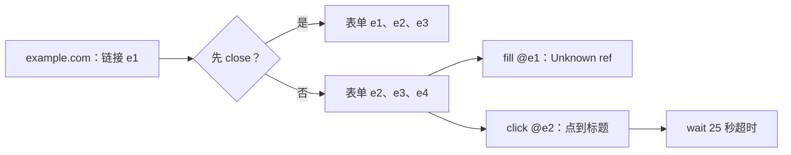
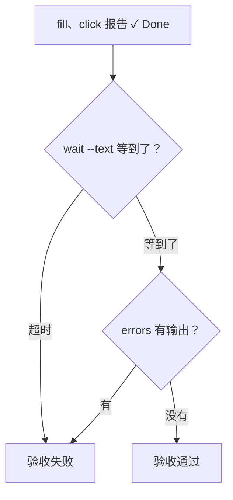
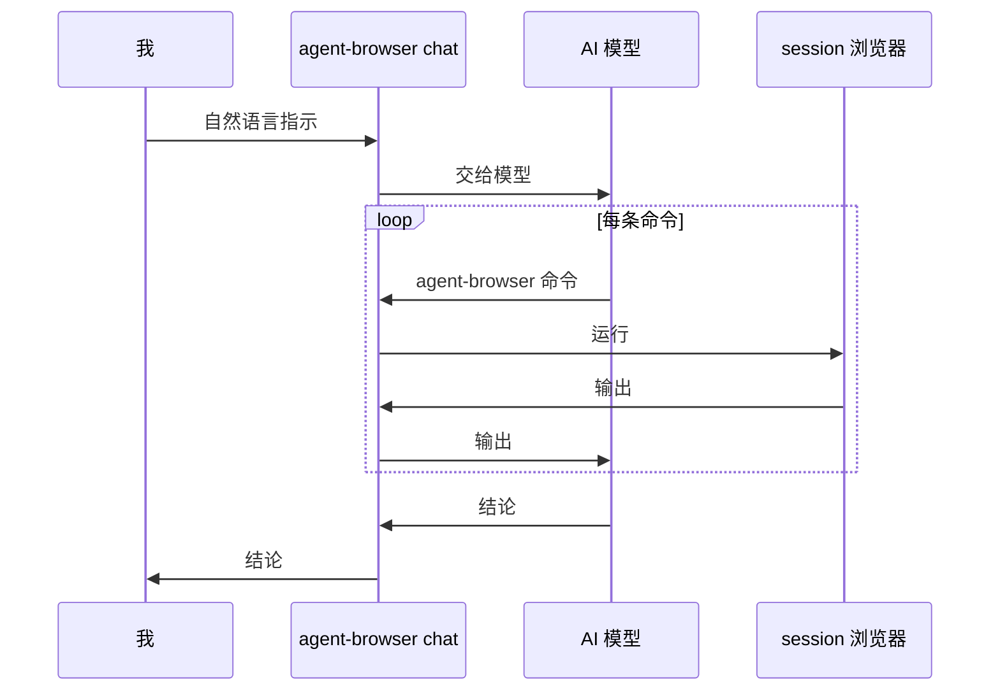

coding agent 改完网页后，如果只读代码，就看不到按钮按下去之后页面有没有反应。代码看起来没问题，页面仍然可能是坏的。

[agent-browser](https://github.com/vercel-labs/agent-browser) 是 Vercel Labs 用 Rust 写的命令行工具。AI 用它一次下一条命令来操作浏览器，比如打开网页、列出页面上的按钮和输入框、点击，再读出结果。coding agent 本来就能在终端里运行命令，所以它可以在报告“改好了”之前，先把页面点一遍。

这篇用一个本地订阅表单和它故意改坏的版本实测，再把检查交给 AI，最后限制它能访问的域名和能执行的操作。两个示例页的源代码都在文中，可以照着重做。

> 依据 agent-browser v0.43.0 tag 的 [README](https://github.com/vercel-labs/agent-browser/tree/v0.43.0)，以及官方的 [Installation](https://agent-browser.dev/installation)、[Quick Start](https://agent-browser.dev/quick-start)、[Snapshots](https://agent-browser.dev/snapshots)、[Security](https://agent-browser.dev/security) 四份文档。官网上的文档可能已经在介绍更新的版本。
>
> 实测在 2026-11-19（台北时间），电脑是 Debian 13（x86_64）。用的是 agent-browser 0.43.0，以及它自己下载的 Chrome for Testing 158.0.8127.36。0.43.0 是当天 GitHub 标记为 Latest 的版本，在台北时间 2026-11-13 发布。从 v0.39.1（台北时间 2026-10-14）到 0.43.0 共发布了 10 个版本，照着做之前请先看你的版本：
>
> ```bash
> agent-browser --version
> ```
>
> 文中的终端截图是把当时录下的输出原样排成图片，有几张只截取了其中几条命令。
{: .prompt-info }

## 先认识几个名词

- headless 浏览器是没有窗口的浏览器。它照常加载网页、运行 JavaScript，只是不显示在屏幕上。根据 `--help`，agent-browser 默认使用这种模式，加上 `--headed` 才会显示窗口。
- snapshot 是 agent-browser 把页面整理成的文本列表，列出标题、输入框、按钮等元素。根据 agent-browser 内置的 core skill（使用指南），snapshot 比截图快，消耗的 token 也少很多。
- ref 是 snapshot 给每个元素编的代号，比如 `@e2`。要点哪个按钮、填哪个输入框，就用 ref 指定。
- session 是一个在后台持续打开的浏览器。同一个 session 的命令都发到同一个浏览器，所以上一步打开的页面，下一步还在。根据 README，它空闲一小时后会自动关闭。要自己关掉，就运行：

  ```bash
  agent-browser close
  ```

## 步骤一：安装

官方推荐用 npm 全局安装，再用 `agent-browser install` 下载它要用的 Chrome。这个 Chrome 是 [Chrome for Testing](https://googlechromelabs.github.io/chrome-for-testing/)，也就是 Google 给自动化测试用的版本。

根据官方文档，macOS 也可以用 brew 安装：

```bash
brew install agent-browser
```

用 cargo 安装则会从源代码编译，需要 Rust 工具链：

```bash
cargo install agent-browser
```

我用的是 npm：

```bash
npm install -g agent-browser
agent-browser --version
agent-browser install
```

{: w="1102" h="636" }
_我在 Debian Linux 上的安装过程（实际输出）_

npm 在安装时输出了 `install-scripts` 警告。警告说 `agent-browser@0.43.0` 的 postinstall 脚本还不在 allowScripts 列表里。它提示可以加 `--allow-scripts=agent-browser`，允许这个脚本运行。

根据官方 Installation 文档，这个警告不需要处理。使用 npm 12 这类默认拦截安装脚本的包管理器时，agent-browser 会在第一次运行时自动完成链接。npm 拦截安装脚本的机制，我在《[npm 12 默认挡掉安装脚本](/posts/npm-12-install-scripts-allowscripts/)》里介绍过。

我没有理会警告，接着运行 `agent-browser --version`，它直接打印出 `agent-browser 0.43.0`。

在 Linux 上，`agent-browser install` 打印了两次提示：浏览器启动失败或出现 shared library 错误时，要改为运行：

```bash
agent-browser install --with-deps
```

根据官方文档，这条命令会用系统的包管理器补装 Chrome 需要的库，不是 root 时会通过 `sudo` 运行。在我的电脑上，`agent-browser install` 就够了，后面每一步的浏览器都正常启动。

装完可以跑一次健康检查：

```bash
agent-browser doctor --offline --quick
```

我跑的结果是 `Summary: 8 pass, 0 warn, 0 fail`。根据官方文档，`--offline --quick` 只检查本机、不联网，也会跳过实际启动浏览器的测试。输出里还有一行 `AI_GATEWAY_API_KEY not set (chat command disabled)`，步骤五会用到这个环境变量。

## 步骤二：走一遍基本流程

agent-browser 的用法是四步：打开页面、获取 snapshot、用 ref 操作、确认结果。页面一有变化，就重新获取 snapshot。

{: w="1600" h="900" }

我先用官方 README 和 Quick Start 都用到的 `example.com` 试：

```bash
agent-browser open example.com
agent-browser snapshot -i
agent-browser get title
agent-browser screenshot shots/example.png
agent-browser click @e1
agent-browser get url
agent-browser snapshot -i
```

![终端实际输出：open example.com 显示 Example Domain；snapshot -i 列出 link "Learn more" [ref=e1]；get title 返回 Example Domain；screenshot 保存文件；click @e1 之后 get url 变成 iana.org 的网址；最后的 snapshot -i 显示 (no interactive elements)](term-core.webp){: w="1102" h="568" }
_snapshot 给出 `@e1`，点击之后网址变了（实际输出）_

逐行看：

- `open` 在后台启动浏览器，第一次会打印 `[agent-browser] launched browser`。接着它打开网页，打印页面标题和网址。
- `snapshot -i` 只列出能交互的元素。这个页面只有一个链接，ref 是 `e1`。0.43.0 实际打印的格式是 `- link "Learn more" [ref=e1]`，和 Quick Start 示例里的格式不同，请以你看到的输出为准。
- `screenshot` 把当前画面保存成 PNG 文件。
- `click @e1` 点击那个链接。`get url` 返回 `https://www.iana.org/help/example-domains`，说明已经跳转了。
- 跳转后的 `snapshot -i` 打印 `(no interactive elements)`。

`-i` 是 interactive 的缩写。不加的话，snapshot 会列出整页的结构，连段落文本也在内。只想找按钮和输入框时，加 `-i` 输出会短一些。

## 步骤三：验收一个本地表单

实际用途通常是检查你自己正在做的网页。我写了一个订阅表单，只有一个 Email 输入框和一个 Subscribe 按钮。提交后，按钮下方应该显示“Thanks! We sent a confirmation to”加上你填的 Email。

这个示例只更新页面文本，不会真的发送确认邮件。下面是完整的 `site/index.html`，请原样保存、不要重新排版，步骤四的错误行号才会和我的一样：

```html
<!doctype html>
<html lang="en"><head><meta charset="utf-8"><title>Newsletter demo</title>
<style>body{font-family:system-ui,sans-serif;background:#fff7ed;margin:0;display:grid;place-items:center;min-height:100vh}
main{background:#fff;border:2px solid #fdba74;border-radius:16px;padding:32px 40px;width:420px}
h1{margin:0 0 8px;color:#9a3412}label{display:block;margin:16px 0 6px}input{width:100%;padding:10px;font-size:16px;box-sizing:border-box}
button{margin-top:16px;padding:10px 18px;font-size:16px;background:#ea580c;color:#fff;border:0;border-radius:8px}
#msg{margin-top:16px;color:#166534;font-weight:600}</style></head>
<body><main><h1>Weekly newsletter</h1><p>A local demo page for agent-browser.</p>
<form id="f"><label for="email">Email</label><input id="email" type="email" placeholder="you@example.com" required>
<button type="submit">Subscribe</button></form><p id="msg" role="status"></p></main>
<script>
document.getElementById('f').addEventListener('submit', e => {
  e.preventDefault();
  const email = document.getElementById('email').value;
  document.getElementById('msg').textContent = 'Thanks! We sent a confirmation to ' + email + '.';
});
</script></body></html>
```
{: file="site/index.html" }

在 `site` 的上一级文件夹运行下面这行，用 Python 内置的 HTTP 服务器把它开在 8765 端口：

```bash
python3 -m http.server 8765 --bind 127.0.0.1 --directory site
```

启动后让这个终端保持运行，另开一个终端操作 agent-browser。换成任何能提供静态文件的服务器都可以，只要网址是 `http://localhost:8765/`。

如果你刚做完步骤二，先关掉浏览器：

```bash
agent-browser close
```

我正式跑这一步时，浏览器是关着的，所以 `open` 打印出 `launched browser`，ref 从 `e1` 开始。没有先关的话，ref 会接着往下编，原因写在本节最后的警告里。

接着打开页面、获取 snapshot：

```bash
agent-browser open http://localhost:8765/
agent-browser snapshot -i
```

snapshot 列出三个元素：标题是 `e1`，Email 输入框是 `e2`，Subscribe 按钮是 `e3`。

再填写 Email、点击 Subscribe，确认感谢消息出现，并检查 JavaScript 错误：

```bash
agent-browser fill @e2 "reader@example.com"
agent-browser click @e3
agent-browser wait --text "Thanks"
agent-browser get text "#msg"
agent-browser errors
agent-browser screenshot shots/good.png
```

{: w="1102" h="658" }

{: w="1280" h="577" }
_正常版本的感谢消息出现了，`errors` 也没有任何输出_

这几条命令各自确认一件事：

- `wait --text "Thanks"` 等到页面上出现这段文本才继续，等不到就报错。根据 `wait --help`，`--text` 是子字符串匹配。官方 core skill 也建议用这种等待，不要用 `wait 2000` 这类固定毫秒数。
- `get text "#msg"` 读出 `#msg` 元素的完整内容，确认填进去的 Email 有带上。
- `errors` 列出页面上的 JavaScript 错误和未捕获的异常。这次没有任何输出，说明工具没有记录到这轮操作的 JavaScript 错误。功能是否正常，仍要结合页面结果判断。

`"#msg"` 一定要加引号，因为 shell 会把 `#` 之后的内容当成注释。我第一次尝试时，包装命令的脚本把引号弄丢了，实际运行的是 `agent-browser get text #msg`。agent-browser 因此返回了 `Missing arguments for: get text`。

ref 的编号也有陷阱。我第一次尝试时没有先 `close`，表单接在 example.com 后面编号，结果如下：



> 不要照抄文档示例里的 ref，每次操作前都用最近一次 snapshot 给出的 ref。上图是我照文档示例写 `fill @e1` 的那次：它得到 `✗ Unknown ref: e1`。接下来的 `click @e2` 报告 `✓ Done`，但那次的 `e2` 是标题，所以 `wait` 等了 25000ms 后超时。
>
> 根据 Snapshots 文档，跳转会让旧的 ref 失效，但编号不会回收重用。所以在同一个 session 里跳转后，编号会接着往下排。
{: .prompt-warning }

## 步骤四：故意改坏，看它能不能发现

我把 `index.html` 复制成 `broken.html`，只改了两行：

- 第 2 行的 `<title>` 加上 ` (broken)`。
- 第 15 行把要写入消息的元素 ID 从 `msg` 拼错成 `mesage`。

其他行都不动，第 7 行 CSS 的 `#msg` 和第 10 行的 `id="msg"` 也要保留。如果把所有 `msg` 都换掉，拼写错误会被抵消，页面反而正常。你可以照下面的差异自己做一份，放在同一个 `site` 文件夹：

```diff
--- site/index.html
+++ site/broken.html
@@ -2 +2 @@
-<html lang="en"><head><meta charset="utf-8"><title>Newsletter demo</title>
+<html lang="en"><head><meta charset="utf-8"><title>Newsletter demo (broken)</title>
@@ -15 +15 @@
-  document.getElementById('msg').textContent = 'Thanks! We sent a confirmation to ' + email + '.';
+  document.getElementById("mesage").textContent = 'Thanks! We sent a confirmation to ' + email + '.';
```

这个拼写错误不会改变页面外观。点击按钮后，画面上只是不会出现消息。

我在同一个 session 里用一样的流程再跑一次。因为还在同一个 session，这次 ref 接着往下排：标题 `e4`、Email 输入框 `e5`、按钮 `e6`。

`wait` 我加了 `--timeout 5000`，只等 5 秒。不加的话会等默认的 25 秒，也就是 `--help` 列出的 `AGENT_BROWSER_DEFAULT_TIMEOUT` 默认值 25000 毫秒。

```bash
agent-browser open http://localhost:8765/broken.html
agent-browser snapshot -i
agent-browser fill @e5 "reader@example.com"
agent-browser click @e6
agent-browser wait --text "Thanks" --timeout 5000
agent-browser errors
agent-browser console
agent-browser screenshot shots/broken.png
```

{: w="1102" h="546" }

{: w="1280" h="577" }
_坏掉的版本在画面上看不出错误，只是什么都没出现_

`fill` 和 `click` 都报告 `✓ Done`，光看这两行看不出问题。根据 README，`click` 在目标被遮挡、隐藏或禁用时会失败，所以 `Done` 只代表操作确实执行了，不代表页面做出了正确反应。

发现问题的是后面两条命令：

1. `wait --text "Thanks" --timeout 5000` 打印 `✗ Wait timed out after 5000ms`，预期的消息没有出现。
2. `errors` 打印 `TypeError: Cannot set properties of null (setting 'textContent')`。位置是 `broken.html:15:49`，就是我拼错的第 15 行。

`getElementById("mesage")` 找不到元素，返回 `null`，对 `null` 设置 `textContent` 就会抛出这个错误。`console` 这次没有输出，最后的 `screenshot` 保存了上面那张没有感谢消息的画面。

所以验收要看结果，不能看操作的报告：



### 补充：在截图上标出 ref

想知道每个 ref 对应画面上的哪个位置，可以用 `screenshot --annotate`。下面两张图来自我另外跑的一次：用新的 session，先设置视口大小，再打开表单并拍下标注截图。如果要试这段，请先关掉步骤四的 session：

```bash
agent-browser close
agent-browser set viewport 1280 800
agent-browser open http://localhost:8765/
agent-browser snapshot -i
agent-browser screenshot --annotate shots/annotated.png
agent-browser close
```

![终端实际输出：snapshot -i 列出 heading、textbox "Email"、button "Subscribe" 三个元素；screenshot --annotate 保存文件并打印 [1] @e1、[2] @e2、[3] @e3 的对照表](term-annotate.webp){: w="1102" h="388" }

{: w="1280" h="800" }
_截图上的 [2]、[3] 就是 snapshot 里的 `@e2`、`@e3`_

## 步骤五：交给 AI 自己跑

上面的命令是我写成几个 shell 脚本运行的，AI 没有参与。把检查交给 AI 有三种方式。前两种把流程交给现有的 coding agent，第三种用内置的 `chat` 检查已经启动的本地网站，后面的实测用的就是第三种。

### 方式一：安装官方 skill

skill 是给 coding agent 读的使用说明。根据官方文档，下面这行会把 agent-browser 的 skill 安装到你的 coding agent 里：

```bash
npx skills add vercel-labs/agent-browser
```

支持的 coding agent 有 Claude Code、Codex、Cursor、Gemini CLI、GitHub Copilot、Goose、OpenCode 和 Windsurf。

根据 v0.43.0 的 README，这样装进去的 skill 只是一段很短的引导，让 agent 先运行 `agent-browser skills get core`。这条命令打印的就是 agent-browser 内置的 core skill，所以 agent 读到的说明会和你安装的 CLI 版本对应。方式三里 AI 的第一条命令也是它。

core skill 提醒每个任务都应该用自己的 `--session <名称>`。默认的 session 是整台电脑共用的一个浏览器，在里面操作可能会抢走别的 agent 的页面。我这次的实测全部在默认 session 里跑。

### 方式二：写进 AGENTS.md

如果你的项目有 `AGENTS.md` 或 `CLAUDE.md`，可以把流程写进去，写法可以参考《[AGENTS.md 怎么写](/posts/agents-md-project-rules-for-coding-agents/)》。下面的模板改写自官方 Installation 文档里的基本流程，多加了几条验收规则。请根据你的项目修改网址和预期文本：

```markdown
## 改完网页后的验收

改到界面、表单或按钮时，用 agent-browser 实际打开页面验收，不要只看代码。
运行 `agent-browser --help` 可以看到所有命令。
每条命令都加上 `--session <这个任务的名称>`，不要用默认 session。

1. `agent-browser --allowed-domains "localhost" open http://localhost:8765/`：只打开本地网址
2. `agent-browser snapshot -i`：获取元素和 ref
3. 用最近一次 snapshot 的 ref 操作，例如 `fill @e2 "..."`、`click @e3`；不要猜 ref
4. `agent-browser wait --text "<预期出现的文本>"`
5. `agent-browser errors`
6. `agent-browser close`

预期文本没有出现，或 `errors` 有输出，就不算完成，要报告错误内容。
页面跳转或内容变化后，要重新 snapshot。
```

### 方式三：用内置的 chat 命令

agent-browser 的 `chat` 命令让 AI 模型替你操作浏览器。根据 `chat --help`，流程如下：



它在你选的 session 里运行，不能自己创建或切换 session。运行 `chat` 需要这些设置：

- 要设置 `AI_GATEWAY_API_KEY`。
- 根据 `--help`，`AI_GATEWAY_URL` 是 Vercel AI Gateway 的 base URL。它的默认值是 `https://ai-gateway.vercel.sh`。
- 默认模型是 `anthropic/claude-sonnet-4.6`，可以用 `--model` 更换。

我手边有一个兼容 OpenAI 的 LiteLLM 服务，就把 `AI_GATEWAY_URL` 和 `AI_GATEWAY_API_KEY` 指向它。密钥和网址都只放在环境变量里，没有写进任何文件。

确认本地 HTTP 服务器仍在运行后，先关掉上一轮的浏览器：

```bash
agent-browser close
```

再用 `gpt-6.1-sol` 模型让它检查坏掉的那一页：

```bash
agent-browser chat --model gpt-6.1-sol "Open http://localhost:8765/broken.html, type reader@example.com into the email field, click Subscribe, and check that a thank-you message appears. Also check the page for JavaScript errors. Tell me in two sentences whether the form works."
```

{: w="1102" h="411" }
_AI 自己跑了 10 条命令，结论和我手动跑的一样（实际输出）_

AI 的结论和我手动跑的一样：它回答表单不能用，并引用了同一个 `TypeError` 和 `broken.html:15:49`。从开始到最后的 `close` 结束共 36 秒，它依次运行了这些命令：

1. `skills get core`，先读 core skill
2. `open`
3. 不加 `-i` 的 `snapshot`
4. `fill @e2`、`click @e3`
5. `wait --text "Thank" --timeout 3000`
6. 再跑一次 `snapshot`
7. `skills get core --ref commands`
8. `errors` 和 `console`

它的 ref 是 `e2`、`e3`，因为上一次运行结束时我已经 `close`，这是新的 session。

同一句指示我另外加 `-v` 跑过一次，`-v` 会打印每条命令的完整输出。那次的命令顺序和结论都一样，`wait` 打印 `✗ Wait timed out after 3000ms`。两次用的都是 `gpt-6.1-sol`。

## 步骤六：限制它能去哪里、能做什么

根据官方 Security 文档，agent-browser 默认对导航、操作和输出都不做限制，这些控制都要自己开启。不开启的话，AI 可以打开任何网站，也可以用 `eval` 在页面上运行任意 JavaScript，比如读取 `document.cookie`。

如果你担心 AI 被网页内容误导，比如页面藏了一段让它打开某个网址的文本，就要自己缩小范围。这类风险可以参考我写的《[OWASP Agentic Top 10 检查表](/posts/owasp-agentic-top-10-ai-workflow-checklist/)》中工具滥用那一节。

我实测了两个设置：

- `--allowed-domains` 只允许列出的域名。根据官方文档，它会拦截页面导航，也会拦截图片、脚本、fetch 等子资源请求。
- `--action-policy` 指定一个 JSON 格式的 policy 文件，列出哪些操作要拦截。

{: w="1102" h="883" }
_域名限制有效；官方示例里的 `"eval"` 在 0.43.0 拦不住，要写 `"evaluate"`（实际输出）_

### 域名限制：和文档一致

我用 `--allowed-domains "localhost"` 打开 session，再运行 `open https://example.com`。它被拦截，打印 `✗ Domain 'example.com' is not in the allowed domains list`。

根据官方文档，域名限制和 action policy 都会跟随 session 保存，直到 `close` 成功为止。

### action policy：要写内部的操作名称

action policy 的结果和文档不同。我先用 Security 文档里的示例 `"deny": ["eval", "download", "upload"]`。结果 `eval "document.title"` 照样运行，返回 `"Newsletter demo"`。

我查了 v0.43.0 的源代码，原因在 `cli/src/native/policy.rs`：它拿命令内部的操作名称做完全匹配。`eval` 命令内部的操作名称是 `evaluate`，所以文档里写的 `eval` 分类不起作用。

这个问题已经有人在 [issue #1612](https://github.com/vercel-labs/agent-browser/issues/1612) 里报告，修复放在 [PR #2506](https://github.com/vercel-labs/agent-browser/pull/2506)，我写这篇时两者都还是 open。我把 `"evaluate"` 也加进去之后，`eval` 就被拦截了，打印 `✗ Action 'evaluate' denied by policy: Action 'evaluate' is denied by policy`：

```json
{
  "default": "allow",
  "deny": ["eval", "evaluate", "download", "upload"]
}
```
{: file="policy-0.43.json" }

文件里保留了 `"eval"`。根据 PR #2506 的说明，修复会让分类名称也匹配到下面的操作，到时候 `"eval"` 这一项就会生效。

我另外手动试了两种写法。第一种是把 Security 文档里的严格示例改成 `"default": "deny"`。`allow` 列表是 `navigate`、`snapshot`、`click`、`fill`、`wait`、`get`、`close`。

结果 `open`、`snapshot -i`、`fill`、`click`、`wait --text` 都能运行，但下面这些命令被拦截。`get` 虽然在列表里，拦截的依据仍是内部的操作名称：

| 命令 | 内部的操作名称 |
| --- | --- |
| `get text "#msg"` | `gettext`，消息是 `Action 'gettext' denied by policy` |
| `get title` | `title` |
| `get url` | `url` |
| `screenshot` | `screenshot` |
| `errors` | `errors` |

第二种是 `--confirm-actions eval`，它也不起作用：`eval "1+1"` 没有要求确认，就直接返回 `2`。

所以设完 action policy，不要只看 policy 文件的内容就放心。请像我这样实际运行一次被禁止的操作，确认它会被拦截，也确认你需要的命令没有被一起拦掉。

### 官方文档里的其他做法

- 根据 `--help`，`--profile` 会沿用某个 Chrome profile 的登录状态。如果用你平时登录的 profile，AI 就能使用那个 profile 里所有已登录账号的状态。根据 Security 文档，`--allowed-domains` 也不能和 `--profile` 一起用。
- 需要登录时，Security 文档提供的是 auth vault。用 `agent-browser auth save` 把账号密码保存在本地，之后用名称登录，密码不会出现在 AI 读到的内容里。
- `--content-boundaries` 会在页面内容前后加上带随机 nonce 的标记，让 AI 分得清哪些是工具输出、哪些是网页上的文本。
- `--max-output` 限制输出字数，避免一个超长页面塞满 AI 的上下文。它限制的是 snapshot、`get text`、`get html`、`eval`、`console` 的输出。

根据 Security 文档，域名限制不是操作系统层面的防火墙。如果你用 Claude Code，可以再配合《[Claude Code 沙箱设置教程](/posts/claude-code-sandbox-setup/)》，在操作系统层面再加一道限制。

## 下一步：放进你的流程

要把验收变成固定流程，可以把操作规则写进项目指引，或者设置自动检查：

- 把步骤五的模板写进 `AGENTS.md`，让支持这份指引的 coding agent 在开工时读取。
- 用 hook 在 AI 报告完成前自动运行一次检查，做法可以参考《[Claude Code hooks 教程](/posts/claude-code-hooks-automate-checks/)》。
- 合并前先证明它能用，我在《[pstack 系列（3）](/posts/pstack-build-verify-merge/)》里写过这个流程。

不管用哪一种，验收的标准都一样：操作报告 `✓ Done` 不算数，要等到预期的文本出现，而且 `errors` 没有输出。

## 延伸阅读

- [agent-browser 官方文档](https://agent-browser.dev/)：完整的命令、设置和进阶功能。
- [Security](https://agent-browser.dev/security)：域名限制、action policy、auth vault 等安全设置。
- 《[AGENTS.md 怎么写：让 Coding Agent 读懂你的项目规则](/posts/agents-md-project-rules-for-coding-agents/)》：把验收规则放进项目。
- 《[Claude Code hooks 教程：自动排版、跑测试与敏感文件提醒](/posts/claude-code-hooks-automate-checks/)》：让检查自动运行。
- 《[OWASP Agentic Top 10 检查表：AI 工作流十项风险与修复方法](/posts/owasp-agentic-top-10-ai-workflow-checklist/)》：为什么要限制 agent 的工具权限。
- 《[Modern Web Guidance 实测：让 coding agent 跟上网页新写法](/posts/modern-web-guidance-coding-agent/)》：让 agent 按指南修改旧网页写法，再用 Chrome 对比改前改后。
