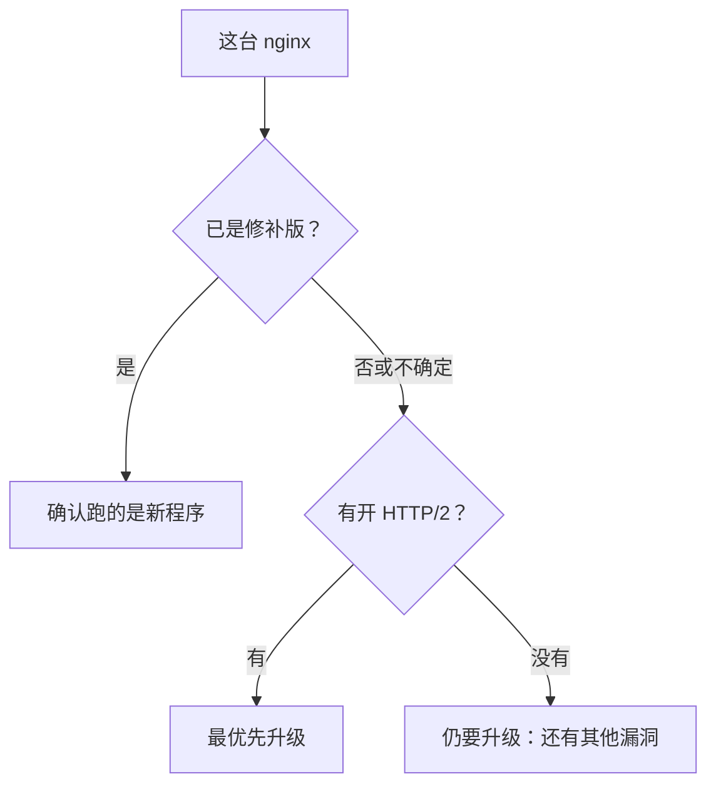
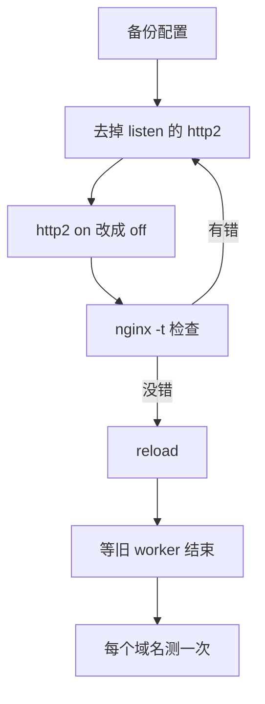

nginx 在 11 月 18 日修补了 HTTP/2 漏洞 **CVE-2026-123007**。网站开着 HTTP/2，无需登录的远程攻击者就可能让 nginx 的内存损坏，进而执行代码。

我整理了确认版本与配置的命令，也用官方 Docker 镜像确认了一个容易漏掉的步骤：升级后只 reload，旧程序会继续服务。

> 内容依据 nginx 官方安全公告、F5 写在 CVE 记录中的说明、CERT-EU 与三个研究团队的文章，查证日期是 2026-11-22（台北时间）。利用状态与修补版本会变动，以官方最新信息为准。
{: .prompt-info }

我会先用这张图判断有多紧急：



“修补版”包含发行版已修补的软件包，判断方式在后面。不是管理服务器的人，可以把这篇交给运维人员，后面的命令需要 root 权限。

## 11 月 18 日的更新修了 10 个问题，HTTP/2 这个最紧急

nginx 在 2026-11-18 同时发布 1.31.9 与 1.30.7。1.31.9 属于 mainline，也就是功能较新的分支；1.30.7 属于只收修复的 stable 分支。

1.31.9 修了 10 个安全问题，1.30.7 修了其中 9 个，少的那个只影响 1.31.x。

CVE-2026-123007 影响 1.9.5 到 1.31.8。1.9.5 是 2015 年 9 月加入 HTTP/2 的版本，所以开过 HTTP/2 的 nginx 几乎都在范围内。

严重程度有三个来源。F5 是 nginx 的母公司，也是这个 CVE 的编号机构；CVSS 是常见的漏洞评分标准，3.1 与 4.0 是两个版本：

| 来源 | 评分 |
| --- | --- |
| [nginx 官方公告](https://nginx.org/en/security_advisories.html) | major（nginx 自己的分级，分为 major、medium、minor） |
| [F5 在 CVE 记录中给的 CVSS 3.1](https://www.cve.org/CVERecord?id=CVE-2026-123007) | 8.1，High |
| F5 在 CVE 记录中给的 CVSS 4.0 | 9.2，Critical |

[NVD](https://nvd.nist.gov/vuln/detail/CVE-2026-123007) 截至 2026-11-22 没有自己的评分，只引用 F5 的分数。所以看到 8.1 和 9.2 两个数字，差别在评分版本，不是两个机构看法不同。

利用状态我分三件事看：

| 项目 | 状态 | 来源 |
| --- | --- | --- |
| 公开的概念验证程序 | 已有，2026-11-18 公开 | [Rapid7](https://www.rapid7.com/blog/post/ve-cve-2026-123007-critical-nginx-http-2-integer-underflow-leads-to-rce-fixed/) |
| 在野利用的报告 | 尚无（2026-11-18 的说法） | [CERT-EU](https://www.cert.europa.eu/publications/security-advisories/2026-022/) |
| CISA 已知被利用漏洞清单（KEV） | 未列入（2026-11-20 版） | [CISA KEV](https://www.cisa.gov/known-exploited-vulnerabilities-catalog) |

概念验证程序（PoC）是证明漏洞能被利用的示例程序，这篇不附链接。没列入 KEV 只代表 CISA 还没确认有人利用，不代表没有人在尝试。

### 研究人员写出的利用门槛不低

据 Rapid7 的说明，他们的演示要发送约 128 GB 的 HTTP/2 数据。网络慢于约 300 Mbit/s 时，在 nginx 默认的一小时连接时限内发不完。HTTP/2 中途经过其他代理再转发的话，攻击多半也无法成功。

ASLR 是让程序每次加载时内存地址都不同的防护。F5 说，要在 ASLR 关闭或被绕过时才能执行代码。[Wiz](https://www.wiz.io/blog/nginx-http2-rce-vulnerabilities) 则说 ASLR 挡不住这次的问题，他们在只提供静态文件的普通服务器上演示了远程代码执行。

我判断门槛不低，但 PoC 已经公开，攻击者只要找到开着 HTTP/2 的主机就能尝试。所以我会把它当成要马上处理的漏洞。

## HTTP/2 流量控制算错，worker 的内存被写坏

HTTP/2 用流量控制限制每条连接能传多少数据。接收端会告诉发送端自己还能收多少，这个额度叫作窗口（window）。

据 Rapid7 的说明，攻击者能让 nginx 算错“客户端还允许它发送多少响应数据”。F5 说，窗口可能超过允许的上限，造成 heap buffer overflow，也就是写到分配范围以外的内存。

出问题的是 worker。nginx 由一个 master 进程读取配置、管理 worker，实际处理连接的是 worker。master 通常以 root 运行，worker 以 `nginx`、`www-data` 这类普通账号运行。

据 [Xint](https://xint.io/blog/nginx2root-remote-code-execution) 的说明，攻击成功时，命令以 worker 的权限执行。Xint 另外把它和一个 Linux 内核漏洞串联起来，从 Docker 容器里的 nginx 获取了 root。所以我不会把“worker 不是 root”当成可以晚点处理的理由。

## 先查三件事：版本、HTTP/2 配置、正在跑的程序

以下命令给管理 nginx 主机的人用，需要 root 权限。

### 1. 版本：用发行版软件包时，看软件包版本号

```sh
nginx -v
nginx -V 2>&1 | grep -o with-http_v2_module
```

第一行显示上游版本。第二行确认可执行文件有没有编入 HTTP/2 模块，没有输出就代表没有编入，这次的 HTTP/2 漏洞碰不到它。nginx 源码默认不编入这个模块，但 nginx.org 与 Debian 的软件包都有编入。

自行编译或使用 nginx 官方软件包、官方 Docker 镜像时，版本到 1.30.7 或 1.31.9 以上就已修补。

用发行版软件包时，`nginx -v` 不准。发行版常把修复应用到旧版软件包，这叫作 backport，上游版本号不会变。最明显的例子是 Debian unstable：软件包 `1.30.6-4` 已修补，但 1.30.6 在 nginx 官方公告里属于受影响版本。

我在 Debian 12 的容器里装到的是已修补的 `1.22.1-9+deb12u11`，`nginx -v` 只显示 1.22.1。

先查软件包版本号，根据系统选一行执行：

```sh
dpkg -l | grep nginx
rpm -qa | grep nginx
apk info -v | grep nginx
```

第一行用于 Debian、Ubuntu，第二行用于 RHEL 系列，第三行用于 Alpine。再对照发行版公告，下表是几个常见版本第一个包含修补的软件包：

| 发行版 | 已修补的软件包版本 | 公告 |
| --- | --- | --- |
| Debian 12 bookworm | `1.22.1-9+deb12u11` | [DLA-4918-1](https://security-tracker.debian.org/tracker/CVE-2026-123007) |
| Debian 13 trixie | `1.26.3-3+deb13u11` | [DSA-6642-1](https://security-tracker.debian.org/tracker/CVE-2026-123007) |
| Ubuntu 22.04 jammy | `1.18.0-6ubuntu14.23` | [USN-9159-1](https://ubuntu.com/security/CVE-2026-123007) |
| Ubuntu 24.04 noble | `1.24.0-2ubuntu7.20` | [USN-9159-1](https://ubuntu.com/security/CVE-2026-123007) |
| RHEL 9 | `nginx-1.20.1-32.el9_9.2` | [RHSA-2026:100748](https://access.redhat.com/security/cve/CVE-2026-123007) |
| RHEL 10 | `nginx-1.26.3-16.el10_3.3` | [RHSA-2026:100744](https://access.redhat.com/security/cve/CVE-2026-123007) |
| Alpine 3.22、3.23 | `1.28.3-r8` | [Alpine secdb](https://secdb.alpinelinux.org/v3.23/main.json) |
| Alpine 3.24 | `1.30.7-r0` | [Alpine secdb](https://secdb.alpinelinux.org/v3.24/main.json) |

RHEL 9 与 RHEL 8 的 nginx 模块流（module stream）另有各自的公告，用 `dnf module` 安装的人要看 Red Hat 的完整清单。Ubuntu 16.04、18.04、20.04 的修补要有 Ubuntu Pro 才能收到。

### 2. HTTP/2 配置：每个 server 块都要看

```sh
sudo nginx -T 2>/dev/null | grep -E '^# configuration file|http2'
```

`nginx -T` 会把主配置文件和所有 `include` 进来的文件一起输出。这行只留下文件名与含 `http2` 的行，读的时候注意两种写法：

- `listen 443 ssl http2;`：旧写法，1.25.1 起标记为弃用，但仍然有效。
- `http2 on;`：1.25.1 起的新写法，可以写在 `server` 块，也可以写在 `http` 块让所有 server 继承。

两种写法的作用范围不同。我用官方 Docker 镜像试了四种配置：

| 配置 | 结果 |
| --- | --- |
| 同一个端口上，A 写 `http2 on;`，B 写 `http2 off;` | 连 A 走 HTTP/2，连 B 走 HTTP/1.1 |
| 同一个端口上，A 写 `listen ... http2`，B 写 `http2 off;` | A 和 B 都走 HTTP/2 |
| 同一个 server 写 `listen ... http2`，又写 `http2 off;` | 仍走 HTTP/2 |
| 明文的 80 端口写 `http2 on;` | 客户端直接发送 HTTP/2 时会被接受 |

所以判断有没有开 HTTP/2，要以“地址加端口”为单位。TLS 连接时，客户端会用 SNI 告诉服务器要连接哪个域名。同一个端口上只要有一个 server 开着，攻击者就能在 SNI 指定那个名称，走到 HTTP/2。

从外部确认时，每个域名各测一次：

```sh
curl -s --http2 -o /dev/null -w '%{http_version}\n' https://example.com/
curl -s --http2-prior-knowledge -o /dev/null -w '%{http_version}\n' http://example.com/
```

把 `example.com` 换成实际域名。第一行测 HTTPS，第二行测明文连接。输出 `2` 代表接受 HTTP/2；输出 `1.1`，或第二行失败输出 `0`，代表没有。这只测得到你指定的名称，所以配置文件仍是主要依据。

### 3. 正在跑的程序：`nginx -v` 看的是磁盘上的文件

```sh
sudo ls -l /proc/$(cat /run/nginx.pid)/exe
```

输出结尾出现 `(deleted)`，代表磁盘上的可执行文件已经换掉，但正在服务的还是旧程序。Alpine 的 pid 文件在 `/run/nginx/nginx.pid`，其他系统可以从 `nginx -V` 输出里的 `--pid-path=` 找到位置。这个检查用的是 Linux 的 `/proc`。

## 升级后要重启，只 reload 不够

nginx 官方只为两个分支发布修补，更旧的分支要换到其中之一，或改用发行版的修补软件包：

| 你用的版本 | 升级到 |
| --- | --- |
| nginx stable（1.30.x） | 1.30.7 以上 |
| nginx mainline（1.31.x） | 1.31.9 以上 |
| NGINX Plus 37.0.x | 37.0.8.1 以上 |
| NGINX Plus 37.1 以后 | 37.3.0.1 以上 |
| 发行版软件包 | 上一节表格中的版本 |

NGINX Plus 的版本号取自 F5 的 CVE 记录。F5 的记录也把 R33 以后的 R 系列列为受影响，但没有列出 R 系列的修补版本。

1.31.9 另外开始拒绝没有冒号的头部行，以及分块开销过大的 chunked 请求体。1.30.7 只有安全修复，用 stable 的人升级时不会碰到这些行为变更。

### reload 不会换掉可执行文件

我在 1.30.6 的官方镜像里，把磁盘上的可执行文件换成 1.30.7，模拟软件包升级。然后看每一步之后，实际响应连接的版本：

| 步骤 | `nginx -v` | 响应头里的版本 | `/proc/<pid>/exe` |
| --- | --- | --- | --- |
| 换掉可执行文件后 | 1.30.7 | 1.30.6 | `(deleted)` |
| 再执行 `nginx -s reload` | 1.30.7 | 1.30.6 | `(deleted)` |
| 重启后 | 1.30.7 | 1.30.7 | 正常 |

reload 只让 master 重新读取配置、换一批 worker。master 本身还是旧的可执行文件，新的 worker 也是从它派生出来的。Xint 的文章也写明，只 reload 配置不会换掉正在运行的程序。

软件包升级时会不会自动处理，要看软件包。nginx.org 的 [deb](https://github.com/nginx/pkg-oss/blob/master/debian/debian/nginx.postinst) 与 rpm 软件包会尝试不停机换掉可执行文件，失败时只输出一行信息，软件包升级仍算成功。所以不管软件包怎么做，我都会在升级后用前面的 `/proc` 检查确认。

确认配置无误后重启：

```sh
sudo nginx -t
sudo systemctl restart nginx
```

Alpine 这类使用 OpenRC 的系统，第二行改成：

```sh
sudo rc-service nginx restart
```

重启会让现有连接中断一下。不能中断的服务，nginx 文档有[不停机更换可执行文件](https://nginx.org/en/docs/control.html#upgrade)的做法。重启后再跑一次 `/proc` 检查，结尾不应该再有 `(deleted)`。

用容器运行 nginx 时，要换成新版镜像，例如 `nginx:1.30.7`，再重新部署。重启同一个旧镜像的容器不会更新。

F5 的 NGINX Ingress Controller、NGINX Gateway Fabric 等产品也内含 nginx，[NVD](https://nvd.nist.gov/vuln/detail/CVE-2026-123007) 把它们列在受影响清单里，要看 F5 的公告。

Kubernetes 社区的 ingress-nginx 已在 2026 年 3 月停止维护，用它的人要看自己所用分支或云服务商的公告。

## 暂时不能升级：去掉 listen 的 http2，也要设置 http2 off

CERT-EU、Xint 与 Wiz 都建议，不能马上升级时先关闭 HTTP/2。这只挡住两个 HTTP/2 漏洞：CVE-2026-123007 与 CVE-2026-123633。F5 的 CVE 记录在缓解措施一栏写的是 None，所以这只是争取时间的做法。

CERT-EU 写的是“去掉 `listen` 的 `http2`，或设置 `http2 off;`”。但前面的测试显示**两件事都要做**。只要还有一行 `listen ... http2`，`http2 off;` 就没有作用。Xint 与 Wiz 的写法也是两者都要。

改完的 server 块像这样：

```nginx
server {
    listen 443 ssl;    # 去掉原来的 http2
    http2 off;         # 原来是 http2 on;
    # 其他配置不变
}
```

1.25.0 以前的版本没有 `http2` 指令，只要去掉 `listen` 的 `http2`。修改范围要涵盖：

- 同一个地址与端口上的每个 server 块，包括 default server。
- `http` 块里的 `http2 on;`，它会被所有 server 继承。
- 80 端口这类明文 listener 上的 `http2 on;`。

完整流程如下：



这里用 reload 就够了，因为只改配置、没换可执行文件：

```sh
sudo nginx -t
sudo nginx -s reload
```

但已经建立的 HTTP/2 连接，会留在旧的 worker 上直到连接结束。nginx 默认一条连接最长可以保持一小时。用这行看还有没有旧 worker：

```sh
ps -eo pid,args | grep '[w]orker process is shutting down'
```

有输出就代表旧 worker 还在处理旧连接。不想等的话，改用前面的命令重启。旧 worker 都结束后，用“先查三件事”里的 `curl` 命令对每个域名各测一次，HTTPS 都要输出 `1.1`。

关闭 HTTP/2 有两个副作用要先确认：

- **gRPC 会失效。** gRPC 构建在 HTTP/2 之上，用 `grpc_pass` 提供 gRPC 服务的主机，客户端会连不上。
- **HTTP/3 不受影响，也没被保护。** HTTP/3 有自己的漏洞 CVE-2026-121810，关闭 HTTP/2 挡不住它。

一般浏览器会自动改用 HTTP/1.1。升级完成后，记得把 HTTP/2 重新打开。

## 没开 HTTP/2 也要升级：同一批还有其他漏洞

没开 HTTP/2 的主机，CVE-2026-123007 碰不到，但同一批还修了其他问题。[CERT-EU](https://www.cert.europa.eu/publications/security-advisories/2026-022/) 认为，其中包括 CVE-2026-123007 在内的五个，可能让无需登录的远程攻击者执行代码。

下表根据 [nginx 官方公告](https://nginx.org/en/security_advisories.html)整理，“涉及的功能”取自公告的标题：

| CVE | 问题 | nginx 分级 | 涉及的功能 |
| --- | --- | --- | --- |
| CVE-2026-123633 | use-after-free | medium | HTTP/2 反向代理 |
| CVE-2026-121810 | use-after-free | medium | HTTP/3 |
| CVE-2026-123634 | use-after-free | medium | `resolver` |
| CVE-2026-113425 | use-after-free | major | mail 代理 |
| CVE-2026-118899 | 无限循环 | major | 通过 TLS 1.3 读取请求体 |
| CVE-2026-125283 | buffer overflow | minor | `alias` 搭配 `try_files` |
| CVE-2026-120967 | SNI 绕过 | medium | stream 模块的客户端证书验证 |
| CVE-2026-123640 | 验证不足 | minor | stream 模块的 `ssl_preread` |
| CVE-2026-120993 | NULL pointer | minor | PROXY protocol v2，只影响 1.31.4 到 1.31.8 |

use-after-free 是程序继续使用已经释放的内存。

表中第一行要特别注意。nginx 分级是 medium，但 F5 给的 CVSS 和 CVE-2026-123007 一样是 8.1 与 9.2。据 F5 的说明，它在反向代理到后端、而且 worker 的连接数快用完时触发。

nginx 官方公告上，CVE-2026-121810 目前显示成“CVE-CVE-2026-121810”，链接也因此失效，查询时要用正确的编号。

还停在 1.31.7、1.30.6 以前的话，这次升级也会一并修掉 10 月 14 日公布的 5 个问题。这些漏洞各有条件，我不会逐条判断能不能跳过，而是直接升级。

## 日志里的 worker 崩溃，不等于已被入侵

CERT-EU 建议监控 worker 崩溃，error log 会出现这样的记录：

```sh
sudo grep 'exited on signal' /var/log/nginx/error.log
```

匹配的行类似 `worker process 165 exited on signal 11`。CERT-EU 也说，这不是成功执行代码的高可信度指标，更可能是有人在尝试；Xint 则提醒，worker 也可能因为与攻击无关的原因崩溃。

据 Xint 的说法，最明确的迹象是 worker 启动了其他程序。nginx 的 worker 平常不会启动其他程序，用这行列出 worker 目前的子进程：

```sh
ps --ppid "$(pgrep -d, -P "$(cat /run/nginx.pid)")" -o pid,user,args
```

只输出标题行就代表目前没有。这只看得到现在，过去的记录要看 auditd 或终端安全工具的进程创建日志。Xint 也提醒，这类攻击在 access log 里可能只留下很少痕迹。

主机曾对外开着 HTTP/2、又跑着受影响的版本，而且查到可疑的子进程时，我会把它当成已遭入侵处理：

1. 限制对外连接，保留日志与磁盘快照。
2. 从可信的干净镜像重建主机。
3. 从干净的环境撤换 worker 读得到的凭证、API token 与密码。

TLS 私钥我也会一起换。worker 要处理 TLS 连接，私钥就在它的内存里，这是我的推论。修补只能挡住之后的攻击，不会清掉已经留下的东西。

## 版本对了，还要确认跑的是新程序

这次最容易出错的地方，是软件包升级了、`nginx -v` 也显示新版，旧程序却还在服务。升级后我会看 `/proc` 确认。

同样是“软件包更新了、旧服务还在跑”，我在 [OpenSSH 密码验证绕过漏洞 CVE-2026-123158：Alpine 怎么修补](/posts/openssh-musl-password-bypass-alpine/)也遇到过，那次是 sshd 没重启。

## 主要来源

- [nginx 安全公告](https://nginx.org/en/security_advisories.html)：每个 CVE 的分级与受影响版本
- [nginx 1.31.9 变更记录](https://nginx.org/en/CHANGES)与 [1.30.7 变更记录](https://nginx.org/en/CHANGES-1.30)
- [CVE-2026-123007 记录](https://www.cve.org/CVERecord?id=CVE-2026-123007)：F5 的说明、CVSS 与 NGINX Plus 版本号
- [NVD 上的 CVE-2026-123007](https://nvd.nist.gov/vuln/detail/CVE-2026-123007)：受影响的 F5 产品清单
- [CERT-EU 2026-022](https://www.cert.europa.eu/publications/security-advisories/2026-022/)：利用状态、缓解方式与日志监控
- [加拿大网络安全中心 AV26-1174](https://www.cyber.gc.ca/en/alerts-advisories/f5-security-advisory-av26-1174)：F5 公告摘要
- [Rapid7 的分析](https://www.rapid7.com/blog/post/ve-cve-2026-123007-critical-nginx-http-2-integer-underflow-leads-to-rce-fixed/)：利用条件与实际限制
- [Wiz 的分析](https://www.wiz.io/blog/nginx-http2-rce-vulnerabilities)：两个 HTTP/2 漏洞与 NGINX Plus 版本号
- [Xint 的 nginx2root](https://xint.io/blog/nginx2root-remote-code-execution)：检查方式、缓解与入侵迹象
- [nginx http2 指令说明](https://nginx.org/en/docs/http/ngx_http_v2_module.html)与[进程控制说明](https://nginx.org/en/docs/control.html)
- 发行版公告：[Debian](https://security-tracker.debian.org/tracker/CVE-2026-123007)、[Ubuntu](https://ubuntu.com/security/CVE-2026-123007)、[Red Hat](https://access.redhat.com/security/cve/CVE-2026-123007)
- [CISA KEV 清单](https://www.cisa.gov/known-exploited-vulnerabilities-catalog)
