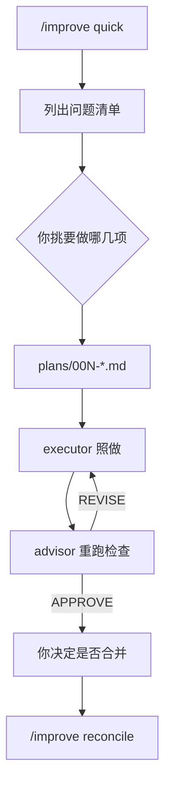

把“这个项目哪里要改”丢给 coding agent，常会拿回一张长清单，哪些该改、怎么验证还得自己判断。

[shadcn/improve](https://github.com/shadcn/improve) 让能力较强的模型读代码、写计划，再交给较便宜的模型执行。我用它在示例项目中生成四份计划、执行其中两份。各步骤的实际输出和 token 用量也一并附上。

> 依据 shadcn/improve 的 README、SKILL.md 与 `references/` 下的三份文档，查证与实测都在 2026-11-22（台北时间）。我安装的是 commit `cac56e1`（2026-09-12），SKILL.md 标注 `version: "1.0.0"`。
{: .prompt-info }

## advisor 写计划，executor 照着改

improve 是 shadcn 写的 agent skill，也就是 agent 照着执行的说明。它没有程序，只有一份 SKILL.md 和三份 Markdown 参考文档，把工作分给两个角色：

- **advisor**（出主意）：就是你在 agent 里正在用的模型。它读代码、列问题、写计划，除了 `plans/` 文件夹什么都不能改。
- **executor**（动手）：执行 `execute` 时派出的 subagent，也就是主 agent 另外开来做单一任务的 agent。它在独立的 git worktree 里照计划修改，worktree 是同一个 repo 的另一份工作目录。默认用 Sonnet，也可以指定其他模型。



improve 本身不调用任何 API。两个角色都跑在你的 agent 里，用的是你自己的订阅额度或 API 用量。

SKILL.md 把理解代码、确定优先级和写计划交给能力较强的模型。这次我选了 Opus 5.5 当 advisor。

这篇照 README“How to use”一节的顺序走完一轮。README 的用法清单还列了这几种：

| 命令 | README 的说明 |
| --- | --- |
| `/improve security` | 只审查安全这一类，也可以换成 perf、tests、bugs 等 |
| `/improve next` | 建议功能，也就是项目接下来可以往哪里走 |
| `/improve plan <描述>` | 跳过审查，直接为一件事写计划 |
| `/improve review-plan <文件>` | 审视并收紧一份现有的计划 |

## 准备一个埋了问题的示例项目

我写了一个叫 `bookmarks-api` 的书签服务，需要 Node.js 22 以上，没有依赖包。程序只有 4 个源文件、约 150 行，测试只有 1 个。

里面故意埋了四个问题：

| 埋的问题 | 位置 |
| --- | --- |
| 下载备份时先解码文件名再 `join()`，`..%2F` 可以读到文件夹外的文件 | `src/server.js` |
| 分页用 `page * pageSize` 算起点，但页码从 1 开始，第 1 页会跳过前 20 条 | `src/store.js` |
| 导入只检查 `new URL()` 能不能解析，`javascript:` 网址也能导入 | `src/import.js` |
| 请求内容不是合法的 JSON 时返回 500，而不是 400 | `src/server.js` |

我在 ADR（架构决策记录）`docs/adr/0001-json-file-storage.md` 里写明，这个项目刻意让每个请求都用同步 API 读写 JSON 文件。我想看 advisor 能不能辨认出这是设计上的取舍。

项目提交成 commit `acf5380`，推到本地一个 bare repo（只有 git 历史、没有工作目录的 repo）当作 `origin`。Claude Code 用下面的命令启动：

```bash
claude --model opus --permission-mode auto
```

这次实测的环境和模型：

| 项 | 版本或设置 |
| --- | --- |
| 操作系统 | macOS |
| Node.js | 25.2.1 |
| Claude Code | 2.1.330，effort 用默认的 medium，权限模式 auto |
| 安装工具 | `skills` 1.9.0 |
| advisor | `claude-opus-5-5`（Claude Code 主 session） |
| executor | `claude-sonnet-5-5`、`claude-haiku-5-5`（由 skill 派出） |

后面的终端截图是把录下的画面文字排成图片，除了下面几处，其余都是原始输出：

- 去掉 Claude Code 启动时的头部信息。
- 主目录路径写成 `~`。
- 一段含临时路径的命令缩短成 `…`。
- 安装画面的提示符缩成 `$`。
- `⋮` 表示省略的段落，黄底是我加的标注。

## 步骤一：安装 skill

```bash
npx skills add shadcn/improve
```

`skills` 是安装 [Agent Skills](https://agentskills.io) 格式的命令行工具，直接运行会问你要装给哪个 agent。我固定了版本并指定 agent，让它不必再问。`DISABLE_TELEMETRY=1` 则关掉它的使用统计：

```bash
DISABLE_TELEMETRY=1 npx -y skills@1.9.0 add shadcn/improve --skill improve --agent claude-code -y
```

{: w="1099" h="1087" }
_skill 被复制到项目的 .claude/skills/improve（实际输出）_

安装工具会在项目根目录写一份 `skills-lock.json`，记下来源、commit 和文件哈希。这个 repo 没有发布 GitHub Release。要确认实际安装的内容，可以查这里的 `commit`。

```json
{
  "version": 2,
  "skills": {
    "improve": {
      "source": "shadcn/improve",
      "commit": "cac56e1ebd3c279aa9153616cfeac7b174ab90f9",
      "sourceType": "github",
      "skillPath": "skills/improve/SKILL.md",
      "computedHash": "9e8fe9ea4f9a0e4155801d1624e38ca23798467bb88b447efaa5120f7b1fe802"
    }
  }
}
```

输出最后一行提醒，skill 拥有和 agent 一样的权限。improve 只有四份 Markdown、没有脚本，装之前花几分钟读完就好。[装了第三方 skill 和 MCP 之后，你的 Coding Agent 多了哪些破口？](/posts/coding-agent-supply-chain-permission-risks/)整理了这类风险。

## 步骤二：用 `/improve quick` 列出问题

在 Claude Code 里输入：

```text
/improve quick
```

`quick` 是三种审查深度里最便宜的一种。SKILL.md 的设置如下：

| | `quick` | `standard`（默认） | `deep` |
| --- | --- | --- | --- |
| 范围 | 最常改、最关键的热点 | 热点加主要的包 | 整个 repo |
| subagent | 0 到 1 个 | 最多 4 个同时运行 | 最多 8 个同时运行 |
| 类别 | 正确性、安全、测试 | 全部 9 类 | 全部 9 类 |
| 列出的问题 | 约前 6 项，只列高置信度的 | 完整表格 | 完整表格，含低置信度的待查项 |

{: w="1099" h="887" }
_它读完所有文件、跑了测试，再对真实的服务器复现问题（实际输出）_

项目很小，它没有派 subagent，自己读完全部代码。接着它用临时数据库启动服务器，逐一复现每个问题。

{: w="1099" h="1689" }
_五个问题、一个被排除的项，以及这次没审查的范围（实际输出）_

四个埋的问题都找到了，每一项都附上 `file:line`。能从 API 复现的，它也附上实际结果，例如 `GET /exports/..%2Fpackage.json` 返回 200。

第 4 项还多了一个我没刻意埋的问题。文件不存在时，500 的错误消息会带出服务器的绝对路径。第 5 项是测试太少，它建议不另写计划，改由每份计划自带测试。

诱饵没有骗到它。ADR 写明的同步写文件列在“Rejected”，它认出那是刻意的选择。

输出最后列出 quick 模式没看的范围，包括性能、文档，以及写文件写到一半崩溃造成的数据丢失。

表格没有置信度这一栏。SKILL.md 要求每个问题都评估置信度，但它规定的表格栏位本来就不含这一栏，置信度只用来排序。

## 步骤三：挑出要做的项，读计划

回复要做哪几项：

```text
plan 1, 2, 3 and 4
```

{: w="1099" h="1511" }
_四份计划加一份索引，都写在 plans/，源代码没有改动（实际输出）_

导入需要复用 API 的 `validateBookmark`。advisor 把修正这个验证函数的工作排成计划 `003`，再把导入验证排成计划 `004`。下表对照审查时的问题编号与写成计划后的编号。

| 问题 | 计划 |
| --- | --- |
| 1：下载备份的路径穿越 | `001-block-export-path-traversal.md` |
| 2：分页跳过第一页 | `002-fix-pagination-off-by-one.md` |
| 4：错误输入返回 500 | `003-return-400-for-bad-input.md` |
| 3：导入没套用验证 | `004-validate-imported-bookmarks.md` |

SKILL.md 说“计划才是产品”（The plan is the product）。计划是写给“另一个能力较弱、对这个 session 一无所知的模型”看的。001 有 219 行，开头先说明执行规则与漂移检查：

```markdown
> **Executor instructions**: Follow this plan step by step. Run every
> verification command and confirm the expected result before moving to the
> next step. If anything in the "STOP conditions" section occurs, stop and
> report — do not improvise. When done, update the status row for this plan
> in `plans/README.md` — unless a reviewer dispatched you and told you they
> maintain the index.
>
> **Drift check (run first)**: `git diff --stat acf5380..HEAD -- src/server.js test/exports.test.js`
> If any in-scope file changed since this plan was written, compare the
> "Current state" excerpts against the live code before proceeding; on a
> mismatch, treat it as a STOP condition.
```

漂移检查比对的是计划写成时的 commit。代码在那之后若有改动，executor 要先核对计划引用的代码片段，对不上就停下来。

范围和停止条件写得很具体。下面节选同一份计划的两段：

```markdown
**Out of scope** (do NOT touch):
- The generic `catch` block at lines 44–46 — another plan (003) changes it. Leave it as is.
- The `/bookmarks` routes, `src/store.js`, `src/validate.js`, `src/import.js`.

## STOP conditions

Stop and report back (do not improvise) if:

- `src/server.js` does not match the excerpts above (drift).
- Test 2 returns 404 before your change (someone already fixed it differently).
- Making a test pass seems to need changes to the generic `catch` block (lines 44–46) — that belongs to plan 003.
```

其余段落依次是：

- **现状**：贴出要改的代码原文和行号。
- **步骤**：先写会失败的测试，再修改。每一步都附验证命令和预期结果。
- **完成条件**包含可执行的验证命令。例如用搜索命令确认 `decodeURIComponent` 只出现在新函数里。
- **Git 流程**：分支名称 `advisor/001-block-export-path-traversal` 和 commit 信息。

`plans/README.md` 是所有计划的索引：

```markdown
| Plan | Title | Priority | Effort | Depends on | Status |
|------|-------|----------|--------|------------|--------|
| [001](001-block-export-path-traversal.md) | `GET /exports/:file` only serves files directly inside `exports/` | P1 | S | — | TODO |
| [002](002-fix-pagination-off-by-one.md) | `GET /bookmarks?page=1` returns the first 20 bookmarks | P1 | S | — | TODO |
| [003](003-return-400-for-bad-input.md) | Bad request bodies return 400; 500s stop leaking details | P2 | S | 001 (same file) | TODO |
| [004](004-validate-imported-bookmarks.md) | Imported bookmarks pass the same validation as the API | P2 | S | 003 | TODO |
```

计划 `004` 要把 `importFromFile` 的返回值从数字改成 `{ imported, skipped }`。执行前要先确认是否接受这个改动。如果还有其他调用方，executor 会按计划停下来汇报。

## 步骤四：用 `/improve execute` 交给便宜的模型

```text
/improve execute 001
```

{: w="1099" h="776" }
_先运行漂移检查，再派 Sonnet 5.5 到独立的 worktree 执行（实际输出）_

advisor 先自己运行一次漂移检查，结果是 `DRIFT-OK`。接着派出一个 subagent，画面上标注的模型是 Sonnet 5.5。`plans/` 还没提交，worktree 里读不到，所以计划内容要直接贴进 subagent 的提示词里。

closing-the-loop.md 要求贴上计划全文。我比对了对话记录，001 和 002 贴进去的都是 advisor 精简过的版本。

以 001 为例，长度从 10,599 字节缩成 7,946 字节。“Test plan”和“Maintenance notes”两节不见了，其余各节也都改写得更短。

步骤、完成条件和停止条件都还在。但 executor 照做的内容，和你读过的计划文件不完全相同。

executor 在 `.claude/worktrees/` 下自己的 worktree 工作，不会动到你的工作目录。worktree 的原理见 [git worktree 教程：让两个 AI 在同一个 repo 分开工作](/posts/git-worktree-parallel-ai-agents/)。

executor 花了 46 秒完成。advisor 没有直接采信它的报告，而是自己在 worktree 里验收：

{: w="1099" h="1221" }
_advisor 重跑完成条件、检查范围、读过 diff 和测试后才批准（实际输出）_

它照 `references/closing-the-loop.md` 的四项检查走：

1. 重跑每一条完成条件。
2. 确认只改了范围内的文件。
3. 读完整个 diff，对照计划要解决的问题。
4. 读新测试实际断言了什么，避免测试通过却什么都没测。

executor 汇报了三处偏离计划的地方，其中一项是计划自己写错。计划预期 `%2E%2E` 的测试在修改前会失败，但 Node 的 URL 解析器会先处理掉它，修改前就已经返回 404。

executor 还跳过了一次中途测试，修复与测试的 commit 顺序也和计划相反。advisor 在最终验收时重新运行了测试。

closing-the-loop.md 规定，有说明的偏离要看理由判断，不是一律驳回。这次 advisor 判定三项都不影响结果，给了 APPROVE。

APPROVE 之后，它把索引的状态改成 DONE。它没有合并，也没有 push，合并由你决定。

第二份计划指定给 Haiku：

```text
/improve execute 002 haiku
```

{: w="1099" h="1177" }
_Haiku 5.5 执行 30 秒，advisor 另外确认 001 和 002 的分支能一起合并（实际输出）_

Haiku 花 30 秒做完，同样拿到 APPROVE。这次 advisor 多做了一件事，用 `git merge-tree` 确认 001 和 002 两个分支一起合并不会冲突。

我另外查了 Claude Code 的对话记录。两个 executor 实际使用的模型分别是 `claude-sonnet-5-5` 和 `claude-haiku-5-5`，与画面上的标注一致。

## 步骤五：合并前用 `/improve branch` 再看一次

`APPROVE` 表示 advisor 验收通过。合并前，可以直接在 executor 的 worktree 里开启一个新 session 做分支审查。

我这次在原来的工作目录切到 001 的分支做审查。Git 默认同一个分支一次只能在一个 worktree 里 checkout，所以我先移除了 001 的 worktree，也一并清理了 002 的。worktree 的目录名每次都不同，可以用下方第一个命令查。

```bash
git worktree list
git worktree remove .claude/worktrees/agent-ac299380af963eaff
git worktree remove .claude/worktrees/agent-ac8a3882939c9f9e3
git switch advisor/001-block-export-path-traversal
```

开一个新的 Claude Code session，执行：

```text
/improve branch
```

`branch` 只审查这个分支改过的文件，以及调用这些文件的代码。每个问题会标注是这个分支带进来的（`introduced`），还是原本就有的（`pre-existing`）。

{: w="1099" h="1956" }
_路径穿越修好了，但它找到一个修复没覆盖的情况（实际输出）_

分支审查确认原来的路径穿越已修复，8 个测试全部通过。第 2 项的标签是 `introduced (the fix is incomplete)`。它指出一个修复未覆盖的例外，有些无效文件名仍会收到 500 响应，消息里也会带出服务器的绝对路径。

计划 001 验收时检查过类似的路径泄露。我认为这体现了两次审查的差异，验收侧重计划列出的条件，分支审查则从这次改动出发，找出计划和测试漏掉的情况。

它建议把第 1 项写成新的计划 005，第 2 项并入计划 003，并问你要把哪些写成计划。

我选择先合并 001 和 002。这次示例服务只在本地运行，advisor 把第 2 项评为低影响。第 1 项的新计划留到下一轮。

计划 003 已包含把 500 的错误消息改成通用消息，可以处理这次看到的路径泄露。这个例外应返回哪个状态码，则是分支审查建议另外处理的部分。

## 步骤六：合并之后用 `/improve reconcile` 整理清单

合并两个分支、运行测试，再推送：

```bash
git switch main
git merge --no-ff --no-edit advisor/001-block-export-path-traversal
git merge --no-ff --no-edit advisor/002-fix-pagination-off-by-one
npm test
git push origin main
```

15 个测试全部通过。下一次开 session 时执行：

```text
/improve reconcile
```

{: w="1099" h="887" }
_两份计划验证完成，003 只有行号过期，在原文件更新（实际输出）_

reconcile 依索引里的状态分别处理：

| 状态 | reconcile 做什么 |
| --- | --- |
| DONE | 在当前的 HEAD 重跑便宜的完成条件 |
| BLOCKED | 查出卡住的原因，改写计划或标成 REJECTED |
| IN PROGRESS | 提醒你，executor 可能中途中断 |
| TODO | 运行漂移检查，必要时更新计划；问题已不存在就标成 REJECTED |

这次 001、002 在 `35fb742` 上重跑通过。004 的文件没动过，维持原样。

003 的代码被前面的合并往下推，行号过期了，但引用的片段还一字不差。所以它直接更新行号和漂移检查的基准 commit，并确认问题还在。

更新后的索引：

```markdown
| Plan | Title | Priority | Effort | Depends on | Status |
|------|-------|----------|--------|------------|--------|
| [001](001-block-export-path-traversal.md) | `GET /exports/:file` only serves files directly inside `exports/` | P1 | S | — | DONE — verified on `35fb742` (merged to `main`) |
| [002](002-fix-pagination-off-by-one.md) | `GET /bookmarks?page=1` returns the first 20 bookmarks | P1 | S | — | DONE — verified on `35fb742` (merged to `main`) |
| [003](003-return-400-for-bad-input.md) | Bad request bodies return 400; 500s stop leaking details | P2 | S | 001 ✓ | TODO — refreshed at `35fb742`, ready |
| [004](004-validate-imported-bookmarks.md) | Imported bookmarks pass the same validation as the API | P2 | S | 003 | TODO — no drift; waits for 003 |
```

它只改了 `plans/` 里的两个文件，没有提交。`plans/` 要不要纳入版本控制，由你决定。

## `--issues` 要明确加上才会开 issue

improve 可以把每份计划开成 GitHub issue，但只有加上 `--issues` 才会执行，例如：

```text
/improve quick --issues
```

按 closing-the-loop.md，它会依次做这些事：

1. 确认 `gh auth status` 成功，而且 repo 有 GitHub remote。
2. 用 `gh repo view --json visibility` 检查 repo 是否公开。公开的话，发布安全漏洞或凭证位置相关的计划前，要先取得你的确认。
3. 列出要创建的 issue 标题，问你一次。
4. 用 `gh issue create --body-file` 创建 issue，加上 `improve` 和类别标签，再把网址写回计划和索引。

像 001 这种路径穿越的计划，修好之前不该出现在公开 repo 的 issue 里。第 2 步的确认就是为了这个。

## 按 API 公开定价估算约 2.76 美元，advisor 占 93%

数字来自 Claude Code 存在本地的对话记录，也就是 `~/.claude/projects/` 下的 jsonl 文件。每条模型回复都有 `usage` 字段，同一条回复会写成好几行，我按消息 id 去重后加总。

价格用 2026-11-22 的 [Claude 定价](https://platform.claude.com/docs/en/about-claude/pricing)换算。缓存是把提示存起来，让后续调用便宜读回。未缓存的输入每个阶段只有几十个 token，表上省略。

| 阶段 | 模型 | 输出 | 写入缓存 | 读取缓存 | 定价换算 |
| --- | --- | ---: | ---: | ---: | ---: |
| quick | Opus 5.5 | 3,167 | 18,419 | 150,490 | $0.241 |
| plan 1, 2, 3 and 4 | Opus 5.5 | 21,785 | 24,813 | 265,124 | $0.687 |
| execute 001（advisor） | Opus 5.5 | 6,824 | 18,919 | 916,208 | $0.471 |
| execute 001（executor） | Sonnet 5.5 | 5,418 | 37,273 | 338,423 | $0.181 |
| execute 002（advisor） | Opus 5.5 | 5,522 | 14,190 | 697,471 | $0.364 |
| execute 002（executor） | Haiku 5.5 | 6,322 | 39,527 | 306,512 | $0.011 |
| branch | Opus 5.5 | 4,675 | 28,073 | 273,952 | $0.373 |
| reconcile | Opus 5.5 | 4,320 | 32,655 | 418,019 | $0.431 |
| 合计 | | | | | $2.759 |

换算用的定价（每百万 token，美元）：

| 模型 | 输入 | 写入缓存（5 分钟） | 写入缓存（1 小时） | 读取缓存 | 输出 |
| --- | ---: | ---: | ---: | ---: | ---: |
| Opus 5.5 | 4 | 5 | 8 | 0.20 | 20 |
| Sonnet 5.5 | 2 | 2.50 | 4 | 0.10 | 10 |
| Haiku 5.5（提示 10 万 token 以内） | 0.10 | 0.125 | 0.20 | 0.01 | 0.50 |

Sonnet 5.5 每个 token 的价格是 Opus 5.5 的一半。Haiku 5.5 的输入和输出只有 Opus 的 1/40。

Opus 的费用是 2.567 美元，包含初审、写计划、分配任务与验收，以及分支审查和合并后的检查。

Opus 费用最高的一项是写入缓存。记录里主 session 的缓存有效期是 1 小时，Opus 写入一百万 token 要 8 美元。单是 Opus 的缓存写入就约 1.10 美元，占总额约四成。

`branch` 和 `reconcile` 各开了新的 session。写入缓存约占这两个阶段合计费用的六成。

execute 001 里，Opus 这一段花了 $0.471，Sonnet 执行只花 $0.181。Opus 这一段包括派活、等待和审查，共跑了 11 次模型调用。

这 11 次调用的提示长度在 7.7 万到 9.1 万 token 之间，大部分从缓存读回。其中约 7 万 token 在进入这个阶段前就已存在。它们是系统提示词、skill 内容，以及 quick 和 plan 两个阶段的对话。

这组数字有三个限制：

- Sonnet 和 Haiku 执行的是不同的计划，两者的费用不能直接比较。
- 这只是一次执行。缓存有效期由 Claude Code 决定，这次主 session 用 1 小时，subagent 用 5 分钟。
- 用订阅套餐的人不会收到这张账单，花的是套餐额度。换算成定价只是为了比较各角色的分量。

这次执行的两份计划都估为 S（S/M/L 里最小的一级）。我推测工作量较大的计划可能更适合这样分工。要验证能省多少，得让 Opus 单独完成相同的工作，再比较整轮费用。

## 从一次 `/improve quick` 开始

在自己的项目试跑时，先选一项写成计划。读完计划，再用实际生成的编号执行，下方以 `001` 为例。

```text
/improve quick
plan 1
/improve execute 001
```

切换到 executor 的分支，或直接进入它的 worktree，再开启一个新 session 做分支审查。

```text
/improve branch
```

## 延伸阅读

- [shadcn/improve](https://github.com/shadcn/improve)：源代码、README 与完整的命令列表。
- [官方示例计划](https://github.com/shadcn/improve/blob/main/examples/001-extract-shadow-config-resolution.md)：对 shadcn/ui 跑出来的一份计划。
- [Agent Skills](https://agentskills.io)：improve 采用的 skill 格式。
- [git worktree 教程：让两个 AI 在同一个 repo 分开工作](/posts/git-worktree-parallel-ai-agents/)：`execute` 用来隔离 executor 的机制。
- [mattpocock/skills 系列（3）：先找出缺口，再决定要写规格还是拆工作单](/posts/mattpocock-skills-specs-work-breakdown/)：把需求拆成可交接工作单的另一种做法。
- [AI 写代码更快了，产品为什么还是交付不了？我如何理解 AI 原生开发流程](/posts/ai-native-sdlc-playbook/)：规划、实现、审查分开的整体流程。
- [自己写 Agent Skill：从 SKILL.md 结构到触发测试与维护](/posts/agent-skill-authoring-guide/)：SKILL.md 的写法。
- [装了第三方 skill 和 MCP 之后，你的 Coding Agent 多了哪些破口？](/posts/coding-agent-supply-chain-permission-risks/)：安装第三方 skill 前该检查什么。
