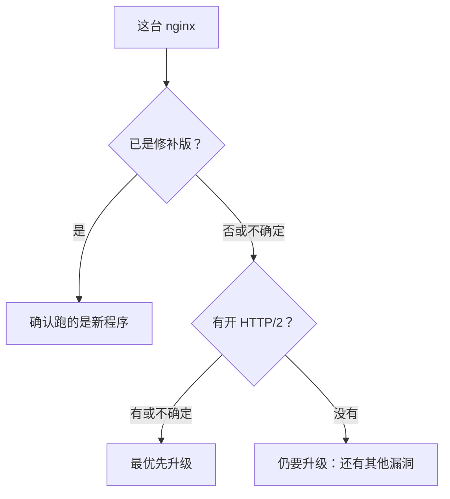
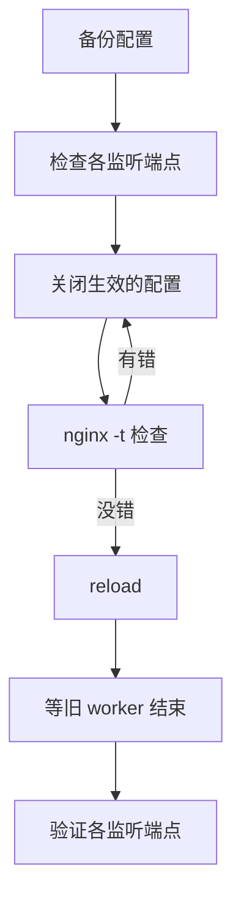

nginx 在 11 月 18 日修补了 HTTP/2 漏洞 **CVE-2026-123007**。受影响的 nginx 如果启用了 HTTP/2，无需登录的远程攻击者就可能破坏 nginx 的内存，进而执行代码。

我整理了确认版本与配置的命令，也用官方 Docker 镜像确认了一个容易漏掉的步骤：如果软件包只替换了磁盘上的可执行文件，reload 后旧程序仍会继续提供服务。

> 内容依据 nginx 官方安全公告、F5 写在 CVE 记录中的说明、CERT-EU 与三个研究团队的文章，查证日期是 2026-11-22（台北时间）。利用状态与修补版本会变动，以官方最新信息为准。
{: .prompt-info }

先用这张图安排修补顺序。图中的“修补版”指磁盘上已安装的版本，也包括发行版提供的修补软件包。



如果查到还有旧进程在运行，请按后面的升级步骤完成切换。如果你不管理服务器，可以把这篇交给运维人员。

## 先查三件事：版本、HTTP/2 配置、正在跑的程序

请在运行 nginx 的主机或容器内检查版本和配置。已经用 root 登录时，可以省略示例中的 `sudo`。

### 1. 版本：用发行版软件包时，看软件包版本号

```sh
nginx -v
nginx -V 2>&1 | grep -o with-http_v2_module
```

第一行显示这个可执行文件的上游版本。如果 `nginx -V` 正常运行，第二行没有输出就表示这个可执行文件没有编入 HTTP/2 模块。nginx.org 和 Debian 的软件包编入了这个模块，自行编译时则要显式启用。

自行编译或使用 nginx 官方软件包、官方 Docker 镜像时，要按分支核对版本号。stable 1.30.x 至少要 1.30.7，mainline 1.31.x 至少要 1.31.9。

用发行版软件包时，请用完整的软件包版本号来判断。发行版常把修复应用到旧版软件包，同时保留上游版本号，这叫作 backport。例如 Debian unstable 的 `1.30.6-4` 已包含修复，而 nginx 官方公告列出的 1.30.6 是上游原版。

我在 Debian 12 的容器里装到的是已修补的 `1.22.1-9+deb12u11`，`nginx -v` 只显示 1.22.1。

先查软件包版本号，根据系统选一行执行：

```sh
dpkg -l | grep nginx
rpm -qa | grep nginx
apk info -v | grep nginx
```

第一行用于 Debian、Ubuntu，第二行用于 RHEL 系列，第三行用于 Alpine。再对照发行版公告，下表是几个常见版本第一个包含修补的软件包：

| 发行版 | 已修补的软件包版本 | 公告 |
| --- | --- | --- |
| Debian 12 bookworm | `1.22.1-9+deb12u11` | [DLA-4918-1](https://security-tracker.debian.org/tracker/CVE-2026-123007) |
| Debian 13 trixie | `1.26.3-3+deb13u11` | [DSA-6642-1](https://security-tracker.debian.org/tracker/CVE-2026-123007) |
| Ubuntu 22.04 jammy | `1.18.0-6ubuntu14.23` | [USN-9159-1](https://ubuntu.com/security/CVE-2026-123007) |
| Ubuntu 24.04 noble | `1.24.0-2ubuntu7.20` | [USN-9159-1](https://ubuntu.com/security/CVE-2026-123007) |
| RHEL 9 | `nginx-1.20.1-32.el9_9.2` | [RHSA-2026:100748](https://access.redhat.com/security/cve/CVE-2026-123007) |
| RHEL 10 | `nginx-1.26.3-16.el10_3.3` | [RHSA-2026:100744](https://access.redhat.com/security/cve/CVE-2026-123007) |
| Alpine 3.22、3.23 | `1.28.3-r8` | [Alpine secdb](https://secdb.alpinelinux.org/v3.23/main.json) |
| Alpine 3.24 | `1.30.7-r0` | [Alpine secdb](https://secdb.alpinelinux.org/v3.24/main.json) |

RHEL 9 与 RHEL 8 的 nginx 模块流（module stream）另有各自的公告，用 `dnf module` 安装的人要看 Red Hat 的完整清单。Ubuntu 16.04、18.04、20.04 的修补要有 Ubuntu Pro 才能收到。

### 2. HTTP/2 配置：每个 server 块都要看

```sh
sudo nginx -T
```

`nginx -T` 会检查磁盘上的配置，并输出主配置文件和所有 `include` 进来的文件。请使用服务的可执行文件和启动参数，包括自定义的 `-c`、`-p` 和 `-g`。如果检查失败，先解决错误再判断。

查看各个监听地址、端口和虚拟主机的配置时，找这两种写法。

- `listen 443 ssl http2;`：旧写法，1.25.1 起标记为弃用，但仍然有效。
- `http2 on;`：1.25.1 起的新写法，写在 `http` 块时，没有单独设置的 server 会继承它。

两种写法的作用范围不同。我用官方 Docker 镜像试了四种配置：

| 配置 | 结果 |
| --- | --- |
| 共用同一个地址和端口，A 写 `http2 on;`，B 写 `http2 off;` | 连 A 走 HTTP/2，连 B 走 HTTP/1.1 |
| 共用同一个地址和端口，A 写 `listen ... http2`，B 写 `http2 off;` | A 和 B 都走 HTTP/2 |
| 同一个 server 写 `listen ... http2`，又写 `http2 off;` | 仍走 HTTP/2 |
| 明文的 80 端口写 `http2 on;` | 客户端直接发送 HTTP/2 时会被接受 |

先按监听地址和端口检查旧写法，再看每个虚拟主机的新写法。TLS 客户端通过 SNI 告知 nginx 要连接的域名，所以同一个地址和端口上的不同域名可能有不同结果。也要检查默认虚拟主机，它会接收未指定域名或域名不匹配的 TLS 连接。

配置文件可能已经修改但还没加载，请从能直连自己 nginx 的网络测试各个监听地址、端口和域名。如果前面有 CDN 或负载均衡器，通过公开域名测到的协议可能来自代理层。下面用 `--resolve` 指定 nginx 地址，同时保留原来的域名。

```sh
curl -sS --noproxy '*' --http2 --resolve example.com:443:192.0.2.10 \
  -o /dev/null -w '%{http_version}\n' https://example.com/
curl -sS --noproxy '*' --http2-prior-knowledge --resolve example.com:80:192.0.2.10 \
  -o /dev/null -w '%{http_version}\n' http://example.com/
```

把域名、地址和端口换成实际值。第一条测 HTTPS，第二条测明文 HTTP/2。收到 HTTP 响应时，`2` 代表该连接使用了 HTTP/2，`1.1` 代表使用了 HTTP/1.1。

输出 `0` 或命令失败时，先标记为“无法确认”。明文 HTTP/2 测试失败时，可以在同一地址和端口用 `--http1.1` 确认服务有响应，再核对明文监听端口的配置。

### 3. 用进程列表确认哪个可执行文件正在提供服务

`nginx -v` 只显示本次执行的文件版本。用进程列表找出服务的 master 和 worker PID。master 负责读取配置和管理进程，worker 实际处理连接。

```sh
ps -e -o pid,ppid,args | grep -E '[n]ginx: (master|worker) process'
```

在 Linux 上，把 `1234` 换成要检查的 PID，把 `/usr/sbin/nginx` 换成已经确认修补的可执行文件。对该实例的 master 和每个 worker 分别检查。

```sh
pid=1234
patched_binary=/usr/sbin/nginx
sudo readlink "/proc/$pid/exe"
sudo stat -Lc '%d:%i %n' "/proc/$pid/exe" "$patched_binary"
```

`(deleted)` 表示进程仍引用已从原路径移除的文件。用 `stat` 比较设备号和 inode，也就是文件的标识信息。两个值都相同，才能确认该进程正在使用指定的修补文件。

## 11 月 18 日两个分支都有修补，启用了 HTTP/2 就优先升级

nginx 在 2026-11-18 同时发布 mainline 1.31.9 和 stable 1.30.7，都修复了 CVE-2026-123007。功能较新的 mainline 修复了 10 个安全问题，只接收修复的 stable 修复了其中 9 个。第 10 个只影响 1.31.4 至 1.31.8。

CVE-2026-123007 影响启用了 HTTP/2 的 nginx 开源版 1.9.5 至 1.30.6，以及 1.31.0 至 1.31.8。1.9.5 是 2015 年 9 月加入 HTTP/2 的版本。

nginx 使用自己的分级，负责分配这个 CVE 编号的 F5 则用了两个版本的漏洞评分标准 CVSS。

| 来源 | 评分 |
| --- | --- |
| [nginx 官方公告](https://nginx.org/en/security_advisories.html) | major（nginx 自己的分级，分为 major、medium、minor） |
| [F5 的 CVE 记录](https://www.cve.org/CVERecord?id=CVE-2026-123007) | CVSS 3.1 为 8.1（High）<br>CVSS 4.0 为 9.2（Critical） |

截至 2026-11-22，[NVD](https://nvd.nist.gov/vuln/detail/CVE-2026-123007) 列出的两项评分都来自 F5。

概念验证程序（PoC）是用来证明漏洞可被利用的示例程序。是否已在真实环境中遭到利用，要看当时的报告和清单。

| 项目 | 状态 | 来源 |
| --- | --- | --- |
| 公开的概念验证程序 | 已有，2026-11-18 公开 | [Rapid7](https://www.rapid7.com/blog/post/ve-cve-2026-123007-critical-nginx-http-2-integer-underflow-leads-to-rce-fixed/) |
| 在野利用的报告 | 尚无（2026-11-18 的说法） | [CERT-EU](https://www.cert.europa.eu/publications/security-advisories/2026-022/) |
| CISA 已知被利用漏洞清单（KEV） | 未列入（2026-11-20 版） | [CISA KEV](https://www.cisa.gov/known-exploited-vulnerabilities-catalog) |

### 研究演示的条件各不相同，对外的 HTTP/2 仍要优先修补

据 Rapid7 的说明，他们的演示有特定的网络和部署条件。

ASLR 是让程序每次加载时内存地址都不同的防护。F5 说，要在 ASLR 关闭或被绕过时才能执行代码。[Wiz](https://www.wiz.io/blog/nginx-http2-rce-vulnerabilities) 在只提供静态文件的普通服务器上演示了远程代码执行，认为仅靠 ASLR 不足以防护。

我判断成功利用仍取决于部署环境。既然已经有公开演示，我会优先修补对外接收 HTTP/2 的受影响主机。

## HTTP/2 流量控制算错，worker 的内存被写坏

HTTP/2 用流量控制限制每条连接能传多少数据。接收端会告诉发送端自己还能收多少，这个额度叫作窗口（window）。

据 Rapid7 的说明，攻击者能让 nginx 算错“客户端还允许它发送多少响应数据”。F5 说，窗口可能超过允许的上限，造成 heap buffer overflow，也就是写到分配范围以外的内存。

出问题的是处理连接的 worker。master 通常以 root 运行，worker 则通常以 `nginx` 或 `www-data` 这类普通账号运行。

据 [Xint](https://xint.io/blog/nginx2root-remote-code-execution) 的说明，攻击成功时，命令以 worker 的权限执行。Xint 另外把它和一个 Linux 内核漏洞串联起来，从 Docker 容器里的 nginx 获取了 root。所以我不会把“worker 不是 root”当成可以晚点处理的理由。

## 升级后要替换正在运行的程序

先按安装来源选择修补版本。如果用的是没有修补的旧开源分支，可以迁移到表中的开源分支，或改用发行版的修补软件包。

| 你用的版本 | 升级到 |
| --- | --- |
| nginx stable（1.30.x） | 1.30.7 以上 |
| nginx mainline（1.31.x） | 1.31.9 以上 |
| NGINX Plus 37.0.x | 37.0.8.1 以上 |
| NGINX Plus 37.1.0 起，低于 37.3.0.1 | 37.3.0.1 以上 |
| 发行版软件包 | “先查三件事”中的软件包版本号 |

NGINX Plus 的版本号来自 F5 的 CVE 记录。记录也从 R33 起列出受影响的 R 系列，包括 CERT-EU 点名的 R34 至 R36。F5 的 CVE 记录未列出 R 系列的修补版本，请按 F5 公告迁移到已修补的分支。

1.31.9 另外开始拒绝没有冒号的头部行，以及分块开销过大的 chunked 请求体。1.30.7 只有安全修复，用 stable 的人升级时不会碰到这些行为变更。

### reload 不会换掉可执行文件

我在 1.30.6 的官方镜像里，把磁盘上的可执行文件换成 1.30.7，模拟软件包升级。然后看每一步之后，实际响应连接的版本：

| 步骤 | `nginx -v` | 响应头里的版本 | `/proc/<pid>/exe` |
| --- | --- | --- | --- |
| 换掉可执行文件后 | 1.30.7 | 1.30.6 | `(deleted)` |
| 再执行 `nginx -s reload` | 1.30.7 | 1.30.6 | `(deleted)` |
| 重启后 | 1.30.7 | 1.30.7 | 正常 |

reload 只让 master 重新读取配置、换一批 worker。master 本身还是旧的可执行文件，新的 worker 也是从它派生出来的。Xint 的文章也写明，只 reload 配置不会换掉正在运行的程序。

有些软件包会在升级时自动替换正在运行的程序。nginx.org 的 [deb](https://github.com/nginx/pkg-oss/blob/master/debian/debian/nginx.postinst) 和 rpm 软件包会尝试不停机切换版本，但切换失败时，软件包升级仍可显示成功。我会用前面的 `/proc` 检查还有没有旧进程。

在主机上直接安装 nginx 时，如果旧进程仍在运行且服务可以短暂中断，就在配置检查成功后重启。如果服务使用自定义配置文件或启动参数，检查时要使用同一套配置。

```sh
sudo nginx -t && sudo systemctl restart nginx
```

Alpine 等使用 OpenRC 的系统改用这条命令。

```sh
sudo nginx -t && sudo rc-service nginx restart
```

重启可能中断现有连接。不能中断的服务，nginx 文档提供了[不停机更换可执行文件](https://nginx.org/en/docs/control.html#upgrade)的方法。

不停机更换期间，原来的 PID 文件可能已经指向新 master，旧 master 的 PID 另存于后缀为 `.oldbin` 的文件。此时新旧 worker 都可能在提供服务。升级后用进程列表和 `/proc` 确认每个仍在服务的 worker 都使用修补文件，并确认旧 worker 已退出。

用容器运行 nginx 时，要换成新版镜像，例如 `nginx:1.30.7`，再重新部署。重启同一个旧镜像的容器不会更新。

F5 的产品各有自己的修补版本。根据 [F5 公告](https://my.f5.com/manage/s/article/K000163926)，NGINX Gateway Fabric 2.x 要升级到 `2.9.0`。NGINX Ingress Controller 5.x 要升级到 `5.8.0`，LTS 要升级到 `2026-lts-r11`。

其他分支请核对同一份公告。

Kubernetes 社区的 ingress-nginx 已在 2026 年 3 月停止维护，用它的人要看自己所用分支或云服务商的公告。

## 暂时不能升级时，关闭 nginx 上所有对外的 HTTP/2

CERT-EU、Xint 和 Wiz 都建议，不能马上升级时先关闭对外的 HTTP/2，以降低 CVE-2026-123007 和 CVE-2026-123633 的风险。F5 的 CVE 记录未列出缓解措施。同批的其他漏洞仍需通过升级修复。

关闭前先确认客户端是否依赖 HTTP/2。gRPC 基于 HTTP/2，通过 `grpc_pass` 提供的 gRPC 服务如果关闭 HTTP/2，客户端就会失去连接。一般浏览器可以改用 HTTP/1.1，也可能改用已启用的 HTTP/3。

如果启用了 HTTP/3，CVE-2026-121810 仍需修补。

CERT-EU 提到了两种关闭方式。用哪一种取决于当前如何启用 HTTP/2。

| 当前配置 | 要修改的地方 |
| --- | --- |
| 只有旧式 `listen ... http2` | 移除同一地址和端口上各个 server 的 `listen` 中的 `http2` |
| 只有 `http2 on;` | 让各 server 生效的配置为 `http2 off;`，包括原来从 `http` 块继承的配置 |
| 两种写法并存 | 同时处理两处。只设置 `http2 off;`，旧的 `listen ... http2` 仍会启用 HTTP/2 |

两种写法并存时，改完的 server 块可以像这样。

```nginx
server {
    listen 443 ssl;    # 去掉原来的 http2
    http2 off;         # 原来是 http2 on;
    # 其他配置不变
}
```

`http2` 指令从 1.25.1 开始支持。也要检查默认虚拟主机，以及 80 端口这类明文监听端口。



如果这次只改了配置，可以在检查通过后 reload。

```sh
sudo nginx -t && sudo nginx -s reload
```

reload 后先确认 error log 中没有加载配置失败的信息。已经建立的 HTTP/2 连接仍可能留在旧 worker 上。用这条命令查看是否还有正在退出的 worker。

```sh
ps -eo pid,args | grep '[w]orker process is shutting down'
```

等旧 worker 退出后，用前面的 `curl` 命令验证各端点。预期仍提供 HTTPS 的端点应能以 HTTP/1.1 响应。明文端点则按前面的方式测试并核对配置。

如果必须立即结束旧连接，可以用前面的命令重启，但要考虑服务中断。

确认修补版已在提供服务后，可以恢复需要的 HTTP/2 配置。

## 没开 HTTP/2 也要升级：同一批还有其他漏洞

CVE-2026-123007 只影响启用 HTTP/2 的部署。同批更新也修复了涉及 HTTP/3、邮件代理等功能的漏洞。[CERT-EU](https://www.cert.europa.eu/publications/security-advisories/2026-022/) 指出，这批漏洞中有五个可能让无需登录的远程攻击者执行代码，其中一个是 CVE-2026-123007。

下表根据 [nginx 官方公告](https://nginx.org/en/security_advisories.html)整理，“涉及的功能”取自公告的标题：

| CVE | 问题 | nginx 分级 | 涉及的功能 |
| --- | --- | --- | --- |
| CVE-2026-123633 | use-after-free | medium | HTTP/2 反向代理 |
| CVE-2026-121810 | use-after-free | medium | HTTP/3 |
| CVE-2026-123634 | use-after-free | medium | `resolver` |
| CVE-2026-113425 | use-after-free | major | mail 代理 |
| CVE-2026-118899 | 无限循环 | major | 通过 TLS 1.3 读取请求体 |
| CVE-2026-125283 | buffer overflow | minor | `alias` 搭配 `try_files` |
| CVE-2026-120967 | SNI 绕过 | medium | stream 模块的客户端证书验证 |
| CVE-2026-123640 | 验证不足 | minor | stream 模块的 `ssl_preread` |
| CVE-2026-120993 | NULL pointer | minor | PROXY protocol v2，只影响 1.31.4 到 1.31.8 |

use-after-free 是程序继续使用已经释放的内存。

表中第一行要特别注意。nginx 分级是 medium，但 F5 给的 CVSS 和 CVE-2026-123007 一样是 8.1 与 9.2。据 F5 的说明，它在反向代理到后端、而且 worker 的连接数快用完时触发。

nginx 官方公告上，CVE-2026-121810 目前显示成“CVE-CVE-2026-121810”，链接也因此失效，查询时要用正确的编号。

10 月 14 日公布的五个问题也包含在这次修补中。这批修复最早已随 mainline 1.31.7 和 stable 1.30.6 发布。我会直接升级，一次应用适用的修复。

## 日志里的 worker 崩溃，不等于已被入侵

CERT-EU 建议监控 worker 崩溃，error log 会出现这样的记录：

```sh
sudo grep 'exited on signal' /var/log/nginx/error.log
```

例如 `worker process 165 exited on signal 11`。CERT-EU 把这类崩溃视为可能有人尝试利用的线索。Xint 提醒，worker 也可能因其他原因崩溃，还要检查是否有异常的进程活动。

据 Xint 的说法，worker 启动非预期的程序是更强的线索。下面从 PID 文件找到 master，再检查它的子进程是否又启动了其他进程。请根据服务的 `pid` 配置调整路径，Alpine 软件包使用 `/run/nginx/nginx.pid`。

```sh
ps --ppid "$(pgrep -d, -P "$(cat /run/nginx.pid)")" -o pid,user,args
```

这条命令需要支持 `--ppid` 的 `ps`，只会列出当前还存在的进程。检查以往的活动要看 auditd 或终端安全工具的进程创建日志。Xint 也提醒，这类攻击在 access log 里可能只留下很少痕迹。

主机曾对外开着 HTTP/2、又跑着受影响的版本，而且查到可疑的子进程时，我会把它当成已遭入侵处理：

1. 限制对外连接，保留日志与磁盘快照。
2. 从可信的干净镜像重建主机。
3. 从干净的环境撤换 worker 读得到的凭证、API token 与密码。

如果由 nginx 处理 TLS，且 worker 能访问私钥，我也会一起更换。我的判断是，能以 worker 权限执行代码，就可能接触它能读取的密钥。重建与替换凭证是为了处理修补前就可能发生的入侵。

## 版本对了，还要确认跑的是新程序

升级后，我会用进程列表和 `/proc` 确认修补版正在提供服务，旧 worker 也已退出。

同样是“软件包更新了、旧服务还在跑”，我在 [OpenSSH 密码验证绕过漏洞 CVE-2026-123158：Alpine 怎么修补](/posts/openssh-musl-password-bypass-alpine/)也遇到过，那次是 sshd 没重启。

nginx 后面如果接 PHP-FPM，PHP 也有已遭利用的 php2shell 要修。重启 nginx 不会替换 PHP 进程，PHP-FPM 要另外重启，做法见 [PHP CVE-2026-109618：php2shell 已遭利用怎么修](/posts/php2shell-cve-2026-109618/)。

## 主要来源

- [nginx 安全公告](https://nginx.org/en/security_advisories.html)：每个 CVE 的分级与受影响版本
- [nginx 1.31.9 变更记录](https://nginx.org/en/CHANGES)与 [1.30.7 变更记录](https://nginx.org/en/CHANGES-1.30)
- [CVE-2026-123007 记录](https://www.cve.org/CVERecord?id=CVE-2026-123007)：F5 的说明、CVSS 与 NGINX Plus 版本号
- [NVD 上的 CVE-2026-123007](https://nvd.nist.gov/vuln/detail/CVE-2026-123007)：受影响的 F5 产品清单
- [CERT-EU 2026-022](https://www.cert.europa.eu/publications/security-advisories/2026-022/)：利用状态、缓解方式与日志监控
- [加拿大网络安全中心 AV26-1174](https://www.cyber.gc.ca/en/alerts-advisories/f5-security-advisory-av26-1174)：F5 公告摘要
- [Rapid7 的分析](https://www.rapid7.com/blog/post/ve-cve-2026-123007-critical-nginx-http-2-integer-underflow-leads-to-rce-fixed/)：利用条件与实际限制
- [Wiz 的分析](https://www.wiz.io/blog/nginx-http2-rce-vulnerabilities)：两个 HTTP/2 漏洞与 NGINX Plus 版本号
- [Xint 的 nginx2root](https://xint.io/blog/nginx2root-remote-code-execution)：检查方式、缓解与入侵迹象
- [nginx http2 指令说明](https://nginx.org/en/docs/http/ngx_http_v2_module.html)与[进程控制说明](https://nginx.org/en/docs/control.html)
- 发行版公告：[Debian](https://security-tracker.debian.org/tracker/CVE-2026-123007)、[Ubuntu](https://ubuntu.com/security/CVE-2026-123007)、[Red Hat](https://access.redhat.com/security/cve/CVE-2026-123007)
- [CISA KEV 清单](https://www.cisa.gov/known-exploited-vulnerabilities-catalog)
