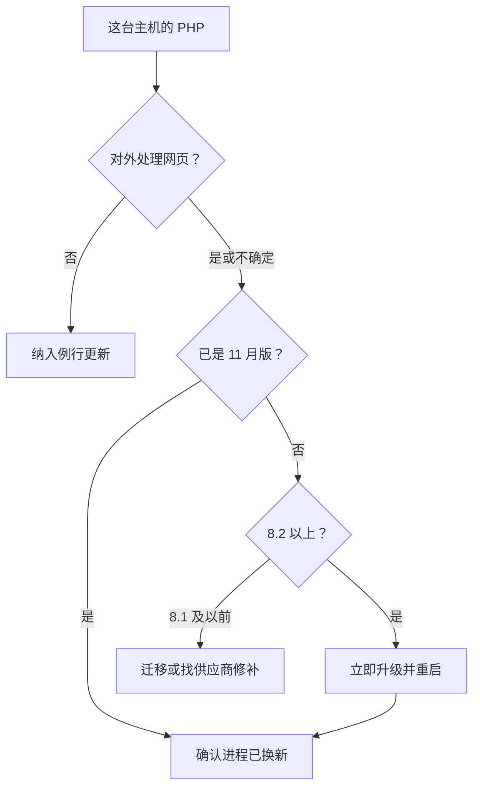

PHP 在 10 月 21 日修补了两个合称 php2shell 的漏洞：**CVE-2026-109618** 与 **CVE-2026-109619**。在特定条件下，无需登录的远程攻击者能在网站的 PHP 上执行代码，CISA 已把两者列入已知被利用漏洞清单。

10 月已经升级的人，还要再升一次：11 月 19 日的版本补上了其中一个修补的缺口。文中的检查命令与缓解配置，我都在官方 Docker 镜像里跑过。

> 内容依据 php.net、PHP 在 GitHub 发布的安全公告（GHSA）、PHP Foundation、CISA 与 NVD，查证日期是 2026-11-23（台北时间）。修补版本与利用状态会变动，以官方最新信息为准。
{: .prompt-info }

先用这张图安排顺序。图中的“11 月版”指 8.5.13、8.4.28、8.3.37、8.2.36、8.6.0，或包含同等修补的发行版软件包。



## php2shell 是两个漏洞，出在每个请求都会经过的地方

两个漏洞都在 PHP 的内存管理与错误处理里。据 PHP Foundation 的说明，几乎每个请求都会经过这两处，所以影响大，也难在不破坏兼容性的前提下修好。

| CVE | 出问题的地方 | 已确认的远程代码执行 |
| --- | --- | --- |
| CVE-2026-109618 | 内存耗尽（OOM）时，PHP 会中断手上的工作。请求数据可能只初始化了一半，清理时却被当成有效数据 | Apache mod_php 的默认配置下，请求在应用代码执行前就能触发 |
| CVE-2026-109619 | 请求结束后，PHP 的全局状态仍指向已释放的内存，同一个 worker 的下一个请求会用到它 | mod_php 已有演示。session 上传进度的路径在 mod_php 与 PHP-FPM 上都验证过 |

worker 是实际处理请求的进程。使用已释放的内存，这类错误叫作 use-after-free。

两者的 CVSS 4.0 都是 9.2（Critical），向量相同。攻击复杂度标为高，而且需要特定前提。

### 所有对外处理网页的 PHP 都在范围内

SAPI 是 PHP 接入 Web 服务器的方式。php.net 列出的受影响 SAPI 有 PHP-FPM、Apache mod_php、php-cgi、FrankenPHP 与 LiteSpeed。官方认为其中 mod_php 的风险最高。

mod_php 是 Apache 直接加载的 PHP 模块。PHP-FPM 则是独立的 PHP 进程池，由 nginx 等服务器把请求转发过去。

CVE-2026-109618 在 PHP-FPM 上的状态，两份官方文档的说法不同：

| 来源 | 对 PHP-FPM 的说法 |
| --- | --- |
| [PHP Foundation](https://thephp.foundation/blog/2026/10/21/todays-php-security-release-and-how-were-strengthening-php-security/)（10 月 21 日） | 已通过应用层的路径确认可远程执行代码 |
| [GHSA-w8hw-w9fx-j79w](https://github.com/php/php-src/security/advisories/GHSA-w8hw-w9fx-j79w)（11 月 3 日更新） | 根据源代码分析判定受影响，但还没有针对 FPM 的完整演示 |

我的判断是，用 FPM 不代表可以晚点修。CVE-2026-109619 已在 FPM 上验证过远程代码执行。

### CISA 在公开五天后列入已知被利用清单

CISA 的已知被利用漏洞清单（KEV）收录有证据表明已被实际利用的漏洞。

| 日期 | 事件 |
| --- | --- |
| 10 月 20 日 | php.net 预告重大安全更新 |
| 10 月 21 日 | 发布 8.5.12、8.4.27、8.3.36、8.2.35，CISA 发出警报 |
| 10 月 23 日 | php.net 补充 session 上传进度的提醒 |
| 10 月 26 日 | CISA 把两个 CVE 列入 KEV |
| 11 月 19 日 | 发布 8.5.13、8.4.28、8.3.37、8.2.36，包含后续修补 |

据 PHP Foundation 的说法，披露前一天有研究团队误发了演示视频。之后各种概念验证程序（PoC）加速出现。安全团队在发布时，还没看到能实际运行的攻击程序。

## 先查网站实际在跑的 PHP，不是 `php -v`

`php -v` 只显示命令行（CLI）那份 PHP。网站用的可能是另一个软件包、另一个版本，配置文件也不同。

### 1. 找出 SAPI

```sh
ps -eo pid,user,args | grep -E '[p]hp-fpm|[a]pache2|[h]ttpd|[l]sphp|[f]rankenphp|[p]hp-cgi'
```

看到 `php-fpm: master process` 就是 PHP-FPM。看到 `apache2` 或 `httpd` 时，再查 Apache 有没有加载 PHP 模块：

```sh
apache2ctl -M 2>/dev/null | grep -i php
httpd -M 2>/dev/null | grep -i php
```

第一行用于 Debian、Ubuntu，第二行用于 RHEL 系列。输出 `php_module (shared)` 就是 mod_php。

### 2. 查网页那份 PHP 的版本

PHP-FPM 的可执行文件名常带版本号，先找出来再查：

```sh
ls /usr/sbin/php-fpm* /usr/local/sbin/php-fpm 2>/dev/null
php-fpm8.3 -v
```

把 `php-fpm8.3` 换成实际的文件名。输出会标出 `(fpm-fcgi)`，代表这是 FPM 那份。

mod_php 没有独立的可执行文件，要看软件包版本号。网站发送 `X-Powered-By` 响应头时，也能从外部看到版本：

```sh
curl -sI https://example.com/ | grep -i x-powered-by
```

我在官方 `php:8.5-apache` 镜像里得到 `X-Powered-By: PHP/8.5.13`。很多生产环境会关掉 `expose_php`，没有这个响应头不代表没跑 PHP。

### 3. 发行版看完整的软件包版本号

根据系统选一行执行：

```sh
dpkg -l | grep -E 'php[0-9.]*-(fpm|cli|cgi|common)|libapache2-mod-php'
rpm -qa | grep -E '^php'
apk info -v | grep -E '^php[0-9]+'
```

第一行用于 Debian、Ubuntu，第二行用于 RHEL 系列，第三行用于 Alpine。对照方式见下一节的发行版表格。

CISA 提醒，PHP 常被打包在其他软件里，不一定看得出来。容器、主机管理面板、套装应用都要算进去。用容器的话，进入容器用同样的方法查。

## 直接升到 11 月 19 日的版本

| 分支 | 10 月 21 日 | 11 月 19 日（目标） |
| --- | --- | --- |
| 8.5 | 8.5.12 | 8.5.13 |
| 8.4 | 8.4.27 | 8.4.28 |
| 8.3 | 8.3.36 | 8.3.37 |
| 8.2 | 8.2.35 | 8.2.36 |

10 月版修复了 php2shell 的两个漏洞。11 月版是 PHP 每四周一次的例行安全更新，也包含 10 月的修补。

11 月版另外修复了两个和 CVE-2026-109619 同一类的漏洞，GHSA 都评为 Critical 9.2：

- [CVE-2026-129481](https://github.com/php/php-src/security/advisories/GHSA-g3vh-838c-65v7)：GHSA 写明是 CVE-2026-109619 的不完整修补，影响 8.3 及以后的版本。
- [CVE-2026-129182](https://github.com/php/php-src/security/advisories/GHSA-2fjv-p558-g82m)：8.5.12 清除了一个全局状态，但之后的关闭流程还能把它写回去。影响 8.5.13 以前的所有 8.5 版本。

两份 GHSA 都说，通过这两条路径执行代码还没有被演示过。php.net 也说，11 月评为 Critical 的问题需要非默认配置或少见的环境。我还是会直接升到 11 月版，一次纳入这些修补。

同一批还修复了 PHP-FPM 的请求走私（CVE-2026-129289）等问题，完整清单见 [PHP 8 ChangeLog](https://www.php.net/ChangeLog-8.php)。8.2 会在 2026-12-31 停止安全更新，要开始规划升级。

### 8.1 及以前没有正式的修补版本

PHP 项目已不再为 8.1 及以前的版本发布更新。因为这次太严重，安全团队为 7.4、8.0、8.1 提供了最小的源代码回溯修补，供自行编译 PHP 的人使用。

部分发行版与 LTS 供应商也有回溯修补，要向供应商确认。CISA 的建议更直接：无法更新、或仍在用 8.1 及以前版本的系统，先下线，直到修补完成。

### 发行版软件包

发行版常把修复应用到旧版软件包，同时保留上游版本号，这叫作 backport。php.net 说，发行版与 LTS 供应商事先拿到了修补。

下表是常见版本第一个包含修补的软件包。CVE-2026-129481 是 11 月的后续修补，标“不受影响”时，有 10 月那一版就够了。

| 发行版 | 软件包 | php2shell（10 月） | CVE-2026-129481（11 月） |
| --- | --- | --- | --- |
| Debian 12 | `php8.2` | `8.2.35-1~deb12u1`（DLA-4848-1） | 不受影响 |
| Debian 13 | `php8.4` | `8.4.27-1~deb13u1`（DSA-6574-1） | `8.4.28-1~deb13u1`（DSA-6641-1） |
| Ubuntu 22.04 | `php8.1` | `8.1.2-1ubuntu2.28`（USN-8948-1） | `8.1.2-1ubuntu2.29` |
| Ubuntu 24.04 | `php8.3` | `8.3.6-0ubuntu0.24.04.13`（USN-8948-1） | `8.3.6-0ubuntu0.24.04.14` |
| Ubuntu 26.04 | `php8.5` | `8.5.4-0ubuntu1.5`（USN-8948-1） | `8.5.4-0ubuntu1.6` |
| RHEL 8 | `php:8.2` 模块 | `8.2.35-1.module+el8.10.0`（RHSA-2026:87073） | 不受影响 |
| RHEL 9 | `php:8.3` 模块 | `8.3.36-1.module+el9.8.0`（RHSA-2026:87079） | 受影响，尚未修补 |
| RHEL 10 | `php` | `8.3.36-1.el10_2`（RHSA-2026:87070） | 受影响，尚未修补 |
| RHEL 10 | `php8.4` | `8.4.27-1.el10_2`（RHSA-2026:87071） | `8.4.28-1.el10_3`（RHSA-2026:100821） |
| Alpine 3.22 | `php83`、`php84` | `8.3.36-r0`、`8.4.27-r0` | secdb 尚无记录 |
| Alpine 3.23 | `php83`、`php84`、`php85` | `8.3.36-r0`、`8.4.27-r0`、`8.5.12-r0` | secdb 尚无记录 |
| Alpine 3.24 | `php83`、`php84`、`php85` | `8.3.36-r0`、`8.4.27-r0`、`8.5.12-r0` | `8.3.37-r0`、`8.4.28-r0`、`8.5.13-r0` |

表中的版本取自 [Debian](https://security-tracker.debian.org/tracker/CVE-2026-109618)、[Ubuntu](https://ubuntu.com/security/CVE-2026-109618)、[Red Hat](https://access.redhat.com/security/cve/CVE-2026-109618) 与 [Alpine secdb](https://secdb.alpinelinux.org/v3.24/community.json)。11 月那一列取自各家的 CVE-2026-129481 页面，例如 [Debian](https://security-tracker.debian.org/tracker/CVE-2026-129481)。RHEL 的其他模块流，例如 RHEL 8 的 `php:7.4`，见 Red Hat 页面的完整清单。

上游说 8.2 及以前不受 CVE-2026-129481 影响，但 Ubuntu 仍为 22.04 的 8.1 列出了修补版本，表中按跟踪页面填写。CVE-2026-129182 只影响 8.5，Ubuntu 26.04 也在 `8.5.4-0ubuntu1.6` 修补，Alpine 的 secdb 还没有记录。

RHEL 9 的 `php:8.3` 与 RHEL 10 的 `php`，截至查证日还没有 CVE-2026-129481 的修补，只有 EUS（延长支持的次要版本）有。

在此期间，GHSA 建议避免 session 清理时出现 fatal error。用 PHP-FPM 的话，也可以设置 `pm.max_requests=1` 并重启 worker，代价是性能。

Windows 版在 10 月 26 日另外重新构建为 8.5.12-1 等版本，修复的是 Brotli 的漏洞，PHP 本身的版本不变。

我查的时候，官方 Docker 镜像 `php:8.5-apache` 与 `php:8.5-fpm` 已是 11 月 19 日构建的 8.5.13。用容器的话，要拉取新镜像并重新部署，重启旧容器不会更新。

`php:latest`、`php:fpm` 这类没写分支的标签已指向 8.6.0。8.6.0 与 11 月版同一天发布，ChangeLog 也列出了 CVE-2026-129481 与 CVE-2026-129182 的修补。要留在原来的分支，请写明版本，例如 `php:8.4-fpm`。

## 升级后重启 PHP，再确认没有旧进程

软件包升级只替换磁盘上的文件。已在运行的 PHP 进程要重新启动，才会加载新的程序。GHSA 的缓解说明也一再要求重启每个 PHP worker。

我在官方镜像里，把磁盘上的文件换成一份副本，模拟软件包升级。然后看各进程加载的是哪份文件：

| 服务与 reload 方式 | 换掉文件后 | reload 后 |
| --- | --- | --- |
| Apache mod_php，`apache2ctl -k graceful` | master 与 worker 的 `libphp.so` 都显示 `(deleted)` | 全部换成新文件 |
| PHP-FPM，对 master 发送 `USR2` | master 与 worker 的 `php-fpm` 都显示 `(deleted)` | 全部换成新文件 |

`(deleted)` 表示进程还在用已从原路径移除的旧文件。nginx 的 reload 不会换掉可执行文件，PHP 这两种 reload 会。

服务名称与 reload 的实现因发行版而异，所以我会直接重启，再确认结果：

```sh
sudo systemctl restart php8.3-fpm
sudo systemctl restart apache2
```

根据系统换成实际的服务名称，例如 RHEL 系列的 `php-fpm` 与 `httpd`。重启可能中断现有连接，请算进维护时间。

```sh
sudo grep -l 'libphp.*(deleted)' /proc/[0-9]*/maps 2>/dev/null
sudo ls -l /proc/[0-9]*/exe 2>/dev/null | grep -E 'php.*\(deleted\)'
```

第一行找还加载着旧 `libphp` 的 Apache 进程，Debian 的 `libphp8.3.so` 也找得到。第二行找还在跑旧可执行文件的 PHP 进程，例如 `php-fpm`、`php-cgi`、`lsphp`。两行都没有输出，才表示没有进程还在用旧文件。

## 暂时不能升级时，官方的缓解措施都不完整

php.net 写得很清楚：只有更新才是完整的解决办法。下面的配置只能挡住特定的攻击路径，不会让系统变安全。

### CVE-2026-109618：去掉可控制的内存上限

- 设置 `memory_limit=-1`，而且要用应用程序改不掉的方式设置，例如 FPM pool 或 Apache 配置里的 `php_admin_value`。也要确认没有其他 pool、目录或应用程序配置把上限加回来。这只去掉了可控制的内存上限，底层的内存分配失败仍会走到有漏洞的路径。
- 把 `post_max_size` 设低。不需要上传文件时设为 `8M`，需要时设为 `32M`，并让 `upload_max_filesize` 小于它。
- 在 Web 服务器或代理层限制解码后的请求大小、字段数、multipart 段数、请求头数与嵌套深度，没有可用 `Content-Length` 的请求也要限制。multipart 是表单上传文件用的请求格式。GHSA 另外建议，应用程序不用 multipart 时，直接在前端挡掉这类请求。
- 用容器或 cgroup（Linux 限制进程资源的机制）的内存上限作为可用性的边界，最好只杀掉超限的 worker。不要改用 `RLIMIT_AS` 或 `RLIMIT_DATA`，它们会让内存分配失败，正好触发有漏洞的路径。

我的理解是，`memory_limit=-1` 让单个请求能用掉大量内存，所以 php.net 把 cgroup 上限列在同一组。

### CVE-2026-109619：关掉已确认的两条路径

- 设置 `session.upload_progress.enabled=0`，并重启每个 worker。要写在解析请求前就生效的 `php.ini`、FPM pool 或服务器配置，不要依赖 `ini_set()` 或 FPM 的 `.user.ini`。这只挡得住已确认的 session 路径。
- PHP 8.5 另外设置 `fatal_error_backtraces=0`，并重启每个 worker。这只挡得住已确认的 fatal error 回溯路径。
- 移除每个请求才应用、而且会产生警告的无效或过时配置。用 `error_reporting`、`display_errors` 或 `@` 隐藏警告没有用。
- 修复攻击者能触发的 fatal error 与执行超时，包括 callback、上传或导入处理、清理流程里的错误。
- GHSA 也提到，不在意性能时可以设置 `pm.max_requests=1`，让每个 worker 只处理一个请求。

11 月版已把 session 上传进度的默认值改为关闭。我在官方镜像里查到 8.4.27、8.5.12 是 `1`，8.4.28、8.5.13 是 `0`。根据 [GHSA-658j-r8rw-q6mx](https://github.com/php/php-src/security/advisories/GHSA-658j-r8rw-q6mx)，配置文件中明确写了开启时，仍会覆盖新的默认值。

GHSA 也提到另一个暴露条件：nginx 等前端用 `PHP_VALUE` 或 `PHP_ADMIN_VALUE` 逐个请求传递配置。这些值如果会产生警告，FPM 就可能受 CVE-2026-109619 影响。

所以缓解配置要写进 pool 文件，不要从前端传递。先查前端有没有这样传递配置：

```sh
sudo grep -rn -E 'PHP_(ADMIN_)?VALUE' /etc/nginx /etc/apache2 /etc/httpd 2>/dev/null
```

### 配置写在 pool 或 Apache 配置里

PHP-FPM 写在 pool 配置的区段里。Debian、Ubuntu 的文件是 `/etc/php/8.3/fpm/pool.d/www.conf`，RHEL 系列是 `/etc/php-fpm.d/www.conf`：

```ini
php_admin_value[memory_limit] = -1
php_admin_value[session.upload_progress.enabled] = 0
; 下一行只用于 PHP 8.5
php_admin_value[fatal_error_backtraces] = 0
```

mod_php 写在 Apache 的主配置或 VirtualHost 里：

```apache
php_admin_value memory_limit -1
php_admin_flag session.upload_progress.enabled off
php_admin_flag fatal_error_backtraces off
```

我在官方镜像里试了这两种写法，并用一个应用程序调用 `ini_set('memory_limit', '128M')`：

| 查看方式 | `memory_limit` | `ini_set()` 的结果 |
| --- | --- | --- |
| FPM 处理的请求 | `-1` | 返回 `false`，值不变 |
| mod_php 处理的请求 | `-1` | 返回 `false`，值不变 |
| `php -i`（CLI） | `128M` | 不适用 |
| `php-fpm -i` | `128M` | 不适用 |

`php -i` 与 `php-fpm -i` 都看不到 pool 的配置。要确认 pool 写对了，用 `-tt` 输出 FPM 读到的完整配置：

```sh
sudo php-fpm8.3 -tt 2>&1 | grep php_admin_value
```

改完配置后，用前一节的命令重启并确认。CISA 另外提到，Web 应用防火墙（WAF）在修补前可能提供部分保护。

## 修补后检查入侵迹象，干净的日志不代表安全

修补只挡得住之后的攻击。主机修补前如果对外开放，还要找入侵的迹象。

CISA 建议留意 PHP worker 启动 shell 或下载工具。下面的命令列出网站账号下、不是 PHP 或 Apache 本身的进程：

```sh
ps -u www-data -o pid,ppid,user,lstart,args | grep -v -E 'php-fpm|apache2|httpd'
```

把 `www-data` 换成 PHP worker 的账号，常见的还有 `apache` 与 `nginx`。我在容器里让 PHP 在后台启动一个 `sleep`。它被移交给 PID 1，不再是 worker 的子进程，这个命令仍能列出来。

看到进程不一定是入侵，定时任务也可能用同一个账号。这个命令只看得到当前的进程，要查过去的活动，得看 auditd 或终端安全工具的记录。CISA 也提供了 [SIGMA 检测规则](https://github.com/cisagov/SIGMA_Rules)。

GHSA 提醒，日志里没有错误不代表安全。旧日志可能没有记录 deprecation 级别的信息，PHP 也可能在写入信息前就出错。

根据 GHSA，已确认的影响是以网站 worker 账号的权限执行代码。查到可疑迹象时，我会把主机当成已遭入侵处理：

1. 限制对外连接，保留日志与磁盘快照。
2. 从可信的干净镜像重建主机。
3. 从干净的环境撤换 worker 读得到的凭据，例如数据库密码、API token 与应用程序的密钥。

## 前端是 nginx 的话，一起看 nginx 的漏洞

PHP-FPM 常放在 nginx 后面。nginx 在 11 月 18 日也修复了可远程执行代码的 HTTP/2 漏洞，见 [nginx CVE-2026-123007：开了 HTTP/2 就要升级](/posts/nginx-http2-cve-2026-123007/)。

软件包更新了、旧服务还在跑的情况，我在 [OpenSSH 密码验证绕过漏洞 CVE-2026-123158：Alpine 怎么修补](/posts/openssh-musl-password-bypass-alpine/)也遇到过。

## 主要来源

- [php.net 10 月 21 日安全公告](https://www.php.net/archive/2026.php#2026-10-21-5)：受影响的 SAPI、修补版本与临时缓解措施
- [php.net 2026 年新闻](https://www.php.net/archive/2026.php)：10 月 23 日的补充与 11 月 19 日的版本
- [GHSA-w8hw-w9fx-j79w](https://github.com/php/php-src/security/advisories/GHSA-w8hw-w9fx-j79w)：CVE-2026-109618 的技术说明与缓解措施
- [GHSA-6wmf-4rv5-p3rp](https://github.com/php/php-src/security/advisories/GHSA-6wmf-4rv5-p3rp)：CVE-2026-109619 的技术说明与缓解措施
- [GHSA-g3vh-838c-65v7](https://github.com/php/php-src/security/advisories/GHSA-g3vh-838c-65v7) 与 [GHSA-2fjv-p558-g82m](https://github.com/php/php-src/security/advisories/GHSA-2fjv-p558-g82m)：11 月的后续修补
- [GHSA-658j-r8rw-q6mx](https://github.com/php/php-src/security/advisories/GHSA-658j-r8rw-q6mx)：session 上传进度改为默认关闭
- [PHP 8 ChangeLog](https://www.php.net/ChangeLog-8.php)：各版本的完整修复清单
- [PHP Foundation 的说明](https://thephp.foundation/blog/2026/10/21/todays-php-security-release-and-how-were-strengthening-php-security/)：发现经过与披露时间线
- [CISA 警报](https://www.cisa.gov/news-events/alerts/2026/10/21/critical-vulnerabilities-php-require-immediate-patching)：处置建议与各国资源
- [CISA 列入 KEV 的公告](https://www.cisa.gov/news-events/alerts/2026/10/26/cisa-adds-two-known-exploited-vulnerabilities-catalog)与 [KEV 清单](https://www.cisa.gov/known-exploited-vulnerabilities-catalog)
- [NVD 上的 CVE-2026-109618](https://nvd.nist.gov/vuln/detail/CVE-2026-109618) 与 [CVE-2026-109619](https://nvd.nist.gov/vuln/detail/CVE-2026-109619)
