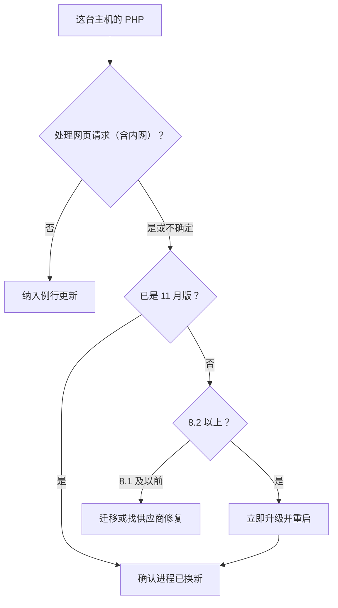

PHP 在 10 月 21 日为两个合称 php2shell 的漏洞发布了第一轮修复，分别是 **CVE-2026-109618** 和 **CVE-2026-109619**。在特定条件下，攻击者无需登录就能远程执行代码，CISA 已将两个漏洞列入已知遭利用漏洞清单。

10 月已经更新过的网站，还要确认是否已纳入 11 月 19 日的后续修复，这要看你使用的 PHP 分支或发行版软件包。

> 内容依据 php.net、PHP 在 GitHub 发布的安全公告（GHSA）、PHP Foundation、CISA 与 NVD，查证日期是 2026-11-23（台北时间）。修复版本与利用状态会变动，以官方最新信息为准。
{: .prompt-info }

用这张图安排更新顺序。图中的“11 月版”指各分支 11 月 19 日发布的版本或之后的版本，也包括已纳入所需修复的发行版软件包。只对内网提供服务的网站同样在处理 Web 请求，也要走“是或不确定”这条路。



## php2shell 影响 PHP 的内存管理与错误处理

据 PHP Foundation 的说明，几乎每个请求都会经过这两部分，所以修复时既要堵住漏洞，也要保持与现有应用的兼容性。

| CVE | 出问题的地方 | 已确认能远程执行代码的情况 |
| --- | --- | --- |
| CVE-2026-109618 | 内存耗尽（OOM）时，PHP 会中断手上的工作。请求数据可能只初始化了一半，清理时却被当成有效数据 | Apache mod_php 的默认配置下，请求在应用代码执行前就能触发 |
| CVE-2026-109619 | 请求结束后，PHP 的全局状态仍指向已释放的内存，同一个 worker 的下一个请求会用到它 | mod_php 上已有演示。经由 session 上传进度的路径，在 mod_php 与 PHP-FPM 上都验证过 |

worker 是实际处理请求的进程。CVE-2026-109619 这类使用已释放内存的错误，称为 use-after-free。

CVSS 是通用的漏洞严重程度评分，两者的 CVSS 4.0 分数都是 9.2（Critical），各项评分条件也相同。其中攻击复杂度标为高，而且攻击需要特定的前提条件。

### 只要 PHP 处理 Web 请求，就要确认修复状态

这里的 SAPI，指 PHP 从 Web 服务器接收请求的接口。php.net 列出的受影响 SAPI 有 PHP-FPM、Apache mod_php、php-cgi、FrankenPHP 与 LiteSpeed。官方认为其中 mod_php 的风险最高。

mod_php 是 Apache 直接加载的 PHP 模块。PHP-FPM 则是独立的 PHP 进程池，由 nginx 等服务器把请求转发过去。

CVE-2026-109618 在 PHP-FPM 上能否远程执行代码，两份官方文档的说法不同：

| 来源 | 对 PHP-FPM 的说法 |
| --- | --- |
| [PHP Foundation](https://thephp.foundation/blog/2026/10/21/todays-php-security-release-and-how-were-strengthening-php-security/)（10 月 21 日） | 已通过应用层的路径确认可远程执行代码 |
| [GHSA-w8hw-w9fx-j79w](https://github.com/php/php-src/security/advisories/GHSA-w8hw-w9fx-j79w)（11 月 3 日更新） | 根据源代码分析判定受影响，但还没有针对 FPM 的完整演示 |

我的判断是，用 FPM 不代表可以晚点修，因为 CVE-2026-109619 已在 FPM 上验证过能远程执行代码。

### CISA 在公开五天后列入已知遭利用清单

CISA 的已知遭利用漏洞清单（KEV）收录有证据表明已遭实际利用的漏洞。

| 日期 | 事件 |
| --- | --- |
| 10 月 20 日 | php.net 预告重大安全更新 |
| 10 月 21 日 | 发布 8.5.12、8.4.27、8.3.36、8.2.35，CISA 发出警报 |
| 10 月 23 日 | php.net 补充 session 上传进度的提醒 |
| 10 月 26 日 | CISA 把两个 CVE 列入 KEV |
| 11 月 19 日 | 发布 8.5.13、8.4.28、8.3.37、8.2.36，包含后续修复 |

据 PHP Foundation 的说法，披露前一天有研究团队误发了演示视频，随后陆续出现了概念验证程序（PoC）。截至 10 月 21 日公开披露时，PHP 安全团队在检查过的 PoC 中还没发现可实际运行的攻击程序。10 月 26 日 CISA 把它们列入 KEV，则表明当时已掌握实际利用的证据。

## 先查网站实际使用的 PHP 版本

`php -v` 只显示命令行（CLI）那份 PHP 的版本。网站用的可能是另一个软件包、另一个版本，配置文件也不同。

所以下面的检查命令，要在网站实际使用的主机或容器上执行。后面的缓解配置也要应用在那里。

### 1. 找出 SAPI

```sh
ps -eo pid,user,args | grep -E '[p]hp-fpm|[a]pache2|[h]ttpd|[l]sphp|[f]rankenphp|[p]hp-cgi'
```

看到 `php-fpm: master process`，说明主机上运行着 PHP-FPM。如果主机运行着多个网站或多个版本的 FPM，先看网站配置把请求转发到哪个 socket 或端口。监听它的 FPM pool（进程池），才是实际处理请求的那一个。

看到 `apache2` 或 `httpd` 时，用下面的命令检查 Apache 有没有加载 PHP 模块：

```sh
apache2ctl -M 2>/dev/null | grep -i php
httpd -M 2>/dev/null | grep -i php
```

第一行用于 Debian、Ubuntu，第二行用于 RHEL 系列。输出 `php_module (shared)` 表示 Apache 配置加载了 mod_php。如果主机还运行着 PHP-FPM，请查看该网站的 VirtualHost（单个网站的配置块），确认请求是交给 mod_php 还是 PHP-FPM 处理。

### 2. 查网页那份 PHP 的版本

PHP-FPM 的可执行文件名通常带版本号，例如 `php-fpm8.3`。先确认上一步找到的 FPM 进程用的是哪个可执行文件，再查它的版本。

```sh
ls /usr/sbin/php-fpm* /usr/local/sbin/php-fpm 2>/dev/null
php-fpm8.3 -v
```

把 `php-fpm8.3` 换成你找到的可执行文件。输出中有 `(fpm-fcgi)`，说明查到的是 FPM 那份 PHP。如果刚升级过软件包，还要按后面“升级后重启 PHP”一节，确认运行中的进程已加载新文件。

mod_php 没有独立的可执行文件，版本要看第 3 步的软件包版本号。如果网站会发送 `X-Powered-By` 响应头，也能从外部看到版本：

```sh
curl -sI https://example.com/ | grep -i x-powered-by
```

根据 [expose_php](https://www.php.net/manual/en/ini.core.php#ini.expose-php) 的说明，这个选项开启时，响应会带 `X-Powered-By` 响应头，内容是运行中的 PHP 版本。例如 PHP 8.5.13 发送的响应头是 `X-Powered-By: PHP/8.5.13`。

生产环境可能关闭 `expose_php`，缺少这个响应头时，仍要在服务器上检查版本。使用发行版软件包的话，还要看完整的软件包版本号，才知道是否已包含修复。

### 3. 发行版看完整的软件包版本号

根据系统选一行执行：

```sh
dpkg -l | grep -E 'php[0-9.]*-(fpm|cli|cgi|common)|libapache2-mod-php'
rpm -qa | grep -E '^php'
apk info -v | grep -E '^php[0-9]+'
```

第一行用于 Debian、Ubuntu，第二行用于 RHEL 系列，第三行用于 Alpine。对照方式见下一节的发行版表格。

CISA 提醒，PHP 常被打包在其他软件里，不一定看得出用到了它。容器、主机管理面板、套装应用都要算进去。用容器的话，进入容器用同样的方法查。

## 上游 PHP 升至 11 月 19 日发布的版本或更新版本

| 分支 | 10 月 21 日 | 11 月 19 日（目标） |
| --- | --- | --- |
| 8.5 | 8.5.12 | 8.5.13 |
| 8.4 | 8.4.27 | 8.4.28 |
| 8.3 | 8.3.36 | 8.3.37 |
| 8.2 | 8.2.35 | 8.2.36 |

10 月安全更新是两个漏洞的第一轮修复。11 月版按 PHP 每四周一次的发布周期推出，保留了 10 月的修复。

11 月版另外修复了两个和 CVE-2026-109619 同一类的漏洞，GHSA 都评为 Critical 9.2：

- [CVE-2026-129481](https://github.com/php/php-src/security/advisories/GHSA-g3vh-838c-65v7)：GHSA 指出它源于 CVE-2026-109619 的修复不完整，也就是 10 月修复留下的缺口。上游 8.3、8.4、8.5 分支在升级到上表的 11 月版之前都受影响。
- [CVE-2026-129182](https://github.com/php/php-src/security/advisories/GHSA-2fjv-p558-g82m)：影响 8.5.13 之前的 8.5 版本。8.5.12 的修复会清除一个全局状态，但之后执行的关闭流程仍可能把它写回去。

两份 GHSA 都说，目前还没有人演示过通过这两个漏洞执行代码。php.net 也说，11 月评为 Critical 的问题需要非默认配置或少见的环境。我还是会直接升到 11 月版，一次纳入这些修复。

同一批更新的完整修复清单见 [PHP 8 ChangeLog](https://www.php.net/ChangeLog-8.php)。8.2 会在 2026-12-31 停止安全更新，还在用 8.2 的话，要开始规划升级到新的分支。

### CVE-2026-129289 要看前端有没有复用 FastCGI 连接

11 月版还修复了 PHP-FPM 的请求走私漏洞 [CVE-2026-129289](https://github.com/php/php-src/security/advisories/GHSA-qc49-hpvq-g2w6)，GHSA 评为 Critical 9.2。请求走私是指攻击者把另一个请求藏在请求体（body）里，让后端当成独立的请求处理。

GHSA 说问题从 PHP 5.6.0 就存在，所以 8.2 也受影响。和前面两个漏洞不同，GHSA 描述了一条已演示的攻击路径，能在 PHP-FPM 上执行代码。

FastCGI 是 nginx 等前端把请求转给 PHP-FPM 的协议。根据 GHSA，应用程序打开 `php://input`（读取请求体的流）却没读完时，PHP 不会丢弃剩下的请求体。前端如果复用这条连接，PHP-FPM 可能把残留的字节当成新的 FastCGI 请求。

这个伪造的请求能控制 `SCRIPT_FILENAME`、`PHP_ADMIN_VALUE` 等参数。GHSA 说，攻击者可借此以 worker 账号执行自己的 PHP 代码。攻击要成立，下面两个条件都要满足：

- 前端复用后端连接，例如 nginx 配置了 `fastcgi_keep_conn on`、Apache 的 `mod_proxy_fcgi` 配置了 `enablereuse=on`，或 HAProxy 保留 FastCGI 连接。
- 应用程序有某条路径会打开 `php://input` 却不读完。GHSA 提到，有些框架在路由或认证之前就创建这个流，用不到请求体的端点也算。

GHSA 指出，每个请求结束就关闭 FastCGI 连接的标准 nginx 与 Apache 配置，不受已演示的攻击影响。LiteSpeed 用的 LSAPI 也会留下残留的请求体、打乱后续请求，但 GHSA 没有证实能在 LSAPI 上执行代码。

用下面的命令查 nginx 与 Apache 有没有开启连接复用：

```sh
sudo grep -rn -E 'fastcgi_keep_conn|enablereuse' /etc/nginx /etc/apache2 /etc/httpd 2>/dev/null
```

输出中有 `fastcgi_keep_conn on` 或 `enablereuse=on`，表示开启了连接复用。HAProxy 等其他前端要另外检查。

没开启复用也一样要升到 11 月版，因为同一批还有其他 Critical 修复。暂时不能升级时，缓解方法见后面的“CVE-2026-129289：关掉前端的连接复用”。

截至查证日期，CVE-2026-129289 不在 CISA 的 KEV 清单上。8.1 及以前的分支没有官方修复版本，请升级到受支持的分支，或向发行版与 LTS 供应商确认。

### 8.1 及以前没有正式的修复版本

PHP 项目已不再为 8.1 及以前的版本发布更新。因为这次漏洞太严重，安全团队仍为 7.4、8.0、8.1 提供了只含必要修改的源代码补丁，供自行编译 PHP 的人使用。

部分发行版和长期支持（LTS）供应商也会把修复移植到这些旧版本，请向供应商确认。根据 CISA 的建议，无法应用补丁的系统，以及仍在运行未修复的 PHP 8.1 或更早版本的系统，应先下线，修复后再恢复服务。

### 发行版软件包

发行版常把修复移植到旧版软件包，同时保留原来的上游版本号，这叫作向后移植（backport）。php.net 说，发行版与 LTS 供应商事先拿到了修复。

下表列出各发行版第一个包含修复的完整软件包版本号。两栏要分别对照：已安装的版本等于或高于某一栏的版本，才说明已有那一栏的修复。

11 月那一栏对照 CVE-2026-129289 与 CVE-2026-129481。据 GHSA，CVE-2026-129481 出问题的 session 内部字段从 PHP 8.3 才加入，8.2 及以前的版本不受影响。但 CVE-2026-129289 从 PHP 5.6.0 就存在，所以 8.2 与 8.1 的软件包同样要更新。

“secdb 尚无记录”表示 Alpine 的安全数据库 secdb 还没有列出 11 月这两个漏洞的状态，请再向 Alpine 确认。

| 发行版 | 软件包 | php2shell（10 月） | 11 月的后续修复 |
| --- | --- | --- | --- |
| Debian 12 | `php8.2` | `8.2.35-1~deb12u1`（DLA-4848-1） | `8.2.36-1~deb12u1`（DLA-4916-1） |
| Debian 13 | `php8.4` | `8.4.27-1~deb13u1`（DSA-6574-1） | `8.4.28-1~deb13u1`（DSA-6641-1） |
| Ubuntu 22.04 | `php8.1` | `8.1.2-1ubuntu2.28`（USN-8948-1） | `8.1.2-1ubuntu2.29` |
| Ubuntu 24.04 | `php8.3` | `8.3.6-0ubuntu0.24.04.13`（USN-8948-1） | `8.3.6-0ubuntu0.24.04.14` |
| Ubuntu 26.04 | `php8.5` | `8.5.4-0ubuntu1.5`（USN-8948-1） | `8.5.4-0ubuntu1.6` |
| RHEL 8 | `php:8.2` 模块 | `8.2.35-1.module+el8.10.0`（RHSA-2026:87073） | `8.2.36-1.module+el8.10.0`（RHSA-2026:101276） |
| RHEL 9 | `php:8.3` 模块 | `8.3.36-1.module+el9.8.0`（RHSA-2026:87079） | `8.3.37-1.module+el9.9.0`（RHSA-2026:102226） |
| RHEL 10 | `php` | `8.3.36-1.el10_2`（RHSA-2026:87070） | 受影响，尚未修复 |
| RHEL 10 | `php8.4` | `8.4.27-1.el10_2`（RHSA-2026:87071） | `8.4.28-1.el10_3`（RHSA-2026:100821） |
| Alpine 3.22 | `php82` | `8.2.35-r0` | secdb 尚无记录 |
| Alpine 3.22 | `php83`、`php84` | `8.3.36-r0`、`8.4.27-r0` | secdb 尚无记录 |
| Alpine 3.23 | `php83`、`php84`、`php85` | `8.3.36-r0`、`8.4.27-r0`、`8.5.12-r0` | secdb 尚无记录 |
| Alpine 3.24 | `php83`、`php84`、`php85` | `8.3.36-r0`、`8.4.27-r0`、`8.5.12-r0` | `8.3.37-r0`、`8.4.28-r0`、`8.5.13-r0` |

表中的版本取自 [Debian](https://security-tracker.debian.org/tracker/CVE-2026-109618)、[Ubuntu](https://ubuntu.com/security/CVE-2026-109618)、[Red Hat](https://access.redhat.com/security/cve/CVE-2026-109618) 与 [Alpine secdb](https://secdb.alpinelinux.org/v3.24/community.json)。11 月那一栏取自各家的 CVE-2026-129289 与 CVE-2026-129481 页面，例如 Debian 的 [CVE-2026-129289](https://security-tracker.debian.org/tracker/CVE-2026-129289) 与 [CVE-2026-129481](https://security-tracker.debian.org/tracker/CVE-2026-129481)，以及 [Ubuntu 的 CVE-2026-129481](https://ubuntu.com/security/CVE-2026-129481)。RHEL 的其他模块流，例如 RHEL 8 的 `php:7.4`，见 Red Hat 页面的完整清单。

另一个后续漏洞 CVE-2026-129182 只影响 8.5。Ubuntu 26.04 已在 `8.5.4-0ubuntu1.6` 中修复，Alpine 的 secdb 截至查证日期仍无记录。

截至查证日期，RHEL 10 的 `php` 在常规软件源还没有修复 CVE-2026-129289 与 CVE-2026-129481。EUS（延长支持的次要版本）的修复版本号和常规版本不同，请对照 [Red Hat 的 CVE 页面](https://access.redhat.com/security/cve/CVE-2026-129289)。

在取得 CVE-2026-129481 的修复前，GHSA 建议避免在会话（session）清理期间发生 fatal error。fatal error 是会让 PHP 中止执行的致命错误。使用 PHP-FPM 的话，也可以先用下文的 `pm.max_requests` 配置降低风险。

### Windows 与 Docker 镜像的版本

Windows 版在 10 月 26 日另外重新构建，推出 8.5.12-1 等版本。这次重新构建修复的是 Brotli 压缩库的漏洞，PHP 本身的版本不变。

我查的时候，官方 Docker 镜像 `php:8.5-apache` 与 `php:8.5-fpm` 已是 11 月 19 日构建的 8.5.13。用容器的话，要拉取新镜像并重新部署，重启旧容器不会更新。

`php:latest`、`php:fpm` 这类没写分支的标签已指向 8.6.0。8.6.0 与 11 月版同一天发布，ChangeLog 也列出了 CVE-2026-129289、CVE-2026-129481 与 CVE-2026-129182 的修复。要留在原来的分支，请写明版本，例如 `php:8.4-fpm`。

## 升级后重启 PHP，再确认没有旧进程

软件包升级只替换磁盘上的文件，已在运行的 PHP 进程可能继续使用升级前加载的旧文件。所以升级后，要确认处理请求的进程已加载新文件。GHSA 也提醒，应用缓解配置后要重启每个 PHP worker。

据 [proc_pid_exe(5)](https://man7.org/linux/man-pages/man5/proc_pid_exe.5.html) 与 [proc_pid_maps(5)](https://man7.org/linux/man-pages/man5/proc_pid_maps.5.html) 的说明，旧文件已从原路径移除时，`/proc` 会在路径后面标上 `(deleted)`。下表列出两种服务常见的 reload（不完全停止服务的重新加载）方式，以及还在用旧文件时这个标记出现的位置。

| 服务 | 常见的 reload | 还在用旧文件时 |
| --- | --- | --- |
| Apache mod_php | `apache2ctl -k graceful` | `maps` 里的 `libphp.so` 标成 `(deleted)` |
| PHP-FPM | 对 master 发送 `USR2` | `exe` 指向的 `php-fpm` 标成 `(deleted)` |

reload 之后是否每个进程都换成新文件、服务叫什么名称，都因发行版而异，所以我会直接重启实际处理网站请求的服务。前端是 nginx 时，要重启的是后面的 PHP-FPM，重启 nginx 不会替换 PHP 进程。

第一行用于 PHP-FPM，第二行用于 Apache mod_php：

```sh
sudo systemctl restart php8.3-fpm
sudo systemctl restart apache2
```

根据系统换成实际的服务名称，例如 RHEL 系列的 `php-fpm` 与 `httpd`。重启可能中断现有连接，请算进维护时间。

重启后，用下面两行找出还在用旧文件的进程：

```sh
sudo grep -l 'libphp.*(deleted)' /proc/[0-9]*/maps 2>/dev/null
sudo ls -l /proc/[0-9]*/exe 2>/dev/null | grep -E 'php.*\(deleted\)'
```

第一行查找仍加载着已移除 `libphp` 的进程，Debian 的 `libphp8.3.so` 也找得到。第二行查找仍在运行已移除 PHP 可执行文件的进程，例如 `php-fpm`、`php-cgi`、`lsphp`。

两行都没有输出，说明没找到还在用旧文件的进程。接着仍要确认服务正常运行，并用前面查版本的方法，确认网站实际使用的 PHP 已是修复后的版本。

## 暂时不能升级时，官方的缓解措施都不完整

php.net 写得很清楚：只有更新才是完整的解决办法。下面的配置只能挡住特定的攻击路径，不代表系统已经安全。

### CVE-2026-109618：取消 PHP 自身的内存上限

- 设置 `memory_limit=-1`，而且要用应用程序改不掉的方式设置，例如 FPM pool 或 Apache 配置里的 `php_admin_value`。也要确认没有其他 pool、目录或应用程序配置把上限加回来。这只能防止攻击者靠撞上固定的上限刻意触发内存耗尽，底层的内存分配失败仍会走到有漏洞的路径。
- 把 `post_max_size` 设低。不需要上传文件时设为 `8M`，需要时设为 `32M`，并让 `upload_max_filesize` 小于它。
- 在 Web 服务器或代理层限制解码后的请求大小、字段数、multipart 段数、请求头数与嵌套深度，没有可用 `Content-Length` 的请求也要限制。multipart 是表单上传文件用的请求格式。GHSA 另外建议，应用程序不用 multipart 时，直接在前端挡掉这类请求。
- 用容器或 cgroup（Linux 限制进程资源的机制）的内存上限来维持服务的可用性，最好设成只杀掉超限的 worker。不要改用 `RLIMIT_AS` 或 `RLIMIT_DATA`，它们会让内存分配失败，正好触发有漏洞的路径。

我的理解是，`memory_limit=-1` 让单个请求能用掉大量内存，所以 php.net 把 cgroup 上限列在同一组。

### CVE-2026-109619：关掉已确认的两条路径

- 设置 `session.upload_progress.enabled=0`，并重启每个 worker。要写在解析请求前就生效的 `php.ini`、FPM pool 或服务器配置，不要依赖 `ini_set()` 或 FPM 的 `.user.ini`。这只挡得住已确认的 session 路径。
- PHP 8.5 另外设置 `fatal_error_backtraces=0`，并重启每个 worker。这只挡得住已确认的 fatal error 回溯路径。
- 移除逐个请求应用、而且因为无效或已弃用而产生警告的配置。用 `error_reporting`、`display_errors` 或 `@` 隐藏警告没有用。
- 修复攻击者能触发的 fatal error 与执行超时，包括 callback、上传或导入处理、清理流程里的错误。
- GHSA 还建议在 PHP-FPM 中配置 `pm.max_requests=1` 并重启服务，让每个 worker 处理一次请求后就更换。代价是要不断创建新的 worker，会增加性能开销。

11 月版把 session 上传进度的默认值改为关闭。根据 [GHSA-658j-r8rw-q6mx](https://github.com/php/php-src/security/advisories/GHSA-658j-r8rw-q6mx)，配置文件中若明确写了开启，仍会覆盖新的默认值。所以升级后，请在处理请求的那份 PHP 上，确认 `session.upload_progress.enabled` 实际是关闭的。

GHSA 也提到另一种暴露情形：nginx 等前端服务器用 `PHP_VALUE` 或 `PHP_ADMIN_VALUE`，在每个请求里把配置传给 FPM。这些值如果会产生警告，FPM 就可能受 CVE-2026-109619 影响。

所以缓解配置要写进 pool 文件，不要从前端传递。先查前端有没有这样传递配置：

```sh
sudo grep -rn -E 'PHP_(ADMIN_)?VALUE' /etc/nginx /etc/apache2 /etc/httpd 2>/dev/null
```

### 配置写在 pool 或 Apache 配置里

PHP-FPM 的配置写在网站使用的进程池里。以默认的 `www` 进程池为例，Debian 或 Ubuntu 的 PHP 8.3 使用 `/etc/php/8.3/fpm/pool.d/www.conf`。RHEL 系列常见的路径是 `/etc/php-fpm.d/www.conf`。

两个示例中的 `fatal_error_backtraces` 都只适用于 PHP 8.5，其他版本请跳过该行。

```ini
php_admin_value[memory_limit] = -1
php_admin_value[session.upload_progress.enabled] = 0
; 下一行只用于 PHP 8.5
php_admin_value[fatal_error_backtraces] = 0
```

mod_php 写在 Apache 的主配置或 VirtualHost 里：

```apache
php_admin_value memory_limit -1
php_admin_flag session.upload_progress.enabled off
# 下一行只用于 PHP 8.5
php_admin_flag fatal_error_backtraces off
```

`php_admin_value` 与 `php_admin_flag` 写在服务器配置里，应用程序用 [`ini_set()`](https://www.php.net/manual/en/function.ini-set.php) 也改不掉，只会得到返回值 `false`。PHP-FPM 的说明见 [pool 配置](https://www.php.net/manual/en/install.fpm.configuration.php)，Apache 的说明见 [如何更改配置](https://www.php.net/manual/en/configuration.changes.php)。

`php -i` 与 `php-fpm -i` 读的是命令行或 FPM 主进程的 ini，看不到 pool 或 Apache 里的 `php_admin_*`。要确认 PHP-FPM 读到了 pool 里的配置，可以用 `-tt` 测试配置文件并打印解析结果，再筛出 `php_admin_value`：

```sh
sudo php-fpm8.3 -tt 2>&1 | grep php_admin_value
```

改完配置后，按“升级后重启 PHP”一节重启服务。再通过实际的网站请求，确认 `memory_limit` 已是 `-1`，而且 `ini_set('memory_limit', '128M')` 改不掉它。

CISA 还提到，Web 应用防火墙（WAF）在修复前可能提供部分保护。

### CVE-2026-129289：关掉前端的连接复用

GHSA 建议在升级前，让前端每处理完一个请求就关闭 FastCGI 连接：

- nginx 不要配置 `fastcgi_keep_conn on`，[nginx 文档](https://nginx.org/en/docs/http/ngx_http_fastcgi_module.html#fastcgi_keep_conn)写明它默认关闭。
- Apache 的 `mod_proxy_fcgi` 不要配置 `enablereuse=on`。
- HAProxy 等其他 FastCGI 前端，配置成每个请求后关闭后端连接。

根据 nginx 文档，FastCGI 的 keepalive 连接要靠 `fastcgi_keep_conn on` 才能工作。关掉它就回到默认行为，每个请求都建立新连接。改完配置后，要重新加载 nginx 或 Apache 才会生效。

GHSA 还提醒两件事：

- 让应用程序每次都把 `php://input` 读完，可以挡住已演示的情况。但错误处理、资源耗尽与关闭流程都可能让它失效，不能当作唯一的缓解措施。
- 不要把 PHP-FPM 或 LSAPI 的监听端口直接开放给不可信的网络。

用下面的命令查 PHP-FPM 与 LSAPI 监听的 TCP 地址：

```sh
sudo ss -ltnp | grep -E 'php-fpm|lsphp'
```

地址是 `127.0.0.1` 或 `[::1]`，表示只接受本机连接。其他地址意味着别的主机可能连得上，要用防火墙或 pool 的 `listen.allowed_clients` 限制来源。监听 Unix socket 的 pool 不会出现在输出里。

## 修复后仍要检查入侵迹象

如果主机修复前曾对外提供 PHP 服务，更新后也要检查暴露期间是否有入侵迹象。

CISA 建议留意 PHP worker 有没有启动 shell 或下载工具。下面的命令列出某个账号当前的所有进程，再按名称过滤掉 PHP-FPM 和 Apache 本身的进程。

```sh
ps -u www-data -o pid,ppid,user,lstart,args | grep -v -E 'php-fpm|apache2|httpd'
```

把 `www-data` 换成 PHP worker 的账号，常见的还有 `apache` 与 `nginx`。这个命令按账号列出进程，不看父进程是谁。后台进程即使已脱离 worker、改由 PID 1（系统的第一个进程）接管，只要账号相同，仍会列出来。

看到进程不一定是入侵，定时任务也可能用同一个账号。这个命令只看得到当前的进程，要查过去的活动，得看 auditd 或终端安全工具的记录。CISA 也提供了 [SIGMA 检测规则](https://github.com/cisagov/SIGMA_Rules)，SIGMA 是通用的日志检测规则格式。

GHSA 提醒，日志里没有错误不代表安全。旧日志可能没有记录 deprecation（弃用警告）级别的信息，PHP 也可能在写入信息前就出错。

根据 GHSA，已确认的影响是攻击者能以网站 worker 账号的权限执行代码。查到可疑迹象时，我会把主机当成已遭入侵处理：

1. 限制对外连接，保留日志与磁盘快照。
2. 从可信的干净镜像重建主机。
3. 从干净的环境轮换 worker 读得到的凭据，例如数据库密码、API token 与应用程序的密钥。

## 前端是 nginx 的话，一起看 nginx 的漏洞

PHP-FPM 常放在 nginx 后面。nginx 在 11 月 18 日也修复了可远程执行代码的 HTTP/2 漏洞，见 [nginx CVE-2026-123007：开了 HTTP/2 就要升级](/posts/nginx-http2-cve-2026-123007/)。

软件包已更新、旧服务却还在跑的情况，我在 [OpenSSH 密码验证绕过漏洞 CVE-2026-123158：Alpine 怎么修补](/posts/openssh-musl-password-bypass-alpine/)也遇到过。

## 主要来源

- [php.net 10 月 21 日安全公告](https://www.php.net/archive/2026.php#2026-10-21-5)：受影响的 SAPI、修复版本与临时缓解措施
- [php.net 2026 年新闻](https://www.php.net/archive/2026.php)：10 月 23 日的补充与 11 月 19 日的版本
- [GHSA-w8hw-w9fx-j79w](https://github.com/php/php-src/security/advisories/GHSA-w8hw-w9fx-j79w)：CVE-2026-109618 的技术说明与缓解措施
- [GHSA-6wmf-4rv5-p3rp](https://github.com/php/php-src/security/advisories/GHSA-6wmf-4rv5-p3rp)：CVE-2026-109619 的技术说明与缓解措施
- [GHSA-g3vh-838c-65v7](https://github.com/php/php-src/security/advisories/GHSA-g3vh-838c-65v7) 与 [GHSA-2fjv-p558-g82m](https://github.com/php/php-src/security/advisories/GHSA-2fjv-p558-g82m)：11 月的后续修复
- [GHSA-qc49-hpvq-g2w6](https://github.com/php/php-src/security/advisories/GHSA-qc49-hpvq-g2w6)：CVE-2026-129289 的前置条件与缓解措施
- [GHSA-658j-r8rw-q6mx](https://github.com/php/php-src/security/advisories/GHSA-658j-r8rw-q6mx)：session 上传进度改为默认关闭
- [PHP 8 ChangeLog](https://www.php.net/ChangeLog-8.php)：各版本的完整修复清单
- [PHP Foundation 的说明](https://thephp.foundation/blog/2026/10/21/todays-php-security-release-and-how-were-strengthening-php-security/)：发现经过与披露时间线
- [CISA 警报](https://www.cisa.gov/news-events/alerts/2026/10/21/critical-vulnerabilities-php-require-immediate-patching)：处置建议与各国资源
- [CISA 列入 KEV 的公告](https://www.cisa.gov/news-events/alerts/2026/10/26/cisa-adds-two-known-exploited-vulnerabilities-catalog)与 [KEV 清单](https://www.cisa.gov/known-exploited-vulnerabilities-catalog)
- [NVD 上的 CVE-2026-109618](https://nvd.nist.gov/vuln/detail/CVE-2026-109618) 与 [CVE-2026-109619](https://nvd.nist.gov/vuln/detail/CVE-2026-109619)
