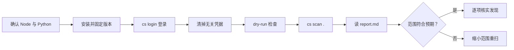

想替自己的代码找漏洞，又不想先搭一整套信息安全平台，可以试试 OpenAI 的 Codex Security。它提供命令行工具 `cs`，在代码仓库（repo）的目录里就能扫描。这篇从安装讲到第一次扫描，再用示例报告说明怎么核对扫描范围和结果。

> 步骤根据 [openai/codex-security](https://github.com/openai/codex-security) 的 npm-v0.10.1 版 [README](https://github.com/openai/codex-security/blob/npm-v0.10.1/README.md)、[CLI 参考](https://github.com/openai/codex-security/blob/npm-v0.10.1/sdk/typescript/docs/cli.md)和官方的 [CLI 快速入门](https://learn.chatgpt.com/docs/security/cli)整理，查证日期是 2026-11-24。工具更新很快，选项以已安装版本的 `cs scan --help` 为准。
{: .prompt-info }

## Codex Security 会找漏洞，但不等于安全审计

Codex Security 是 OpenAI 官方的漏洞扫描工具，源代码以 Apache-2.0 许可证在 GitHub 上公开。它可以在 Codex 对话里用，也能从终端运行，或接入 CI（每次推送代码就自动运行的检查）。这篇只讲终端里的 CLI。

根据 README 的说明，一次扫描会找出疑似漏洞、对照源代码验证，再把结果保存成报告和一条条发现（findings）。它也能为发现生成修补代码并验证，这篇不讲这部分。

我不会把它的结果当成正式的信息安全审计或渗透测试。官方文档也写明，扫描完成不代表每个文件都看过，报告没有发现也不代表没有漏洞。我把报告当成“接下来该先查哪里”的清单。

第一次扫描的流程如下：



## 扫描前先知道：它用你的权限运行，结果含源代码

Codex Security CLI 以你的本机用户身份运行。根据[官方快速入门](https://learn.chatgpt.com/docs/security/cli)，扫描过程中它不会停下来等你批准。[SECURITY.md](https://github.com/openai/codex-security/blob/npm-v0.10.1/SECURITY.md) 建议只扫描你信任、也有权做安全评估的仓库。

开始前先确认这几件事：

- **扫描进程会继承环境变量。** 官方提醒，这包括和扫描无关的 API token 与云凭据。步骤 4 会在扫描前清除这些变量。
- **代码会交给模型分析。** 默认的模型提供方是 OpenAI，也可以改用 Amazon Bedrock 等其他提供方。
- **报告和日志可能含敏感信息。** 报告会附上代码片段和漏洞细节。根据[官方 FAQ](https://learn.chatgpt.com/docs/security/cli/faq)，`cs scans logs` 会输出未经脱敏的日志，可能含有源代码或凭据。分享前先检查内容。
- **登录成功，不代表能扫描。** 根据 README，有些安全相关的请求和受保护的发现，需要 [Trusted Access for Cyber](https://chatgpt.com/cyber) 资格。账号没有资格时，扫描可能被拒绝，处理方式见步骤 4。

## 步骤 1：确认 Node.js 与 Python 版本

CLI 支持 Node.js 22.13.0 以上的 22.x，以及 24.x 和 26.x，23、25 这类奇数版不支持。Python 则要 3.10 以上。先看手头的版本：

```bash
node --version
python3 --version
```
{: .nolineno }

如果是 Python 3.10，还要另外安装 `tomli`：

```bash
python3 -m pip install tomli
```
{: .nolineno }

## 步骤 2：安装 CLI，并固定在 0.10.1

用 npm 全局安装，并写明版本号，之后的选项和输出才会和这篇一致：

```bash
npm install --global @openai/codex-security@0.10.1
```
{: .nolineno }

装好后确认版本，应该输出 `0.10.1`：

```bash
cs --version
```
{: .nolineno }

安装后会有 `cs` 和 `codex-security` 两个命令，作用完全相同。如果 `cs` 和电脑上的其他命令重名，就改用 `codex-security`。

不想全局安装，或者 npm 报告 `EEXIST` 冲突时，改用 npx，把后面每个步骤里的 `cs` 换成 `npx @openai/codex-security@0.10.1`。例如确认版本：

```bash
npx @openai/codex-security@0.10.1 --version
```
{: .nolineno }

以后要升级，先读 [GitHub Releases](https://github.com/openai/codex-security/releases) 的版本说明，再用新的版本号重新安装。`cs update` 也能更新，但它会直接换到最新版。

## 步骤 3：用 cs login 登录 ChatGPT 账号

第一次扫描之前，先运行 `cs login`，在打开的浏览器里用 ChatGPT 账号登录。接着确认状态：

```bash
cs login
cs login status
```
{: .nolineno }

**如果你也用 Codex CLI，而且它的登录信息保存在文件里，这一步一定不能跳过。** 根据 CLI 参考，Codex Security 还没有自己的登录时，扫描或查询状态会直接导入 Codex 的登录信息。两个工具因此共用同一个只能用一次的刷新令牌（refresh token）。

其中一个工具刷新令牌后，另一个下次刷新就可能失败，状态却仍显示已登录。

在没有浏览器的远程机器上，如果 ChatGPT 工作区（workspace）允许，改用设备验证：

```bash
cs login --device-auth
```
{: .nolineno }

工作区不允许设备验证时，按照 [CLI 参考的 SSH 转发说明](https://github.com/openai/codex-security/blob/npm-v0.10.1/sdk/typescript/docs/cli.md#remote-login-with-ssh-forwarding)登录。

如果 Codex Security 报告 refresh token 已经用过，先退出再重新登录：

```bash
cs logout
cs login
```
{: .nolineno }

报告这个错误的如果是 Codex CLI 或 Codex app，就改在 Codex 那边退出再登录。

## 步骤 4：清掉无关凭据，先 dry-run 再扫描

先在要运行扫描的终端里，找出扫描用不到的凭据。如果环境变量里有 PEM 私钥这类多行的值，不要用下面的筛选，它会输出值的片段。其他情况可以用它列出疑似凭据的变量名称：

```bash
env | grep -iE 'token|secret|key|pass' | cut -d= -f1
```
{: .nolineno }

筛选也会匹配变量的值，所以可能列出和凭据无关的名称。确认哪些是扫描用不到的凭据后，用 `unset` 移除。下面的名称只是示例，换成你找到的那些：

```bash
unset GITHUB_TOKEN AWS_ACCESS_KEY_ID AWS_SECRET_ACCESS_KEY
```
{: .nolineno }

`unset` 只影响当前这个终端，从这里启动的扫描就不会继承这些变量。shell 配置文件和其他已经打开的终端不受影响。

切到仓库的根目录，先做一次 dry-run：

```bash
cd /path/to/your-repo
cs scan . --dry-run
```
{: .nolineno }

dry-run 只检查这次扫描的设置，比如要扫哪里、用哪种模式（默认是 Standard）、结果存到哪里。它不会开始扫描、不加载凭据，也不检查 Python。所以 dry-run 通过，不代表登录和运行环境都没问题。

dry-run 会显示 `stateDirectory`，也就是保存扫描历史和默认结果的目录，通常是 `~/.codex/state/plugins/codex-security`。想把这次的结果存到仓库外的某个空目录，dry-run 和正式扫描都要加上同一个 `--output-dir`。

想先看报告长什么样，可以运行 mock 扫描。它不用登录，也不调用模型、不分析代码，报告里标着 `[Mock]` 的发现都是模拟数据。官方建议为 mock 扫描另外指定一个临时的状态目录，免得它混进正式扫描的历史：

```bash
CODEX_SECURITY_STATE_DIR="$(mktemp -d)" cs scan . --mock
```
{: .nolineno }

dry-run 的设置没问题，就去掉 `--dry-run` 正式扫描：

```bash
cs scan .
```
{: .nolineno }

环境里有 `OPENAI_API_KEY` 或 `CODEX_API_KEY` 时，根据 CLI 参考，非交互式和输出 JSON 的扫描会优先用这个 API key。交互式扫描则会让你在 ChatGPT 登录和 API key 之间选。想固定用 ChatGPT 账号，改用这个命令：

```bash
cs scan . --auth chatgpt
```
{: .nolineno }

在交互式终端里，扫描会显示实时仪表盘，按 `d` 可以看细节。想要一行一行的纯文本进度，加上 `--headless`。

用 ChatGPT 登录时，如果 CLI 拿得到额度信息，进度界面会显示账号在各个额度周期已用掉的百分比。想为单次扫描设费用上限，用 `--max-cost` 指定美元金额：

```bash
cs scan . --max-cost 5
```
{: .nolineno }

CLI 会按模型的标准费率估算费用，估计值超过你指定的金额就停止扫描。停止时已经发出的请求仍会跑完，所以最后可能超过上限。ChatGPT 订阅的额度不在这个估计里。

扫描结束时，终端会输出一段摘要。下面是官方文档的示例：

```text
  REPORT    /path/outside/repository/codex-security-results/report.md
  FINDINGS  2 (2 confirmed this scan; 0 previously found; 1 high, 1 medium)
  SCOPE     repository: .
  ELAPSED   42s
  RESULTS   /path/outside/repository/codex-security-results
```
{: .nolineno }

`REPORT` 是报告文件，`RESULTS` 是这次扫描的结果目录。扫描完成时默认返回退出码 0，有发现也一样，输入或运行出错则返回 2。加上 `--fail-on-severity high` 时，有 high 或 critical 的发现会返回 1。

不过，扫描不一定能跑到这里。扫描开始时会先整理出可能的攻击场景，也就是威胁模型。我用 ChatGPT Team 账号实测，两次扫描都在这一步被拦下，退出码是 2，CLI 显示这段信息：

```text
This content was flagged for possible cybersecurity risk. If this seems wrong, try rephrasing your request. If you’re doing authorized security work that requires more cyber permissive safeguards, apply for Daybreak access via https://platform.openai.com/settings/organization/status-and-access before retrying.
```
{: .nolineno }

这表示 OpenAI 的网络安全使用政策拦下了请求。信息里的 Daybreak，是给已授权安全工作使用、限制较宽松的访问方案。

账号没有这个资格时，缩小范围也没用。我第一次扫整个仓库，第二次只扫代码目录，两次都被拦下。扫描日志（`cs scans logs`）里也写着 `Daybreak access: status=not_granted`。

根据 README，要先申请 [Trusted Access for Cyber](https://chatgpt.com/cyber)。用 API key 扫描时，根据 GitHub Action 的说明，组织获批后还要为 API 项目启用对应的方案，并改用那个项目的 key。获批后被拒绝的情况会变少，但不保证每次扫描都能跑完。

资格获批后，根据 CLI 参考，扫描时要加上 `--codex daybreak=true`。这个开关默认关闭，打开它也不会让你获得资格：

```bash
cs scan . --codex daybreak=true
```
{: .nolineno }

## 步骤 5：读报告时，先看范围再看发现

结果目录里最重要的是这三个文件：

| 文件 | 用途 |
| --- | --- |
| `report.md` | 给人读的报告，整理扫描范围与每个发现 |
| `findings.json` | 每个发现的位置与证据，适合交给程序处理 |
| `scan-manifest.json` | 扫描状态、目标与范围，`scan.scope` 记录包含与排除的路径 |

扫描也会尝试生成 `exports/results.sarif`。SARIF 是代码扫描结果的标准格式，GitHub 等平台都能读取。这个导出是可选的，没生成不代表扫描失败。

下面根据官方文档和 mock 扫描的 `report.md`，从上到下说明报告各节的用途：

1. **Scope** 记录扫描目标、commit（Revision）、纳入与排除的路径，以及扫描限制（Limitations and exclusions）。
2. **Scan Summary** 汇总结果、发现数量，以及严重程度和置信度的分布。
3. **Threat Model** 是这次扫描采用的威胁模型摘要。
4. **Findings** 先列出每项发现的严重程度（Severity）和置信度（Confidence），再逐项说明。

我会先在 Scope 里核对仓库、commit 和排除的路径，确认这份报告对应到我想扫描的版本和范围。接着看 Limitations and exclusions，了解哪些地方没扫到、还有哪些事项待查。

严重程度是漏洞被利用时的影响有多大。置信度是现有证据对这个发现的支持程度，报告里分成三级：

| 置信度 | 含义 |
| --- | --- |
| high | 有直接证据支持，没有重大的未解疑点 |
| medium | 证据显示问题可能存在，但还缺运行时或可达性的证明 |
| low | 证据不完整，先记下来待追查 |

每个发现的说明分成 Summary、Root Cause、Remediation 等几段。官方快速入门建议逐一确认每个发现的这几件事：

- 受影响的代码在哪里。
- 攻击者要具备什么前提条件。
- 验证的证据是什么。
- 还剩下哪些不确定的地方。

这些发现来自阅读源代码，不一定附有实际运行的复现结果。官方的建议是，等证据足以证明问题成立，再挑出来修。

最后根据扫描的情况决定下一步：

| 情况 | 下一步 |
| --- | --- |
| 扫描完成，范围也符合预期 | 逐项核实发现，记下报告列出的限制 |
| 重要目录没扫到，或报告列出待查的问题 | 先弄清楚缺的是范围、权限还是背景信息，再决定要不要只针对那些目录重扫 |
| 扫描失败或被取消 | 用 `cs scans logs` 查那次扫描没跑完的原因，处理后再重跑 |

根据 CLI 参考，同样的扫描再跑一次，不保证能补上遗漏的地方。如果是漏选了路径，用后面“缩小范围”一节的 `--path` 指定要补查的目录。

## 步骤 6：之后用 cs scans show 找回结果

在同一个仓库、用同一个状态目录运行下面的命令，会显示最近一次完成的扫描：

```bash
cs scans show
```
{: .nolineno }

输出的 `artifacts` 会列出报告、结果文件和导出文件的路径。根据 CLI 参考，`cs scans logs` 默认查的则是最近一次运行，包括失败或正在运行的扫描。两个命令看到的可能不是同一次，要对照时就都指定扫描 ID：

```bash
cs scans show SCAN_ID
cs scans logs SCAN_ID
```
{: .nolineno }

扫描 ID 和这个仓库的扫描记录，用 `cs scans list` 查。要看各次扫描累积、还没处理的发现，用 `cs findings list`：

```bash
cs scans list
cs findings list
```
{: .nolineno }

`cs findings list` 会为每个未处理的发现列出 occurrence ID。确认某个发现是误报时，用这个 ID 记下理由：

```bash
cs findings false-positive OCCURRENCE_ID --reason "这个输入在进入查询前已由框架转义"
```
{: .nolineno }

之后扫描同一个仓库时，会参考这个理由。根据官方 FAQ，扫描仍会重新检查当前的代码，不会因此跳过整类问题。

同一个仓库扫两次，结果可能不一样。要比较两次扫描，用 `cs scans compare`，它默认比较最近两次完成的扫描：

```bash
cs scans compare
```
{: .nolineno }

## 缩小范围：只扫某些目录，或只扫这次的改动

仓库很大，或者只想看某一块时，用下面这些选项：

```bash
# 只扫描 src 和 tests
cs scan . --path src --path tests

# 排除 examples 目录
cs scan . --exclude-path examples/

# 只扫描从 origin/main 到 HEAD 已 commit 的改动
cs scan . --diff origin/main

# 给 Standard 扫描大约 15 分钟的调查时间
cs scan . --max-time 15
```
{: .nolineno }

- **`--exclude-path` 优先于 `--path`。** 被排除的文件仍可能被读来当上下文，但一个发现的位置如果全落在排除范围内，就会从结果中去掉。
- **`--diff` 需要干净、完整的 checkout。** 当前所在的 commit 必须就是要扫的那一个，有未提交的修改要先 commit 或 stash。想扫描还没 commit 的修改，改用 `--working-tree`。
- **`--max-time` 的单位是分钟。** 在 Standard 模式它只是建议值，时间到了就不再开始新的调查，整理报告可能还要再花一些时间。

`--mode deep` 会分批重复运行 Standard 扫描，再合并并去除重复的发现，花的时间和额度都更多。我建议第一次先用默认的 Standard 模式，看过报告再决定要不要用 deep。

## 接入 CI：改用 API key 与官方 GitHub Action

CI 里没有浏览器可以登录，所以要改用 API key，把 `OPENAI_API_KEY` 或 `CODEX_API_KEY` 设成扫描步骤的环境变量。根据官方 CLI 参考，这个 key 只应交给可信工作流里的扫描步骤。

官方也提供 GitHub Action。根据 README，先把 OpenAI API key 存成 repo secret `CODEX_SECURITY_API_KEY`，再复制[每周扫描的 workflow 示例](https://github.com/openai/codex-security/blob/npm-v0.10.1/github-action/examples/repository.yml)。

示例里的 `REPLACE_WITH_REVIEWED_COMMIT`，要换成 Action release 说明里列出、你也审查过的 commit SHA。为什么要把 action 锁定在 commit SHA，可以参考 [gh actions-lock 教程](/posts/gh-actions-lock-workflow-lockfile/)。

示例把单次扫描的估计费用上限设为 5 美元。默认情况下，有发现只会报告，不会让 job 失败。只有扫描本身出错，job 才会失败，像步骤 4 那样被网络安全政策拦下也算。

要让 CI 在有 high 或 critical 的发现时也失败，CLI 加上步骤 4 提过的 `--fail-on-severity high`，Action 则把 `fail-on-severity` 设成 `high`。

## 结论

我建议第一次先挑自己熟悉的仓库扫描，熟悉代码，才判断得出哪些发现是真的。从证据最充分的一项发现开始，对照代码确认问题成立再修。

## 延伸阅读

- [openai/codex-security](https://github.com/openai/codex-security)：源代码、README 与版本说明。
- [Codex Security CLI 快速入门](https://learn.chatgpt.com/docs/security/cli)：官方的第一次扫描教程。
- [Codex Security CLI FAQ](https://learn.chatgpt.com/docs/security/cli/faq)：误报、重扫结果不同、费用上限等常见问题。
- [OWASP Agentic Top 10 检查表：AI 工作流十项风险与修复方法](/posts/owasp-agentic-top-10-ai-workflow-checklist/)：为 coding agent、MCP 与 CI 做十题自我检查。
- [Claude Code 沙箱设置教程：挡住 SSH 密钥与 token](/posts/claude-code-sandbox-setup/)：让 AI 运行的命令碰不到密钥与 token。
- [用 GitHub Actions 加 AI Agent 自动化审查：以本站 PR 为例](/posts/github-actions-ai-agent-pr-review/)：在 CI 里用 Codex 审查 PR 的实例。
- [gh actions-lock 教程：用 lockfile 锁定 GitHub Actions 依赖](/posts/gh-actions-lock-workflow-lockfile/)：把 workflow 用到的 action 锁定在确切的 commit。
