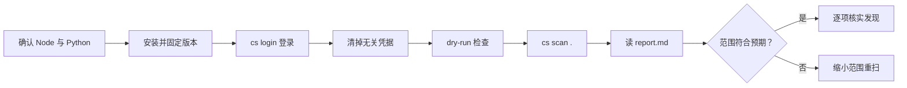

想知道自己的代码有没有漏洞，又不想先搭一整套信息安全平台？OpenAI 的 Codex Security 提供命令行工具 `cs`，可以扫描自己的代码仓库（repo）。这篇带你在本机准备第一次扫描，并用示例报告说明怎么核对扫描范围和结果。

> 步骤根据 [openai/codex-security](https://github.com/openai/codex-security) 的 npm-v0.10.1 版 [README](https://github.com/openai/codex-security/blob/npm-v0.10.1/README.md)、[CLI 参考](https://github.com/openai/codex-security/blob/npm-v0.10.1/sdk/typescript/docs/cli.md)和官方的 [CLI 快速入门](https://learn.chatgpt.com/docs/security/cli)整理，查证日期是 2026-11-24。工具更新很快，选项以已安装版本的 `cs scan --help` 为准。
{: .prompt-info }

## Codex Security 会找漏洞，但不等于安全审计

Codex Security 是 OpenAI 官方的漏洞扫描工具，源代码以 Apache-2.0 许可证在 GitHub 上公开。它可以在 Codex 对话里用，也能从终端运行，或接入 CI（每次推送代码就自动运行的检查）。这篇只讲终端里的 CLI。

根据 README 的说明，一次扫描会找出疑似漏洞、对照源代码验证，再把结果保存成报告与发现项（findings）。它还能为发现生成修补并验证修补，这部分这篇不讲。

我不会把它的结果当成正式的信息安全审计或渗透测试。官方文档也写明，扫描完成不代表每个文件都看过，报告没有发现也不代表没有漏洞。我把报告当成“接下来该先查哪里”的清单。

第一次扫描的流程如下：



## 扫描前先知道：它用你的权限运行，结果含源代码

Codex Security CLI 用你的本机账号启动。根据[官方快速入门](https://learn.chatgpt.com/docs/security/cli)，扫描时不会暂停来请你批准。[SECURITY.md](https://github.com/openai/codex-security/blob/npm-v0.10.1/SECURITY.md) 建议只扫描你信任、也有权评估的仓库。

开始前先确认这几件事：

- **扫描进程会继承环境变量。** 官方提醒，这包括和扫描无关的 API token 与云凭据。步骤 4 会在扫描前清除这些变量。
- **代码会交给模型分析。** 默认的模型提供方是 OpenAI，也可以改用 Amazon Bedrock 等其他提供方。
- **报告和日志可能含敏感信息。** 报告会附上代码片段和漏洞细节。根据[官方 FAQ](https://learn.chatgpt.com/docs/security/cli/faq)，`cs scans logs` 会输出未经脱敏的日志，可能含有源代码或凭据。分享前先检查内容。
- **登录和安全访问资格要分开确认。** 根据 README，部分安全请求和受保护的发现需要 [Trusted Access for Cyber](https://chatgpt.com/cyber)。账号登录成功后，扫描仍可能被拒绝，见步骤 4。

## 步骤 1：确认 Node.js 与 Python 版本

CLI 需要 Node.js 22.13.0 以上的 22.x，或者 24.x、26.x，另外要有 Python 3.10 以上。先看手头的版本：

```bash
node --version
python3 --version
```
{: .nolineno }

包声明的支持范围是 `^22.13.0 || ^24.0.0 || ^26.0.0`，23、25 这类奇数版不在其中。用 Python 3.10 的话，还要安装 `tomli`：

```bash
python3 -m pip install tomli
```
{: .nolineno }

## 步骤 2：安装 CLI，并固定在 0.10.1

用 npm 全局安装，并写明版本号：

```bash
npm install --global @openai/codex-security@0.10.1
```
{: .nolineno }

装好后确认版本，应该输出 `0.10.1`：

```bash
cs --version
```
{: .nolineno }

安装会提供 `cs` 和 `codex-security` 两个命令，两者完全相同。`cs` 和你电脑上的其他命令重名时，改用 `codex-security`。

不想全局安装，或者 npm 报告 `EEXIST` 冲突，就改用 npx。后面每个步骤里的 `cs`，都换成 `npx @openai/codex-security@0.10.1`：

```bash
npx @openai/codex-security@0.10.1 --version
```
{: .nolineno }

以后要升级，先读 [GitHub Releases](https://github.com/openai/codex-security/releases) 的版本说明，再用新的版本号重新安装。`cs update` 也能更新，但它会直接换到最新版。

## 步骤 3：用 cs login 登录 ChatGPT 账号

**如果 Codex CLI 把 ChatGPT 登录信息保存在文件里，请先让 Codex Security 建立自己的登录会话。** 根据 CLI 参考，第一次扫描或查询登录状态时，CLI 可能会导入 Codex 的登录信息。这会让两个工具共用一个只能用一次的刷新令牌（refresh token）。

其中一个工具用掉令牌后，另一个下次刷新登录信息时就可能失败。这时状态仍可能显示已登录。

登录会打开浏览器，用 ChatGPT 账号完成。登录后再确认状态：

```bash
cs login
cs login status
```
{: .nolineno }

在没有浏览器的远程机器上，工作区（workspace）允许的话，改用设备验证：

```bash
cs login --device-auth
```
{: .nolineno }

工作区不允许设备验证时，按照 [CLI 参考的 SSH 转发说明](https://github.com/openai/codex-security/blob/npm-v0.10.1/sdk/typescript/docs/cli.md#remote-login-with-ssh-forwarding)登录。

如果 Codex Security 报告“refresh token 已被使用”，就在这个 CLI 退出后重新登录。

```bash
cs logout
cs login
```
{: .nolineno }

## 步骤 4：先 dry-run，再正式扫描

在准备运行扫描的终端里，先检查有没有扫描用不到的凭据。环境变量的值都是单行时，可以用下面的命令找出可疑的名称。如果有多行凭据，例如 PEM 私钥，请跳过这个筛选示例，以免输出值的片段。

```bash
env | grep -iE 'token|secret|key|pass' | cut -d= -f1
```
{: .nolineno }

筛选也会匹配变量的值，可能列出与凭据无关的名称。确认哪些变量是扫描用不到的凭据后，再把它们填入下面的 `unset` 示例。

```bash
unset GITHUB_TOKEN AWS_ACCESS_KEY_ID AWS_SECRET_ACCESS_KEY
```
{: .nolineno }

`unset` 会从当前 shell 中移除这些变量，接下来从这里启动的扫描也不会继承它们。Shell 配置文件和其他已经打开的终端都不受影响。

切到 repo 的根目录，先做一次 dry-run：

```bash
cd /path/to/your-repo
cs scan . --dry-run
```
{: .nolineno }

dry-run 只检查本机的输入：要扫哪里、用哪种模式、结果存到哪里。它不会开始扫描、不加载凭据，也不检查 Python。所以 dry-run 通过，不代表登录和运行环境都没问题。

dry-run 显示的 `stateDirectory` 是扫描历史和默认结果的根目录。通常位于 `~/.codex/state/plugins/codex-security`。如果要将本次结果另存到仓库外的空目录，dry-run 和正式扫描都加上同一个 `--output-dir`。

想先看报告的版式，可以试试 mock 扫描。这个模式无需登录，也不调用模型或分析代码。报告里的 `[Mock]` 发现都是模拟数据。

官方建议用独立的临时状态目录保存 mock 扫描，让它的历史记录和正式扫描分开。

```bash
CODEX_SECURITY_STATE_DIR="$(mktemp -d)" cs scan . --mock
```
{: .nolineno }

确认无误后，去掉 `--dry-run` 正式扫描：

```bash
cs scan .
```
{: .nolineno }

检测到 `OPENAI_API_KEY` 或 `CODEX_API_KEY` 时，根据 CLI 参考，非交互式或 JSON 输出的扫描会优先用 API key。如果 ChatGPT 登录和 API key 都可用，交互式扫描会让你选。要明确使用 ChatGPT 账号，就用下面这个版本替换上一个命令。

```bash
cs scan . --auth chatgpt
```
{: .nolineno }

在交互式终端里，扫描会显示实时仪表盘，按 `d` 可以看细节。想要一行一行的纯文本进度，加上 `--headless`。

用 ChatGPT 登录且工具获取到额度信息时，进度界面会显示账号各时段的已用百分比。如果想按估算费用设置单次扫描的停止条件，用 `--max-cost` 指定美元金额。

```bash
cs scan . --max-cost 5
```
{: .nolineno }

CLI 按模型的标准费率估算，超过阈值才会停止扫描。已经发出的请求仍可能让估算金额超标。ChatGPT 账号额度单独计算。

扫描结束时，终端会输出一段摘要。下面是官方文档的示例：

```text
  REPORT    /path/outside/repository/codex-security-results/report.md
  FINDINGS  2 (2 confirmed this scan; 0 previously found; 1 high, 1 medium)
  SCOPE     repository: .
  ELAPSED   42s
  RESULTS   /path/outside/repository/codex-security-results
```
{: .nolineno }

`REPORT` 指向报告文件，`RESULTS` 指向保存本次扫描结果的目录。扫描完成默认返回退出码 0，即使有发现也一样。设置严重程度阈值后，达到阈值会返回 1，输入或运行错误则可能返回 2。

我用 ChatGPT Team 账号实测，两次扫描都在建立威胁模型时被安全策略拦截，最后返回退出码 2。威胁模型是扫描用来整理可能攻击场景的摘要。当时 CLI 显示了这段信息。

```text
This content was flagged for possible cybersecurity risk. If this seems wrong, try rephrasing your request. If you’re doing authorized security work that requires more cyber permissive safeguards, apply for Daybreak access via https://platform.openai.com/settings/organization/status-and-access before retrying.
```
{: .nolineno }

这表示 OpenAI 的网络安全使用政策拦下了请求。信息里的 Daybreak，是给已授权安全工作使用、限制较宽松的访问方案。账号没有这个资格时，缩小扫描范围不一定有用，要先到 [Trusted Access for Cyber](https://chatgpt.com/cyber) 申请。

根据 CLI 参考，通过后再扫描时要加上 `--codex daybreak=true`，因为这个开关默认关闭：

```bash
cs scan . --codex daybreak=true
```
{: .nolineno }

## 步骤 5：读报告时，先看范围再看发现

结果目录里最重要的是这三个文件：

| 文件 | 用途 |
| --- | --- |
| `report.md` | 给人读的报告，整理扫描范围与每个发现 |
| `findings.json` | 每个发现的位置与证据，适合交给程序处理 |
| `scan-manifest.json` | 扫描状态、目标与范围，`scan.scope` 记录包含与排除的路径 |

扫描也会尝试生成 `exports/results.sarif`。SARIF 是 GitHub 等平台可以读取的标准格式。即使没有生成这个可选的导出文件，扫描仍可能完成。

上面的实测没有生成正式报告。下面根据官方文档和 mock 扫描的 `report.md` 说明各节的用途。

1. **Scope** 记录扫描目标、commit（Revision）、纳入与排除的路径，以及扫描限制（Limitations and exclusions）。
2. **Scan Summary** 汇总结果、发现数量，以及严重程度和置信度的分布。
3. **Threat Model** 概述扫描采用的威胁模型。
4. **Findings** 先列出每项发现的严重程度（Severity）和置信度（Confidence），再逐项说明。

我会先在 Scope 里核对仓库、commit 和排除的路径，确认这份报告对应到我想扫描的版本和范围。接着看 Limitations and exclusions，弄清楚报告还有哪些范围限制或待查事项。

严重程度描述漏洞可能造成的影响。置信度则反映现有证据对这项发现的支持程度，报告里分成三级。

| 置信度 | 含义 |
| --- | --- |
| high | 有直接证据支持，没有重大的未解疑点 |
| medium | 证据显示问题可能存在，但还缺运行时或可达性的证明 |
| low | 证据不完整，只是留着待追查 |

每个发现的详细说明分成几段，从 Summary、Root Cause 一直到 Remediation。官方快速入门建议，每个发现都逐一确认：

- 受影响的代码在哪里。
- 攻击者要具备什么前提条件。
- 验证的证据是什么。
- 还剩下哪些不确定的地方。

这些发现来自源代码分析，不一定附有实际运行的复现结果。官方的建议是，证据足以支持问题成立之后，才挑出来修。

先看这次扫描的状态，再决定是读报告、补查范围，还是先处理失败的原因。

| 情况 | 下一步 |
| --- | --- |
| 扫描完成，范围也符合预期 | 逐项核实发现，记下报告列出的限制 |
| 重要目录未纳入，或相关问题仍待查 | 先确认缺少的是范围、权限还是背景信息，再决定是否针对相关目录重扫 |
| 扫描失败或被取消 | 用 `cs scans logs` 加上那次扫描的 ID 查原因，处理后再重跑 |

根据 CLI 参考，重跑同一个扫描不一定能补上原先遗漏的地方。如果是漏选了路径，可以用后面“缩小范围”一节的 `--path` 指定要补查的目录。

## 步骤 6：之后用 cs scans show 找回结果

在同一个仓库里，用原来的状态目录运行下方命令，会显示最近一次完成的扫描。根据 CLI 参考，`cs scans logs` 默认查的是最近一次运行，包括失败或正在运行的扫描。要确保两个命令指向同一次扫描，就都指定扫描 ID。

```bash
cs scans show
```
{: .nolineno }

输出的 `artifacts` 会列出报告、结果文件和可用的导出文件路径。要找这个仓库的扫描记录，用 `cs scans list`。要查看跨扫描仍未处理的发现，用 `cs findings list`。

```bash
cs scans list
cs findings list
```
{: .nolineno }

`cs findings list` 会为每个未处理的发现列出 occurrence ID。确认某个发现是误报时，用这个 ID 记下理由：

```bash
cs findings false-positive OCCURRENCE_ID --reason "这个输入在进入查询前已由框架转义"
```
{: .nolineno }

之后扫描同一个 repo，会把这个理由当成参考资料。根据官方 FAQ，扫描仍会独立检查当前的代码，不会因此跳过整类问题。

AI 扫描每次的结果可能不同。要比较两次扫描，用 `cs scans compare`，默认比较最近两次完成的扫描：

```bash
cs scans compare
```
{: .nolineno }

## 缩小范围：只扫某些目录，或只扫这次的改动

repo 很大，或者只想看某一块时，用下面这些选项：

```bash
# 只扫描 src 和 tests
cs scan . --path src --path tests

# 排除 examples 目录
cs scan . --exclude-path examples/

# 只扫描从 origin/main 到 HEAD 已 commit 的改动
cs scan . --diff origin/main

# 给 Standard 扫描大约 15 分钟的调查时间
cs scan . --max-time 15
```
{: .nolineno }

- **`--exclude-path` 优先于 `--path`。** 被排除的文件仍可能被读来当上下文，但位置全在排除范围内的发现，会从结果中移除。
- **`--diff` 需要干净、完整的 checkout。** 当前所在的 commit 必须就是要扫的那一个，有未提交的修改要先 commit 或 stash。想扫描还没 commit 的修改，改用 `--working-tree`。
- **`--max-time` 的单位是分钟。** 在 Standard 模式它只是建议值，时间到了就不再开始新的调查，整理报告可能还要再花一些时间。

`--mode deep` 会分批重复运行 Standard 扫描，再合并并去除重复的发现，花的时间和额度都更多。我建议第一次先用默认的 Standard 模式，看过报告再决定要不要用 deep。

## 接入 CI：改用 API key 与官方 GitHub Action

CI 要自动运行扫描，可以把 `OPENAI_API_KEY` 或 `CODEX_API_KEY` 设在扫描步骤的环境变量里。根据官方 CLI 参考，这个 key 只应提供给可信工作流里的扫描步骤。

官方也提供 GitHub Action。根据 README，先把 OpenAI API key 存成 repo secret `CODEX_SECURITY_API_KEY`，再复制[每周扫描的 workflow 示例](https://github.com/openai/codex-security/blob/npm-v0.10.1/github-action/examples/repository.yml)。

示例里的 `REPLACE_WITH_REVIEWED_COMMIT`，要换成 Action release 标注、你审查过的 commit SHA。把 action 固定在 commit SHA 的理由，可以参考[gh actions-lock 教程](/posts/gh-actions-lock-workflow-lockfile/)。

示例把单次扫描的估算费用阈值设为 5 美元。有发现时，默认只报告结果。扫描本身失败时，job 仍会失败。

如果要让 high 或 critical 级别的发现也使 CI 失败，CLI 可用 `--fail-on-severity high`。用 Action 时，将 `fail-on-severity` 设为 `high`。

## 结论

我建议第一次先挑自己熟悉的仓库，用默认的 Standard 模式扫一次。可以从一项有充分证据的发现开始，对照自己的代码，确认问题成立再修。

## 延伸阅读

- [openai/codex-security](https://github.com/openai/codex-security)：源代码、README 与版本说明。
- [Codex Security CLI 快速入门](https://learn.chatgpt.com/docs/security/cli)：官方的第一次扫描教程。
- [Codex Security CLI FAQ](https://learn.chatgpt.com/docs/security/cli/faq)：误报、重扫结果不同、费用上限等常见问题。
- [OWASP Agentic Top 10 检查表：AI 工作流十项风险与修复方法](/posts/owasp-agentic-top-10-ai-workflow-checklist/)：为 coding agent、MCP 与 CI 做十题自我检查。
- [Claude Code 沙箱设置教程：挡住 SSH 密钥与 token](/posts/claude-code-sandbox-setup/)：让 AI 运行的命令碰不到密钥与 token。
- [用 GitHub Actions 加 AI Agent 自动化审查：以本站 PR 为例](/posts/github-actions-ai-agent-pr-review/)：在 CI 里用 Codex 审查 PR 的实例。
- [gh actions-lock 教程：用 lockfile 锁定 GitHub Actions 依赖](/posts/gh-actions-lock-workflow-lockfile/)：把 workflow 用到的 action 锁定在确切的 commit。
