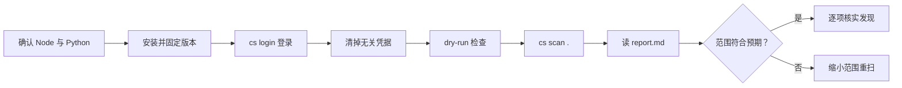

想知道自己的代码有没有漏洞，又不想先搭一整套信息安全平台？OpenAI 的 Codex Security 提供命令行工具 `cs`，在 repo 目录运行一行命令，就会让模型读一遍代码、验证疑似漏洞，再保存成一份 Markdown 报告。这篇带你在自己的电脑上完成第一次扫描，并读懂那份报告。

> 步骤根据 [openai/codex-security](https://github.com/openai/codex-security) 的 npm-v0.10.1 版 [README](https://github.com/openai/codex-security/blob/npm-v0.10.1/README.md)、[CLI 参考](https://github.com/openai/codex-security/blob/npm-v0.10.1/sdk/typescript/docs/cli.md)和官方的 [CLI 快速入门](https://learn.chatgpt.com/docs/security/cli)整理，查证日期是 2026-11-24。工具更新很快，选项以已安装版本的 `cs scan --help` 为准。
{: .prompt-info }

## Codex Security 会找漏洞，但不等于安全审计

Codex Security 是 OpenAI 官方的漏洞扫描工具，源代码以 Apache-2.0 许可证在 GitHub 上公开。它可以在 Codex 对话里用，也能从终端运行，或接入 CI（每次推送代码就自动运行的检查）。这篇只讲终端里的 CLI。

根据 README 的说明，一次扫描会找出疑似漏洞、对照源代码验证，再把结果保存成报告与发现项（findings）。它还能为发现生成修补并验证修补，这部分这篇不讲。

我不会把它的结果当成正式的信息安全审计或渗透测试。官方文档也写明，扫描完成不代表每个文件都看过，报告没有发现也不代表没有漏洞。我把报告当成“接下来该先查哪里”的清单。

第一次扫描的流程如下：



## 扫描前先知道：它用你的权限运行，结果含源代码

Codex Security 以你的本机账户运行，能做的事和你自己一样多。根据[官方快速入门](https://learn.chatgpt.com/docs/security/cli)，CLI 运行时不会停下来请你批准。[SECURITY.md](https://github.com/openai/codex-security/blob/npm-v0.10.1/SECURITY.md) 因此建议，只扫描你信任、也有权评估的 repo。

开始前先确认这几件事：

- **扫描进程会继承环境变量。** 官方提醒，这包括和扫描无关的 API token 与云凭据，开始前要先移除。
- **代码会交给模型分析。** 默认的模型提供商是 OpenAI，也可以改用 Amazon Bedrock 等其他提供商。
- **结果里有源代码。** 报告会附上代码片段和漏洞细节。根据[官方 FAQ](https://learn.chatgpt.com/docs/security/cli/faq)，`cs scans logs` 输出的记录也没有脱敏，分享前先检查内容。
- **账号可能要先申请安全访问资格。** 根据 README，部分网络安全相关请求与受保护的发现需要 [Trusted Access for Cyber](https://chatgpt.com/cyber)。没有资格时，扫描可能一开始就被拒绝，处理方法见步骤 4。

要找出当前终端里疑似凭据的环境变量，可以只打印名称、不打印值：

```bash
env | grep -iE 'token|secret|key|pass' | cut -d= -f1
```
{: .nolineno }

把和扫描无关的变量在这个终端里清掉。下面的名称只是示例，换成你列出来的那些：

```bash
unset GITHUB_TOKEN AWS_ACCESS_KEY_ID AWS_SECRET_ACCESS_KEY
```
{: .nolineno }

`unset` 只影响当前这个终端，关掉窗口就恢复原状。`OPENAI_API_KEY` 和 `CODEX_API_KEY` 会影响登录方式，步骤 3 再说明。

## 步骤 1：确认 Node.js 与 Python 版本

CLI 需要 Node.js 22.13.0 以上的 22.x，或者 24.x、26.x，另外要有 Python 3.10 以上。先看手头的版本：

```bash
node --version
python3 --version
```
{: .nolineno }

包声明的支持范围是 `^22.13.0 || ^24.0.0 || ^26.0.0`，23、25 这类奇数版不在其中。用 Python 3.10 的话，还要安装 `tomli`：

```bash
python3 -m pip install tomli
```
{: .nolineno }

## 步骤 2：安装 CLI，并固定在 0.10.1

用 npm 全局安装，并写明版本号：

```bash
npm install --global @openai/codex-security@0.10.1
```
{: .nolineno }

装好后确认版本，应该输出 `0.10.1`：

```bash
cs --version
```
{: .nolineno }

安装会提供 `cs` 和 `codex-security` 两个命令，两者完全相同。`cs` 和你电脑上的其他命令重名时，改用 `codex-security`。

不想全局安装，或者 npm 报告 `EEXIST` 冲突，就改用 npx。后面每个步骤里的 `cs`，都换成 `npx @openai/codex-security@0.10.1`：

```bash
npx @openai/codex-security@0.10.1 --version
```
{: .nolineno }

以后要升级，先读 [GitHub Releases](https://github.com/openai/codex-security/releases) 的版本说明，再用新的版本号重新安装。`cs update` 也能更新，但它会直接换到最新版。

## 步骤 3：用 cs login 登录 ChatGPT 账号

**平时也用 Codex CLI 的人，第一次扫描或查看登录状态之前，一定要先运行 `cs login`。** 根据 CLI 参考，没有自己的登录时，Codex Security 会导入 Codex 保存在文件里的登录信息。两边因此共用一个只能用一次的刷新令牌（refresh token）。

共用的后果是，其中一边刷新令牌后，另一边下次刷新就可能失败。这时状态甚至仍显示已登录。

登录会打开浏览器，用 ChatGPT 账号完成。登录后再确认状态：

```bash
cs login
cs login status
```
{: .nolineno }

在没有浏览器的远程机器上，工作区（workspace）允许的话，改用设备验证：

```bash
cs login --device-auth
```
{: .nolineno }

工作区不允许设备验证时，按照 [CLI 参考的 SSH 转发说明](https://github.com/openai/codex-security/blob/npm-v0.10.1/sdk/typescript/docs/cli.md#remote-login-with-ssh-forwarding)登录。

遇到“refresh token 已被使用”这类错误，先退出登录再重新登录：

```bash
cs logout
cs login
```
{: .nolineno }

环境里有 `OPENAI_API_KEY` 或 `CODEX_API_KEY` 时，非交互式与 JSON 输出的扫描，默认会改用这个 key。交互式扫描则会问你要用哪一个。要固定使用 ChatGPT 登录，扫描时加上 `--auth chatgpt`：

```bash
cs scan . --auth chatgpt
```
{: .nolineno }

## 步骤 4：先 dry-run，再正式扫描

切到 repo 的根目录，先做一次 dry-run：

```bash
cd /path/to/your-repo
cs scan . --dry-run
```
{: .nolineno }

dry-run 只检查本机的输入：要扫哪里、用哪种模式、结果存到哪里。它不会开始扫描、不加载凭据，也不检查 Python。所以 dry-run 通过，不代表登录和运行环境都没问题。

输出里的 `stateDirectory` 是结果的存放位置，默认是 `~/.codex/state/plugins/codex-security`。它在 repo 之外，结果不会被你顺手 commit 进去。想存到别处，加上 `--output-dir`，指定一个空的、在 repo 外的目录。

想在消耗额度之前先看报告长什么样，可以运行 mock 扫描。它不调用模型、不分析代码，也不用登录，只生成标题带 `[Mock]` 的虚构发现。mock 结果会照常记进扫描历史，官方建议另外指定一个临时的状态目录，不和真正的结果混在一起：

```bash
CODEX_SECURITY_STATE_DIR="$(mktemp -d)" cs scan . --mock
```
{: .nolineno }

确认无误后，去掉 `--dry-run` 正式扫描：

```bash
cs scan .
```
{: .nolineno }

在交互式终端里，扫描会显示实时仪表盘，按 `d` 可以看细节。想要一行一行的纯文本进度，加上 `--headless`。

用 ChatGPT 登录时，进度界面会显示账号额度在各个时段用掉的百分比。想限制一次扫描的花费，用 `--max-cost` 指定美元金额：

```bash
cs scan . --max-cost 5
```
{: .nolineno }

这个金额按 API 的标准费率估算，估计值超过就停止。它不是硬性上限，已经发出的请求仍可能让实际用量超过。

扫描结束时，终端会输出一段摘要。下面是官方文档的示例：

```text
  REPORT    /path/outside/repository/codex-security-results/report.md
  FINDINGS  2 (2 confirmed this scan; 0 previously found; 1 high, 1 medium)
  SCOPE     repository: .
  ELAPSED   42s
  RESULTS   /path/outside/repository/codex-security-results
```
{: .nolineno }

`REPORT` 是报告的路径，`RESULTS` 是这次扫描的结果目录。默认情况下，有发现也会以 0 退出，只有扫描本身运行失败才会以 2 退出。

扫描也可能在构建威胁模型的阶段就以 2 退出，并显示这段信息：

```text
This content was flagged for possible cybersecurity risk. If this seems wrong, try rephrasing your request. If you’re doing authorized security work that requires more cyber permissive safeguards, apply for Daybreak access via https://platform.openai.com/settings/organization/status-and-access before retrying.
```
{: .nolineno }

这表示 OpenAI 的网络安全使用政策拦下了请求。信息里的 Daybreak，是给已授权安全工作使用、限制较宽松的访问方案。账号没有这个资格时，缩小扫描范围不一定有用，要先到 [Trusted Access for Cyber](https://chatgpt.com/cyber) 申请。

根据 CLI 参考，通过后再扫描时要加上 `--codex daybreak=true`，因为这个开关默认关闭：

```bash
cs scan . --codex daybreak=true
```
{: .nolineno }

## 步骤 5：读报告时，先看范围再看发现

结果目录里最重要的是这三个文件：

| 文件 | 用途 |
| --- | --- |
| `report.md` | 给人读的报告，整理扫描范围与每个发现 |
| `findings.json` | 每个发现的位置与证据，适合交给程序处理 |
| `scan-manifest.json` | 扫描状态、目标与范围，`scan.scope` 记录包含与排除的路径 |

另外还有 `exports/results.sarif`。SARIF 是代码扫描结果的标准格式，GitHub 等平台都能读取。

mock 扫描走的是正式的报告流程，生成的 `report.md` 从上到下依次是：

1. **Scope**：扫描的目标、commit（Revision）、包含与排除的路径，以及 Limitations and exclusions。
2. **Scan Summary**：扫描结果、发现数量，以及严重程度与置信度的分布。
3. **Threat Model**：这次扫描采用的威胁模型摘要。威胁模型是“谁可能从哪里攻击什么”的整理。
4. **Findings**：所有发现的总表，每行有严重程度（Severity）与置信度（Confidence），再往下是各个发现的详细说明。

读的时候，我会先确认 Scope。repo、commit 和排除的路径都对了，后面的发现才有意义。Limitations and exclusions 列出的，就是这次没看到的地方。

置信度分三级，报告里附有定义：

| 置信度 | 含义 |
| --- | --- |
| high | 有直接证据支持，没有重大的未解疑点 |
| medium | 证据显示问题可能存在，但还缺运行时或可达性的证明 |
| low | 证据不完整，只是留着待追查 |

每个发现的详细说明分成几段，从 Summary、Root Cause 一直到 Remediation。官方快速入门建议，每个发现都逐一确认：

- 受影响的代码在哪里。
- 攻击者要具备什么前提条件。
- 验证的证据是什么。
- 还剩下哪些不确定的地方。

这些发现来自源代码分析，不一定附有实际运行的复现结果。官方的建议是，证据足以支持问题成立之后，才挑出来修。

读完范围和发现，按情况决定下一步：

| 情况 | 下一步 |
| --- | --- |
| 扫描完成，范围也符合预期 | 逐项核实发现，记下报告列出的限制 |
| 重要的目录或问题没被覆盖 | 用 `--path` 对那个目录重扫，见后面“缩小范围”一节 |
| 扫描失败或被取消 | 用 `cs scans logs` 查原因，修好后重新运行 |

根据 CLI 参考，同样的扫描再跑一次，不保证会补上漏掉的地方。缺的是访问权限或背景信息时，要先补上。

## 步骤 6：之后用 cs scans show 找回结果

在同一个 repo 里运行下面这行，会显示最近一次完成的扫描：

```bash
cs scans show
```
{: .nolineno }

输出的 `artifacts` 列出 `report.md`、`findings.json`、`scan-manifest.json` 与 SARIF 文件的完整路径。要看这个 repo 的所有扫描，或者跨扫描仍未处理的发现：

```bash
cs scans list
cs findings list
```
{: .nolineno }

`cs findings list` 会为每个未处理的发现列出 occurrence ID。确认某个发现是误报时，用这个 ID 记下理由：

```bash
cs findings false-positive OCCURRENCE_ID --reason "这个输入在进入查询前已由框架转义"
```
{: .nolineno }

之后扫描同一个 repo，会把这个理由当成参考资料。根据官方 FAQ，扫描仍会独立检查当前的代码，不会因此跳过整类问题。

AI 扫描每次的结果可能不同。要比较两次扫描，用 `cs scans compare`，默认比较最近两次完成的扫描：

```bash
cs scans compare
```
{: .nolineno }

## 缩小范围：只扫某些目录，或只扫这次的改动

repo 很大，或者只想看某一块时，用下面这些选项：

```bash
# 只扫描 src 和 tests
cs scan . --path src --path tests

# 排除 examples 目录
cs scan . --exclude-path examples/

# 只扫描从 origin/main 到 HEAD 已 commit 的改动
cs scan . --diff origin/main

# 给 Standard 扫描大约 15 分钟的调查时间
cs scan . --max-time 15
```
{: .nolineno }

- **`--exclude-path` 优先于 `--path`。** 被排除的文件仍可能被读来当上下文，但位置全在排除范围内的发现，会从结果中移除。
- **`--diff` 需要干净、完整的 checkout。** 当前所在的 commit 必须就是要扫的那一个，有未提交的修改要先 commit 或 stash。想扫描还没 commit 的修改，改用 `--working-tree`。
- **`--max-time` 的单位是分钟。** 在 Standard 模式它只是建议值，时间到了就不再开始新的调查，整理报告可能还要再花一些时间。

`--mode deep` 会分批重复运行 Standard 扫描，再合并并去除重复的发现，花的时间和额度都更多。我建议第一次先用默认的 Standard 模式，看过报告再决定要不要用 deep。

## 接入 CI：改用 API key 与官方 GitHub Action

CI 里没有浏览器可以登录，要改用 API key，也就是把 `OPENAI_API_KEY` 或 `CODEX_API_KEY` 设在扫描进程的环境变量里。根据官方 CLI 参考，这个 key 应该只给扫描那一步，并在可信的 workflow 里运行。

官方也提供 GitHub Action。根据 README，先把 OpenAI API key 存成 repo secret `CODEX_SECURITY_API_KEY`，再复制[每周扫描的 workflow 示例](https://github.com/openai/codex-security/blob/npm-v0.10.1/github-action/examples/repository.yml)。

示例里的 `REPLACE_WITH_REVIEWED_COMMIT`，要换成 Action release 标注、你审查过的 commit SHA。把 action 固定在 commit SHA 的理由，可以参考[gh actions-lock 教程](/posts/gh-actions-lock-workflow-lockfile/)。

示例每次扫描的估计上限是 5 美元，只报告发现，不会让 job 失败。要让 CI 在有 high 或 critical 发现时失败，CLI 加上 `--fail-on-severity high`。Action 则设置同名的 `fail-on-severity` 输入。

## 结论

我建议第一次先挑自己熟悉的 repo，用默认的 Standard 模式扫一次。读报告时先看 Scope，再逐项看每个发现的证据。报告是线索，修之前要先确认问题在你的系统里真的成立。

## 延伸阅读

- [openai/codex-security](https://github.com/openai/codex-security)：源代码、README 与版本说明。
- [Codex Security CLI 快速入门](https://learn.chatgpt.com/docs/security/cli)：官方的第一次扫描教程。
- [Codex Security CLI FAQ](https://learn.chatgpt.com/docs/security/cli/faq)：误报、重扫结果不同、费用上限等常见问题。
- [OWASP Agentic Top 10 检查表：AI 工作流十项风险与修复方法](/posts/owasp-agentic-top-10-ai-workflow-checklist/)：为 coding agent、MCP 与 CI 做十题自我检查。
- [Claude Code 沙箱设置教程：挡住 SSH 密钥与 token](/posts/claude-code-sandbox-setup/)：让 AI 运行的命令碰不到密钥与 token。
- [用 GitHub Actions 加 AI Agent 自动化审查：以本站 PR 为例](/posts/github-actions-ai-agent-pr-review/)：在 CI 里用 Codex 审查 PR 的实例。
- [gh actions-lock 教程：用 lockfile 锁定 GitHub Actions 依赖](/posts/gh-actions-lock-workflow-lockfile/)：把 workflow 用到的 action 锁定在确切的 commit。
