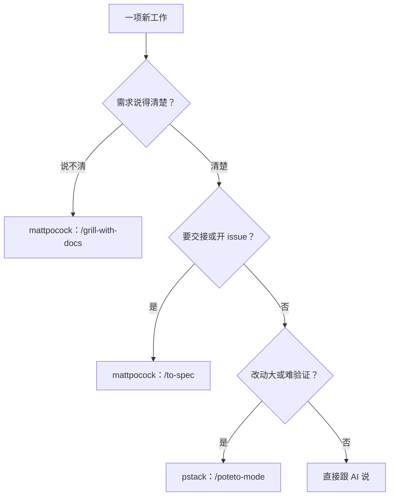

想让 AI 编程助手按固定流程做事，常会看到 mattpocock/skills 和 pstack 这两套 skill。两套都能装进 Claude Code，我也各写过一个完整系列。这篇用两套的源码对照差在哪里，再按你手上的工作建议先装哪一套。

> 对比基准是 mattpocock/skills [`1.3.2`](https://github.com/mattpocock/skills/blob/d1478fcb140db0b93c0c8df17bcfd311844749d0/.claude-plugin/plugin.json#L3) 与 pstack [`0.15.48`](https://github.com/cursor/plugins/blob/9e278fe4d4ecd8bfe98b1b79bf4be662efb338cc/pstack/.cursor-plugin/plugin.json#L4)，查证日期是 2026-11-24。两个系列写成时用的是较旧的 `1.2.3` 与 `0.15.43`，这篇的数字以新版为准。
{: .prompt-info }

## 最大的差别在谁决定下一步

从 `/ask-matt` 开始时，由你决定接下来调用哪个 skill。从 `/poteto-mode` 开始时，pstack 会按目标安排并执行步骤。两个入口都要手动调用。

- mattpocock/skills 的入口是 `/ask-matt`。按它的 [`SKILL.md`](https://github.com/mattpocock/skills/blob/d1478fcb140db0b93c0c8df17bcfd311844749d0/skills/engineering/ask-matt/SKILL.md#L1-L9)，它是架在其他 skill 上面的路由：你描述现在的情况，它建议下一个该调用的 skill，再由你去调用。
- pstack 的入口是 `/poteto-mode`。它会把任务对应到一份 playbook（针对某种任务写好的固定步骤），把步骤抄进待办清单后[开始照做](https://github.com/cursor/plugins/blob/9e278fe4d4ecd8bfe98b1b79bf4be662efb338cc/pstack/skills/poteto-mode/SKILL.md#L108)。

`/poteto-mode` 会自行读取 playbook 用到的其他 skill。可以撤回的工作会直接做，向共享分支 force push、部署或删除数据前会先停下来。 [pstack 自主规则](https://github.com/cursor/plugins/blob/9e278fe4d4ecd8bfe98b1b79bf4be662efb338cc/pstack/skills/poteto-mode/SKILL.md#L76-L78)

无人值守时，如果遇到需要你决定的产品取舍，或工作确实无法继续，pstack 也会把问题交还给你。 [自主运行 playbook](https://github.com/cursor/plugins/blob/9e278fe4d4ecd8bfe98b1b79bf4be662efb338cc/pstack/skills/poteto-mode/playbooks/autonomous-run.md#L3-L9)

## 一张表看两套的差异

| | mattpocock/skills | pstack |
| --- | --- | --- |
| 作者 | Matt Pocock | Lauren Tan（网络昵称 poteto） |
| 放在哪里 | 作者自己的 repo [`mattpocock/skills`](https://github.com/mattpocock/skills)，MIT 许可 | Cursor 官方插件库 [`cursor/plugins`](https://github.com/cursor/plugins/tree/9e278fe4d4ecd8bfe98b1b79bf4be662efb338cc/pstack)，MIT 许可 |
| 规模 | 官方插件收录 [27 个 skill](https://github.com/mattpocock/skills/blob/d1478fcb140db0b93c0c8df17bcfd311844749d0/.claude-plugin/plugin.json#L21-L49) | 59 个 skill（其中 24 个是原则），加上 22 份 playbook |
| 支持的 AI 编程助手 | Claude Code、Codex、GitHub Copilot 有插件，Cursor 等其他工具用 `npx skills` 安装 | Cursor，以及用插件安装的 Claude Code |
| 入口 | `/ask-matt` 建议下一个 skill | `/poteto-mode` 挑 playbook 并照做 |
| 其他 skill 由谁调用 | 你按 `/ask-matt` 的建议调用，其中 11 个 AI 也能自己用 | `/poteto-mode` 按 playbook 调用，你也可以直接调用 |
| 首次设置写到哪里 | repo 里的 `docs/agents/`，以及 `AGENTS.md` 或 `CLAUDE.md` | 用户目录里的模型配置文件 |
| 工作记在哪里 | issue、词汇表 `GLOSSARY.md`、决策记录 | 计划文件、分支与 PR |
| 用哪个模型 | 不指定，README 说任何模型都能用 | 按角色指定，评审默认开三个席位 |

在 Claude Code 中，pstack 会跳过需要 Cursor Automations 或启动 Bugbot 的步骤。原本分配给 Gemini 的评审席位会沿用当前会话的模型。 [pstack 的 Claude Code 兼容性说明](https://github.com/cursor/plugins/blob/9e278fe4d4ecd8bfe98b1b79bf4be662efb338cc/pstack/docs/harness/claude-code.md)

表上的数字是我数两个 repo 在上述版本的文件得出的，和两个系列写的不同。

mattpocock/skills 系列写的是 25 个。新版多了 `implement-spec`、`pr`、`retro`，去掉了 `resolving-merge-conflicts`。pstack 系列写的是 58 个，`0.15.47` 多了一个 `/reframe`。

## mattpocock/skills 把决定留在 repo 里

mattpocock/skills 的产出多半是 repo 里的文件，下一次对话或下一个人可以从文件接手。首次设置时，`setup-matt-pocock-skills` 会[写下这些东西](https://github.com/mattpocock/skills/blob/d1478fcb140db0b93c0c8df17bcfd311844749d0/skills/engineering/setup-matt-pocock-skills/SKILL.md#L69-L70)：

- `docs/agents/` 下面的三份文件，记录 issue 放在哪里、分类标签叫什么、领域文档在哪里。
- `AGENTS.md` 或 `CLAUDE.md` 里的一个 `## Agent skills` 区块，让 AI 每次开工都读得到。

之后的 skill 也沿着这个方向走。`grill-with-docs` 访谈时确认的词汇会写进 `GLOSSARY.md`，重要决定写成 ADR（架构决策记录）。`to-tickets` 把规格切成一张张工作单（issue），每张写明被哪几张挡住。详细流程见 mattpocock/skills 系列的[第 2 篇](/posts/mattpocock-skills-requirements-shared-language/)与[第 3 篇](/posts/mattpocock-skills-specs-work-breakdown/)。

工作单拆好后，你也可以用 `/implement-spec` 一次实现整份规格。它会根据工作单的依赖关系安排哪些可以并行实现，再把成果合并到同一个集成分支。 [implement-spec 的步骤](https://github.com/mattpocock/skills/blob/d1478fcb140db0b93c0c8df17bcfd311844749d0/skills/engineering/implement-spec/SKILL.md#L17-L33)

我认为这套最适合多人维护，或一项功能要分好几次对话才做得完的项目。这些文档能让接手的人查到当初做了哪些决定。

## pstack 把力气花在动手前后的检查

pstack 的强项是改代码前先看懂，改完之后证明它能用。它的工具大致分三段：

- 看懂与设计：`/how`、`/why` 读代码与历史，`/architect`、`/arena` 比较几种设计（[第 2 篇](/posts/pstack-understand-design/)）。
- 证明能用：`/interrogate` 让几个 AI 试着找出改动的漏洞，只留下实际跑得出来的问题；验证 skill 把手动验证写成 AI 能重跑的步骤（[第 3 篇](/posts/pstack-build-verify-merge/)）。
- 自己跑：设好权限与费用上限后，让它在你离开时照 playbook 做完（[第 4 篇](/posts/pstack-principles-customization/)）。

pstack 也有理清需求的工具，但结果放的地方不同。`/reframe` 教你描述这件事的专业术语，`/sharpen` 把任务往深处挖，两者最后都是改写你这次的提示词。它们不会像 `grill-with-docs` 那样，把结论写进 repo 的文档。

代价是用量。pstack 经常派出子代理，也就是另外开一个 AI 去做子任务。评审与设计比较默认同时开[三个评审席位](https://github.com/cursor/plugins/blob/9e278fe4d4ecd8bfe98b1b79bf4be662efb338cc/pstack/skills/poteto-mode/SKILL.md#L92)，每个席位各跑一个子代理。

mattpocock/skills 也有几个 skill 会派子代理，例如 [`code-review`](https://github.com/mattpocock/skills/blob/d1478fcb140db0b93c0c8df17bcfd311844749d0/skills/engineering/code-review/SKILL.md#L11) 让两个子代理分头审查，但它不替你挑模型。

## 两套可以装在同一个 Claude Code

我的 Claude Code 两套都装着。mattpocock/skills 从 Claude Code 官方插件市场安装，在终端执行：

```bash
claude plugin install mattpocock-skills@claude-plugins-official
```

按 [README](https://github.com/mattpocock/skills/blob/d1478fcb140db0b93c0c8df17bcfd311844749d0/README.md#L26)，插件与 `npx skills` 只能选一种，两种都装会让每个 skill 出现两次。

pstack 要先加入 Cursor 的插件库，在 Claude Code 里输入：

```text
/plugin marketplace add cursor/plugins
/plugin install pstack@cursor-plugins
```

两套都有 `tdd` 与 `teach`，但不会互相覆盖。Claude Code 会在插件的命令前面加上插件名称，所以调用时要写完整：

```text
/mattpocock-skills:tdd
/pstack:tdd
```

同名不代表做法相同。mattpocock/skills 的 [`tdd`](https://github.com/mattpocock/skills/blob/d1478fcb140db0b93c0c8df17bcfd311844749d0/skills/engineering/tdd/SKILL.md#L3) 是先写测试的红绿重构流程；pstack 的 [`tdd`](https://github.com/cursor/plugins/blob/9e278fe4d4ecd8bfe98b1b79bf4be662efb338cc/pstack/skills/tdd/SKILL.md#L3) 只在你明确要求、或有成本很低的测试可写时才用。

我建议每个阶段都选定一套流程，让接手的人清楚下一步该用哪套工具。

更新的默认行为也不同。mattpocock/skills 的插件默认[会自动更新](https://github.com/mattpocock/skills/blob/d1478fcb140db0b93c0c8df17bcfd311844749d0/README.md#L35-L38)；pstack 来自第三方插件库，Claude Code [默认不自动更新](https://github.com/cursor/plugins/blob/9e278fe4d4ecd8bfe98b1b79bf4be662efb338cc/pstack/README.md#L28)。要固定 pstack 的版本，做法见 [pstack 系列第 1 篇](/posts/pstack-install-routing/)。

## 按你手上的工作选

例如要给后台新增订单 CSV 导出功能，团队得先确定要导出哪些字段、谁可以下载。可以用 mattpocock/skills 讨论这些问题，再把共识写成规格，交给下一个人接手。 [规格 skill](https://github.com/mattpocock/skills/blob/d1478fcb140db0b93c0c8df17bcfd311844749d0/skills/engineering/to-spec/SKILL.md)

等规格和验收条件确认后，同一项工作可以交给 pstack 的功能 playbook。它会完成设计和实现，验证导出结果，再创建 PR。 [功能 playbook](https://github.com/cursor/plugins/blob/9e278fe4d4ecd8bfe98b1b79bf4be662efb338cc/pstack/skills/poteto-mode/playbooks/feature.md)

如果你只想先装一套，可以从手头的工作卡在哪里开始判断。



另外有三种情况，可以直接决定答案：

- 你用 Codex 或 GitHub Copilot：选 mattpocock/skills，pstack 没有提供这两个工具的安装方式。
- 你想在离开时让 AI 自己做完：选 pstack，先读[第 4 篇](/posts/pstack-principles-customization/)的权限与费用上限。
- 用量预算很紧：我建议先从 mattpocock/skills 开始，pstack 的评审会同时开三个子代理。

还没决定的话，先从你最常卡住的那一段开始。两篇系列导读都有按情况挑起点的表格，可以直接从那里选第一篇。

## 延伸阅读

- [mattpocock/skills 系列导读：这套 skill 是什么、六篇该怎么读](/posts/mattpocock-skills-series-guide/)：六篇按开发顺序排。
- [pstack 系列导读：这套 skill 是什么、四篇该怎么读](/posts/pstack-series-guide/)：四篇按工作流程排。
- [自己写 Agent Skill：从 SKILL.md 结构到触发测试与维护](/posts/agent-skill-authoring-guide/)：两套都不合用时，自己写一个。
- [装了第三方 skill 和 MCP 之后，你的 Coding Agent 多了哪些破口？](/posts/coding-agent-supply-chain-permission-risks/)：装任何一套之前，先看权限与锁版本。
- [mattpocock/skills 的 README](https://github.com/mattpocock/skills/blob/d1478fcb140db0b93c0c8df17bcfd311844749d0/README.md)：各家 AI 编程助手的安装方式（`1.3.2`）。
- [pstack 的 README](https://github.com/cursor/plugins/blob/9e278fe4d4ecd8bfe98b1b79bf4be662efb338cc/pstack/README.md)：作者的设计理念与 Claude Code 的安装说明（`0.15.48`）。
